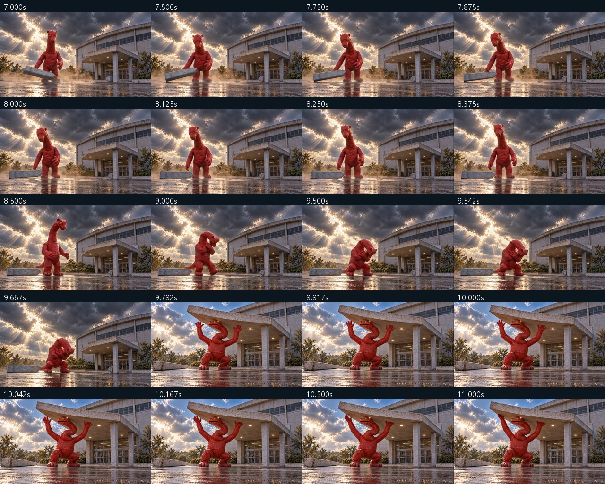
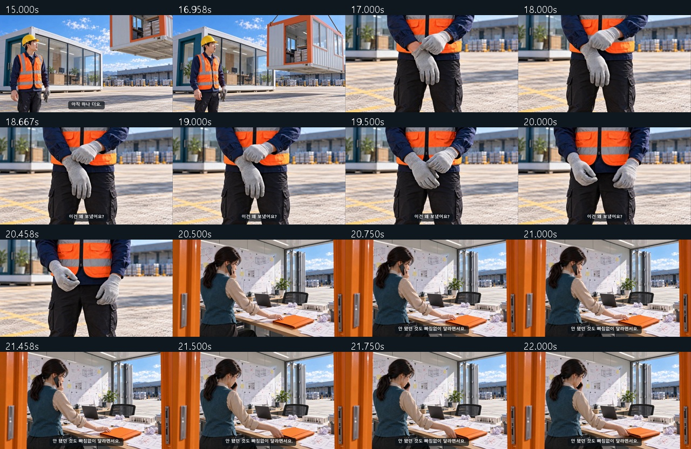

# Q-AI Fair · 10안 장면 연결 재검토

2026-10-24. [10안 목록](README.md) · [편집본](00_완성_영상.md)

**5번의 실제 연결 누락 외에, 10번은 원인 동작이 콘티에서 빠졌고 9번은 연속 장면의 장치 위치가 다릅니다. 3번의 기존 편집도 최신 자막판으로 고쳐야 합니다.** 이 네 항목을 해결하지 않은 채 전체 제작·상영 준비 완료로 판단하지 않습니다.

5번의 핵심 이동을 이전 검토에서 ‘시간 생략’으로 받아들인 판단은 철회합니다. 또한 10번에서 가위가 붙는 과정을 제작 편의를 위해 생략한 수정도 되돌려 검토해야 합니다. 원인이 없는데 결과만 자연스러워 보이는지는 충분한 통과 기준이 아닙니다.

이번 작업은 **조사와 수정 지시의 정리**입니다. 아래 보완을 영상·이미지·제출 프롬프트에 반영한 상태는 아닙니다. Flow 요청·새 이미지·새 영상 렌더·크레딧 사용은 없습니다.

## 확인한 자료와 한계

- 현재 10안은 V11 콘티 87컷·시작 이미지 88장입니다. 콘티와 각 안의 실제 시작 이미지 모음을 확인했습니다.
- 최신 자막 중심 편집이 있는 작품은 5번·6번이며 v04의 실제 추출 프레임을 확인했습니다. 기존 3번은 V8 계열 v03 편집의 추출 프레임을 별도로 확인했습니다.
- 나머지 7안은 콘티·이미지 검토입니다. 실제 동작이 성공했다거나 실패했다고 판정한 것이 아닙니다. 예전에 완성한 ‘우는 관객’ 1번과 현재 ‘성공 자세 교정원’ 1번은 다른 작품입니다.
- 세 검수자가 같은 기준으로 독립 검토한 뒤 다른 두 의견을 교차 검증했습니다. 판단 기준은 화면+자막으로 원인→선택→행동→결과가 이어지는지입니다. 연속 재생·실청취·현장 상영 테스트는 이번에 수행하지 않았습니다.

## 1~10안 결과

| 안 | 현재 판정 | 어색한 부분 또는 제작 시 확인할 핵심 | 필요한 조치 |
|---|---|---|---|
| **1. 성공 자세 교정원** | 큰 기획 누락 미발견 · 동작 확인 필요 | 성공 자세가 실제로 의자에서 미끄러지던 순간이어야 함. 사진→바닥에 앉은 결과만 붙이면 반전이 사라짐. | K04·K06의 의자 이탈과 착지를 실제 움직임으로 확보. 성공한 동작에 사진·모니터를 맞춤. |
| **2. 검은 점을 잡아라** | 큰 기획 누락 미발견 | 사진 비교→촬영창 청소·재촬영→수갑 부착→새 가림의 원인은 명시됨. | 닦기 전후 같은 제품 화면, 수갑이 광로를 막는 순간을 확인. 사진 출력 시간 생략은 수용 가능. |
| **3. 환경까지 가져왔습니다** | **기존 편집 후처리 필요** | 18.65~20.45초 ‘이건 왜 보냈어요?’가 장갑 화면 위에 나와 ‘이것’과 화자가 모호함. 최신 V11 자막판은 아직 영상에 적용되지 않음. | 잘된/안된 환경 구분, ‘보낸 동료:’ 화자 표기, 기록 도해·Q-AI Fair 엔딩 적용. 기존 원본 재사용 우선. |
| **4. 목마는 식사 중입니다** | 큰 기획 누락 미발견 | 급식 메모→신고의 모순→음식 공개→병사 노출→지휘관도 배식 합류가 이어짐. | 음식 공개 뒤 세 창이 열리는 순서와 병사·팔·식기 수를 영상에서 확인. |
| **5. 괴수는 퇴근할 수 없다** | **실제 편집 연결 누락 · 필수 보완** | 밖에서 웅크리다가 이미 지붕 아래에 있음. 입구를 몸으로 막으러 들어가는 선택·이동이 없음. | 입구 진입→점령 자세→지붕 기울기→받침을 연결할 실제 동작 확보. 자막만으로 해결 처리 금지. |
| **6. 퇴근 좀 해주세요** | 주요 연결 성립 · 동기 보강 권고 | 갑자기 행사장으로 가서 공부하는 선택, 배운 방법이 직원의 일로 이어지는 연결이 짧음. 현재도 추론은 가능함. | 강의 전후 한 곳에 짧은 목적 자막 보강. 새 영상보다 기존 편집 개선 우선. |
| **7. 결투 시간을 뺏긴 여자** | 동기 보강 권고 | 따라가며 설명을 듣는 것은 자연스럽지만 질문자들이 굳이 줄까지 잡는 이유, 결투자가 배우기로 바뀌는 계기는 약함. | 수첩의 수정 흔적을 보고 시선이 멈추는 한 박자. 줄을 무심코 잡는 연기 또는 줄을 안 잡고 따라오는 방향 검토. |
| **8. 이 오페라는 끝났습니다** | 핵심 동작·합성 확인 필요 | 망토를 들자 화면이 좋아지는 원인은 콘티에 있음. 아직 실제 차광 동작·합성 결과는 없음. | 같은 도해가 반사로 안 보임→천이 빛길에 들어감→반사만 사라짐을 증명. 화면 켜짐·전체 암전으로 대체 금지. |
| **9. 지구인은 질문이 많다** | **시작 이미지 연결 정리 필요** | 즉시 이어지는 손바닥 요청 사이 로봇 팔 받침대가 인물 뒤에서 자료대 옆으로 바뀜. ‘컷 사이 재배치’라는 제작 메모만으로는 해결되지 않음. | 연속 요청 구간의 장치 위치를 고정한 시작 이미지·구도로 정리. 손→팔→같은 자료→투구까지의 이동도 실제 영상 확인. |
| **10. 개막을 허가하지 않는 기계** | **콘티의 원인 누락 · 필수 보완** | 리본이 길어진 뒤 두 가위가 이미 붙어 있음. 가위를 포기하고 줄넘기를 선택하는 원인이 화면 밖에서 발생함. | 가위에 접착 띠가 붙는 짧은 원인 동작을 넣거나, 가위 개그를 덜고 다른 명료한 선택 이유로 수정. |

‘큰 기획 누락 미발견’은 제작된 영상의 통과를 뜻하지 않습니다. 1·2·4·8·9·10번 등의 핵심 동작은 아직 구현을 확인해야 합니다.

## 필수 보완의 근거

### 연결-01 · 5번 K02B→K03: 입구 점령 행동이 없다

v04의 9.667초에는 건물 밖에서 몸을 숙이고, 9.792초에는 이미 지붕 아래에서 양팔을 듭니다. 위치뿐 아니라 ‘입구를 점령하려다가 자기 행동 때문에 갇혔다’는 이야기의 이유가 사라집니다.

완전한 진입을 목표로 만든 K02B take01·02·03과 reverse 실험 원본은 있지만, 만족스러운 연속 진입은 확보하지 못했습니다. K03 take02의 짧은 지지 동작은 진입을 대신하지 못합니다. **현재 원본 구성으로 트림·자막만 고쳐 해결됐다고 보고하지 않습니다.** 이야기를 유지하려면 연결 동작 원본이 필요합니다. 몇 번의 생성으로 성공할지는 미확정입니다.

### 연결-02 · 10번 K04→K05: 가위가 붙은 결과만 있다

K04 명세는 리본 과잉 공급만 보여주고 자투리 절단·낙하·가위 접착을 제외합니다. 반면 K05는 별도 접착 자투리가 두 가위 날을 붙인 상태로 시작합니다. 현재 이미지도 그 결과를 전제로 합니다.

| K04: 분리된 가위 | K05: 이미 붙은 가위 |
|---|---|
|  |  |

**기획에서 빠진 원인**입니다. 아직 Flow 영상의 실패를 확인한 것은 아닙니다. 복구 장치가 가위까지 못 쓰게 만드는 순간을 짧게 보여준 뒤 함께 들리는 결과를 써야 합니다. 대안으로 이 보조 개그를 삭제할 수 있지만, 그 경우에도 왜 다시 자르지 않고 줄넘기로 바꾸는지 선택 이유를 다시 설계해야 합니다.

### 연결-03 · 9번 K02→K03: 연속 요청 사이 받침대가 이동한다

K02에서 손을 펴고 K03에서 곧바로 자료를 받습니다. S02의 오른쪽 받침대는 사절 바깥쪽에 있고, S03에서는 사절 안쪽·자료대 옆에 있습니다. 단순 관절의 회전과 다르게 바닥 받침대 위치도 바뀝니다.

| K02 시작 이미지 | K03 시작 이미지 |
|---|---|
|  |  |

영상 생성 전 시작 이미지와 구도를 맞춥니다. K04→K05의 다른 팔 위치도 같은 기준으로 함께 정리합니다. 별도의 이동 장면을 무조건 늘리기보다 **연속 동작 동안 받침대를 고정**하는 편이 간결합니다. 아직 영상에서 순간이동이 일어났다고 보고하지 않습니다. 결과판은 두 이미지에 실제로 있으며 소품 소실로 지적하지 않습니다.

### 연결-04 · 3번 기존 v03: 지시 대상·화자가 모호하다

장갑 근접 장면에 ‘이건 왜 보냈어요?’를 얹으면 소리 없이 볼 때 장갑을 물어보는 것으로 읽힐 수 있습니다. 뒤 통화 화면의 답변에도 화자 표시가 없습니다. 최신 V11에는 ‘안 됐던 작업 환경도 도착’과 ‘보낸 동료:’ 등의 보완이 있지만 기존 v03 영상에 적용된 것은 아닙니다. 기존 움직임을 재사용해 최신 자막·화면 도해·행사명을 적용한 편집을 확인해야 합니다. 장갑 탈착 전체를 다시 생성할 이유로 삼지 않습니다.

## 개선 제안과 통과 조건

- **6번:** ‘고마워요’ 뒤 유령의 목적을 ‘일을 끝내야 나가겠네.’처럼 짧게 보강하는 방향이 있습니다. 강의 후 ‘배운 방법으로 마지막 한 건’이라는 연결을 택할 수도 있습니다. 두 문구를 모두 덧붙여 호흡을 늘리지 말고 한 지점만 우선 확인합니다. 문구·타이밍은 아직 미적용입니다.
- **7번:** 질문자들의 이동은 수첩을 계속 보고 싶은 행동으로 읽혀야 합니다. 결투자의 시선이 수정 흔적에 멈춘 뒤 ‘그 부분부터 다시’로 이어지면 선택이 선명해집니다. 현재 스토리를 붕괴시키는 결함으로 단정하지 않습니다.
- **1번:** 넘어지기 전과 후만 연결하면 안 됩니다. 사진의 정체인 실제 미끄러짐과 코치의 재현이 반전입니다.
- **8번:** K06의 망토 이동으로 같은 작업 도해의 반사만 줄어들어야 합니다. 시야를 가리던 망토가 단순히 치워지는 그림이나 새 화면이 켜지는 그림이면 보류합니다.
- **9번:** 이미지 위치를 정리한 후에도 손바닥 호출→한 팔 출발→이미 있는 자료 전달→손 회피→빈 투구에 들어감이 보여야 합니다. 자료가 든 투구의 결과 장면만으로 통과시키지 않습니다.

이미 알려진 행동의 준비 시간은 생략할 수 있습니다. 2번 사진 출력, 3번 방 설치·이동, 6번 가방 메기, 10번 정지 후 리본 분리는 그 자체로 새 오류로 보지 않았습니다. 반면 **뒤 사건의 이유를 새로 만드는 행동**인 5번 진입과 10번 접착은 결과만 남겨서는 안 됩니다.

## 후속 처리 순서

1. 5번 연결 원본 확보 방안, 10번 원인 장면, 9번 장치 위치를 제작 전에 정리.
2. 3번 최신 자막판 적용, 6번 목적 연결과 7번 선택 동기를 기존 구조 안에서 보강.
3. 선택 작품의 핵심 동작부터 확인한 뒤 나머지 컷 제작. 원인 동작이 실패하면 결과 상태만 이어 붙여 완료 처리하지 않음.

원본·V11 콘티·88개 이미지·기존 편집본은 보존했습니다. [검토 기록](storyboards/2026-10-24_causality-audit/README.md)에 독립 의견과 PD 처리 상태를 남깁니다.
