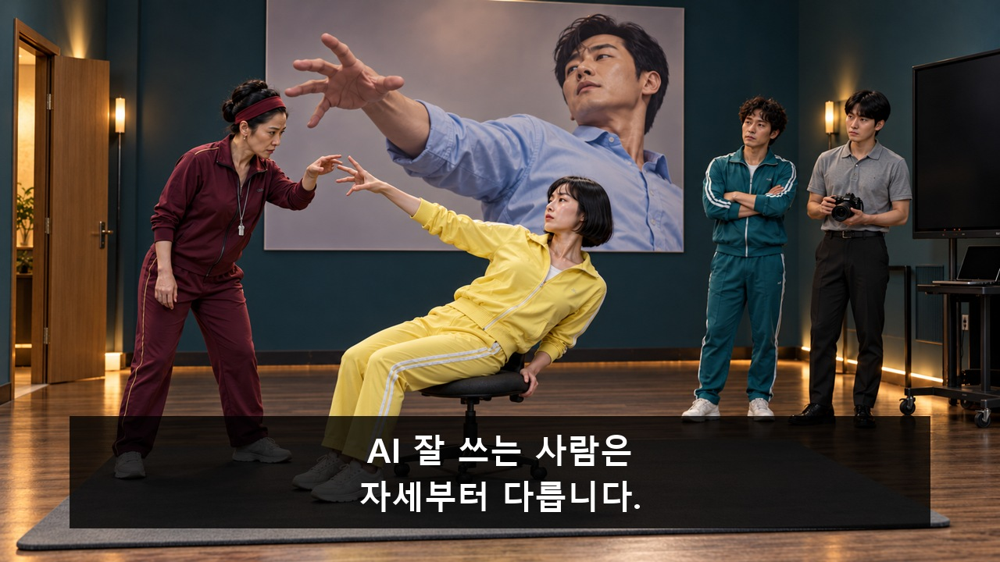
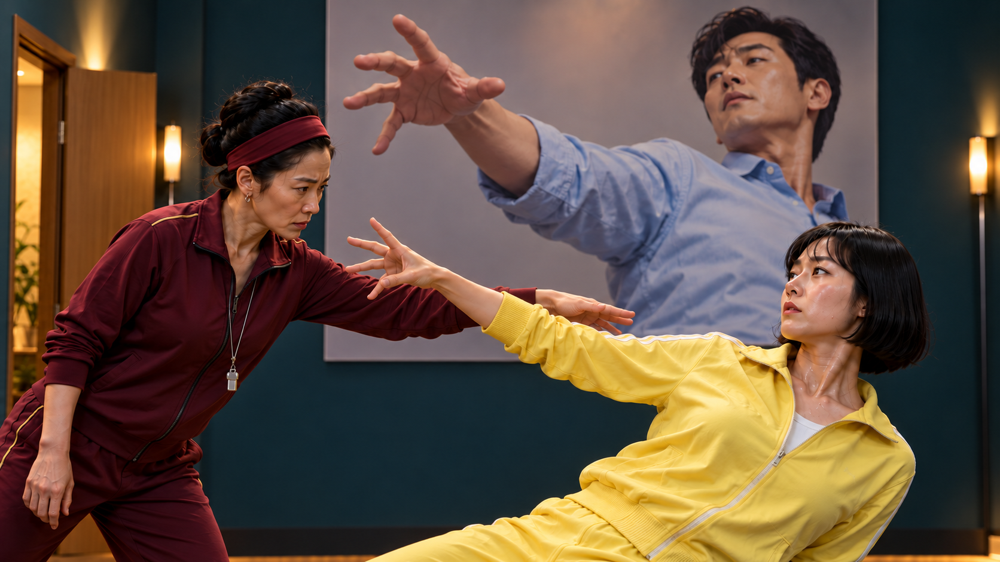
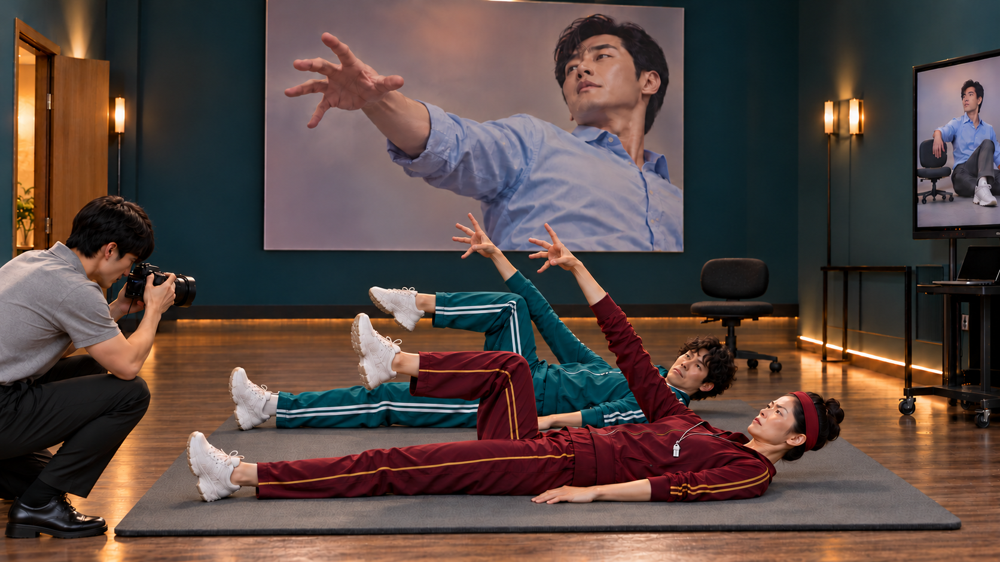

[검수 목록으로](README.md) · [다음 안 →](02_검은_점을_잡아라.md)

# 01. 성공 자세 교정원

**성공자의 자세를 가르치던 코치가 그 자세가 의자에서 미끄러지기 직전이었다는 원본을 보고도, 바닥에 내려앉는 동작까지 새 비법으로 판다.**

**C01 · V10 · 참석 독려 · 37.5초 · 9개 시작 이미지**

**전달할 내용:** 성공한 겉모양보다 실제 실행 과정과 경험을 함께 본다.

**웃음의 전개:** 우연한 몸모양을 성공 비법으로 상품화 → 원본의 낮은 풀썩 공개 → 권위를 지키려 사고까지 모방 → 조수가 다시 교본으로 찍고 다음 수강생이 바닥 자세를 복제

화면과 후처리 자막으로 전달하는 검수용 콘티입니다. 아래 이미지는 동작의 시작 상태이며, 자막이 있는 컷은 그 첫 이미지 위에 자막 위치를 얹은 정지 예시입니다. 실제 동작 완료 화면이나 생성 영상은 아닙니다.

등장인물·연출 보기

- **P**: 사진 당사자. 30대 한국인 남성, 짧은 검정 머리, 하늘색 셔츠·짙은 회색 바지·흰 운동화. 포스터·원본 화면·현장 동일인. 실제 승인 이미지의 각진 턱·높은 광대·짙고 비교적 곧은 눈썹, 앞머리에 볼륨이 있는 검정 웨이브, 긴 목과 넓은 어깨의 날씬한 체형을 고정. 하늘색 셔츠 당사자와 벽 포스터는 같은 얼굴.
- **T**: 코치. 40대 한국인 여성, 단정한 올림머리와 버건디 머리띠, 버건디 트레이닝복, 목의 작은 호루라기. 권위 있는 태도.
- **L1**: 첫 수강생. 30대 한국인 여성, 검정 단발, 레몬색 트레이닝복. 고통이 아니라 힘주어 집중한 표정.
- **L2**: 두 번째 수강생. 30대 한국인 남성, 검정 곱슬 짧은 머리, 청록 트레이닝복. 실제 승인 이미지의 둥글고 부드러운 볼선, 이마 위까지 퍼진 촘촘한 검정 곱슬, 턱을 괴고 살피는 자세를 유지. P의 매끈한 웨이브·각진 턱과 구분.
- **A**: 조수. 20대 한국인 남성, 회색 폴로셔츠·검정 바지, 검정 미러리스 카메라. 실제 승인 이미지의 부드럽고 긴 타원형 얼굴·이마로 내려오는 비교적 곧은 검정 앞머리·가느다란 상체, 카메라를 앞으로 숙여 보는 자세 유지. P처럼 뚜렷한 각진 턱과 위로 세운 머리로 바꾸지 않음.

**형식:** 스포츠 훈련 광고처럼 진지하게 찍는 허구의 성공 교습소

**연출:** 고급 체육관 광고. 짙은 청록 벽, 따뜻한 얼굴 역광, 땀, 단단한 정면 구도. 장비와 바닥 매트는 실제 체육관처럼 보이되 사진의 우스운 몸모양을 가장 크게 둔다.

## 컷별 스토리보드

### C01_K01 · 0–4초 · 4초

**첫 상태:** L1의 오른손 손가락이 살짝 구부러져 있고 T의 두 손가락은 아직 닿기 직전. 벽 사진에는 같은 손모양과 기울어진 상체만 크게 보이며 의자·다리·바닥은 잘려 있다.

**이어질 동작:** T가 손가락만 2cm 펴 준다. L1은 숨을 참고 자세를 유지한다. 카메라는 움직이지 않는다.

**후처리 자막**

- **0.3–3.8초:** AI 잘 쓰는 사람은 / 자세부터 다릅니다.

**웃음·정보 의도:** 사소한 몸모양에 지나치게 진지한 교습의 불균형을 먼저 보여준다.

대사·음악·효과음·구도·전환

| 항목 | 내용 |
|---|---|
| 대사·내레이션 | 없음. 필요한 의미는 caption_cues로 전달. |
| 음악·효과음·정적 | 선택 BGM/SFX: 스포츠 훈련 리듬, 손끝 클릭·바퀴·매트 푹·셔터. K04 착지 후0.7초 정적 가능. 대사/내레이션 없음; 소리를 꺼도 필수 정보 유지. |
| 구도 | 눈높이 고정 와이드. 왼쪽 출입문, 중앙 포스터·의자, 오른쪽 모니터 카트가 한 화면. |
| 전환 | 공간 축·물리 상태를 이어 하드 컷. 자막 종료 뒤 다음 정보. |

[자막 없는 시작 PNG 원본](storyboards/2026-10-23_v10-ten-concepts/images/C01/S01.png)

### C01_K02 · 4–6.5초 · 2.5초

**첫 상태:** 벽 사진 속 P와 L1의 상체가 같은 방향으로 기울어 있다. T의 손바닥은 L1 어깨 옆에서 각도를 표시하기 직전. 사진 속 의자나 바닥은 보이지 않는다.

**이어질 동작:** L1이 상체 각도를 조금 더 기울이고 손끝을 편다. T가 엄숙히 한 번 고개를 끄덕인다.

**후처리 자막:** 없음. 행동과 표정으로 전달.

**웃음·정보 의도:** 포스터와 실제 몸의 일치를 확실히 심어 원본 공개가 작은 UI 설명 없이 읽히게 한다.

대사·음악·효과음·구도·전환

| 항목 | 내용 |
|---|---|
| 대사·내레이션 | 없음. 필요한 의미는 caption_cues로 전달. |
| 음악·효과음·정적 | 선택 BGM/SFX: 스포츠 훈련 리듬, 손끝 클릭·바퀴·매트 푹·셔터. K04 착지 후0.7초 정적 가능. 대사/내레이션 없음; 소리를 꺼도 필수 정보 유지. |
| 구도 | 고정 허리 위 미디엄. 벽 사진의 상체와 실제 L1의 상체가 비슷한 크기로 나란히 보임. |
| 전환 | 공간 축·물리 상태를 이어 하드 컷. 자막 종료 뒤 다음 정보. |

[자막 없는 시작 PNG 원본](storyboards/2026-10-23_v10-ten-concepts/images/C01/S02.png)

### C01_K03 · 6.5–9.5초 · 3초

**첫 상태:** P가 포스터와 같은 하늘색 셔츠를 입고 노트북 재생 키에 손을 올린 상태. 큰 모니터는 사진과 같은 자세로 정지해 있다. 로고·작은 UI·문구 없음.

**이어질 동작:** P가 재생 키를 한 번 누른다. 모니터는 편집용 정지 상태 유지. K04 독립 원본을 후편집 합성. 발화 없음.

**후처리 자막**

- **6.8–9.3초:** 그 사진의 원본

**웃음·정보 의도:** 사진 당사자의 실물과 원본을 연결하며 뒤늦은 증거를 연다.

대사·음악·효과음·구도·전환

| 항목 | 내용 |
|---|---|
| 대사·내레이션 | 없음. 필요한 의미는 caption_cues로 전달. |
| 음악·효과음·정적 | 선택 BGM/SFX: 스포츠 훈련 리듬, 손끝 클릭·바퀴·매트 푹·셔터. K04 착지 후0.7초 정적 가능. 대사/내레이션 없음; 소리를 꺼도 필수 정보 유지. |
| 구도 | 고정 미디엄 와이드. P와 모니터를 함께 두고 벽 포스터 일부를 왼쪽에 포함. |
| 전환 | 재생키 뒤 K04 독립 모니터 내부 원본으로 전환; 비교화면 합성. |

[자막 없는 시작 PNG 원본](storyboards/2026-10-23_v10-ten-concepts/images/C01/S03.png)

### C01_K04 · 9.5–14.5초 · 5초

**첫 상태:** V8 S04_v2 모니터 내부와 동일 P·상체·손방향. 아직 낮은 바퀴 의자 끝에 앉은 전신, 매트·바퀴가 보이는 독립 원본 프레임. 착지 전.

**이어질 동작:** 사진과 같은 자세로 시작한 P의 의자가 옆으로 밀려, 두꺼운 매트에 낮게 풀썩한다. 움직임은 모니터 내부에만 합성한다. 착지 후 설명 자막 없이 반응을 읽히며 정지 박자를 둔다.

**후처리 자막:** 없음. 행동과 표정으로 전달.

**웃음·정보 의도:** 사진과 같은 자세의 크롭 없는 착지 전 상태에서 시작해, 의자 밀림과 낮은 착지를 실제 움직임으로 공개한다. 관객이 먼저 원인을 알아채게 한다.

대사·음악·효과음·구도·전환

| 항목 | 내용 |
|---|---|
| 대사·내레이션 | 없음. 필요한 의미는 caption_cues로 전달. |
| 음악·효과음·정적 | 선택 BGM/SFX: 스포츠 훈련 리듬, 손끝 클릭·바퀴·매트 푹·셔터. K04 착지 후0.7초 정적 가능. 대사/내레이션 없음; 소리를 꺼도 필수 정보 유지. |
| 구도 | 모니터 내부 원본 영상만. P 전신·바퀴 의자·매트 고정 와이드, 포스터/방 없음. |
| 전환 | 공간 축·물리 상태를 이어 하드 컷. 자막 종료 뒤 다음 정보. |

[자막 없는 시작 PNG 원본](storyboards/2026-10-23_v10-ten-concepts/images/C01/S04.png)

### C01_K05 · 14.5–18.5초 · 4초

**첫 상태:** L1은 이미 일어서 P를 바라본다. 다시 일어나거나 의자에 앉지 않는다. P는 왼쪽 문 방향으로 손을 펼치고 T는 빈 의자를 본다.

**이어질 동작:** 이미 서 있는 L1이 P에게 작업 방법을 묻는 태도. 자막을 읽은 뒤 둘이 왼쪽 문으로 두 걸음. T는 같은 의자를 매트 중앙으로 당긴다. 발화 없음.

**후처리 자막**

- **14.7–18.2초:** 자세 말고, / 어떻게 일했는지요.

**웃음·정보 의도:** 훈화 없이 수강생의 질문·선택만 바꾸고, 웃음은 남아 있는 코치에게 넘긴다.

대사·음악·효과음·구도·전환

| 항목 | 내용 |
|---|---|
| 대사·내레이션 | 없음. 필요한 의미는 caption_cues로 전달. |
| 음악·효과음·정적 | 선택 BGM/SFX: 스포츠 훈련 리듬, 손끝 클릭·바퀴·매트 푹·셔터. K04 착지 후0.7초 정적 가능. 대사/내레이션 없음; 소리를 꺼도 필수 정보 유지. |
| 구도 | 고정 와이드. 왼쪽 문으로 향하는 P·L1, 중앙 T·의자, 오른쪽에 남은 L2·A. |
| 전환 | 공간 축·물리 상태를 이어 하드 컷. 자막 종료 뒤 다음 정보. |

[자막 없는 시작 PNG 원본](storyboards/2026-10-23_v10-ten-concepts/images/C01/S05.png)

### C01_K06 · 18.5–23.5초 · 5초

**첫 상태:** T는 아직 의자 끝에 앉아 오른손을 들고 있다. 양발은 매트 가까이, 의자는 낮고 몸 뒤로 조금 이동할 여유가 있다.

**이어질 동작:** 의자가 옆으로 빠짐→T가 낮은 매트에 풀썩→오른팔·굽힌 무릎을 굳혀 권위를 유지. 착지 후 자막. 큰 부상 연기·발화 없음.

**후처리 자막**

- **21.3–23.4초:** 착지까지가 비법입니다.

**웃음·정보 의도:** 반박을 인정하지 않고 증거를 새 상품으로 편입시키는 과잉 확신.

대사·음악·효과음·구도·전환

| 항목 | 내용 |
|---|---|
| 대사·내레이션 | 없음. 필요한 의미는 caption_cues로 전달. |
| 음악·효과음·정적 | 선택 BGM/SFX: 스포츠 훈련 리듬, 손끝 클릭·바퀴·매트 푹·셔터. K04 착지 후0.7초 정적 가능. 대사/내레이션 없음; 소리를 꺼도 필수 정보 유지. |
| 구도 | 고정 전신 미디엄 와이드. T의 발·매트·바퀴가 잘리지 않음. |
| 전환 | 공간 축·물리 상태를 이어 하드 컷. 자막 종료 뒤 다음 정보. |

[자막 없는 시작 PNG 원본](storyboards/2026-10-23_v10-ten-concepts/images/C01/S06.png)

### C01_K07 · 23.5–26.5초 · 3초

**첫 상태:** T는 등을 매트에 대고 한 무릎을 굽혀 올린 채 오른팔을 들고 있다. A는 무릎을 꿇고 카메라를 향한다. L2는 아직 서 있지만 T의 굽힌 무릎을 유심히 보고 있다.

**이어질 동작:** A가 셔터를 누른다. T는 자세를 더 굳히고 L2가 그 옆 매트로 몸을 낮추기 시작한다.

**후처리 자막**

- **23.9–26.3초:** 새 교본 촬영

**웃음·정보 의도:** 코치의 허세가 조수의 기록을 통해 다시 권위가 되는 두 번째 사건.

대사·음악·효과음·구도·전환

| 항목 | 내용 |
|---|---|
| 대사·내레이션 | 없음. 필요한 의미는 caption_cues로 전달. |
| 음악·효과음·정적 | 선택 BGM/SFX: 스포츠 훈련 리듬, 손끝 클릭·바퀴·매트 푹·셔터. K04 착지 후0.7초 정적 가능. 대사/내레이션 없음; 소리를 꺼도 필수 정보 유지. |
| 구도 | 고정 낮은 미디엄 와이드. 뒤집힌 코치의 온몸과 카메라, 서 있는 L2의 비교 시선을 함께. |
| 전환 | 공간 축·물리 상태를 이어 하드 컷. 자막 종료 뒤 다음 정보. |

[자막 없는 시작 PNG 원본](storyboards/2026-10-23_v10-ten-concepts/images/C01/S07.png)

### C01_K08 · 26.5–30.5초 · 4초

**첫 상태:** 두 사람은 이미 나란히 매트에 등을 댄 채 오른팔과 한 무릎을 들고 있다. L2의 발끝 각도만 T와 다르다. A는 둘을 함께 촬영한다.

**이어질 동작:** L2가 발끝을 T와 같은 방향으로 꺾는다. T가 눈으로 만족을 표시하고 A의 셔터가 한 번 울린다.

**후처리 자막:** 없음. 행동과 표정으로 전달.

**웃음·정보 의도:** 행사명과 대사를 가려도 복제되는 바닥 자세가 마지막 그림으로 남게 한다.

대사·음악·효과음·구도·전환

| 항목 | 내용 |
|---|---|
| 대사·내레이션 | 없음. 필요한 의미는 caption_cues로 전달. |
| 음악·효과음·정적 | 선택 BGM/SFX: 스포츠 훈련 리듬, 손끝 클릭·바퀴·매트 푹·셔터. K04 착지 후0.7초 정적 가능. 대사/내레이션 없음; 소리를 꺼도 필수 정보 유지. |
| 구도 | 고정 정면 전신 투 샷. 벽 포스터의 상반신이 위에 겹쳐 보임. |
| 전환 | 공간 축·물리 상태를 이어 하드 컷. 자막 종료 뒤 다음 정보. |

[자막 없는 시작 PNG 원본](storyboards/2026-10-23_v10-ten-concepts/images/C01/S08.png)

### C01_K09 · 30.5–37.5초 · 7초

**첫 상태:** K08의 나란히 누운 T·L2와 조수. 팔과 굽힌 무릎 자세 유지, 좌상단 벽은 텍스트 없는 여백.

**이어질 동작:** A가 한 장 더 찍고 T·L2는 자세를 유지한다. 왼쪽 문만 천천히 닫힌다. 카메라 고정.

**후처리 자막**

- **31.0–37.3초:** Q-AI Fair / AI 실행 경험을 함께 나눠요.

**웃음·정보 의도:** 교습소의 후폭풍을 보며 실제 경험을 듣는 행사로 연결. 미확인 참석 방법은 제시하지 않는다.

대사·음악·효과음·구도·전환

| 항목 | 내용 |
|---|---|
| 대사·내레이션 | 없음. 필요한 의미는 caption_cues로 전달. |
| 음악·효과음·정적 | 선택 BGM/SFX: 스포츠 훈련 리듬, 손끝 클릭·바퀴·매트 푹·셔터. K04 착지 후0.7초 정적 가능. 대사/내레이션 없음; 소리를 꺼도 필수 정보 유지. |
| 구도 | 고정 와이드. 웃음의 인물은 하단 오른쪽, 좌상단은 후편집 자막용 빈 벽. |
| 전환 | 행사명·초대 문구 읽기 시간 뒤 종료. |

[자막 없는 시작 PNG 원본](storyboards/2026-10-23_v10-ten-concepts/images/C01/S09.png)

---

[검수 목록으로](README.md) · [다음 안 →](02_검은_점을_잡아라.md)

정확한 행사 날짜·장소·참석 방법은 아직 기입하지 않았습니다. 실제 영상 제작 뒤 움직이는 소품·자막 가림·읽는 시간·편집 호흡을 재확인합니다.
