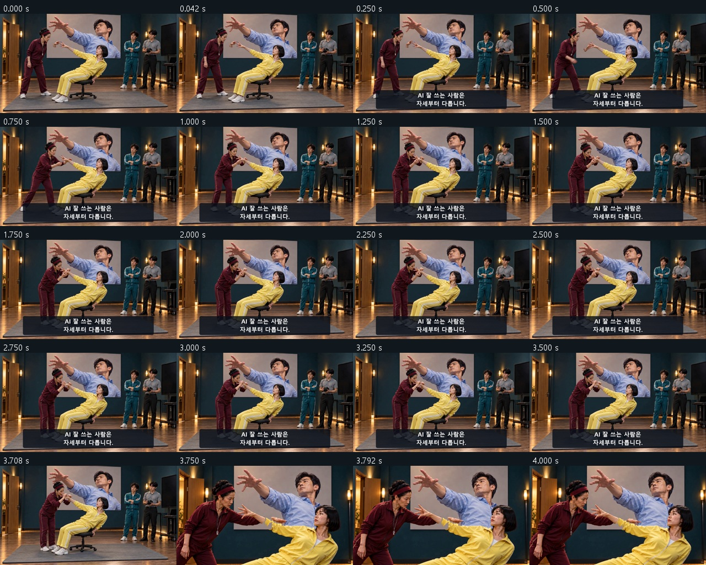
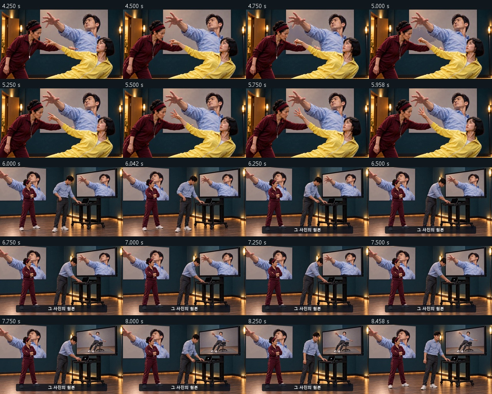
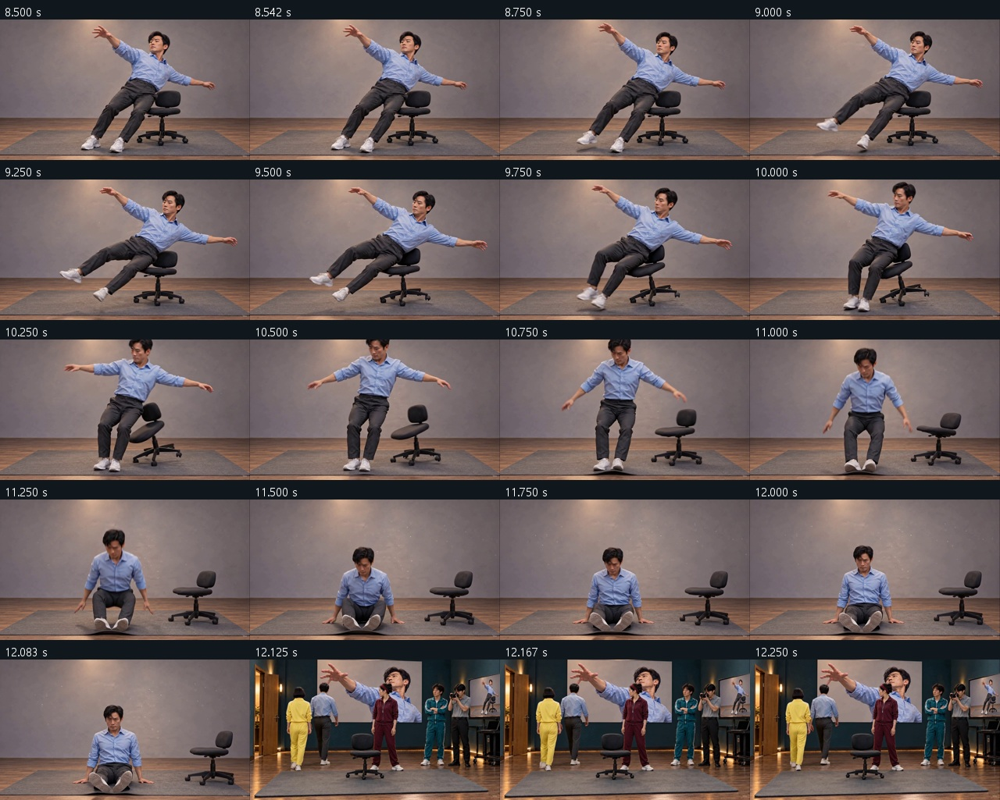
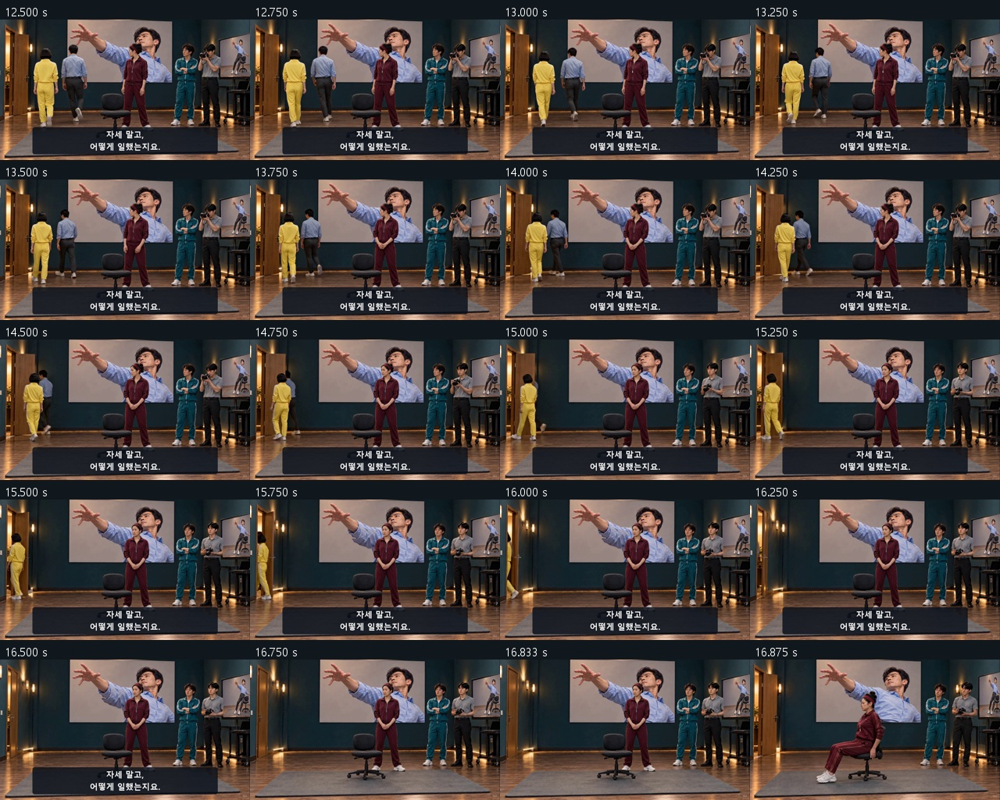
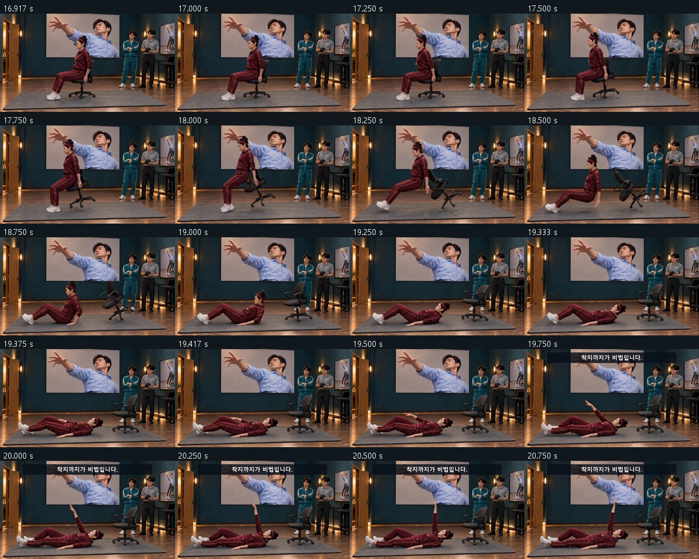
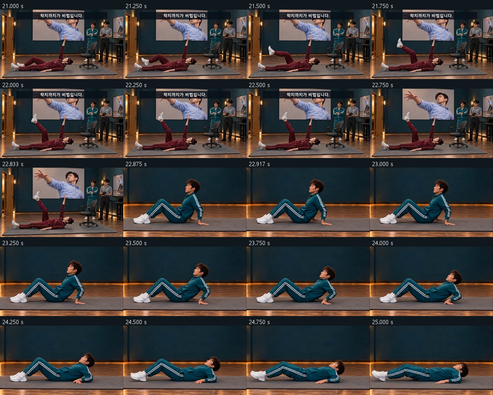
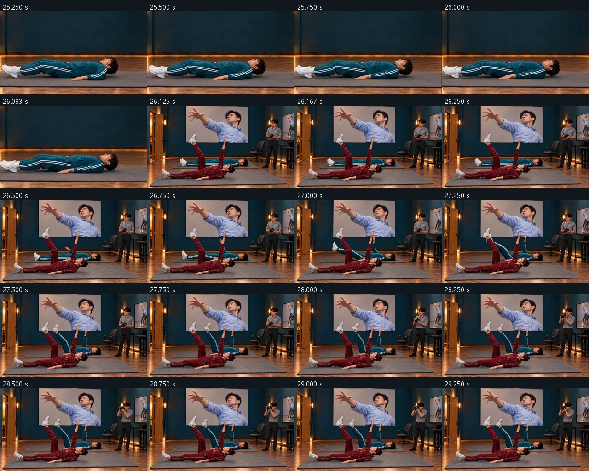
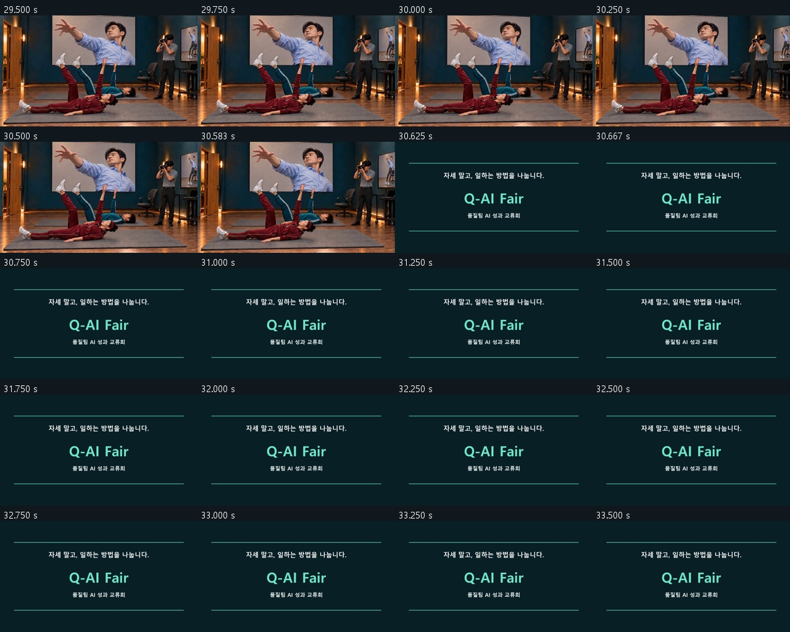
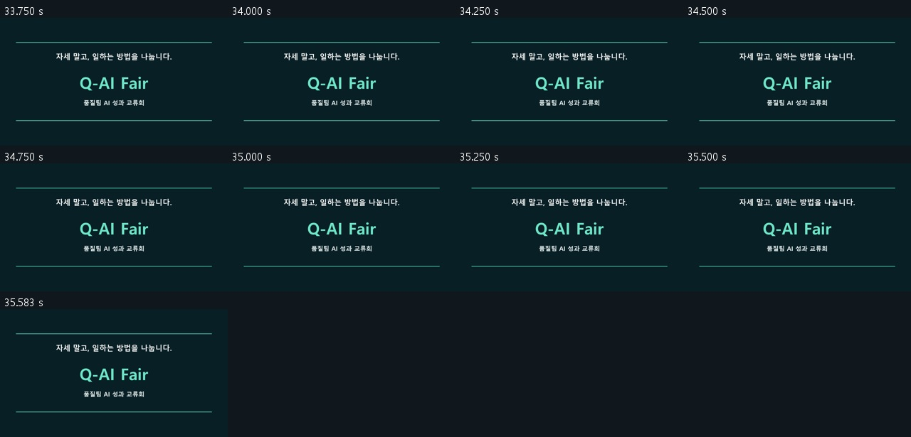

# C01 · 성공 자세 교정원

**[최종 MP4](storyboards/2026-10-25_final-six-v13/C01/C01_Q-AI_Fair_final_v13.mp4) · 35.625초 · 720p 24fps · V13**

모니터·포스터에 같은 실영상 인물을 합성. 실제 퇴장→눕기→따라 하는 포즈로 연결.

[전체 영상](00_완성_영상.md) · [원본·추가 생성 기록](00_V13_보완_검수.md)

## 최종 편집 순서

| 컷 | 본편 구간 | 원본 사용 구간 | 소스 |
|---|---:|---:|---|
| K01 | 0–3.75s | 0–3.75s | [원본](storyboards/2026-10-24_v12-C02-C04-C01-flow/C01_K01_take02.mp4) |
| K02 | 3.75–6s | 0–2.25s | [원본](storyboards/2026-10-24_v12-C02-C04-C01-flow/C01_K02_take02.mp4) |
| K03 | 6–8.5s | 1–3.5s | [원본](storyboards/2026-10-24_v12-C02-C04-C01-flow/C01_K03_take01.mp4) |
| K04 | 8.5–12.125s | 0.875–4.5s | [원본](storyboards/2026-10-24_v12-C02-C04-C01-flow/C01_K04_take01.mp4) |
| K05 | 12.125–16.875s | 2.5–7.25s | [원본](storyboards/2026-10-24_C01-C06-repair110/C01_K05_take03.mp4) |
| K06 | 16.875–19.375s | 1.5–4s | [원본](storyboards/2026-10-24_v12-C02-C04-C01-flow/C01_K06_take01.mp4) |
| POSE | 19.375–22.875s | 0.5–4s | [원본](storyboards/2026-10-25_final-six-v13/C01_K06_pose_bridge_take01.mp4) |
| CLOSE | 22.875–26.125s | 1–4.25s | [원본](storyboards/2026-10-25_final-six-v13/C01_K07_close_recline_take01.mp4) |
| MIRROR | 26.125–30.625s | 1–5.5s | [원본](storyboards/2026-10-25_final-six-v13/C01_K08_mirror_take01.mp4) |
| END | 30.625–35.625s | 0–5s | 후처리 엔딩 |

## 화면 자막

| 구간 | 자막 |
|---|---|
| 0.25–3.65s | AI 잘 쓰는 사람은 자세부터 다릅니다. |
| 6.25–8.3s | 그 사진의 원본 |
| 12.325–16.65s | 자세 말고, 어떻게 일했는지요. |
| 19.65–22.75s | 착지까지가 비법입니다. |

## 실제 편집본 검수 화면

검수 범위: 실제 추출 프레임·접합 표본, 자막, 전체 파일 디코딩·시간축·원본 해시. 실시간 연속 재생·실청취·현장 상영 테스트를 마쳤다는 의미는 아닙니다.
