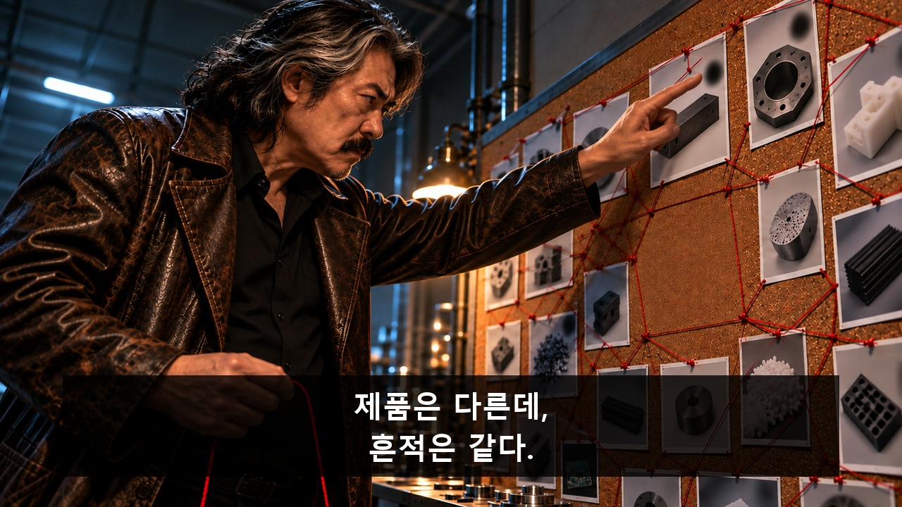
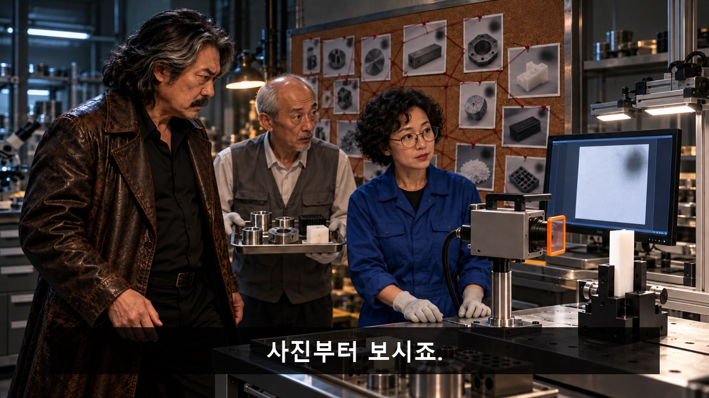
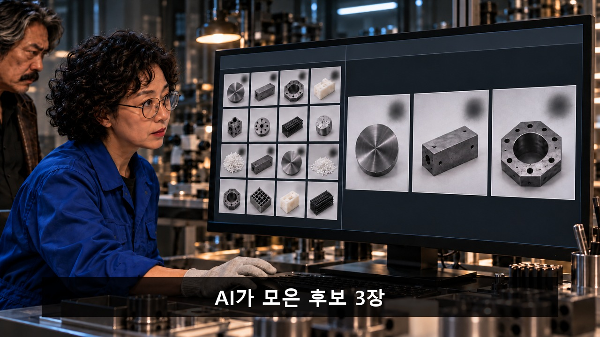
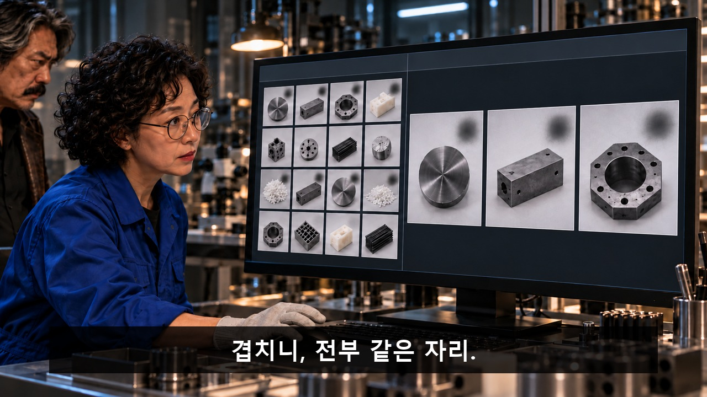
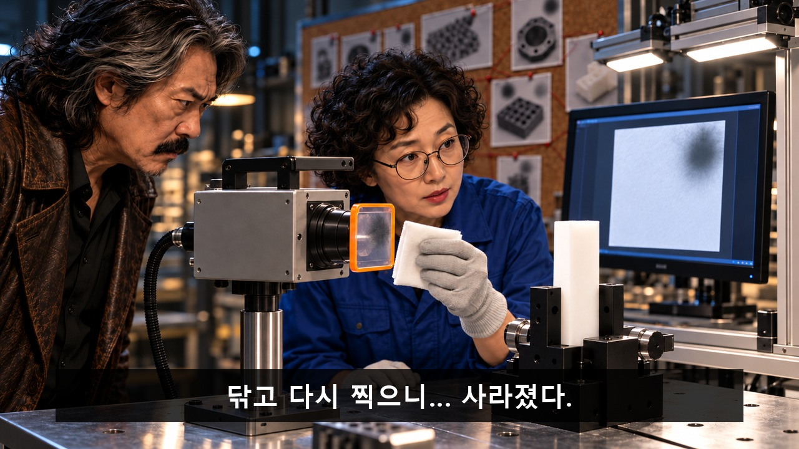
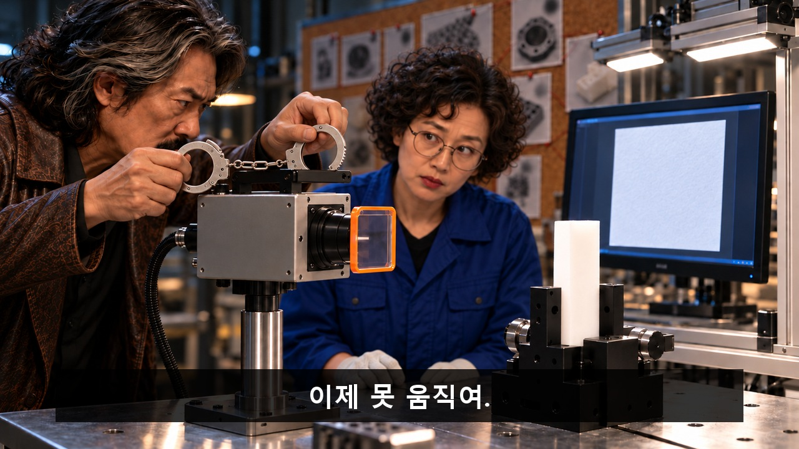
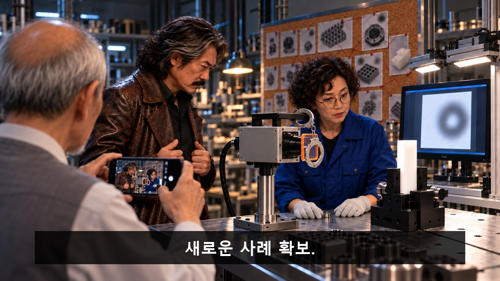
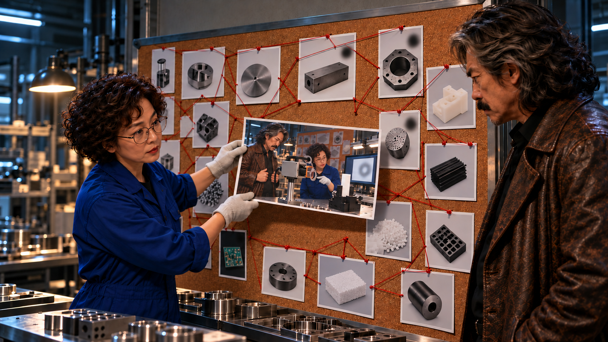
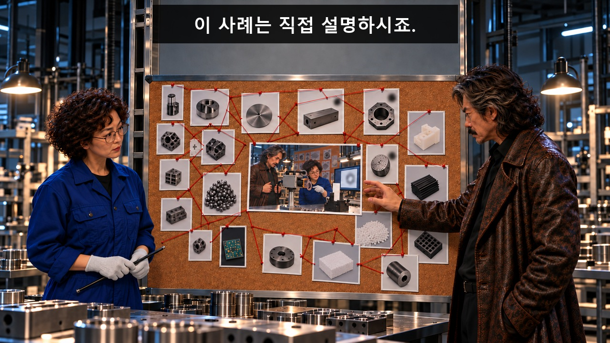
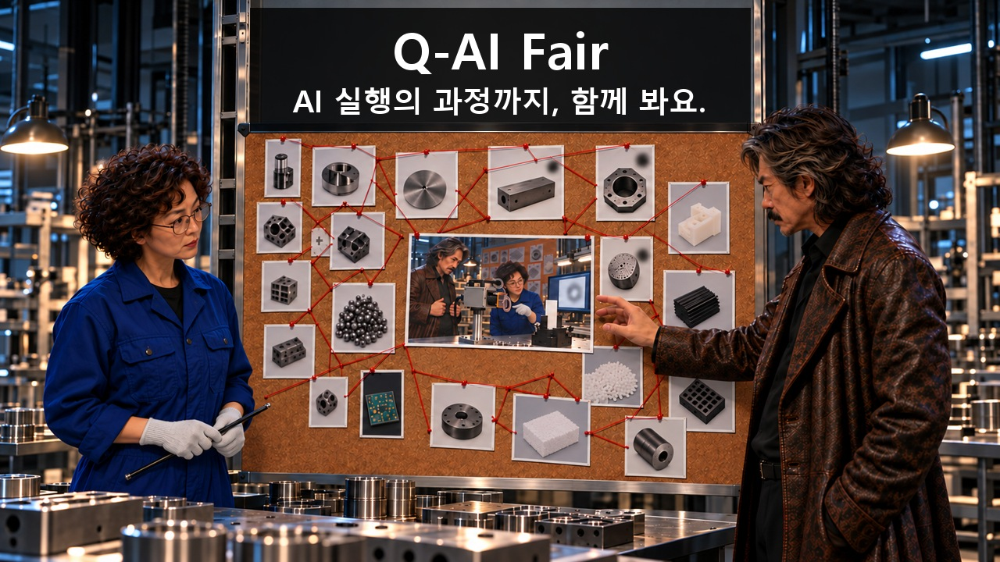

[검수 목록으로](README.md) · [← 이전 안](01_성공_자세_교정원.md) · [다음 안 →](03_환경까지_가져왔습니다.md)

# 02. 검은 점을 잡아라

**검사 사진의 흐린 흔적을 범인 표식으로 쫓던 형사가 AI 후보 비교와 재촬영으로 원인을 듣고 카메라를 체포했다가, 자신이 만든 새 가림까지 다음 공개 사례로 올라간다.**

**C02 · V11 · 참석 독려 · 39초 · 9개 시작 이미지**

**전달할 내용:** AI가 좁힌 후보를 사람이 확인한 과정까지 함께 듣는다.

**웃음의 전개:** 제품 표식을 범인 흔적으로 확신 → AI 후보와 사람 비교로 촬영 쪽 단서 발견 → 청소·재촬영 확인 → 이미 고정된 카메라에게 이제 못 움직인다고 수갑을 채워 새 가림 생성 → 자신의 현장 사진을 떼려다 반듯하게 펴 주는 척하며 체면 유지

화면과 후처리 자막으로 전달하는 검수용 콘티입니다. 아래 이미지는 동작의 시작 상태이며, 자막이 있는 컷은 그 첫 이미지 위에 자막 위치를 얹은 정지 예시입니다. 실제 동작 완료 화면이나 생성 영상은 아닙니다.

등장인물·연출 보기

- **DE**: 형사. 50대 한국인 남성, 어깨에 닿는 숱 많은 회흑색 장발, 굵은 검정 콧수염, 깊은 팔자 주름, 긴 상체와 약간 나온 배. 낡은 짙은 갈색 가죽 코트·검정 셔츠. 실제 경찰 계급장·기관 로고 없음. 과잉 확신과 증거 확보 욕망이 웃음의 대상.
- **IN**: 검사 담당자. 40대 한국인 여성, 작은 체격, 짧고 촘촘한 검정 곱슬머리, 넓은 이마와 둥근 안경. 코발트색 작업복·밝은 회색 장갑. AI 결과를 확인하고 동료에게 보여주는 주체이며 나이나 외형을 희화화하지 않는다.
- **TE**: 검사 기사. 60대 한국인 남성, 매우 마른 체형, 민머리와 옆머리의 짧은 은색 털, 작은 턱수염. 회색 작업조끼·흰 긴팔. 현장 상태를 휴대전화로 직접 기록하며 AI가 사람을 판정하는 역할이 아님.

**형식:** 범인 표식을 추적하는 과잉 수사극과 실제 검사 사진 분석 사례의 충돌

**연출:** 같은 검사실. 형사 쪽은 어두운 누아르 빛·갈색 가죽, 담당자 쪽은 중성 검사 조명·코발트 작업복. 붉은 실의 과잉 수사벽과 차분한 실제 장비를 대비한다. 상표·실제 사건·실존 배우 얼굴 없음.

## 컷별 스토리보드

### C02_K01 · 0–4초 · 4초

**첫 상태:** 기존 DE 캐스팅·가죽 코트·사진벽 그대로, 낮은 시점에서 손가락이 전경에 크게 보인다. 손가락은 흐린 흔적 사진에 닿기 직전이고 붉은 실 끝도 아직 다음 사진에 걸리지 않았다. 중앙 빈 영역과 사진·실 배치는 유지.

**이어질 동작:** DE가 사진의 흐린 흔적을 한 번 짚고 붉은 실을 다른 사진으로 당긴다. 확신에 찬 얼굴, 웃음·윙크·발화 없음.

**후처리 자막**

- **0.4–3.8초:** 제품은 다른데, / 흔적은 같다.

**웃음·정보 의도:** 그럴듯한 수사 영화의 확신을 먼저 믿게 해 실제 촬영 원인과의 차이를 키운다.

대사·음악·효과음·구도·전환

| 항목 | 내용 |
|---|---|
| 대사·내레이션 | 없음. 필요한 의미는 caption_cues로 전달. |
| 음악·효과음·정적 | 선택 BGM/SFX: 누아르 리듬, 촬영·천 닦기·수갑 철컥. K05 철컥 뒤0.6초 무반응. 대사/내레이션 없음; 소리를 꺼도 필수 정보 유지. |
| 구도 | 같은 수사벽을 낮은 시점에서 보는 누아르 미디엄. DE의 얼굴·갈색 코트와 전경 손을 크게 두되 제품 사진의 위치·붉은 실·중앙 빈 영역은 V7과 동일하게 유지. |
| 전환 | 공간 축·물리 상태를 이어 하드 컷. 자막 종료 뒤 다음 정보. |

[자막 없는 시작 PNG 원본](storyboards/2026-10-23_v11-production-lock/images/C02/S01_v2.png)

### C02_K02 · 4–7초 · 3초

**첫 상태:** DE가 트레이 앞에 들어서기 직전, IN은 모니터를 가리키기 직전. 수갑은 아직 코트 안.

**이어질 동작:** TE가 트레이를 멈추자 DE가 몸을 크게 가로질러 제품 반출을 지나치게 엄숙하게 막는다. IN이 모니터를 가리키면 DE는 막은 몸을 그대로 둔 채 고개만 돌린다. 윙크·발화 없음.

**후처리 자막**

- **4.3–6.8초:** 사진부터 보시죠.

**웃음·정보 의도:** 추격을 공개 분석 쪽으로 돌려 설명이 뒤에 붙은 정보가 아니라 선택의 계기가 되게 한다.

대사·음악·효과음·구도·전환

| 항목 | 내용 |
|---|---|
| 대사·내레이션 | 없음. 필요한 의미는 caption_cues로 전달. |
| 음악·효과음·정적 | 선택 BGM/SFX: 누아르 리듬, 촬영·천 닦기·수갑 철컥. K05 철컥 뒤0.6초 무반응. 대사/내레이션 없음; 소리를 꺼도 필수 정보 유지. |
| 구도 | 검사대 측면 미디엄 와이드. 왼쪽 고정 H, 오른쪽 지그, 전경 DE와 IN. TE는 뒤에서 트레이를 멈춤. |
| 전환 | 공간 축·물리 상태를 이어 하드 컷. 자막 종료 뒤 다음 정보. |

[자막 없는 시작 PNG 원본](storyboards/2026-10-23_v11-production-lock/images/C02/S02.png)

### C02_K03 · 7–13초 · 6초

**첫 상태:** 모니터 왼쪽에는 다수의 서로 다른 제품 썸네일, 오른쪽에는 AI가 좁힌 후보 원본3장이 나란히 이미 보인다. 세 사진은 서로 다른 제품이며 같은 위치에 부드러운 어두운 가림이 있다. IN 손은 사람의 원본 겹침 조작 직전. 원인 판정은 없다.

**이어질 동작:** IN이 이미 좁혀진 원본3장을 겹쳐 비교한다. 같은 위치를 지목하는 손과 DE가 장비로 돌리는 시선을 겹쳐 다음 컷으로 연결한다.

**후처리 자막**

- **7.2–9.8초:** AI가 모은 후보 3장
- **10–12.8초:** 겹치니, 전부 같은 자리.

이 컷의 다음 자막 배치 보기

**웃음·정보 의도:** AI는 다수 입력을 좁히고 사람은 원본을 비교했다는 역할을 시각으로 분리한다.

대사·음악·효과음·구도·전환

| 항목 | 내용 |
|---|---|
| 대사·내레이션 | 없음. 필요한 의미는 caption_cues로 전달. |
| 음악·효과음·정적 | 선택 BGM/SFX: 누아르 리듬, 촬영·천 닦기·수갑 철컥. K05 철컥 뒤0.6초 무반응. 대사/내레이션 없음; 소리를 꺼도 필수 정보 유지. |
| 구도 | IN의 손·작은 체격 옆얼굴과 모니터를 함께. 전체 영상에서 AI 처리 화면은 이 컷 한 화면에 집중. |
| 전환 | 공간 축·물리 상태를 이어 하드 컷. 자막 종료 뒤 다음 정보. |

[자막 없는 시작 PNG 원본](storyboards/2026-10-23_v11-production-lock/images/C02/S03.png)

### C02_K04 · 13–17초 · 4초

**첫 상태:** 천이 흐린 W 표면에 닿기 직전. 동일 시편은 지그에 고정, 모니터는 청소 전 가림이 있는 결과.

**이어질 동작:** IN이 W를 닦고 촬영 버튼을 누른다. 모니터가 동일 시편의 가림 없는 결과로 바뀌며 DE가 고개를 끄덕인다.

**후처리 자막**

- **14.5–16.9초:** 닦고 다시 찍으니… 사라졌다.

**웃음·정보 의도:** 후보를 사실로 단정하지 않고 사람이 닦기 전후를 확인해 처음 추격의 대상을 바꾼다.

대사·음악·효과음·구도·전환

| 항목 | 내용 |
|---|---|
| 대사·내레이션 | 없음. 필요한 의미는 caption_cues로 전달. |
| 음악·효과음·정적 | 선택 BGM/SFX: 누아르 리듬, 촬영·천 닦기·수갑 철컥. K05 철컥 뒤0.6초 무반응. 대사/내레이션 없음; 소리를 꺼도 필수 정보 유지. |
| 구도 | 고정 측면 미디엄. H와 W, 오른쪽 지그의 동일 시편, 뒤 모니터가 한 화면. W 표면과 결과를 전후로 확인 가능. |
| 전환 | 공간 축·물리 상태를 이어 하드 컷. 자막 종료 뒤 다음 정보. |

[자막 없는 시작 PNG 원본](storyboards/2026-10-23_v11-production-lock/images/C02/S04.png)

### C02_K05 · 17–21초 · 4초

**첫 상태:** 수갑 첫 고리가 B 앞에서 열린 상태. 두 번째 고리는 DE 손에 있어 아직 W를 가리지 않는다.

**이어질 동작:** DE가 첫 고리를 B에 잠그고 손을 놓는다. 다른 고리가 W 앞에 매달린다. 철컥 뒤 0.6초 무반응. H는 움직이지 않음, 발화 없음.

**후처리 자막**

- **17.3–19.5초:** 이제 못 움직여.

**웃음·정보 의도:** 이미 고정된 카메라를 체포하면서 진지하게 자유를 빼앗았다고 믿는 행동의 불균형. 이 개입이 실제 새 가림의 원인이다.

대사·음악·효과음·구도·전환

| 항목 | 내용 |
|---|---|
| 대사·내레이션 | 없음. 필요한 의미는 caption_cues로 전달. |
| 음악·효과음·정적 | 선택 BGM/SFX: 누아르 리듬, 촬영·천 닦기·수갑 철컥. K05 철컥 뒤0.6초 무반응. 대사/내레이션 없음; 소리를 꺼도 필수 정보 유지. |
| 구도 | 고정 H의 측면 타이트 미디엄. DE 콧수염 옆얼굴·수갑·B·W·오른쪽 시편의 광로를 함께. |
| 전환 | 공간 축·물리 상태를 이어 하드 컷. 자막 종료 뒤 다음 정보. |

[자막 없는 시작 PNG 원본](storyboards/2026-10-23_v11-production-lock/images/C02/S05.png)

### C02_K06 · 21–24초 · 3초

**첫 상태:** 고리가 W 앞에 걸려 있지만 모니터에는 아직 K04 깨끗한 이전 결과. IN 손은 촬영 버튼 위.

**이어질 동작:** IN이 촬영하고 모니터에 새 흐린 고리 가림이 나타난다. IN이 실물 고리를 본 뒤 TE와 눈을 마주친다.

**후처리 자막:** 없음. 행동과 표정으로 전달.

**웃음·정보 의도:** 새 결과와 새 원인이 실제 같은 화면에 보인다. AI가 형사를 판정하지 않는다.

대사·음악·효과음·구도·전환

| 항목 | 내용 |
|---|---|
| 대사·내레이션 | 없음. 필요한 의미는 caption_cues로 전달. |
| 음악·효과음·정적 | 선택 BGM/SFX: 누아르 리듬, 촬영·천 닦기·수갑 철컥. K05 철컥 뒤0.6초 무반응. 대사/내레이션 없음; 소리를 꺼도 필수 정보 유지. |
| 구도 | K04와 같은 검사대 축. 실물 고리·W·시편·모니터를 동시에. |
| 전환 | 공간 축·물리 상태를 이어 하드 컷. 자막 종료 뒤 다음 정보. |

[자막 없는 시작 PNG 원본](storyboards/2026-10-23_v11-production-lock/images/C02/S06.png)

### C02_K07 · 24–27초 · 3초

**첫 상태:** TE 휴대전화가 가슴 높이에서 올라가기 직전. DE는 아직 뿌듯한 자세, IN 손은 실물 고리를 가리키기 직전.

**이어질 동작:** TE가 들어 한 번 촬영한다. DE는 늦게 전화 쪽으로 얼굴을 돌린다. IN이 고리를 확인해 준다.

**후처리 자막**

- **24.6–26.9초:** 새로운 사례 확보.

**웃음·정보 의도:** 마지막 공개의 주체와 사진 출처를 명확히 한다.

대사·음악·효과음·구도·전환

| 항목 | 내용 |
|---|---|
| 대사·내레이션 | 없음. 필요한 의미는 caption_cues로 전달. |
| 음악·효과음·정적 | 선택 BGM/SFX: 누아르 리듬, 촬영·천 닦기·수갑 철컥. K05 철컥 뒤0.6초 무반응. 대사/내레이션 없음; 소리를 꺼도 필수 정보 유지. |
| 구도 | TE 어깨 너머 현장 와이드. 전화 화면에는 현재 DE·수갑·장비가 그대로 보임. 얼굴 자동 인식 UI 없음. |
| 전환 | 공간 축·물리 상태를 이어 하드 컷. 자막 종료 뒤 다음 정보. |

[자막 없는 시작 PNG 원본](storyboards/2026-10-23_v11-production-lock/images/C02/S07_v2.png)

### C02_K08 · 27–31초 · 4초

**첫 상태:** IN이 새 사진을 중앙에서 10cm 떨어진 곳에 들고 있다. 아직 벽에 붙이지 않았고 중앙은 비어 있다.

**이어질 동작:** IN이 직접 사진을 붙인다. DE는 사진 속 자기 모습을 알아보고 눈이 멈춘다. 이 컷에서 말하거나 손을 뻗지 않는다.

**후처리 자막:** 없음. 행동과 표정으로 전달.

**웃음·정보 의도:** 추격하던 사람이 자신이 만든 새 사례의 중앙에 들어가는 두 번째 반전.

대사·음악·효과음·구도·전환

| 항목 | 내용 |
|---|---|
| 대사·내레이션 | 없음. 필요한 의미는 caption_cues로 전달. |
| 음악·효과음·정적 | 선택 BGM/SFX: 누아르 리듬, 촬영·천 닦기·수갑 철컥. K05 철컥 뒤0.6초 무반응. 대사/내레이션 없음; 소리를 꺼도 필수 정보 유지. |
| 구도 | 수사벽 정면 미디엄 와이드. IN 손과 새 사진, DE 옆얼굴. 새 사진 속 H·수갑·인물은 K07과 동일. |
| 전환 | 공간 축·물리 상태를 이어 하드 컷. 자막 종료 뒤 다음 정보. |

[자막 없는 시작 PNG 원본](storyboards/2026-10-23_v11-production-lock/images/C02/S08_v2.png)

### C02_K09 · 31–39초 · 8초

**첫 상태:** DE 손끝은 자기 사진 앞 10cm. IN의 포인터는 아직 허리 높이에 있고 중앙 사진은 붙어 있다.

**이어질 동작:** IN의 포인터가 사진에 닿으면 DE가 떼려던 손가락을 펴 가장자리를 한 번 반듯하게 누른다. 그 손과 태연한 얼굴을 유지한다. 옷깃 정리·팔짱·추가 손짓은 넣지 않는다.

**후처리 자막**

- **31.2–33.8초:** 이 사례는 직접 설명하시죠.
- **34–38.8초:** Q-AI Fair / AI 실행의 과정까지, 함께 봐요.

이 컷의 다음 자막 배치 보기

**웃음·정보 의도:** 자신이 다음 공유 사례가 된 순간에도 지위를 내려놓지 못해 삭제 시도를 사진 정리로 위장한다. 한 번의 손동작으로 체면과 웃음을 남긴다.

대사·음악·효과음·구도·전환

| 항목 | 내용 |
|---|---|
| 대사·내레이션 | 없음. 필요한 의미는 caption_cues로 전달. |
| 음악·효과음·정적 | 선택 BGM/SFX: 누아르 리듬, 촬영·천 닦기·수갑 철컥. K05 철컥 뒤0.6초 무반응. 대사/내레이션 없음; 소리를 꺼도 필수 정보 유지. |
| 구도 | 고정 미디엄 와이드. DE 손·포인터·중앙 사진, 위쪽 벽의 자막 여백. |
| 전환 | 행사명·초대 문구 읽기 시간 뒤 종료. |

[자막 없는 시작 PNG 원본](storyboards/2026-10-23_v11-production-lock/images/C02/S09_v2.png)

---

[검수 목록으로](README.md) · [← 이전 안](01_성공_자세_교정원.md) · [다음 안 →](03_환경까지_가져왔습니다.md)

정확한 행사 날짜·장소·참석 방법은 아직 기입하지 않았습니다. 실제 영상 제작 뒤 움직이는 소품·자막 가림·읽는 시간·편집 호흡을 재확인합니다.
