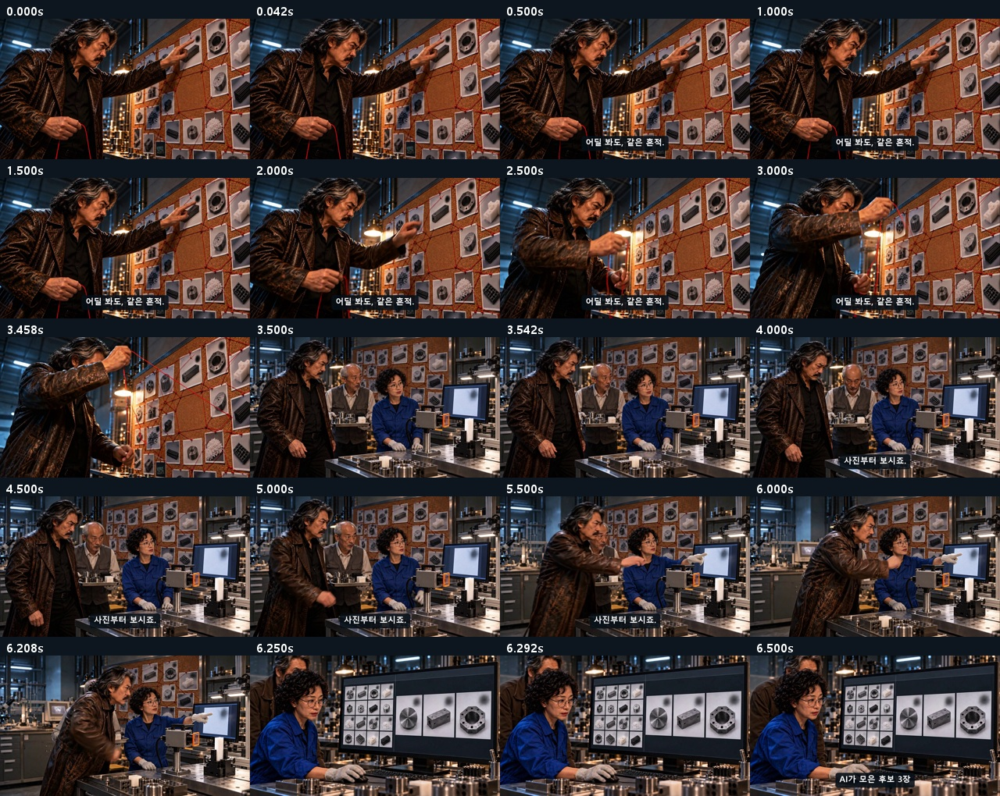
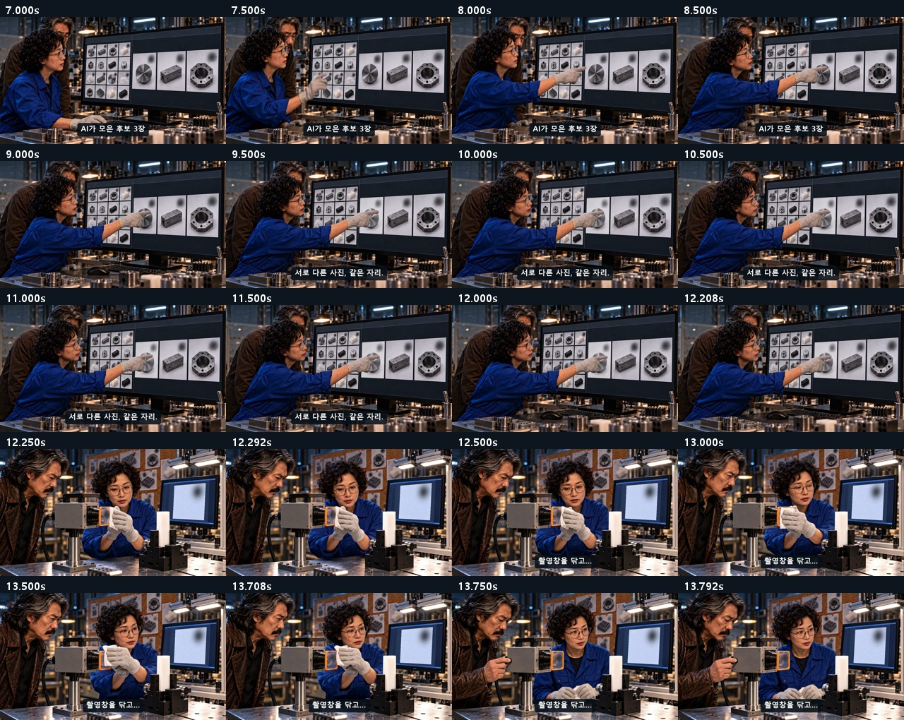
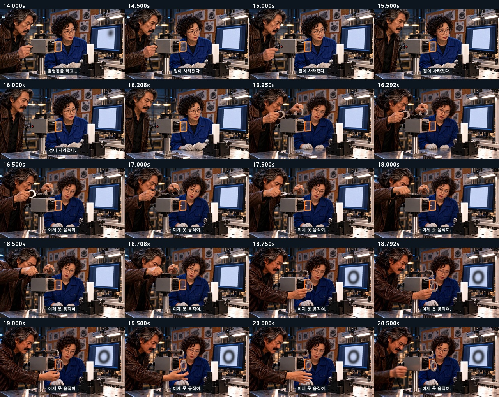
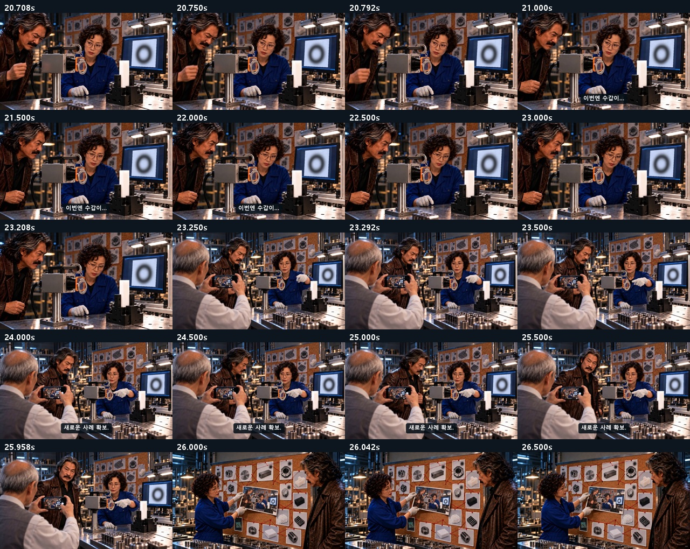
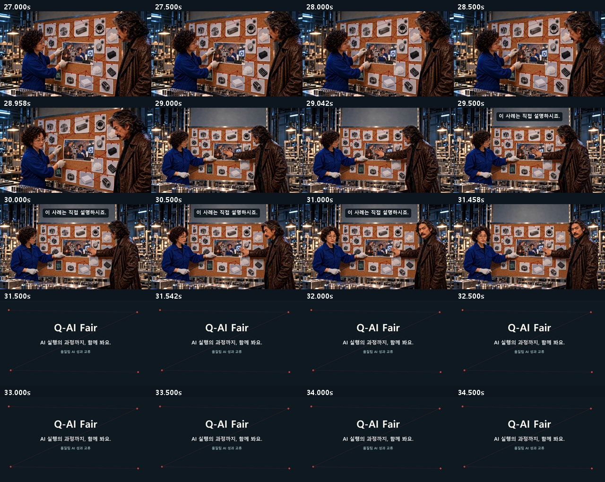
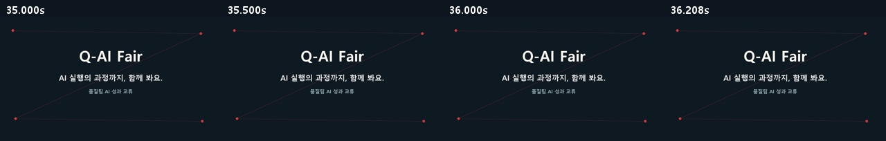

# C02 · 검은 점을 잡아라

**[최종 MP4](storyboards/2026-10-25_final-six-v13/C02/C02_Q-AI_Fair_final_v13.mp4) · 36.25초 · 720p 24fps · V13**

제품 사진의 같은 검은 점·청소 전후와 두 수갑의 짧은 사슬, 촬영 사진을 맞춤.

[전체 영상](00_완성_영상.md) · [원본·추가 생성 기록](00_V13_보완_검수.md)

## 최종 편집 순서

| 컷 | 본편 구간 | 원본 사용 구간 | 소스 |
|---|---:|---:|---|
| K01 | 0–3.5s | 0–3.5s | [원본](storyboards/2026-10-24_v12-C02-C04-C01-flow/C02_K01_take01.mp4) |
| K02 | 3.5–6.25s | 0–2.75s | [원본](storyboards/2026-10-24_v12-C02-C04-C01-flow/C02_K02_take01.mp4) |
| K03 | 6.25–12.25s | 1.5–7.5s | [원본](storyboards/2026-10-24_v12-C02-C04-C01-flow/C02_K03_take01.mp4) |
| K04 | 12.25–13.75s | 1–2.5s | [원본](storyboards/2026-10-24_v12-C02-C04-C01-flow/C02_K04_take01.mp4) |
| K04 | 13.75–16.25s | 4.5–7s | [원본](storyboards/2026-10-24_v12-C02-C04-C01-flow/C02_K04_take01.mp4) |
| K05 | 16.25–18.75s | 0–2.5s | [원본](storyboards/2026-10-24_v12-C02-C04-C01-flow/C02_K05_take01.mp4) |
| NEW | 18.75–20.75s | 0.5–2.5s | [원본](storyboards/2026-10-25_final-six-v13/C02_K05_shortchain_take02.mp4) |
| NEW_REACT | 20.75–23.25s | 2.5–5s | [원본](storyboards/2026-10-25_final-six-v13/C02_K05_shortchain_take02.mp4) |
| K07 | 23.25–26s | 1.5–4.25s | [원본](storyboards/2026-10-24_v12-C02-C04-C01-flow/C02_K07_take02.mp4) |
| K08 | 26–29s | 0.5–3.5s | [원본](storyboards/2026-10-24_v12-C02-C04-C01-flow/C02_K08_take01.mp4) |
| K09 | 29–31.5s | 4–6.5s | [원본](storyboards/2026-10-24_v12-C02-C04-C01-flow/C02_K09_take01.mp4) |
| END | 31.5–36.25s | 0–4.75s | 후처리 엔딩 |

## 화면 자막

| 구간 | 자막 |
|---|---|
| 0.3–3.3s | 어딜 봐도, 같은 흔적. |
| 3.75–6s | 사진부터 보시죠. |
| 6.5–9s | AI가 모은 후보 3장 |
| 9.25–12s | 서로 다른 사진, 같은 자리. |
| 12.4–14.15s | 촬영창을 닦고… |
| 14.3–16.1s | 점이 사라졌다. |
| 16.5–20.6s | 이제 못 움직여. |
| 20.85–22.15s | 이번엔 수갑이… |
| 23.55–25.85s | 새로운 사례 확보. |
| 29.1–31.4s | 이 사례는 직접 설명하시죠. |
| 31.5–36.25s | Q-AI Fair AI 실행의 과정까지, 함께 봐요. |

## 실제 편집본 검수 화면

검수 범위: 실제 추출 프레임·접합 표본, 자막, 전체 파일 디코딩·시간축·원본 해시. 실시간 연속 재생·실청취·현장 상영 테스트를 마쳤다는 의미는 아닙니다.
