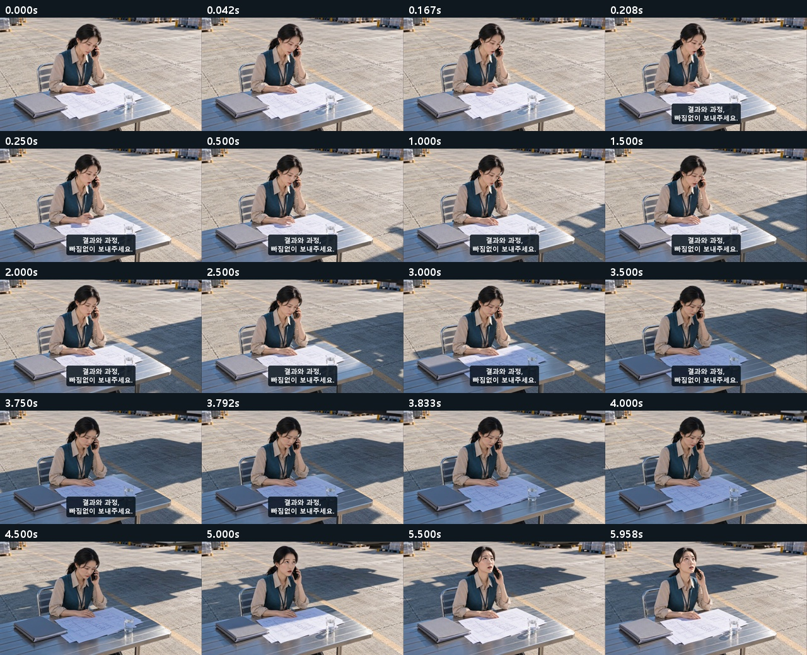
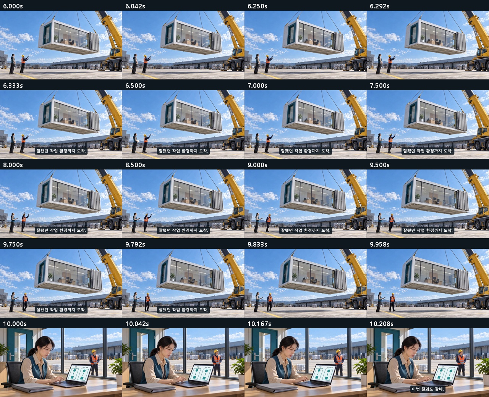
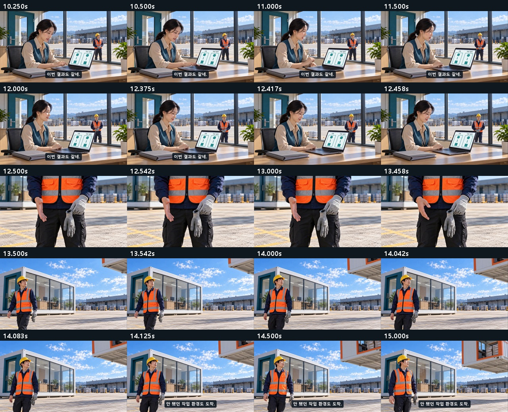
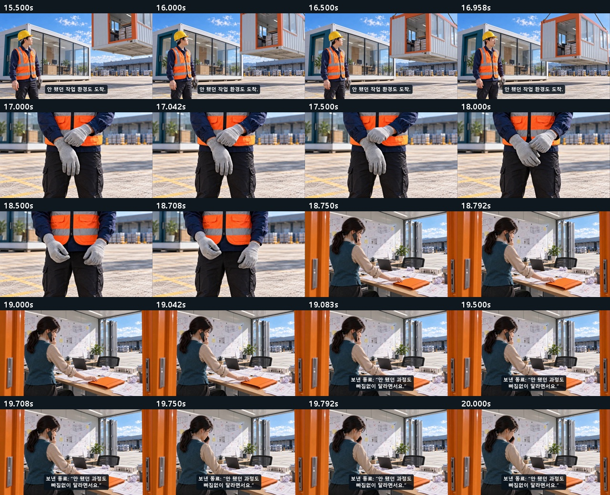
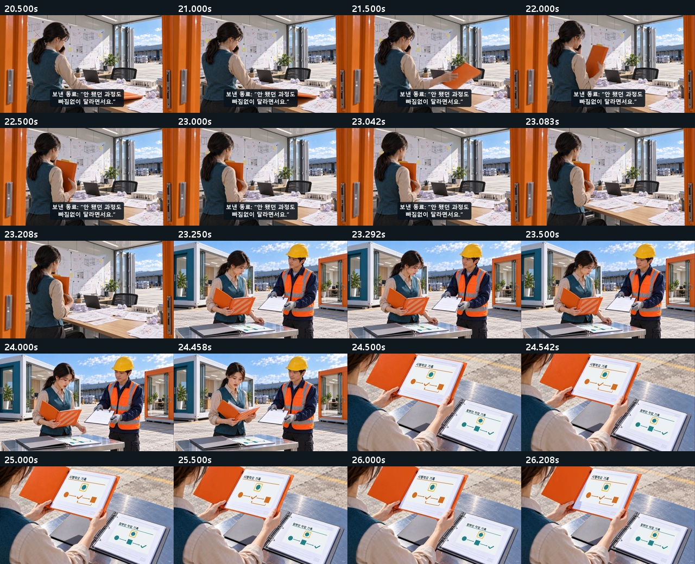
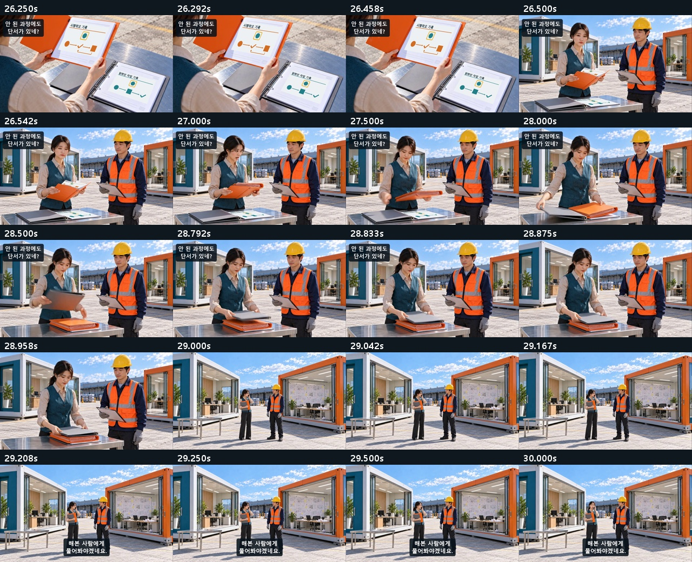
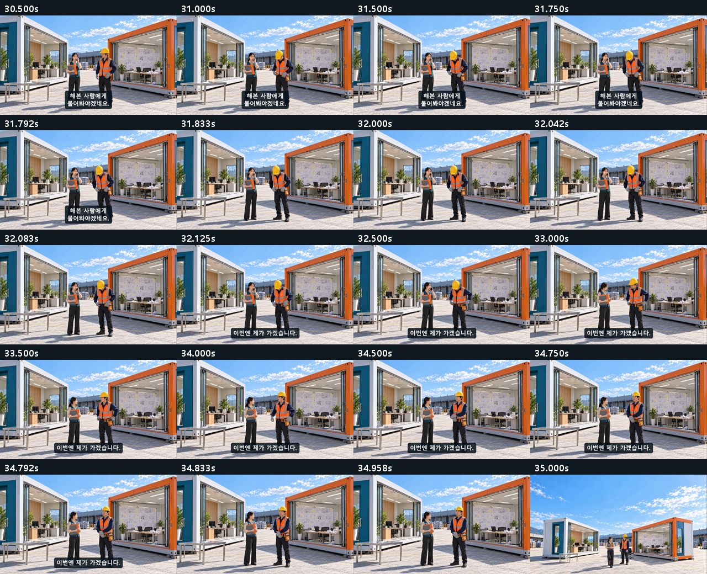
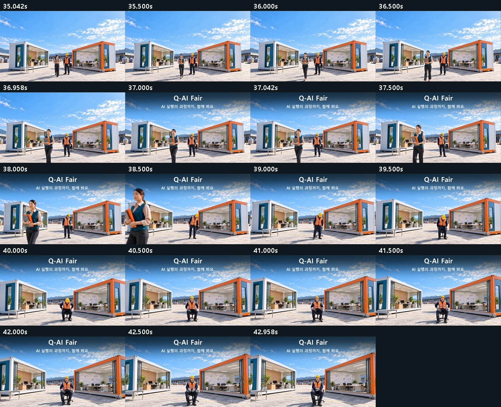

# C03 · 환경까지 가져왔습니다

**[최종 MP4](storyboards/2026-10-25_final-six-v13/C03/C03_Q-AI_Fair_final_v13.mp4) · 43초 · 720p 24fps · V13**

장갑 확인 구간을 줄이고 겹치던 자막을 정리. 무음 영상.

[전체 영상](00_완성_영상.md) · [원본·추가 생성 기록](00_V13_보완_검수.md)

## 최종 편집 순서

| 컷 | 본편 구간 | 원본 사용 구간 | 소스 |
|---|---:|---:|---|
| K01 | 0–6s | 0–6s | [원본](storyboards/2026-10-20_C03-flow-run08/C03_K01_take02.mp4) |
| K02 | 6–10s | 0–4s | [원본](storyboards/2026-10-19_C03-flow-run01/C03_K02_take01.mp4) |
| K03 | 10–12.5s | 0–2.5s | [원본](storyboards/2026-10-19_C03-flow-run01/C03_K03_take01.mp4) |
| K03_done | 12.5–13.5s | 6–7s | [원본](storyboards/2026-10-20_C03-flow-run05/C03_K03_insert_take02.mp4) |
| K04 | 13.5–17s | 0–3.5s | [원본](storyboards/2026-10-20_C03-flow-run03/C03_K04_take02.mp4) |
| K04_cuff | 17–18.75s | 3.75–5.5s | [원본](storyboards/2026-10-20_C03-flow-run06/C03_K04_insert_take05.mp4) |
| K05_listen | 18.75–19.75s | 0–1s | [원본](storyboards/2026-10-20_C03-flow-run09/C03_K05_question_take05.mp4) |
| K05 | 19.75–23.25s | 1.25–4.75s | [원본](storyboards/2026-10-20_C03-flow-run03/C03_K05_take03.mp4) |
| K06_before | 23.25–24.5s | 0–1.25s | [원본](storyboards/2026-10-19_C03-flow-run02/C03_K06_take01.mp4) |
| K06_records | 24.5–26.5s | 0–2s | [원본](storyboards/2026-10-20_C03-flow-run08/C03_K06_insert_take01.mp4) |
| K06_after | 26.5–29s | 3.25–5.75s | [원본](storyboards/2026-10-19_C03-flow-run02/C03_K06_take01.mp4) |
| K07 | 29–35s | 0–6s | [원본](storyboards/2026-10-20_C03-flow-run03/C03_K07_take02.mp4) |
| K08 | 35–43s | 0–8s | [원본](storyboards/2026-10-20_C03-flow-run03/C03_K08_take02.mp4) |

## 화면 자막

| 구간 | 자막 |
|---|---|
| 0.2–3.8s | 결과와 과정, 빠짐없이 보내주세요. |
| 6.3–9.8s | 잘됐던 작업 환경까지 도착. |
| 10.2–12.4s | 이번 결과도 같네. |
| 14.1–17s | 안 됐던 작업 환경도 도착. |
| 19.05–23.05s | 보낸 동료: “안 됐던 과정도 빠짐없이 달라면서요.” |
| 26.25–28.85s | 안 된 과정에도 단서가 있네? |
| 29.2–31.8s | 해본 사람에게 물어봐야겠네요. |
| 32.1–34.8s | 이번엔 제가 가겠습니다. |
| 37–43s | Q-AI Fair AI 실행의 과정까지, 함께 봐요. |

## 실제 편집본 검수 화면

검수 범위: 실제 추출 프레임·접합 표본, 자막, 전체 파일 디코딩·시간축·원본 해시. 실시간 연속 재생·실청취·현장 상영 테스트를 마쳤다는 의미는 아닙니다.
