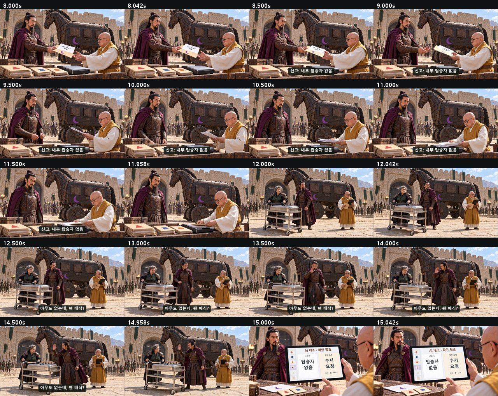
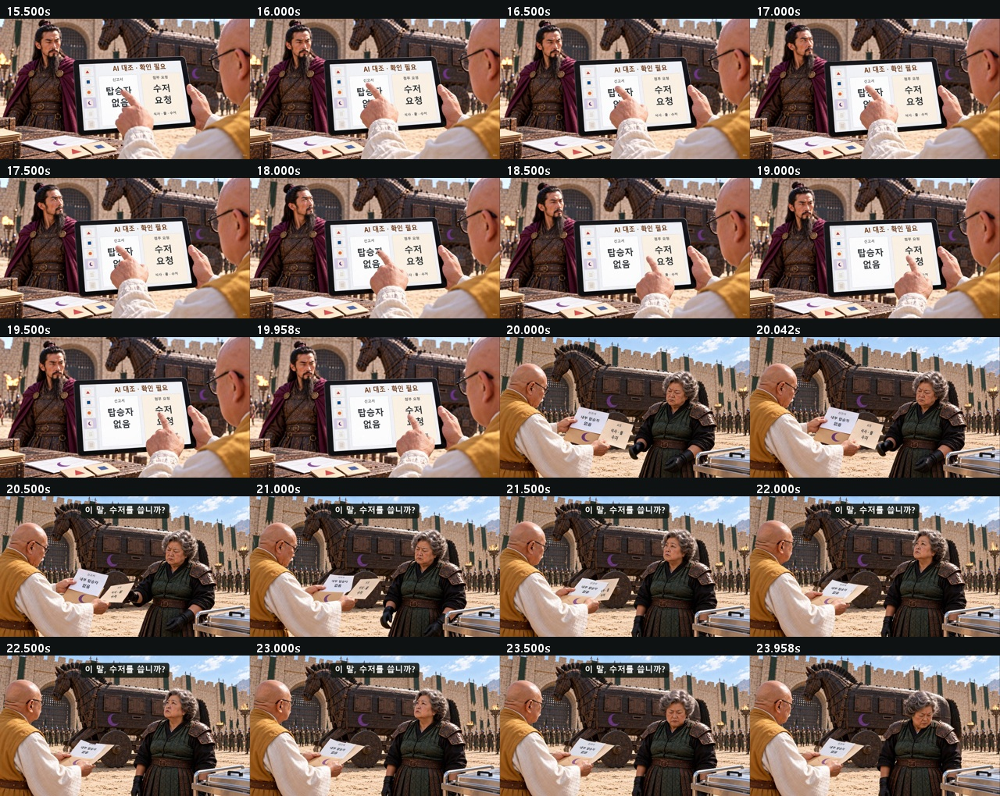
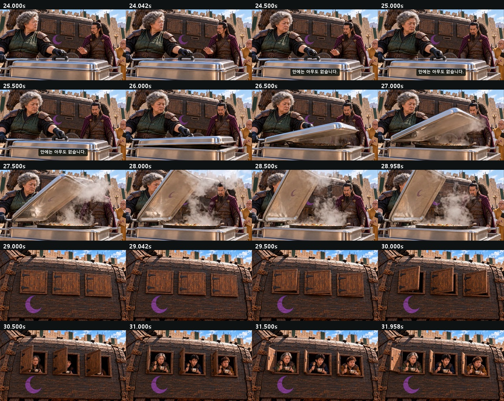
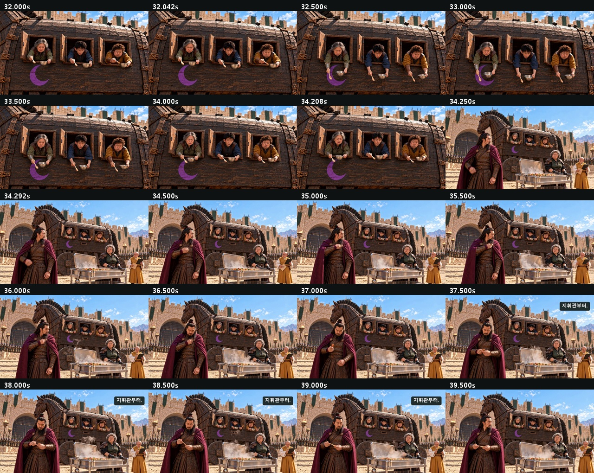
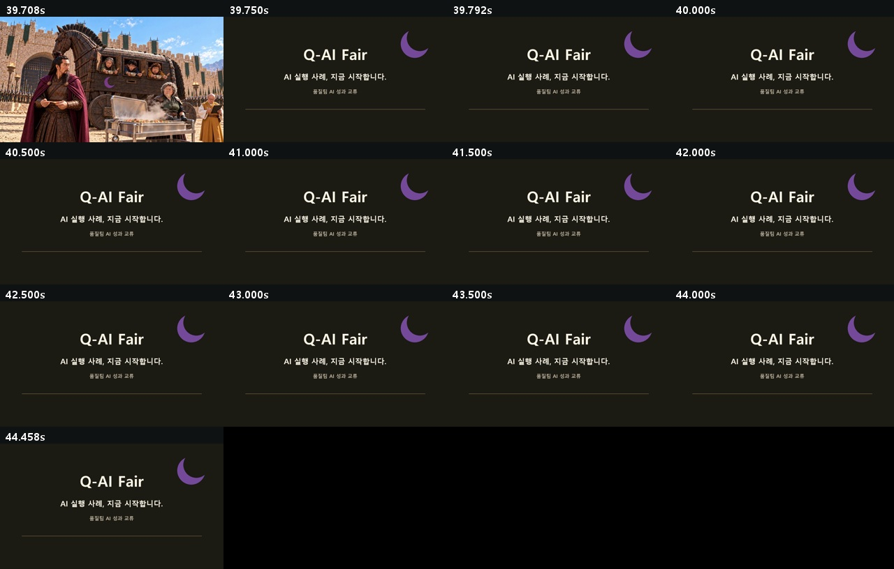

# C04 · 목마는 식사 중입니다

**[최종 MP4](storyboards/2026-10-25_final-six-v13/C04/C04_Q-AI_Fair_final_v13.mp4) · 44.5초 · 720p 24fps · V13**

쪽지 완전 투입·문서 합성·세 창문 열림·한 숟가락 추출 연결.

[전체 영상](00_완성_영상.md) · [원본·추가 생성 기록](00_V13_보완_검수.md)

## 최종 편집 순서

| 컷 | 본편 구간 | 원본 사용 구간 | 소스 |
|---|---:|---:|---|
| K01 | 0–3s | 0–3s | [원본](storyboards/2026-10-24_v12-C02-C04-C01-flow/C04_K01_take01.mp4) |
| NOTE | 3–8s | 0.5–5.5s | [원본](storyboards/2026-10-25_final-six-v13/C04_K01_note_push_take01.mp4) |
| K02 | 8–12s | 0.5–4.5s | [원본](storyboards/2026-10-24_v12-C02-C04-C01-flow/C04_K02_take01.mp4) |
| K03 | 12–15s | 0–3s | [원본](storyboards/2026-10-24_v12-C02-C04-C01-flow/C04_K03_take01.mp4) |
| K04 | 15–20s | 0.5–5.5s | [원본](storyboards/2026-10-24_v12-C02-C04-C01-flow/C04_K04_take01.mp4) |
| K05 | 20–24s | 0.5–4.5s | [원본](storyboards/2026-10-24_v12-C02-C04-C01-flow/C04_K05_take01.mp4) |
| K07 | 24–29s | 0–5s | [원본](storyboards/2026-10-24_v12-C02-C04-C01-flow/C04_K07_take01.mp4) |
| WINDOWS | 29–32s | 1–4s | [원본](storyboards/2026-10-25_final-six-v13/C04_K08_hinges_take01.mp4) |
| BOWLS | 32–34.25s | 2–4.25s | [원본](storyboards/2026-10-24_C01-C06-repair110/C04_K08_three_visible_take01.mp4) |
| SPOON | 34.25–39.75s | 0.5–6s | [원본](storyboards/2026-10-24_C01-C06-repair110/C04_K09_take02.mp4) |
| END | 39.75–44.5s | 0–4.75s | 후처리 엔딩 |

## 화면 자막

| 구간 | 자막 |
|---|---|
| 0.2–1.8s | 숨소리도 내지 마라. |
| 1.9–3s | 꼬르륵… |
| 3.2–6.8s | 식사 · 물 · 수저 요청 |
| 8.25–11.8s | 신고: 내부 탑승자 없음 |
| 12.2–14.8s | 아무도 없는데, 웬 배식? |
| 20.2–23.8s | 이 말, 수저를 씁니까? |
| 24.1–26s | 안에는 아무도 없습니다. |
| 37.05–39.5s | 지휘관부터. |
| 39.75–44.5s | Q-AI Fair AI 실행 사례, 지금 시작합니다. |

## 실제 편집본 검수 화면

검수 범위: 실제 추출 프레임·접합 표본, 자막, 전체 파일 디코딩·시간축·원본 해시. 실시간 연속 재생·실청취·현장 상영 테스트를 마쳤다는 의미는 아닙니다.
