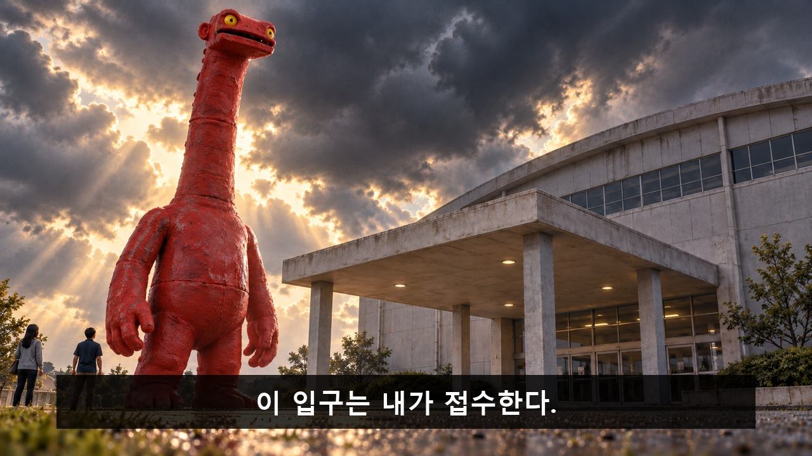
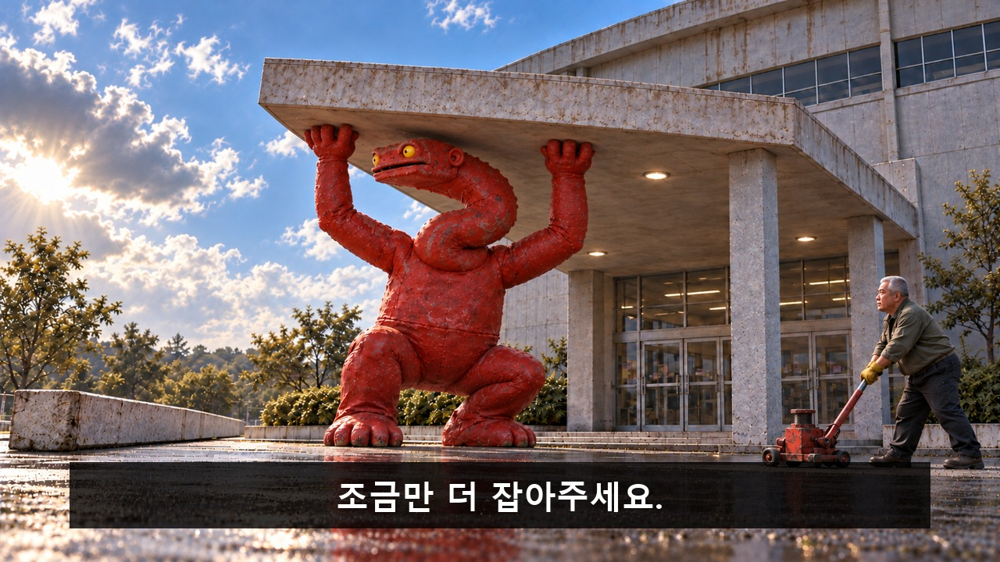
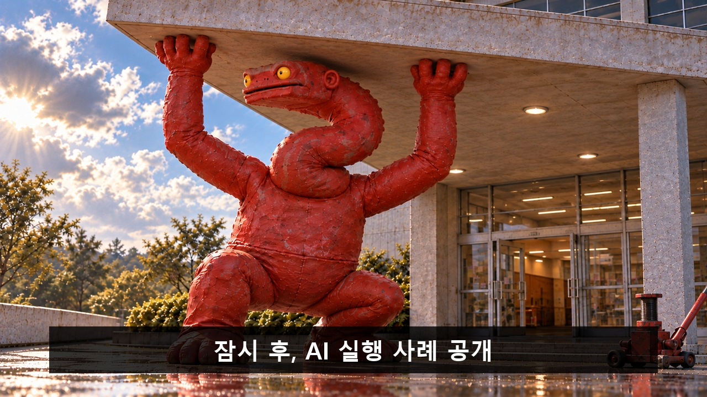
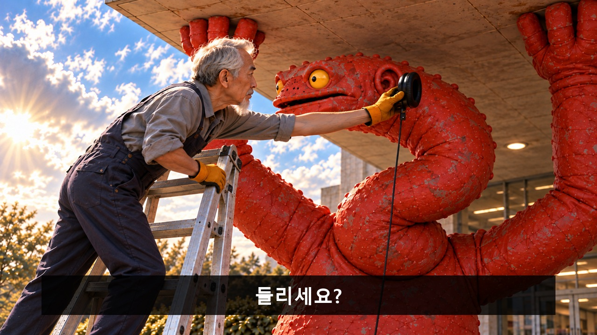
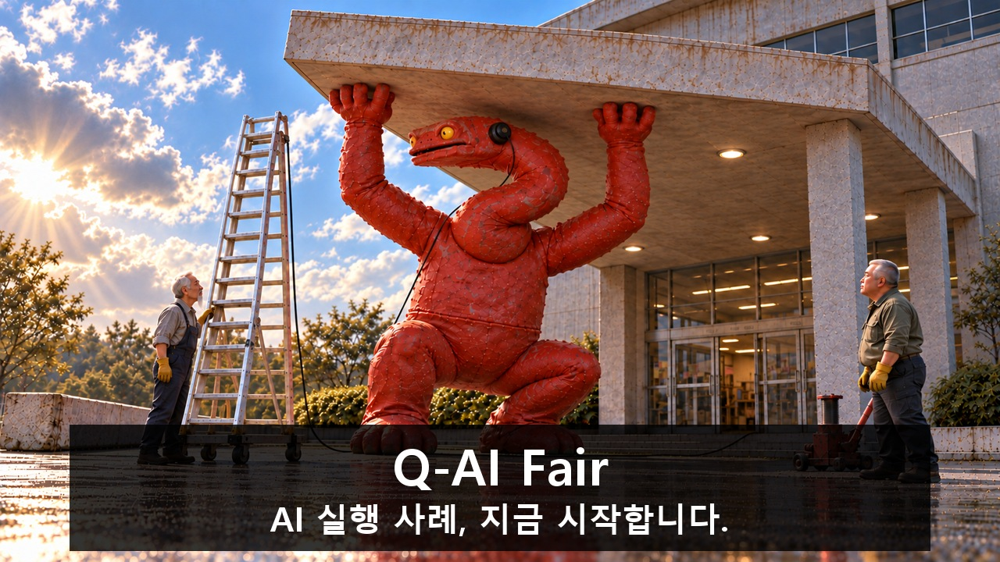

[검수 목록으로](README.md) · [← 이전 안](04_목마는_식사_중입니다.md) · [다음 안 →](06_퇴근_좀_해주세요.md)

**[최신 편집 영상 보기](00_완성_영상.md)** — 38.5초. 아래는 제작 전 V11 콘티입니다.

# 05. 괴수는 퇴근할 수 없다

**출입구를 독점하려 기둥을 뽑은 괴수가 새 기둥이 되고, 구조용인 줄 알았던 사다리에서는 행사 청취용 이어폰이 올라온다.**

**C05 · V11 · 현장 도입 · 43초 · 9개 시작 이미지**

**전달할 내용:** 직접 해본 AI 실행 이야기를 함께 듣는 시간이 시작된다.

**웃음의 전개:** 입구를 막으려던 괴수가 입구를 떠날 수 없는 기둥이 됨→구조 사다리 기대가 이어폰 설치로 바뀜→응답하려 손을 떼는 것조차 실패하는 새 관객.

화면과 후처리 자막으로 전달하는 검수용 콘티입니다. 아래 이미지는 동작의 시작 상태이며, 자막이 있는 컷은 그 첫 이미지 위에 자막 위치를 얹은 정지 예시입니다. 실제 동작 완료 화면이나 생성 영상은 아닙니다.

등장인물·연출 보기

- **MO**: 괴수. 사람이 분장한 현실 동물이 아닌 명백한 특촬 인형. 아주 긴 빨간 목, 짧고 네모난 빨간 몸통, 길고 두툼한 팔 두 개, 네모난 짧은 다리 두 개. 둥근 노란 눈 두 개와 작은 검정 동공, 입은 단순한 가로 홈. 머리 양옆 뒤에 이어폰을 댈 수 있는 작은 빨간 반원형 귀. 특정 인종·장애·실존 캐릭터를 닮게 하지 않는다. 처음은 과시, 이후는 떠나고 싶은 당혹감, 마지막은 어쩔 수 없는 호기심. 시각 크기 기준: 똑바로 섰을 때 약 8m, 무릎과 긴 목을 S자로 접은 지지 자세의 정수리는 약 4.5m·먼쪽 귀는 약 4.2m. 목 길이나 몸 크기는 줄어들지 않는다.
- **FM**: 시설 반장. 50대 한국인 남성, 은발 버즈컷, 큰 체격, 깊은 이마·눈가 주름, 넓은 턱. 진한 올리브 작업 재킷과 검정 작업 바지, 노란 목장갑. 문제를 해결하려 바쁘게 움직이며, 괴수가 놓으면 안 된다는 급한 표정을 유지한다. 괴수를 벌주거나 조롱하지 않는다.
- **TE**: 시설 기사. 60대 한국인 남성, 마르고 작은 어깨, 가늘고 긴 흰 수염과 짧은 은회색 머리, 남색 작업 멜빵 바지와 주황색 장갑. 매우 긴 이동식 사다리와 커다란 유선 한쪽 이어폰을 담당한다.
- **EV**: 초반 건물 바깥 통행인 2명. 회색 재킷 여성 1명과 짙은 파랑 셔츠 남성 1명, 크기 비교용 원경. K02 이전 포치 바깥으로 피하고 이후 포치 아래에 사람이 들어가지 않는다. 실제 행사 발표자로 소개하지 않음.

**형식:** 재난 영화의 괴수 습격이 낮의 허술한 특촬과 시설 대응, 예상 밖 청취 준비로 바뀌는 코미디

**연출:** 초반은 실루엣·낮은 하늘·극적인 역광의 재난 영화. 파손 후는 밝은 낮과 페인트 질감·고무 봉제선·얕은 모형 심도가 드러나는 특촬. 체육관은 온전하고 독립 포치만 한쪽으로 기운다. 실제 시설이나 로고를 재현하지 않는다.

## 컷별 스토리보드

### C05_K01 · 0–4초 · 4초

**첫 상태:** 괴수 입이 포효 직전 벌어져 있고 두 팔은 몸 옆. 앞왼쪽 기둥은 온전하며 포치 지붕은 수평.

**이어질 동작:** 괴수가 포효 자세로 과시. 접수 선언 자막 뒤 실내 쪽으로 눈을 돌리고 기둥으로 손을 뻗음. 실내 소리를 들어야 동기가 이해되는 연출 제거.

**후처리 자막**

- **0.6–3.7초:** 이 입구는 내가 접수한다.

**웃음·정보 의도:** 괴수의 관심 욕구와 방해 행동의 원인을 먼저 보여준다.

대사·음악·효과음·구도·전환

| 항목 | 내용 |
|---|---|
| 대사·내레이션 | 없음. 필요한 의미는 caption_cues로 전달. |
| 음악·효과음·정적 | 선택 BGM/SFX: 재난 브라스→짧은 승리→구조 기대. 삐걱·잭·바퀴 잠금·이어컵. 이어컵 공개 때 기대음악 중단. 대사/내레이션 없음; 소리를 꺼도 필수 정보 유지. |
| 구도 | 극적인 외부 로앵글. 직립 높이 약 8m인 괴수의 긴 목·노란 눈·네모 몸통과 5m 포치를 전경에, 12m 체육관 본체는 원근으로 작아 보이게. 실제 크기를 바꾸지 않고 위압감을 만든다. |
| 전환 | 공간 축·물리 상태를 이어 하드 컷. 자막 종료 뒤 다음 정보. |

[자막 없는 시작 PNG 원본](storyboards/2026-10-23_v11-production-lock/images/C05/S01.png)

### C05_K02A · 4–7초 · 3초 (K02 앞부분)

**첫 상태:** 기둥 온전·괴수 직립·손 접촉 직전.

**이어질 동작:** 기둥을 빼 왼쪽 바닥에 놓고 손을 놓는다. 끝까지 직립, 지붕 수평, 두 손 자유.

**앞 컷 연결:** 같은 앞왼쪽 기둥. 건물 본체·다른 세 기둥은 그대로.

**이 단위의 종료 상태:** 기둥은 왼쪽 바닥에 놓였고 괴수는 끝까지 직립·양손 자유·지붕 수평. 목·무릎 접기는 다음 B에서 시작. 포치 아래 진입하지 않음.

**후처리 자막:** 없음. 행동과 표정으로 전달.

**웃음·정보 의도:** 입구를 독점하려는 자기 선택으로 지붕 아래 들어간다. 다음 컷에서 남을 막던 양팔이 자기 머리 위 지붕을 떠받치게 되는 반전.

대사·음악·효과음·구도·전환

| 항목 | 내용 |
|---|---|
| 대사·내레이션 | 없음. 필요한 의미는 caption_cues로 전달. |
| 음악·효과음·정적 | 선택 BGM/SFX: 재난 브라스→짧은 승리→구조 기대. 삐걱·잭·바퀴 잠금·이어컵. 이어컵 공개 때 기대음악 중단. 대사/내레이션 없음; 소리를 꺼도 필수 정보 유지. |
| 구도 | 직립 괴수·앞왼쪽 기둥·왼쪽 빈 바닥·포치가 함께 보이는 고정 와이드. 기둥 제거와 내려놓기만 담는다. |
| 전환 | 공간 축·물리 상태를 이어 하드 컷. 자막 종료 뒤 다음 정보. |

[자막 없는 시작 PNG 원본](storyboards/2026-10-23_v11-production-lock/images/C05/S02A.png)

### C05_K02B · 7–11초 · 4초 (K02 뒷부분)

**첫 상태:** 기둥 왼쪽 바닥·괴수 직립·양손 자유·목과 무릎 접기 전·지붕 수평.

**이어질 동작:** 출입구를 자기 몸으로 막으려고 목·무릎을 접어 빈자리로 들어가 양팔을 벌린다. 다음 컷에서 양팔이 지붕 지지가 된다.

**앞 컷 연결:** A 채택 끝 상태를 이어 기둥은 왼쪽 바닥, 괴수는 밖에서 직립·양손 자유·지붕 수평. 이 상태부터 목·무릎을 접기 시작. 실제 제작에서는 채택 A의 종료 프레임을 B 시작에 우선 사용.

**이 단위의 종료 상태:** 기둥 하나 제거. 괴수 무릎 굽힘·S자 목으로 정수리 약 4.5m·귀 약 4.2m가 5m 포치 아래에 들어간 상태.

**후처리 자막:** 없음. 행동과 표정으로 전달.

**웃음·정보 의도:** 입구를 독점하려는 자기 선택으로 지붕 아래 들어간다. 다음 컷에서 남을 막던 양팔이 자기 머리 위 지붕을 떠받치게 되는 반전.

대사·음악·효과음·구도·전환

| 항목 | 내용 |
|---|---|
| 대사·내레이션 | 없음. 필요한 의미는 caption_cues로 전달. |
| 음악·효과음·정적 | 선택 BGM/SFX: 재난 브라스→짧은 승리→구조 기대. 삐걱·잭·바퀴 잠금·이어컵. 이어컵 공개 때 기대음악 중단. 대사/내레이션 없음; 소리를 꺼도 필수 정보 유지. |
| 구도 | 외부 고정 와이드. 같은 8m 괴수가 몸을 접어 5m 포치 아래로 들어가는 동작을 온전히 보여 크기 변화로 오인하지 않게 한다. 분리된 본체·포치와 빈 왼쪽 바닥도 보임. |
| 전환 | 공간 축·물리 상태를 이어 하드 컷. 자막 종료 뒤 다음 정보. |

[자막 없는 시작 PNG 원본](storyboards/2026-10-23_v11-production-lock/images/C05/S02B_v3.png)

### C05_K03 · 11–15초 · 4초

**첫 상태:** 괴수는 무릎을 굽히고 긴 목을 S자로 접은 채 두 팔을 승리 자세로 든다. 지붕이 막 기울기 시작했고 양손은 아직 닿지 않았다. 귀는 약 4.2m 높이.

**이어질 동작:** 지붕이 더 기울기 시작하자 괴수가 양손으로 앞 가장자리를 받쳐 멈춘다. 머리·몸에 충돌하지 않는다.

**후처리 자막:** 없음. 행동과 표정으로 전달.

**웃음·정보 의도:** 위협하던 괴수가 자기 머리를 지키기 위해 새로운 기둥이 되는 첫 반전.

대사·음악·효과음·구도·전환

| 항목 | 내용 |
|---|---|
| 대사·내레이션 | 없음. 필요한 의미는 caption_cues로 전달. |
| 음악·효과음·정적 | 선택 BGM/SFX: 재난 브라스→짧은 승리→구조 기대. 삐걱·잭·바퀴 잠금·이어컵. 이어컵 공개 때 기대음악 중단. 대사/내레이션 없음; 소리를 꺼도 필수 정보 유지. |
| 구도 | 괴수 옆 3/4 미디엄 와이드. 지붕 기울기·양손·목·무릎과 왼쪽 바닥 기둥이 동시에 읽힘. |
| 전환 | 공간 축·물리 상태를 이어 하드 컷. 자막 종료 뒤 다음 정보. |

[자막 없는 시작 PNG 원본](storyboards/2026-10-23_v11-production-lock/images/C05/S03.png)

### C05_K04 · 15–20초 · 5초

**첫 상태:** FM이 접힌 받침대를 굴려 멈추기 직전. 괴수는 무릎과 긴 목을 S자로 접은 같은 크기로 지붕을 받치며 왼쪽 길을 본다. 정수리 4.5m·귀 4.2m 기준.

**이어질 동작:** FM이 잭을 끝까지 올려 짧음을 확인하고 놓지 말라는 두 손을 듦. 그 뒤 부탁 자막. 괴수는 나갈 길을 흘겨보지만 지지 유지.

**후처리 자막**

- **17.5–19.8초:** 조금만 더 잡아주세요.

**웃음·정보 의도:** 해결 도구가 크기에 맞지 않아 대기가 늘어난다. 괴수의 떠나고 싶은 표정과 반장의 놓지 말라는 표정을 대비한다.

대사·음악·효과음·구도·전환

| 항목 | 내용 |
|---|---|
| 대사·내레이션 | 없음. 필요한 의미는 caption_cues로 전달. |
| 음악·효과음·정적 | 선택 BGM/SFX: 재난 브라스→짧은 승리→구조 기대. 삐걱·잭·바퀴 잠금·이어컵. 이어컵 공개 때 기대음악 중단. 대사/내레이션 없음; 소리를 꺼도 필수 정보 유지. |
| 구도 | 고정 와이드. 거대한 인형·짧은 잭·주름 있는 반장의 크기 대비. 포치 아래로 FM이 들어가지 않음. |
| 전환 | 공간 축·물리 상태를 이어 하드 컷. 자막 종료 뒤 다음 정보. |

[자막 없는 시작 PNG 원본](storyboards/2026-10-23_v11-production-lock/images/C05/S04.png)

### C05_K05 · 20–26초 · 6초

**첫 상태:** 괴수는 무릎·긴 목을 S자로 접은 같은 지지 자세. 양손이 지붕을 받치고 귀는 약 4.2m. 눈만 열린 문으로 돌아가 귀를 기울이기 직전.

**이어질 동작:** 앞 3.6초 양손 지지 유지하며 발표 예고 자막. 뒤 2.4초 눈만 문 쪽으로 이동하고 눈꺼풀이 조금 열림→고개를 기울이다 지붕이 조금 움직여 즉시 복귀. 개과천선이 아니라 기다리던 중 생긴 호기심. 필수 안내 음성 없음.

**후처리 자막**

- **20.2–23.6초:** 잠시 후, AI 실행 사례 공개

**웃음·정보 의도:** 듣고 싶은 호기심이 생겨도 구조를 놓을 수 없다. 발표는 아직 시작 전임을 명확히 한다.

대사·음악·효과음·구도·전환

| 항목 | 내용 |
|---|---|
| 대사·내레이션 | 없음. 필요한 의미는 caption_cues로 전달. |
| 음악·효과음·정적 | 선택 BGM/SFX: 재난 브라스→짧은 승리→구조 기대. 삐걱·잭·바퀴 잠금·이어컵. 이어컵 공개 때 기대음악 중단. 대사/내레이션 없음; 소리를 꺼도 필수 정보 유지. |
| 구도 | 괴수 머리·양손·지붕 앞 가장자리와 오른쪽 열린 체육관 문을 보는 고정 미디엄. |
| 전환 | 공간 축·물리 상태를 이어 하드 컷. 자막 종료 뒤 다음 정보. |

[자막 없는 시작 PNG 원본](storyboards/2026-10-23_v11-production-lock/images/C05/S05.png)

### C05_K06 · 26–30초 · 4초

**첫 상태:** 실제 PNG의 사다리는 이미 긴 길이로 펴져 있다. TE가 하부를 이동·고정하기 직전이며 새로 늘리거나 조립하지 않는다. 이어컵은 이 구도에서 보이지 않는다.

**이어질 동작:** 이미 펴진 사다리의 하부를 TE가 바깥 지면에서 밀어 위치를 맞추고 지지대·바퀴 브레이크를 고정한다. 귀 높이는 그대로, 사다리 연장·조립 없음. 괴수는 목을 펴지 않고 눈만 따라간다.

**후처리 자막:** 없음. 행동과 표정으로 전달.

**웃음·정보 의도:** 긴 사다리가 구조 해결책이라는 관객의 두 번째 기대를 만들고 다음 컷에서 뒤집는다.

대사·음악·효과음·구도·전환

| 항목 | 내용 |
|---|---|
| 대사·내레이션 | 없음. 필요한 의미는 caption_cues로 전달. |
| 음악·효과음·정적 | 선택 BGM/SFX: 재난 브라스→짧은 승리→구조 기대. 삐걱·잭·바퀴 잠금·이어컵. 이어컵 공개 때 기대음악 중단. 대사/내레이션 없음; 소리를 꺼도 필수 정보 유지. |
| 구도 | 사다리 하부에서 위로 향하는 와이드. TE·바퀴형 지지대·긴 사다리·괴수 양손이 보임. 이어폰이 달린 상부 장비는 이 구도에서 가림. |
| 전환 | 하부 고정 뒤, 작업 높이 조절과 등반을 마친 시간을 생략하여 K07의 귀 높이 설치 상태로 컷. 긴 사다리가 한 동작에서 자동 변형되는 생성은 요구하지 않음. |

[자막 없는 시작 PNG 원본](storyboards/2026-10-23_v11-production-lock/images/C05/S06_v2.png)

### C05_K07 · 30–35초 · 5초

**첫 상태:** 주둥이 왼쪽·보이는 귀는 머리 오른쪽으로 와이드와 같은 축. TE가 검정 이어컵을 그 귀 바로 옆에 띄워 든 미장착 상태. 양손 지붕 지지 유지.

**이어질 동작:** TE가 같은 먼쪽 귀에 이어컵·뒤끈을 건다. 실체를 먼저 보여준 뒤 아래 FM의 들리세요? 자막. 괴수 한 번 깜빡임. 발화 없음.

**후처리 자막**

- **32.4–34.9초:** 들리세요?

**웃음·정보 의도:** 구조용인 줄 알았던 사다리가 청취를 돕는 장비다. 시설 반장이 괴수를 벌준다는 웃음으로 바꾸지 않는다.

대사·음악·효과음·구도·전환

| 항목 | 내용 |
|---|---|
| 대사·내레이션 | 없음. 필요한 의미는 caption_cues로 전달. |
| 음악·효과음·정적 | 선택 BGM/SFX: 재난 브라스→짧은 승리→구조 기대. 삐걱·잭·바퀴 잠금·이어컵. 이어컵 공개 때 기대음악 중단. 대사/내레이션 없음; 소리를 꺼도 필수 정보 유지. |
| 구도 | 와이드와 같은 쪽에서 당긴 사다리 상부 미디엄. 주둥이 왼쪽·귀 오른쪽·같은 S목. 기술자와 양손 지붕 지지 일부. |
| 전환 | 설치 뒤 하강·사다리 정리 시간 생략, K08 손짓 답신. |

[자막 없는 시작 PNG 원본](storyboards/2026-10-23_v11-production-lock/images/C05/S07_v3.png)

### C05_K08 · 35–43초 · 8초

**첫 상태:** 괴수의 S자 목·굽힌 무릎·두 손 지지는 그대로. 이어컵은 연결 완료, 눈은 아래 FM을 향해 잘 들린다는 답을 보내려는 표정. 오른손 손목은 아직 펴져 있고 손가락도 지붕을 잡고 있다.

**이어질 동작:** 35–38초 오른손 엄지 답신 시도→지붕 흔들림→다시 잡기→작은 끄덕임. 38–42.8초 손 고정 상태에 행사명·시작 문구. 필수 안내 음성 없음.

**후처리 자막**

- **38–42.8초:** Q-AI Fair / AI 실행 사례, 지금 시작합니다.

**웃음·정보 의도:** 자기가 망친 현관의 새 기둥이면서 새 청자가 되는 마지막 몸개그. 청취 준비의 완료가 실제 행사 시작을 여는 원인이 된다.

대사·음악·효과음·구도·전환

| 항목 | 내용 |
|---|---|
| 대사·내레이션 | 없음. 필요한 의미는 caption_cues로 전달. |
| 음악·효과음·정적 | 선택 BGM/SFX: 재난 브라스→짧은 승리→구조 기대. 삐걱·잭·바퀴 잠금·이어컵. 이어컵 공개 때 기대음악 중단. 대사/내레이션 없음; 소리를 꺼도 필수 정보 유지. |
| 구도 | 외부 고정 와이드. 같은 S목·무릎·양손 지지. 몸개그 3초 후 하단 제목판을 사용해 지붕·손·얼굴을 보존한다. |
| 전환 | 행사명·시작 문구 유지 후 실제 진행 연결. |

[자막 없는 시작 PNG 원본](storyboards/2026-10-23_v11-production-lock/images/C05/S08_v2.png)

---

[검수 목록으로](README.md) · [← 이전 안](04_목마는_식사_중입니다.md) · [다음 안 →](06_퇴근_좀_해주세요.md)

정확한 행사 날짜·장소·참석 방법은 아직 기입하지 않았습니다. 실제 영상 제작 뒤 움직이는 소품·자막 가림·읽는 시간·편집 호흡을 재확인합니다.
