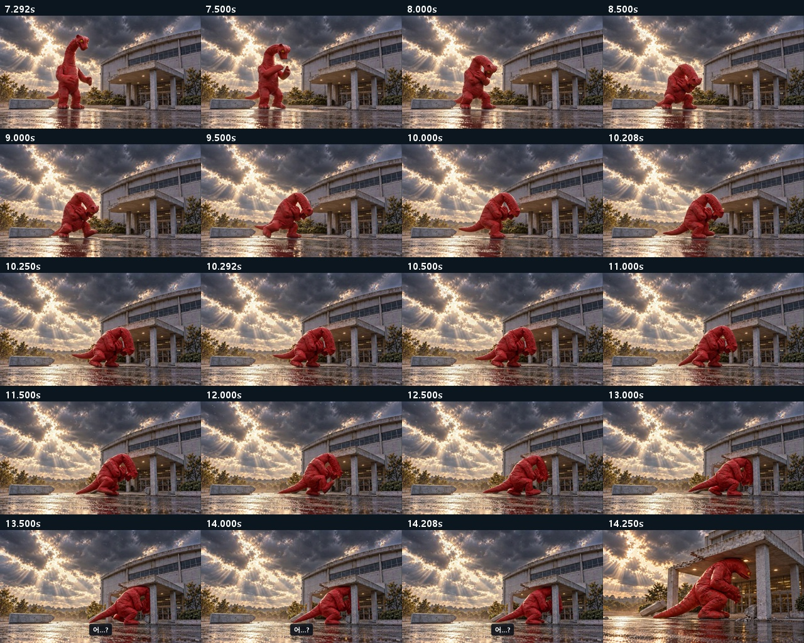
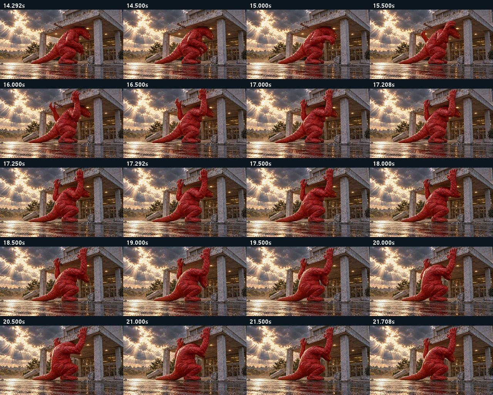
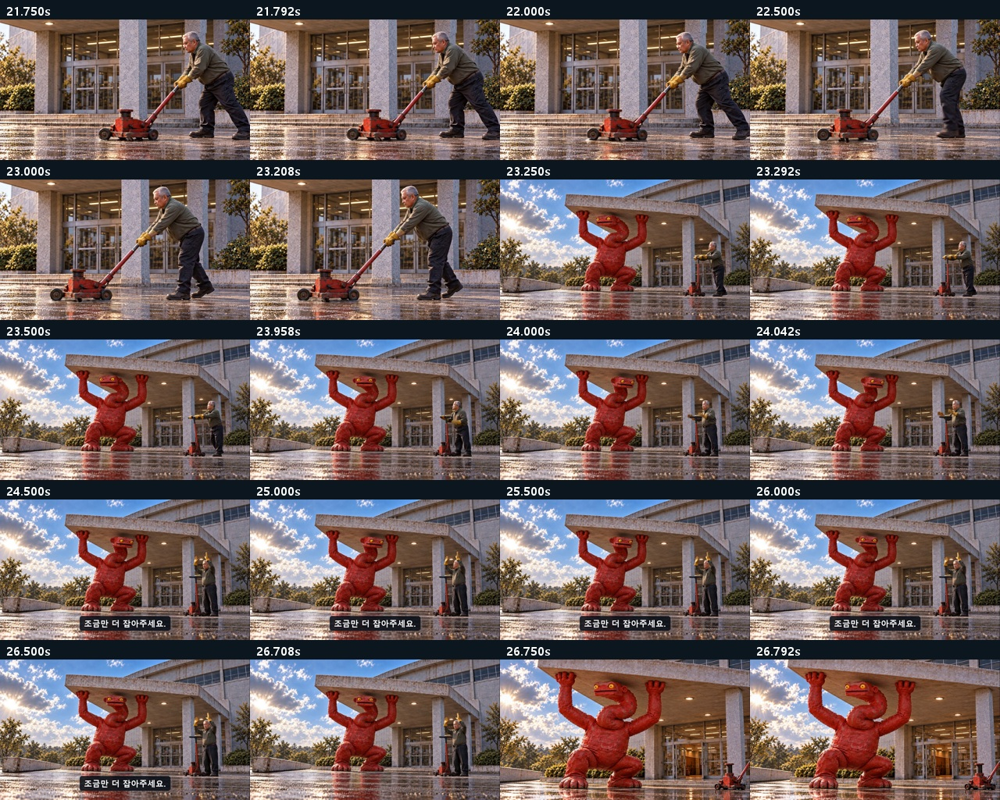
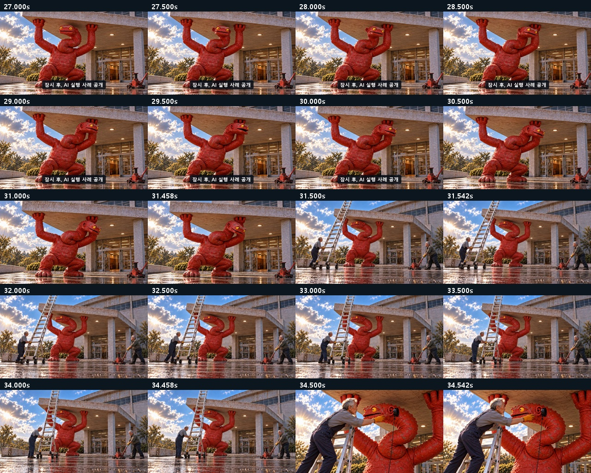
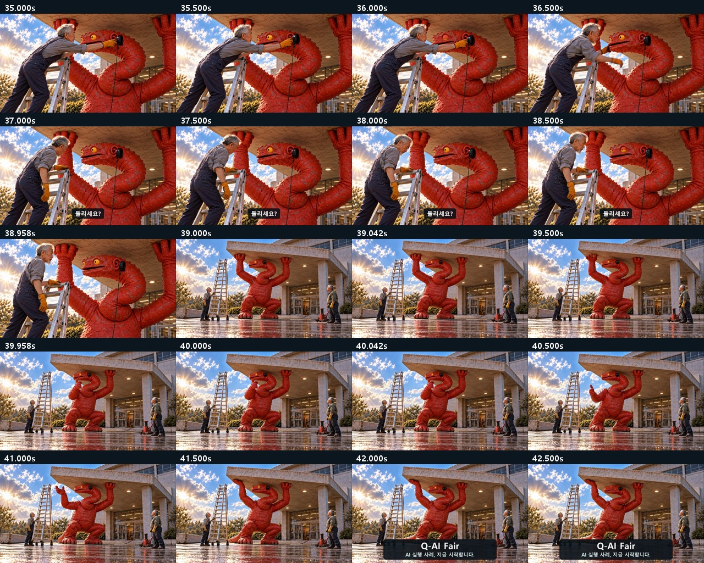
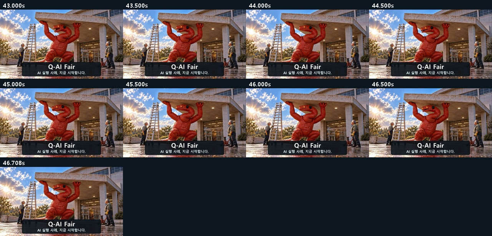

# C05 · 괴수는 퇴근할 수 없다

**[최종 MP4](storyboards/2026-10-25_final-six-v13/C05_r3/C05_Q-AI_Fair_final_v13.mp4) · 46.75초 · 720p 24fps · V13**

목 걸림→목 빼기→잭 운반→받침. 괴수 변형 테이크는 제외. 회전·손 이동은 컷어웨이 동안 시간 생략이며 연속 동작 촬영은 아님.

[전체 영상](00_완성_영상.md) · [원본·추가 생성 기록](00_V13_보완_검수.md)

## 최종 편집 순서

| 컷 | 본편 구간 | 원본 사용 구간 | 소스 |
|---|---:|---:|---|
| K01 | 0–3.25s | 0–3.25s | [원본](storyboards/2026-10-23_C06-C05-flow-run03/C05_K01_take02.mp4) |
| K02A | 3.25–7.25s | 1.75–5.75s | [원본](storyboards/2026-10-23_C06-C05-flow-run01/C05_K02A_take01.mp4) |
| K02B | 7.25–10.25s | 0.5–3.5s | [원본](storyboards/2026-10-23_C06-C05-flow-run01/C05_K02B_take02.mp4) |
| N01_entry | 10.25–14.25s | 0.5–4.5s | [원본](storyboards/2026-10-24_C05-first-flow-run01/C05_N01_take01.mp4) |
| N02_hands_grip_front_edge | 14.25–17.25s | 1.5–4.5s | [원본](storyboards/2026-10-24_C05-first-flow-run01/C05_N02_take02.mp4) |
| N03_neck_withdraws | 17.25–21.75s | 3–7.5s | [원본](storyboards/2026-10-24_C05-first-flow-run01/C05_N03_take01.mp4) |
| K04_worker_jack_insert | 21.75–23.25s | 1.5–3s | [원본](storyboards/2026-10-24_C01-C06-repair110/C05_K04_jack_detail_take01.mp4) |
| K04_wide | 23.25–24s | 2.5–3.25s | [원본](storyboards/2026-10-23_C06-C05-flow-run01/C05_K04_take02.mp4) |
| K04_plead | 24–26.75s | 4.5–7.25s | [원본](storyboards/2026-10-23_C06-C05-flow-run01/C05_K04_take02.mp4) |
| K05 | 26.75–31.5s | 0.5–5.25s | [원본](storyboards/2026-10-23_C06-C05-flow-run01/C05_K05_take02.mp4) |
| K06 | 31.5–34.5s | 0.5–3.5s | [원본](storyboards/2026-10-23_C06-C05-flow-run03/C05_K06_take02.mp4) |
| K07 | 34.5–39s | 1–5.5s | [원본](storyboards/2026-10-23_C06-C05-flow-run03/C05_K07_take02.mp4) |
| K08_thumb | 39–40s | 0.5–1.5s | [원본](storyboards/2026-10-23_C06-C05-flow-run01/C05_K08_take01.mp4) |
| K08_return | 40–46.75s | 0–6.75s | [원본](storyboards/2026-10-23_C06-C05-flow-run03/C05_K08_take02.mp4) |

## 화면 자막

| 구간 | 자막 |
|---|---|
| 0.6–3.15s | 이 입구는 내가 접수한다. |
| 13.25–14.25s | 어…? |
| 24.25–26.55s | 조금만 더 잡아주세요. |
| 26.95–30.35s | 잠시 후, AI 실행 사례 공개 |
| 36.85–38.85s | 들리세요? |
| 41.75–46.75s | Q-AI Fair AI 실행 사례, 지금 시작합니다. |

## 실제 편집본 검수 화면

검수 범위: 실제 추출 프레임·접합 표본, 자막, 전체 파일 디코딩·시간축·원본 해시. 실시간 연속 재생·실청취·현장 상영 테스트를 마쳤다는 의미는 아닙니다.
