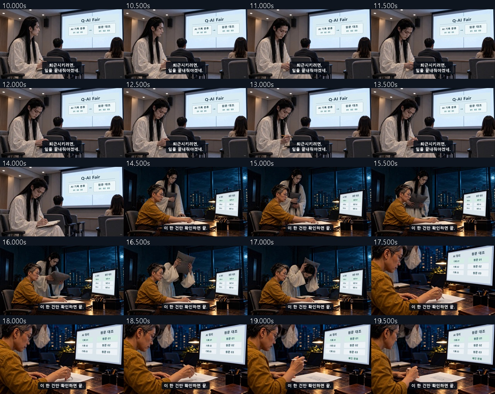
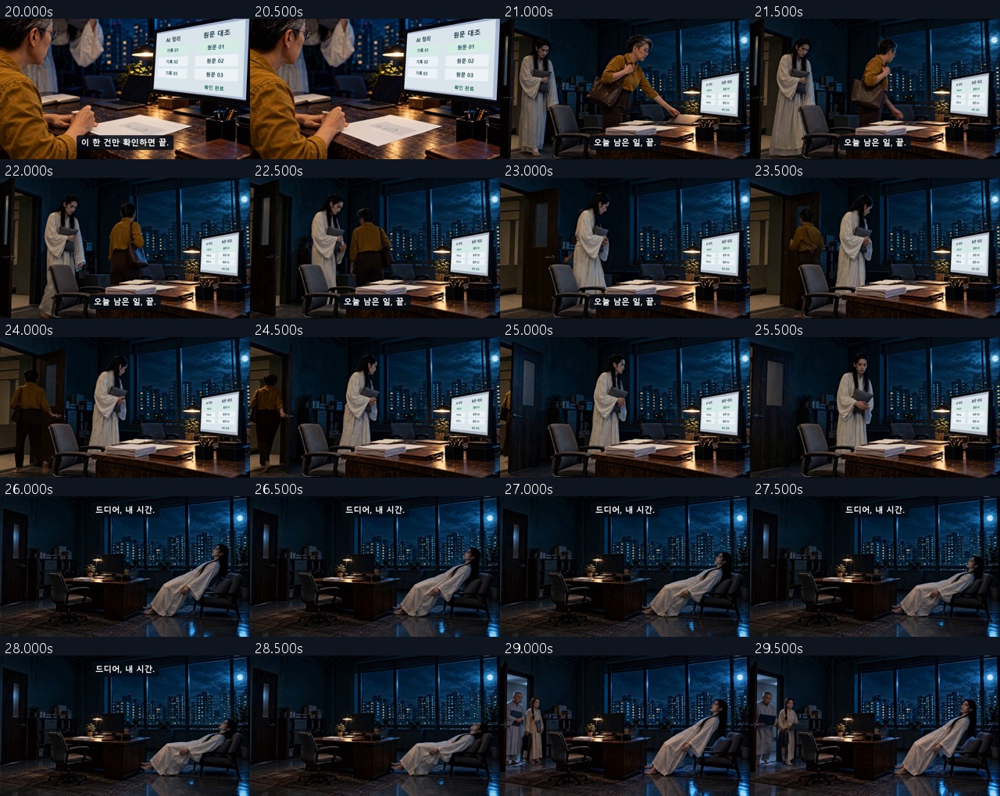
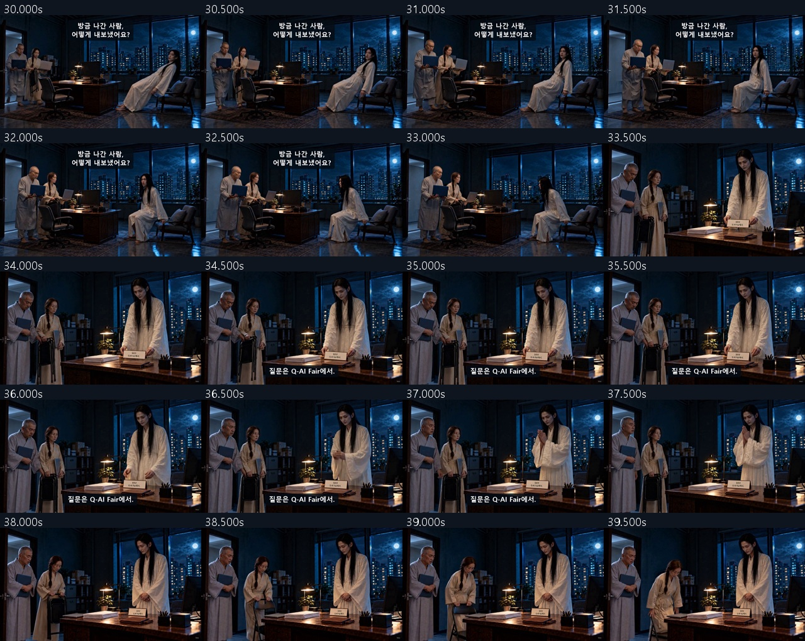
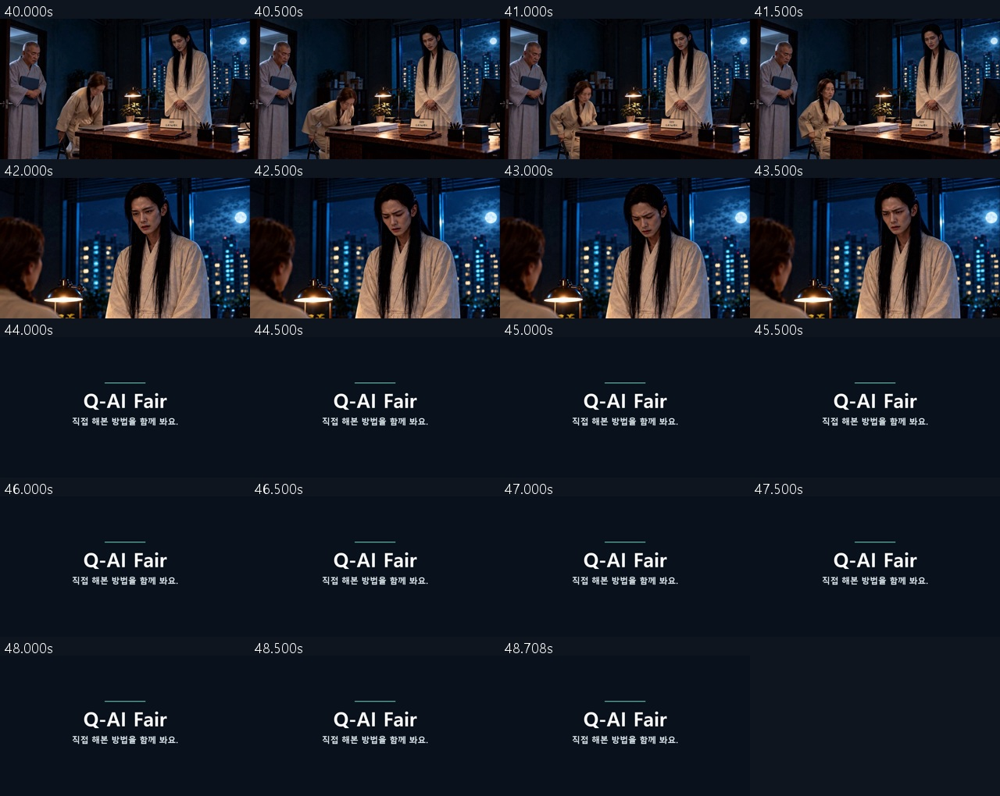

# C06 · 퇴근 좀 해주세요

**[최종 MP4](storyboards/2026-10-25_final-six-v13/C06/C06_Q-AI_Fair_final_v13.mp4) · 48.75초 · 720p 24fps · V13**

책상 첫 타격만 사용하고 효과음 시점을 손 접촉에 맞춤.

[전체 영상](00_완성_영상.md) · [원본·추가 생성 기록](00_V13_보완_검수.md)

## 최종 편집 순서

| 컷 | 본편 구간 | 원본 사용 구간 | 소스 |
|---|---:|---:|---|
| K01 | 0–5s | 0–5s | [원본](storyboards/2026-10-23_C06-C05-flow-run01/C06_K01_take01.mp4) |
| K02_attack | 5–6.5s | 0.75–2.25s | [원본](storyboards/2026-10-24_C01-C06-repair110/C06_K02_impact_take01.mp4) |
| K02_sort | 6.5–9.75s | 4.25–7.5s | [원본](storyboards/2026-10-23_C06-C05-flow-run01/C06_K02_take01.mp4) |
| K03 | 9.75–14.25s | 1.25–5.75s | [원본](storyboards/2026-10-23_C06-C05-flow-run01/C06_K03_take01.mp4) |
| K04_wide | 14.25–17.25s | 0.5–3.5s | [원본](storyboards/2026-10-23_C06-C05-flow-run01/C06_K04_take01.mp4) |
| K04_check | 17.25–20.75s | 1.25–4.75s | [원본](storyboards/2026-10-23_C06-C05-flow-run03/C06_K04_check_take02.mp4) |
| K05 | 20.75–25.75s | 1–6s | [원본](storyboards/2026-10-23_C06-C05-flow-run02/C06_K05_take03.mp4) |
| K06 | 25.75–28.75s | 0.75–3.75s | [원본](storyboards/2026-10-23_C06-C05-flow-run01/C06_K06_take01.mp4) |
| K07 | 28.75–33.25s | 0–4.5s | [원본](storyboards/2026-10-23_C06-C05-flow-run01/C06_K07_take01.mp4) |
| K08 | 33.25–37.75s | 1.25–5.75s | [원본](storyboards/2026-10-23_C06-C05-flow-run01/C06_K08_take01.mp4) |
| K09_seat | 37.75–41.75s | 0.75–4.75s | [원본](storyboards/2026-10-23_C06-C05-flow-run01/C06_K09_take01.mp4) |
| K09_reaction | 41.75–44s | 2–4.25s | [원본](storyboards/2026-10-23_C06-C05-flow-run03/C06_K09_reaction_take01.mp4) |
| END | 44–48.75s | 0–4.75s | 후처리 엔딩 |

## 화면 자막

| 구간 | 자막 |
|---|---|
| 0.3–2.4s | 제발 퇴근 좀 해. |
| 7.75–9.55s | 고마워요. |
| 9.88–14s | 퇴근시키려면, 일을 끝내줘야겠네. |
| 14.45–20.45s | 이 한 건만 확인하면 끝. |
| 20.91–23.47s | 오늘 남은 일, 끝. |
| 26–28.1s | 드디어, 내 시간. |
| 29.75–33s | 방금 나간 사람, 어떻게 내보냈어요? |
| 34.5–37.5s | 질문은 Q-AI Fair에서. |
| 44–48.75s | Q-AI Fair 직접 해본 방법을 함께 봐요. |

## 실제 편집본 검수 화면

검수 범위: 실제 추출 프레임·접합 표본, 자막, 전체 파일 디코딩·시간축·원본 해시. 실시간 연속 재생·실청취·현장 상영 테스트를 마쳤다는 의미는 아닙니다.
