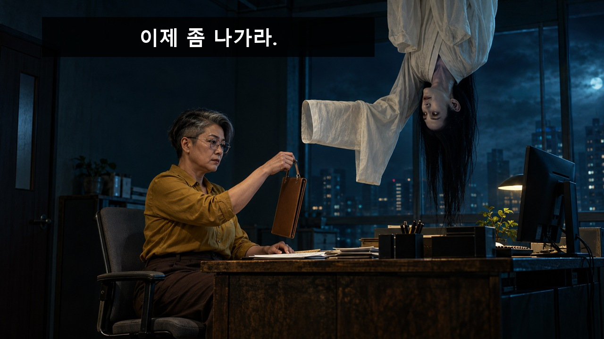
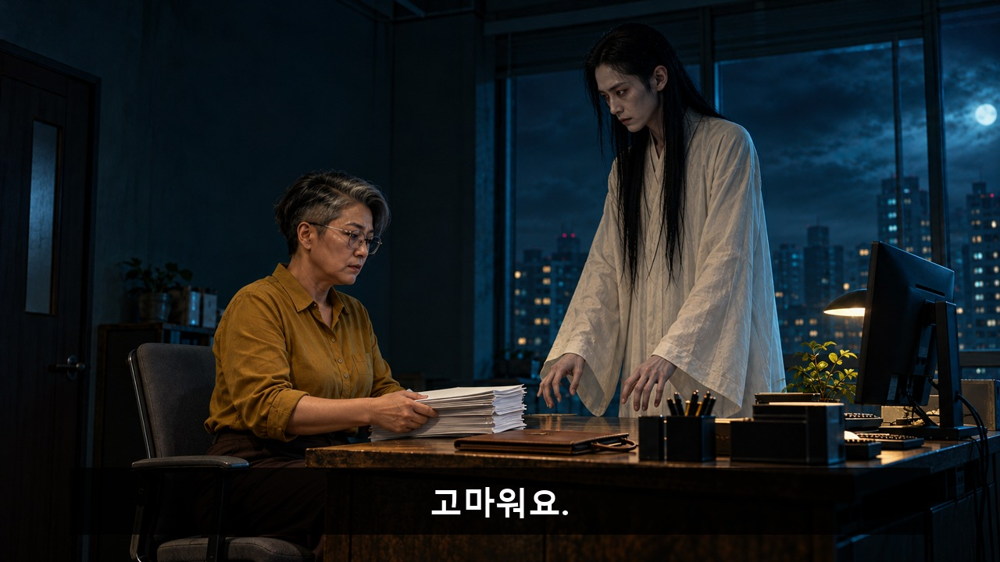
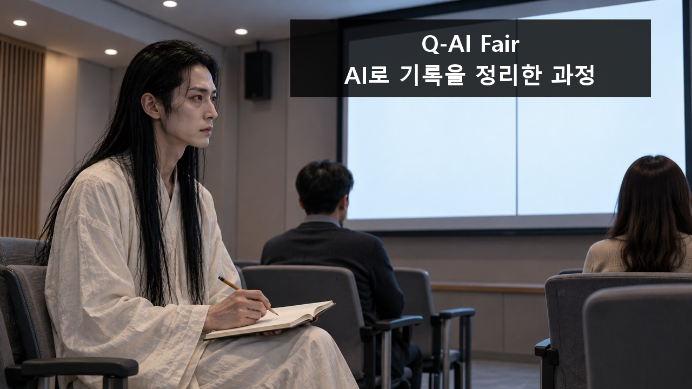
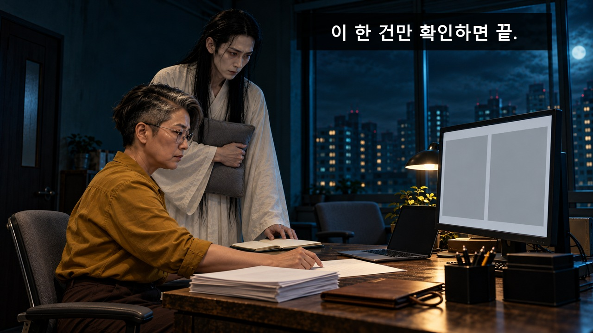
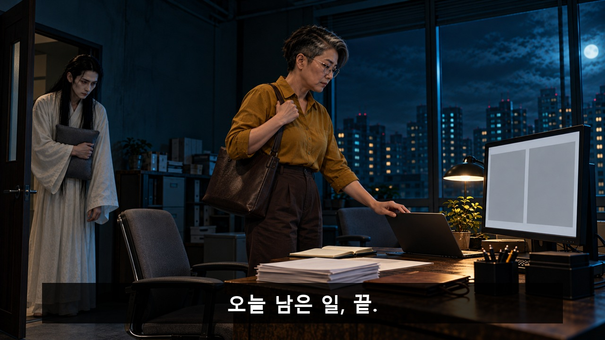
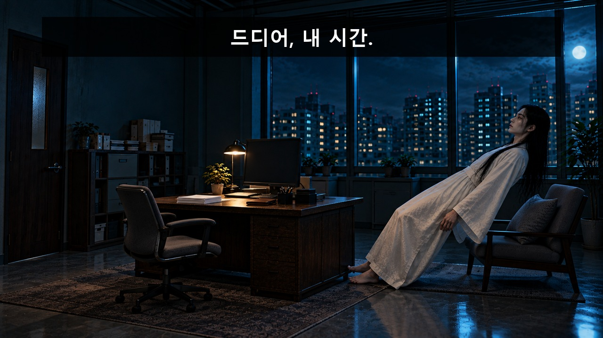
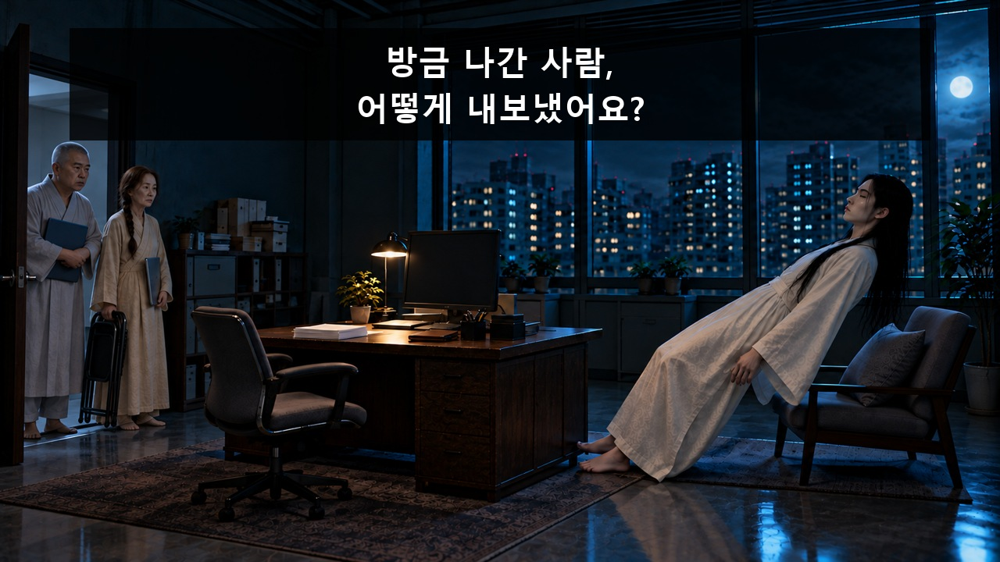
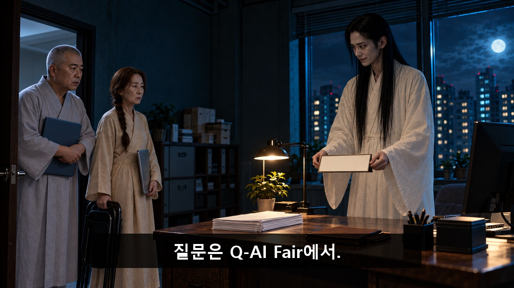
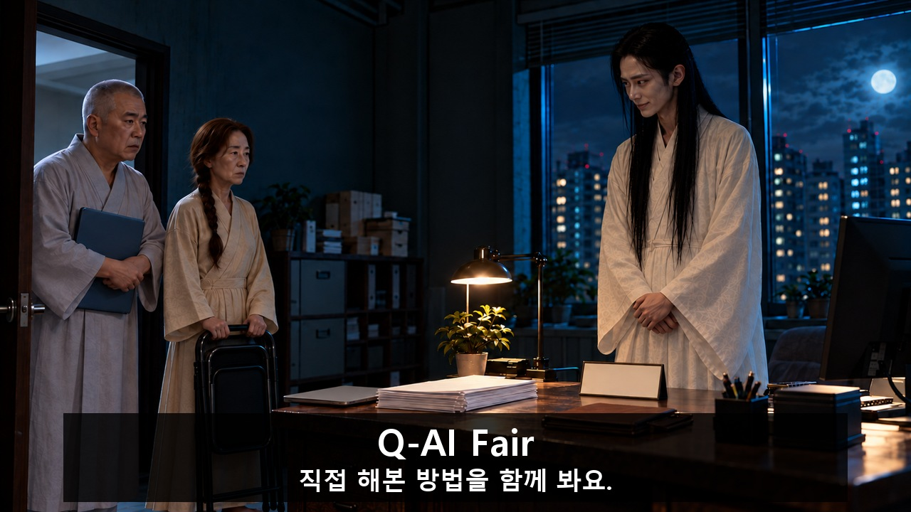

> **V12 제작 상태:** [현재 원본·채택 구간·후처리](00_영상제작_현재상태.md)를 먼저 확인하세요. 아래 V11 콘티보다 실제 채택 구간과 최신 5·6·3번 편집 기록이 우선합니다.

[검수 목록으로](README.md) · [← 이전 안](05_괴수는_퇴근할_수_없다.md) · [다음 안 →](07_훔칠_필요가_없었다.md)

**[최신 편집 영상 보기](00_완성_영상.md)** — v06 48.75초. 아래는 제작 전 V11 콘티입니다.

# 06. 퇴근 좀 해주세요

**사람을 쫓아내려던 유령이 업무 보조로 쓰이다 AI 활용 사례를 배워 직원의 남은 일을 끝내게 했더니, 다른 유령들의 상담 창구가 된다.**

**C06 · V11 · 참석 독려 · 44초 · 9개 시작 이미지**

**전달할 내용:** 실제 적용해 본 과정과 확인 방법을 배우러 간다. 한 번의 참석으로 모든 야근이 없어진다는 주장은 하지 않는다.

**웃음의 전개:** 공포 행위의 용도 오독 → 쫓아내려면 일을 도와야 하는 역할 역전 → 사람을 내보낸 방법 때문에 유령들의 업무가 몰리는 후폭풍.

화면과 후처리 자막으로 전달하는 검수용 콘티입니다. 아래 이미지는 동작의 시작 상태이며, 자막이 있는 컷은 그 첫 이미지 위에 자막 위치를 얹은 정지 예시입니다. 실제 동작 완료 화면이나 생성 영상은 아닙니다.

등장인물·연출 보기

- **GH**: 30대 남성형 허구 유령. 극도로 마른 긴 직선 몸, 좁은 어깨, 긴 검정 직모를 귀 뒤로 넘겨 길고 창백한 얼굴과 두 눈이 보임. 발목까지 흰 수의, 특히 긴 빈 소매. 목은 정상 정렬. 거꾸로 떠도 목이 꺾이거나 상해를 입은 모양은 없다.
- **WO**: 50대 후반 여성 직원. 큰 키와 넓은 어깨, 긴 직사각형 얼굴, 각진 투명 안경. 한쪽을 짧게 민 소금후추색 비대칭 숏컷이며 단발이나 곱슬머리가 아니다. 겨자색 셔츠, 짙은 갈색 하이웨이스트 바지. 조급하지 않고 담담하게 집중한다.
- **G2**: 추가 유령 1. 40대 남성형, 짧고 넓은 몸, 구레나룻 없는 회색 버즈컷, 둥근 턱. 연한 회백색 짧은 수의, 닫힌 짙은 남색 노트북. 노트북은 상담 준비 소품이며 유령 외형을 조롱하지 않는다.
- **G3**: 추가 유령 2. 60대 여성형, 작은 체구, 긴 갈색 머리를 오른쪽 한 가닥으로 땋음, 가늘고 긴 얼굴. 옅은 모래색 수의, 작은 회색 노트북과 검정 접이식 의자. C04의 회색 머리 장수와 복장·체형·머리색이 다름.

**형식:** 정통 공포의 공격이 야근 보조가 되는 생활 코미디

**연출:** 청록 그림자가 깊은 야간 사무실의 정통 공포 조명. 유령은 겁주기에 진심, 직원은 급한 자기 일을 할 뿐이다. 행사 장면은 밝고 담백하며, 돌아온 사무실은 동일한 밤이다.

## 컷별 스토리보드

### C06_K01 · 0–5초 · 5초

**첫 상태:** 책상 위쪽에서 GH가 정상 목을 유지한 거꾸로 공중 자세로 내려오기 직전. 얼굴은 머리카락 사이로 보인다. 한쪽 소매로 덮인 팔뚝을 수평으로 뻗고 손목을 조금 들어 불길하게 WO 쪽으로 내민다. WO는 닫힌 서류철의 고리 손잡이를 들고 있으며 아직 팔에 걸지 않았다.

**이어질 동작:** GH가 천천히 얼굴을 가까이 내밀자 WO가 수평으로 내민 소매 덮인 팔뚝에 서류철의 고리 손잡이를 건다. GH의 눈만 매달린 서류철을 향한다.

**후처리 자막**

- **0.3–2.4초:** 이제 좀 나가라.

**웃음·정보 의도:** 관객에게 공포 장르를 약속한 뒤, 놀라는 대신 물건을 맡기는 직원의 행동으로 첫 기대를 꺾는다.

대사·음악·효과음·구도·전환

| 항목 | 내용 |
|---|---|
| 대사·내레이션 | 없음. 의미는 화면과 후편집 자막으로 전달. |
| 음악·효과음·정적 | 선택 BGM은 낮은 현악 공포 드론. K01 소매에 서류가 걸리는 순간 0.5초 음악 정지, K02 서류가 반듯해진 뒤 다시 저음. K03 담백한 리듬, K05 퇴근 때 짧은 해소, K07 공포 드론을 유령의 난처한 표정에 복귀. 음성·노래 가사 없음. 이 컷: 낮은 바람, 서류 손잡이의 작은 마찰음. 소리를 꺼도 걸린 서류가 보인다. |
| 구도 | 책상과 두 얼굴, 빈 소매 끝을 동시에 보는 고정 미디엄 와이드. 하단 책상 앞면은 자막 여백. |
| 전환 | 직원의 무반응을 0.5초 유지한 뒤 같은 책상의 옆 구도로 컷. |

[자막 없는 시작 PNG 원본](storyboards/2026-10-23_v11-production-lock/images/C06/S01.png)

### C06_K02 · 5–10초 · 5초

**첫 상태:** GH가 이제 정상 방향으로 책상 반대쪽에 서서 두 손을 책상 가장자리에 대기 직전. WO 앞에는 끝이 조금 어긋난 두꺼운 종이 묶음이 놓여 있다.

**이어질 동작:** GH가 책상을 한 번 짧게 흔든다. WO는 종이 묶음 끝을 책상에 대어 반듯하게 맞춘 뒤, 고개만 작게 끄덕인다. GH가 흔들던 손을 멈춘다.

**후처리 자막**

- **7.6–9.8초:** 고마워요.

**웃음·정보 의도:** 두 번째 공격은 첫 소매 개그의 반복이 아니라 더 적극적인 공포 시도가 정리 보조가 되는 확대.

대사·음악·효과음·구도·전환

| 항목 | 내용 |
|---|---|
| 대사·내레이션 | 없음. 의미는 화면과 후편집 자막으로 전달. |
| 음악·효과음·정적 | 선택 BGM은 낮은 현악 공포 드론. K01 소매에 서류가 걸리는 순간 0.5초 음악 정지, K02 서류가 반듯해진 뒤 다시 저음. K03 담백한 리듬, K05 퇴근 때 짧은 해소, K07 공포 드론을 유령의 난처한 표정에 복귀. 음성·노래 가사 없음. 이 컷: 책상 덜컹 1회. 종이 정렬 뒤 0.4초 박자. |
| 구도 | 책상 높이의 고정 미디엄. GH 양손과 종이 모서리, WO 얼굴을 포함. |
| 전환 | GH의 난처한 얼굴에서 밝은 행사 공간의 같은 얼굴로 하드 컷. |

[자막 없는 시작 PNG 원본](storyboards/2026-10-23_v11-production-lock/images/C06/S02.png)

### C06_K03 · 10–14초 · 4초

**첫 상태:** 밝은 소규모 발표 공간. GH가 앞줄 끝 의자에 똑바로 앉아 열린 무지 수첩 위로 연필을 들고 있다. 오른쪽의 큰 깨끗한 화면은 후편집용 두 단 빈 패널. 화면과 GH 얼굴이 함께 보인다. 다른 참석자는 멀리 보이는 뒷모습 두 명만.

**이어질 동작:** GH가 화면과 수첩을 번갈아 보고 한 줄을 적는다. 발표 화면에는 후편집으로 기록 분류→원문 대조의 두 단계가 차례로 강조된다.

**후처리 자막**

- **10.13–13.87초:** Q-AI Fair / AI로 기록을 정리한 과정

**웃음·정보 의도:** 행사에 가서 실제 적용과 확인 방법을 배웠다는 연결을 한 장면에 명확히 만든다. 유령의 학습도 과하게 진지하다.

대사·음악·효과음·구도·전환

| 항목 | 내용 |
|---|---|
| 대사·내레이션 | 없음. 의미는 화면과 후편집 자막으로 전달. |
| 음악·효과음·정적 | 선택 BGM은 낮은 현악 공포 드론. K01 소매에 서류가 걸리는 순간 0.5초 음악 정지, K02 서류가 반듯해진 뒤 다시 저음. K03 담백한 리듬, K05 퇴근 때 짧은 해소, K07 공포 드론을 유령의 난처한 표정에 복귀. 음성·노래 가사 없음. 이 컷: 공포 음악을 걷고 짧은 연필 소리. 발표 음성 없음. |
| 구도 | 앞줄을 대각선으로 보는 미디엄 와이드. GH의 얼굴이 식별되며 중앙 화면 글은 후편집. |
| 전환 | 수첩의 두 단계에서 같은 수첩이 놓인 사무실 책상으로 매치 컷. |

[자막 없는 시작 PNG 원본](storyboards/2026-10-23_v11-production-lock/images/C06/S03.png)

### C06_K04 · 14–19초 · 5초

**첫 상태:** 원래 밤 사무실. GH가 K03의 수첩을 책상에 펼쳐 놓고, 다른 팔에는 휴식 의자의 회색 쿠션을 미리 안고 있다. WO는 모니터의 빈 분류 패널 옆에 원본 종이를 펴고 손끝으로 한 항목을 짚기 직전이다.

**이어질 동작:** WO가 AI 분류 제안의 한 항목과 원본의 같은 표시를 대조한다. GH는 끝난 줄 알고 쿠션을 베개처럼 얼굴 옆에 대며 눕기 준비를 하다, WO가 확인할 두 번째 표시로 손을 옮기자 바로 멈춘다. 마지막 확인 표시는 WO가 직접 한다. 한 묶음 외 다른 업무는 저절로 처리되지 않는다.

**후처리 자막**

- **14.21–18.79초:** 이 한 건만 확인하면 끝.

**웃음·정보 의도:** 행사 참석→무조건 퇴근이라는 생략을 막고, 배운 방법을 해당 작업에 적용·확인한 행동을 둔다.

대사·음악·효과음·구도·전환

| 항목 | 내용 |
|---|---|
| 대사·내레이션 | 없음. 의미는 화면과 후편집 자막으로 전달. |
| 음악·효과음·정적 | 선택 BGM은 낮은 현악 공포 드론. K01 소매에 서류가 걸리는 순간 0.5초 음악 정지, K02 서류가 반듯해진 뒤 다시 저음. K03 담백한 리듬, K05 퇴근 때 짧은 해소, K07 공포 드론을 유령의 난처한 표정에 복귀. 음성·노래 가사 없음. 이 컷: 마우스 한 번, 연필 체크. 안내 음성 없음. |
| 구도 | 직원·모니터·원본 종이를 함께 잡는 어깨 너머 미디엄. 화면 좌우 패널은 크게 단순하게. |
| 전환 | 확인 표시 후 같은 직원의 퇴근 동작으로 컷. |

[자막 없는 시작 PNG 원본](storyboards/2026-10-23_v11-production-lock/images/C06/S04.png)

### C06_K05 · 19–23초 · 4초

**첫 상태:** 원문 대조를 마친 WO가 닫기 직전인 노트북 위에 손을 올리고 있다. 책상에는 확인한 서류가 남아 있고 가방은 이미 어깨에 걸었다. GH는 출입문 옆을 비켜 선다.

**이어질 동작:** WO가 노트북을 닫고 왼쪽 문 밖으로 걸어 나간다. GH는 문이 닫히는 것을 끝까지 지켜본다.

**후처리 자막**

- **19.16–21.72초:** 오늘 남은 일, 끝.

**웃음·정보 의도:** 완료의 범위를 오늘 남은 일로 제한하며 유령의 목표가 처음 달성된다.

대사·음악·효과음·구도·전환

| 항목 | 내용 |
|---|---|
| 대사·내레이션 | 없음. 의미는 화면과 후편집 자막으로 전달. |
| 음악·효과음·정적 | 선택 BGM은 낮은 현악 공포 드론. K01 소매에 서류가 걸리는 순간 0.5초 음악 정지, K02 서류가 반듯해진 뒤 다시 저음. K03 담백한 리듬, K05 퇴근 때 짧은 해소, K07 공포 드론을 유령의 난처한 표정에 복귀. 음성·노래 가사 없음. 이 컷: 노트북 닫힘, 발걸음, 문. 짧은 해소 화음. |
| 구도 | 왼쪽 문과 책상 전체를 보는 고정 와이드. |
| 전환 | 문 닫힘에서 유령의 휴식 준비로 하드 컷. |

[자막 없는 시작 PNG 원본](storyboards/2026-10-23_v11-production-lock/images/C06/S05.png)

### C06_K06 · 23–27초 · 4초

**첫 상태:** 사람이 떠난 사무실. GH가 책상 옆 낮은 휴식 의자 위로 천천히 몸을 눕히려는 반쯤 기대 선 자세다. 작은 회색 쿠션은 이미 의자에 놓였다. 문은 닫힘.

**이어질 동작:** GH가 의자 바로 위에 몸을 길게 띄우며 눈을 감는다. 긴 수의는 정상 중력처럼 아래로 드리워지고 문 쪽 소리에 반응해야 할 필요는 없다.

**후처리 자막**

- **23.32–25.4초:** 드디어, 내 시간.

**웃음·정보 의도:** 첫 목표 달성의 안도감을 실제 휴식 행동으로 주어 다음 방문의 손해가 커지게 한다.

대사·음악·효과음·구도·전환

| 항목 | 내용 |
|---|---|
| 대사·내레이션 | 없음. 의미는 화면과 후편집 자막으로 전달. |
| 음악·효과음·정적 | 선택 BGM은 낮은 현악 공포 드론. K01 소매에 서류가 걸리는 순간 0.5초 음악 정지, K02 서류가 반듯해진 뒤 다시 저음. K03 담백한 리듬, K05 퇴근 때 짧은 해소, K07 공포 드론을 유령의 난처한 표정에 복귀. 음성·노래 가사 없음. 이 컷: 조용한 해소음 뒤 정적 0.7초. 문 열림은 선택 효과음. |
| 구도 | 작은 휴식 의자와 닫힌 문이 같은 화면에 있는 고정 와이드. 유령은 누워도 정상 목. |
| 전환 | 휴식을 0.7초 유지한 뒤 문 쪽 역구도. |

[자막 없는 시작 PNG 원본](storyboards/2026-10-23_v11-production-lock/images/C06/S06_v2.png)

### C06_K07 · 27–32초 · 5초

**첫 상태:** 왼쪽 문이 조금 열려 G2와 G3가 문턱 밖에 서 있다. G2는 닫힌 남색 노트북, G3는 회색 노트북과 접힌 의자를 들었다. GH는 오른쪽에서 반쯤 누운 자세로 눈을 뜨기 직전.

**이어질 동작:** G2와 G3가 문 안으로 한 걸음 들어와 닫힌 노트북을 조심스럽게 내민다. GH는 몸을 일으키려다 멈추고 두 노트북을 번갈아 본다.

**후처리 자막**

- **28.33–31.75초:** 방금 나간 사람, / 어떻게 내보냈어요?

**웃음·정보 의도:** 성공이 더 큰 반복 업무를 부른다. 직원에게 이용당하던 유령이 동료 유령에게도 사례 공유를 요구받는다.

대사·음악·효과음·구도·전환

| 항목 | 내용 |
|---|---|
| 대사·내레이션 | 없음. 의미는 화면과 후편집 자막으로 전달. |
| 음악·효과음·정적 | 선택 BGM은 낮은 현악 공포 드론. K01 소매에 서류가 걸리는 순간 0.5초 음악 정지, K02 서류가 반듯해진 뒤 다시 저음. K03 담백한 리듬, K05 퇴근 때 짧은 해소, K07 공포 드론을 유령의 난처한 표정에 복귀. 음성·노래 가사 없음. 이 컷: 노트북 두드림 대신 발걸음만. 저음 공포 리듬을 GH의 난처함에 복귀. |
| 구도 | 문·두 방문자·메인 유령의 얼굴이 보이는 미디엄 와이드. 하단에는 노트북을 가리지 않는 폭 좁은 여백. |
| 전환 | GH가 책상 앞으로 돌아선 뒤 팻말을 세우는 동작으로 컷. |

[자막 없는 시작 PNG 원본](storyboards/2026-10-23_v11-production-lock/images/C06/S07_v2.png)

### C06_K08 · 32–36초 · 4초

**첫 상태:** GH가 책상 뒤에 서서 작은 무지 탁상 팻말을 손에 들고 있다. G2는 노트북을 안고, G3는 접힌 의자를 든 채 책상 앞에 기다린다.

**이어질 동작:** GH가 팻말을 두 방문자 쪽으로 반듯하게 세우고 두 손을 모은다. 팻말에는 후편집으로 질문을 행사로 돌리는 문구를 넣는다. G3는 의자를 아직 펴지 않는다.

**후처리 자막**

- **32.93–35.87초:** 질문은 Q-AI Fair에서.

**웃음·정보 의도:** 안내문으로 상황을 통제하려는 유령의 마지막 방어. 다음 컷의 상담 자리 확보를 먼저 설명하지 않는다.

대사·음악·효과음·구도·전환

| 항목 | 내용 |
|---|---|
| 대사·내레이션 | 없음. 의미는 화면과 후편집 자막으로 전달. |
| 음악·효과음·정적 | 선택 BGM은 낮은 현악 공포 드론. K01 소매에 서류가 걸리는 순간 0.5초 음악 정지, K02 서류가 반듯해진 뒤 다시 저음. K03 담백한 리듬, K05 퇴근 때 짧은 해소, K07 공포 드론을 유령의 난처한 표정에 복귀. 음성·노래 가사 없음. 이 컷: 팻말 놓는 작은 탁 소리. 방문자는 대사 없음. |
| 구도 | 책상과 GH 얼굴, 팻말 앞면, 양쪽 방문자의 어깨가 보이는 고정 미디엄. |
| 전환 | 팻말을 세운 손에서 의자를 펴는 손의 넓은 구도로 컷. |

[자막 없는 시작 PNG 원본](storyboards/2026-10-23_v11-production-lock/images/C06/S08.png)

### C06_K09 · 36–44초 · 8초

**첫 상태:** 팻말이 책상에 서 있다. G3의 닫힌 회색 노트북은 책상 왼쪽에 내려놓았다. G3가 접힌 의자의 양쪽을 잡고 펴기 직전이고 G2는 옆에서 남색 노트북을 안고 차례를 기다린다. GH는 정중한 미소를 유지하려 한다.

**이어질 동작:** G3가 의자를 펴고 조용히 앉는다. GH의 미소가 굳는다. 마지막에는 G2가 여전히 서서 기다리는 상태를 유지하고 행사명·연결 문구를 후편집한다.

**후처리 자막**

- **39.2–43.8초:** Q-AI Fair / 직접 해본 방법을 함께 봐요.

**웃음·정보 의도:** 방문자가 안내문을 읽고도 자리를 잡는 마지막 침묵 반전. 괴롭힘이나 강요보다 서로의 필요가 부딪히는 생활 코미디.

대사·음악·효과음·구도·전환

| 항목 | 내용 |
|---|---|
| 대사·내레이션 | 없음. 의미는 화면과 후편집 자막으로 전달. |
| 음악·효과음·정적 | 선택 BGM은 낮은 현악 공포 드론. K01 소매에 서류가 걸리는 순간 0.5초 음악 정지, K02 서류가 반듯해진 뒤 다시 저음. K03 담백한 리듬, K05 퇴근 때 짧은 해소, K07 공포 드론을 유령의 난처한 표정에 복귀. 음성·노래 가사 없음. 이 컷: 접이식 의자 철컥 뒤 공포 음악이 아주 작게 한 번 재개. 음성 없음. |
| 구도 | 책상·접이식 의자·세 얼굴을 읽는 고정 와이드. 의자가 펴지고 앉는 몸개그 뒤 하단 제목판. 얼굴·의자 동작을 가리지 않으며 정확한 위치는 caption_cues.box. |
| 전환 | 제목 약 4.6초 유지 뒤 종료. |

[자막 없는 시작 PNG 원본](storyboards/2026-10-23_v11-production-lock/images/C06/S09_v2.png)

---

[검수 목록으로](README.md) · [← 이전 안](05_괴수는_퇴근할_수_없다.md) · [다음 안 →](07_훔칠_필요가_없었다.md)

정확한 행사 날짜·장소·참석 방법은 아직 기입하지 않았습니다. 실제 영상 제작 뒤 움직이는 소품·자막 가림·읽는 시간·편집 호흡을 재확인합니다.
