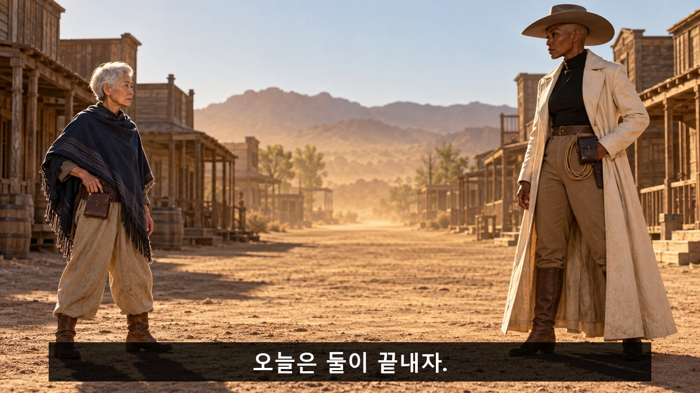
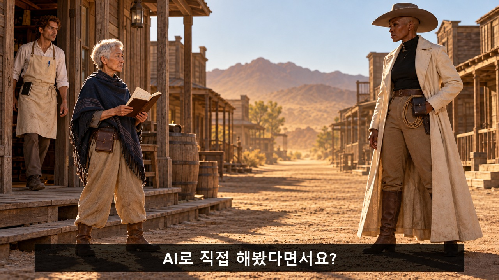
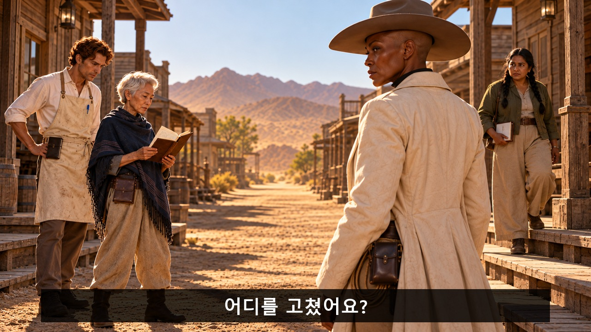
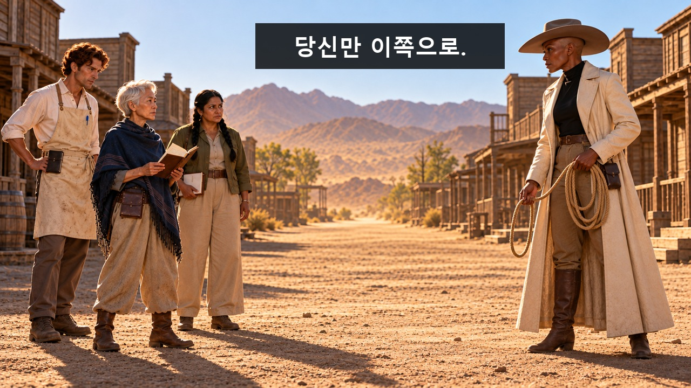
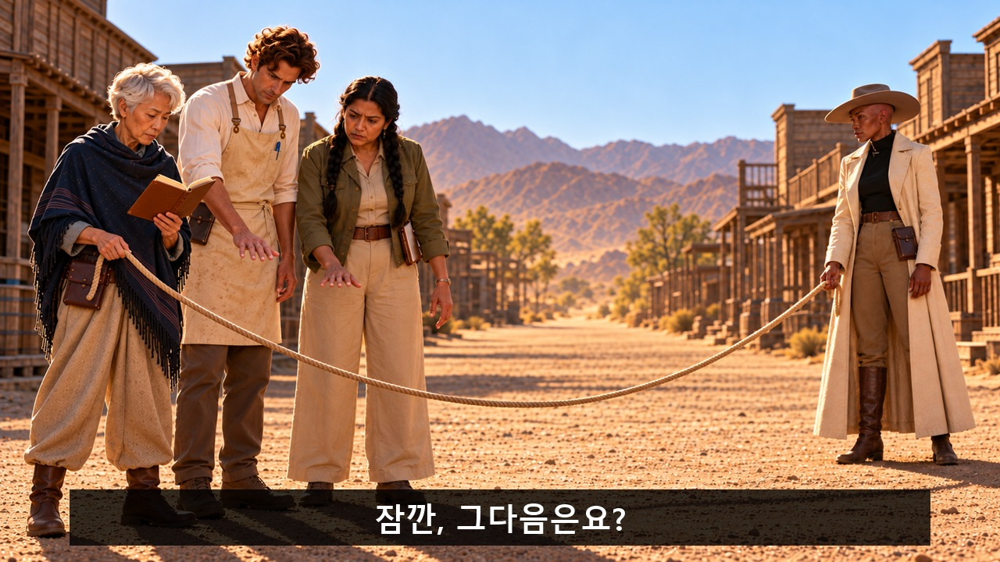
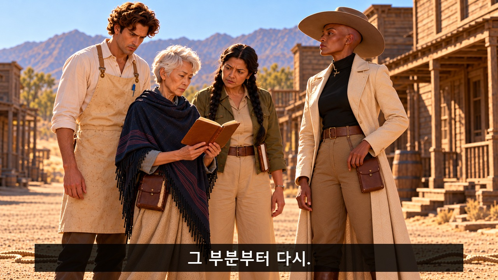

[검수 목록으로](README.md) · [← 이전 안](06_퇴근_좀_해주세요.md) · [다음 안 →](08_이_오페라는_끝났습니다.md)

# 07. 결투 시간을 뺏긴 여자

**상대를 독점하려 줄을 던진 총잡이가 질문자들까지 자기 앞으로 데려오고, 결국 맨 앞에서 필기하면서도 결투의 폼을 버리지 못한다.**

**C07 · V11 · 참석 독려 · 39초 · 9개 시작 이미지**

**전달할 내용:** 직접 해본 사람의 과정과 고친 지점을 묻고 함께 배운다.

**웃음의 전개:** 결투 상대를 독점하려는 위엄 → 질문으로 시선 두 번 차단 → 독점하려고 당긴 줄이 설명회 전체를 자기 앞으로 옮김 → 권총 대신 돌린 연필마저 잃음.

화면과 후처리 자막으로 전달하는 검수용 콘티입니다. 아래 이미지는 동작의 시작 상태이며, 자막이 있는 컷은 그 첫 이미지 위에 자막 위치를 얹은 정지 예시입니다. 실제 동작 완료 화면이나 생성 영상은 아닙니다.

등장인물·연출 보기

- **CW**: 40대 흑인 여성 총잡이. 민머리, 넓은 어깨와 길고 단단한 체형, 긴 각진 얼굴, 뚜렷한 광대. 삼각 형태의 넓은 챙 모자, 발목까지 오는 상아색 코트, 검정 하이넥, 짙은 갈색 부츠. 모자 아래 민머리 윤곽이 보임. 권총 발사·신체 위협은 없고 허리에는 줄과 작은 수첩이 있다.
- **EX**: 60대 동아시아 여성 경험자. 낮은 체구, 작은 사각 얼굴, 아주 짧은 백발 픽시컷, 남색 판초와 모래색 바지, 가죽 작업 수첩. 안경과 수염 없음. 담담하게 설명한다.
- **Q1**: 30대 라틴계 남성 가게 주인. 키 크고 가는 몸, 길고 곧은 코, 짧은 붉은 갈색 곱슬머리, 수염 없음. 누런 캔버스 앞치마, 흰 셔츠, 작은 검정 메모장. 둥근 볼펜을 앞치마 주머니에 꽂음.
- **Q2**: 50대 남아시아 여성 질문자. 중간 키와 단단한 체구, 둥근 얼굴, 짙은 눈썹, 긴 검정 머리를 낮은 두 갈래로 묶음. 올리브색 짧은 재킷, 넓은 베이지 바지, 작은 흰 수첩. CW/EX와 머리·체형·실루엣이 명확히 다름.

**형식:** 정통 서부극의 결투 독점 욕망이 이동 설명회로 바뀌는 군집 코미디

**연출:** 먼지와 길게 뻗은 그림자의 정통 서부극. 시네마스코프 같은 넓은 공간감을 16:9 안에서 사용. 총잡이는 짜증을 절제하며 끝까지 위엄을 지킨다. 경험자는 평온하게 수첩에 집중.

## 컷별 스토리보드

### C07_K01 · 0–5초 · 5초

**첫 상태:** CW가 화면 오른쪽에서 긴 코트 자락을 뒤로 열고 대치. 왼쪽 EX는 닫힌 작은 가죽 수첩이 걸린 허리 파우치에 손을 대기 직전. 둘 사이 먼지 낀 빈 길.

**이어질 동작:** EX가 허리에서 가죽 수첩을 꺼내 펼친다. CW의 손은 허리 옆에서 그대로 멈추고 눈만 수첩으로 내려간다.

**후처리 자막**

- **0.3–2.8초:** 오늘은 둘이 끝내자.

**웃음·정보 의도:** 진짜 결투의 장르 긴장을 먼저 세우고 무기를 예상한 순간 작업 수첩을 공개한다.

대사·음악·효과음·구도·전환

| 항목 | 내용 |
|---|---|
| 대사·내레이션 | 없음. 의미는 화면과 후편집 자막으로 전달. |
| 음악·효과음·정적 | 선택 BGM은 느린 서부극 기타와 낮은 타악. K01 수첩 공개 때 장르 음악을 끊지 않고 진지함을 유지한다. K06 이동 설명회가 완성되면 0.6초 정적. K08 연필이 화면 밖으로 나갈 때만 짧은 공기음, 볼펜 제시 뒤 소박한 박자. 휘파람 가사·대사 없음. 이 컷: 부츠 먼지, 가죽 수첩 펼침. 기대를 깨는 장난스런 효과음은 넣지 않는다. |
| 구도 | 두 사람 전신과 긴 사이 거리를 보는 눈높이 와이드. 하늘 위쪽 여백. |
| 전환 | 수첩을 보는 CW 시선에서 옆 가게 문으로 컷. |

[자막 없는 시작 PNG 원본](storyboards/2026-10-23_v11-production-lock/images/C07/S01.png)

### C07_K02 · 5–10초 · 5초

**첫 상태:** EX가 펼친 수첩을 가슴 높이에 들고 있다. Q1이 왼쪽 가게 문에서 한 발을 내딛기 직전. CW는 오른쪽에서 EX를 바라본다.

**이어질 동작:** Q1이 둘 사이에 들어와 EX의 수첩을 가리킨다. CW가 EX 얼굴을 보려고 몸을 옆으로 반 걸음 옮긴다.

**후처리 자막**

- **5.5–9.08초:** AI로 직접 해봤다면서요?

**웃음·정보 의도:** 새 인물의 관심이 결투보다 강함을 말싸움 없이 물리적으로 보여준다.

대사·음악·효과음·구도·전환

| 항목 | 내용 |
|---|---|
| 대사·내레이션 | 없음. 의미는 화면과 후편집 자막으로 전달. |
| 음악·효과음·정적 | 선택 BGM은 느린 서부극 기타와 낮은 타악. K01 수첩 공개 때 장르 음악을 끊지 않고 진지함을 유지한다. K06 이동 설명회가 완성되면 0.6초 정적. K08 연필이 화면 밖으로 나갈 때만 짧은 공기음, 볼펜 제시 뒤 소박한 박자. 휘파람 가사·대사 없음. 이 컷: 가게 문 삐걱, 발걸음. 질문 음성 없음. |
| 구도 | 기존 축의 미디엄 와이드. Q1이 시야를 실제로 가리는 동선을 크게 보여줌. |
| 전환 | CW가 새 시야를 확보하는 순간 다른 질문자가 들어오는 다음 컷. |

[자막 없는 시작 PNG 원본](storyboards/2026-10-23_v11-production-lock/images/C07/S02.png)

### C07_K03 · 10–14초 · 4초

**첫 상태:** CW가 옆으로 이동해 EX를 겨우 다시 보고 있다. Q2가 반대쪽 보도에서 작은 흰 수첩을 들고 길로 발을 내딛기 직전. EX와 Q1은 열린 가죽 수첩을 보고 있다.

**이어질 동작:** Q2가 CW의 새 시야를 가로질러 EX 앞으로 다가가 기록 한 곳을 가리킨다. CW가 다시 옆으로 몸을 기울이지만 세 사람이 겹쳐 보인다.

**후처리 자막**

- **10.48–13.12초:** 어디를 고쳤어요?

**웃음·정보 의도:** 두 번째 방해는 인물 수 증가와 시야 차단의 반복. 총잡이가 상대를 빼내려는 행동을 하게 만든다.

대사·음악·효과음·구도·전환

| 항목 | 내용 |
|---|---|
| 대사·내레이션 | 없음. 의미는 화면과 후편집 자막으로 전달. |
| 음악·효과음·정적 | 선택 BGM은 느린 서부극 기타와 낮은 타악. K01 수첩 공개 때 장르 음악을 끊지 않고 진지함을 유지한다. K06 이동 설명회가 완성되면 0.6초 정적. K08 연필이 화면 밖으로 나갈 때만 짧은 공기음, 볼펜 제시 뒤 소박한 박자. 휘파람 가사·대사 없음. 이 컷: 사각거리는 메모. CW의 코트 마찰만. |
| 구도 | CW 어깨 뒤에서 EX와 질문자 둘을 보는 고정 미디엄. 세 사람의 집중 방향은 수첩. |
| 전환 | CW의 굳은 얼굴에서 허리의 줄로 시선 연결. |

[자막 없는 시작 PNG 원본](storyboards/2026-10-23_v11-production-lock/images/C07/S03.png)

### C07_K04 · 14–17초 · 3초

**첫 상태:** CW가 오른손에 느슨한 줄 고리를 어깨보다 낮게 들고, 왼손으로 나머지 줄을 잡는다. 왼쪽 EX는 수첩을 두 손으로 받친 채 고개만 CW 쪽으로 돌린다. 두 사람 사이 바닥은 비어 있다.

**이어질 동작:** CW가 줄 고리를 EX 발 앞 빈 바닥에 던진다. 빈 오른손으로 EX 한 사람만 가리킨 뒤 자기 앞 빈자리를 짚는다. EX가 고개를 한 번 끄덕인다. 줄은 누구의 몸에도 걸리지 않는다. 준비 대기 없이 동작을 연결한다.

**후처리 자막**

- **14.2–16.8초:** 당신만 이쪽으로.

**웃음·정보 의도:** 장르의 대표 도구를 위협이 아닌 상대를 자기 쪽으로 데려오려는 초조한 선택에 쓴다.

대사·음악·효과음·구도·전환

| 항목 | 내용 |
|---|---|
| 대사·내레이션 | 없음. 의미는 화면과 후편집 자막으로 전달. |
| 음악·효과음·정적 | 선택 BGM은 느린 서부극 기타와 낮은 타악. K01 수첩 공개 때 장르 음악을 끊지 않고 진지함을 유지한다. K06 이동 설명회가 완성되면 0.6초 정적. K08 연필이 화면 밖으로 나갈 때만 짧은 공기음, 볼펜 제시 뒤 소박한 박자. 휘파람 가사·대사 없음. 이 컷: 짧은 줄 스침과 모래 툭. 음악은 진지한 결투 템포 유지. |
| 구도 | 두 사람과 줄 낙하 지점이 한 화면에 있는 고정 와이드. 줄의 끝까지 보임. |
| 전환 | 고리 낙하 뒤 EX 손에 들린 느슨한 줄로 컷. |

[자막 없는 시작 PNG 원본](storyboards/2026-10-23_v11-production-lock/images/C07/S04.png)

### C07_K05 · 17–20초 · 3초

**첫 상태:** EX가 바닥에서 집은 줄 끝을 한 손으로 느슨하게 잡고, 다른 손으로 열린 수첩을 Q1에게 보여준다. Q1/Q2는 줄 뒤쪽으로 각각 손을 내밀기 직전. CW는 멀리서 줄 반대 끝을 잡고 있다.

**이어질 동작:** EX가 한 손에 든 열린 수첩을 CW 쪽으로 돌린다. Q1은 보던 페이지를 놓치지 않으려고 몸을 따라 돌리며 바로 앞 느슨한 줄을 가볍게 잡는다. Q2도 시선을 수첩에 둔 채 다른 구간을 잡는다. EX는 페이지를 넘기거나 추가 손으로 가리키지 않는다.

**후처리 자막**

- **17.15–19.85초:** 잠깐, 그다음은요?

**웃음·정보 의도:** 다음 컷에서 함께 걷는 이유를 수첩과 지속되는 설명으로 심는다. 줄이 사람을 자동으로 끌어들이는 마법이 아니다.

대사·음악·효과음·구도·전환

| 항목 | 내용 |
|---|---|
| 대사·내레이션 | 없음. 의미는 화면과 후편집 자막으로 전달. |
| 음악·효과음·정적 | 선택 BGM은 느린 서부극 기타와 낮은 타악. K01 수첩 공개 때 장르 음악을 끊지 않고 진지함을 유지한다. K06 이동 설명회가 완성되면 0.6초 정적. K08 연필이 화면 밖으로 나갈 때만 짧은 공기음, 볼펜 제시 뒤 소박한 박자. 휘파람 가사·대사 없음. 이 컷: 작은 종이 넘김. 필요한 설명은 자막 한 줄뿐. |
| 구도 | EX·Q1·Q2와 느슨하게 늘어진 줄을 보는 미디엄 와이드. CW는 오른쪽 후경. |
| 전환 | CW가 줄을 잡아당기려는 방향으로 넓게 컷. |

[자막 없는 시작 PNG 원본](storyboards/2026-10-23_v11-production-lock/images/C07/S05_v2.png)

### C07_K06 · 20–24초 · 4초

**첫 상태:** 오른쪽 CW가 줄 끝을 두 손으로 잡아 자기 쪽으로 안내하듯 당기기 직전. 왼쪽 세 사람은 수첩을 둘러보고 자기 발로 걷기 직전. 줄은 가볍게 늘어져 있다.

**이어질 동작:** CW가 줄을 자기 쪽으로 안내한다. EX가 먼저 자기 발로 걷고 Q1·Q2가 수첩을 보려고 함께 걷는다. CW는 세 사람이 함께 오는 것을 보고 한 걸음 물러나며 느슨한 줄을 거둔다. 도착한 질문자 둘이 다시 시야를 가린다. CW가 틈으로 고개를 내밀다 멈추는 마지막 0.6초를 남긴다. 긴 이동의 중간 대기는 편집에서 덜어낸다.

**후처리 자막:** 없음. 행동과 표정으로 전달.

**웃음·정보 의도:** 상대 한 명을 독점하려던 선택이 작은 설명회 전체를 맨 앞으로 옮기는 물리 반전.

대사·음악·효과음·구도·전환

| 항목 | 내용 |
|---|---|
| 대사·내레이션 | 없음. 의미는 화면과 후편집 자막으로 전달. |
| 음악·효과음·정적 | 선택 BGM은 느린 서부극 기타와 낮은 타악. K01 수첩 공개 때 장르 음악을 끊지 않고 진지함을 유지한다. K06 이동 설명회가 완성되면 0.6초 정적. K08 연필이 화면 밖으로 나갈 때만 짧은 공기음, 볼펜 제시 뒤 소박한 박자. 휘파람 가사·대사 없음. 이 컷: 네 사람의 정상 발걸음. 집결 뒤 0.6초 정적. |
| 구도 | 걷는 발과 네 사람 전신이 보이는 고정 와이드. 과장된 미끄러짐이나 강제 끌림 없음. |
| 전환 | 이동 중간 대기를 덜고 마지막 접근·재차 가림을 연결. 줄이 사람을 끌지 않는다. 0.6초 막힌 표정 뒤 K07 수첩 준비. |

[자막 없는 시작 PNG 원본](storyboards/2026-10-23_v11-production-lock/images/C07/S06.png)

### C07_K07 · 24–28초 · 4초

**첫 상태:** CW가 자기 허리 파우치에서 작은 검정 수첩을 꺼내기 직전. EX가 앞에서 펼친 가죽 수첩을 보여주고 Q1/Q2는 양옆에서 기다린다. 줄은 바닥.

**이어질 동작:** CW가 작은 수첩과 노란 연필을 꺼내 가장 앞에서 적을 준비를 한다. 고개를 숙이지 않고 결투 때처럼 턱을 높인 채 EX에게 한 줄을 요청한다.

**후처리 자막**

- **25.12–27.84초:** 그 부분부터 다시.

**웃음·정보 의도:** 총잡이가 학습자로 선택을 바꾸지만 장르의 권위는 내려놓지 않는 세 번째 성격 비트.

대사·음악·효과음·구도·전환

| 항목 | 내용 |
|---|---|
| 대사·내레이션 | 없음. 의미는 화면과 후편집 자막으로 전달. |
| 음악·효과음·정적 | 선택 BGM은 느린 서부극 기타와 낮은 타악. K01 수첩 공개 때 장르 음악을 끊지 않고 진지함을 유지한다. K06 이동 설명회가 완성되면 0.6초 정적. K08 연필이 화면 밖으로 나갈 때만 짧은 공기음, 볼펜 제시 뒤 소박한 박자. 휘파람 가사·대사 없음. 이 컷: 수첩 탁, 연필 나무 마찰. 대사 없음. |
| 구도 | 네 사람 상반신이 모인 미디엄. CW의 수첩·연필과 무표정 얼굴이 전경. |
| 전환 | CW가 연필을 멋있게 잡는 손의 미디엄으로 컷. |

[자막 없는 시작 PNG 원본](storyboards/2026-10-23_v11-production-lock/images/C07/S07.png)

### C07_K08 · 28–33초 · 5초

**첫 상태:** CW가 왼손에 열린 검정 수첩을 들고 오른손 엄지와 검지 사이에 짧은 노란 연필을 세워 돌리기 직전. Q1의 파란 볼펜은 아직 앞치마 주머니에 있다.

**이어질 동작:** CW가 연필을 한 번 멋있게 돌리려다 화면 옆으로 놓친다. 빈손을 보는 0.5초 뒤 Q1이 평범한 파란 볼펜을 내민다. CW는 모자를 고치거나 웃지 않는다.

**후처리 자막:** 없음. 행동과 표정으로 전달.

**웃음·정보 의도:** 학습자가 되어도 남은 서부극 폼을 평범한 볼펜이 끝낸다. 복잡한 손가락 묘기 대신 빈손과 표정을 읽힌다.

대사·음악·효과음·구도·전환

| 항목 | 내용 |
|---|---|
| 대사·내레이션 | 없음. 의미는 화면과 후편집 자막으로 전달. |
| 음악·효과음·정적 | 선택 BGM은 느린 서부극 기타와 낮은 타악. K01 수첩 공개 때 장르 음악을 끊지 않고 진지함을 유지한다. K06 이동 설명회가 완성되면 0.6초 정적. K08 연필이 화면 밖으로 나갈 때만 짧은 공기음, 볼펜 제시 뒤 소박한 박자. 휘파람 가사·대사 없음. 이 컷: 연필 슉, 빈손 0.5초 정적, 볼펜 딸깍은 선택. |
| 구도 | 손과 CW 얼굴, Q1 상반신을 함께 보는 고정 미디엄. 연필은 한 방향으로만 화면 밖 이동. |
| 전환 | 내민 볼펜에서 받아 적는 다음 컷으로 매치 컷. |

[자막 없는 시작 PNG 원본](storyboards/2026-10-23_v11-production-lock/images/C07/S08.png)

### C07_K09 · 33–39초 · 6초

**첫 상태:** CW가 빌린 파란 볼펜을 손에 쥐고 검정 수첩 첫 줄 위에 대기 직전. EX가 가죽 수첩을 그쪽으로 기울이고, Q1/Q2도 함께 들여다본다.

**이어질 동작:** CW가 턱은 높인 채 볼펜으로 한 줄을 적는다. EX는 다음 항목을 가리키고 둘은 조용히 고개를 맞댄다. 마지막에는 네 사람의 작은 학습 원을 유지한다.

**후처리 자막**

- **34.0–38.8초:** Q-AI Fair / 직접 해본 이야기를 함께 봐요.

**웃음·정보 의도:** 결투를 원했던 사람이 제일 앞자리에서 적는 정반대 행동으로 참석 동기를 마무리한다.

대사·음악·효과음·구도·전환

| 항목 | 내용 |
|---|---|
| 대사·내레이션 | 없음. 의미는 화면과 후편집 자막으로 전달. |
| 음악·효과음·정적 | 선택 BGM은 느린 서부극 기타와 낮은 타악. K01 수첩 공개 때 장르 음악을 끊지 않고 진지함을 유지한다. K06 이동 설명회가 완성되면 0.6초 정적. K08 연필이 화면 밖으로 나갈 때만 짧은 공기음, 볼펜 제시 뒤 소박한 박자. 휘파람 가사·대사 없음. 이 컷: 작은 필기 소리와 담백한 서부 기타 마침. 필수 음성 없음. |
| 구도 | 조금 넓어진 미디엄 와이드. 네 얼굴과 함께 보는 수첩을 유지하고 하단 제목판. 정확한 위치는 caption_cues.box이며 하늘 상단 제목 지시를 쓰지 않는다. |
| 전환 | 행사명 4.8초 유지 뒤 종료. |

[자막 없는 시작 PNG 원본](storyboards/2026-10-23_v11-production-lock/images/C07/S09.png)

---

[검수 목록으로](README.md) · [← 이전 안](06_퇴근_좀_해주세요.md) · [다음 안 →](08_이_오페라는_끝났습니다.md)

정확한 행사 날짜·장소·참석 방법은 아직 기입하지 않았습니다. 실제 영상 제작 뒤 움직이는 소품·자막 가림·읽는 시간·편집 호흡을 재확인합니다.
