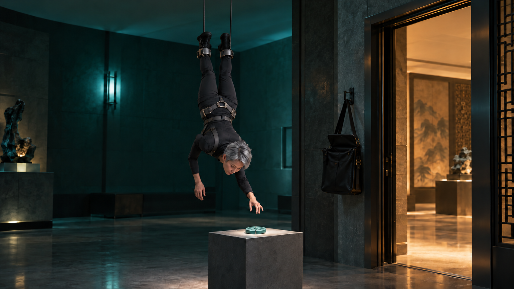
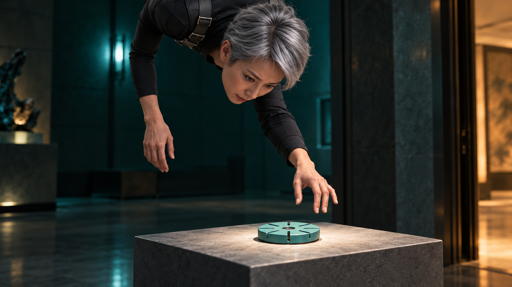
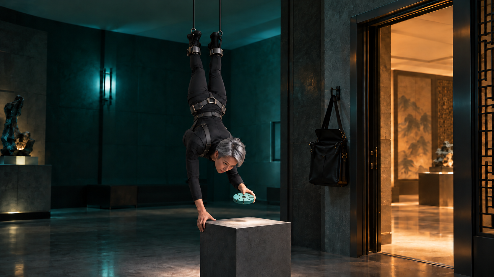
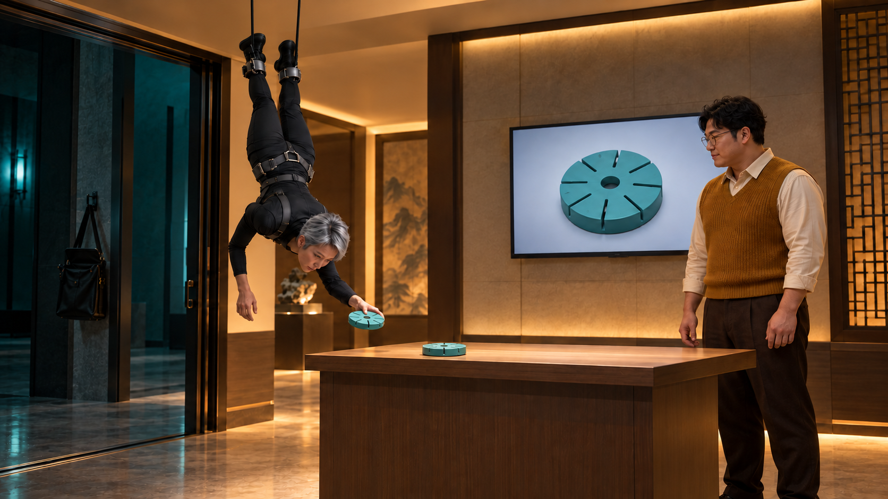
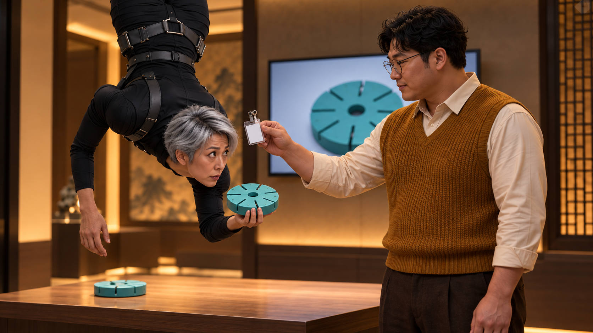
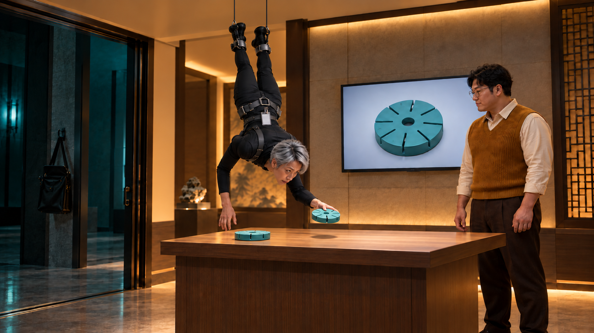
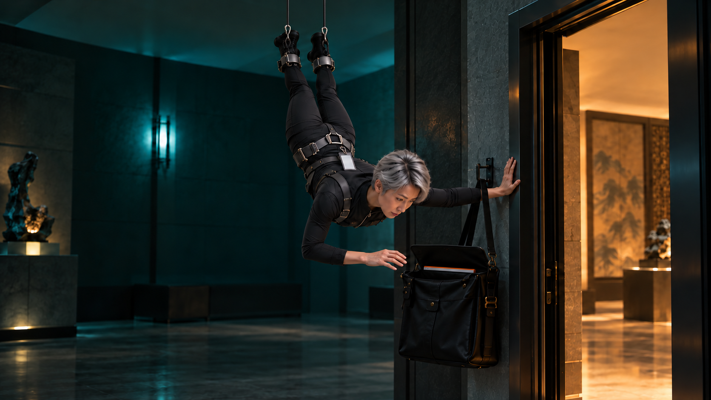
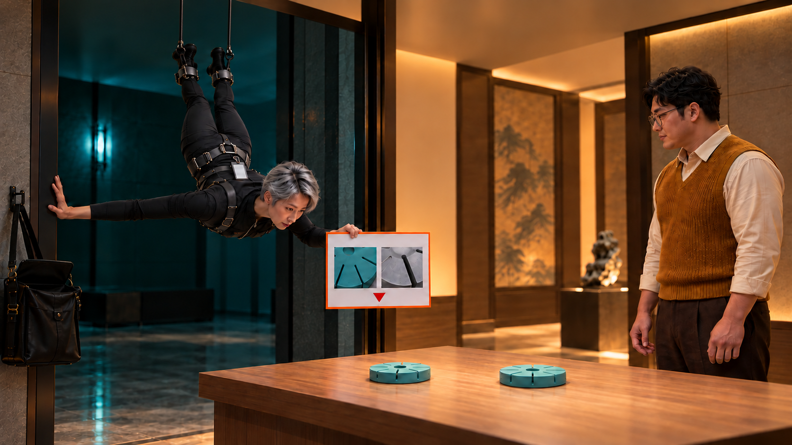
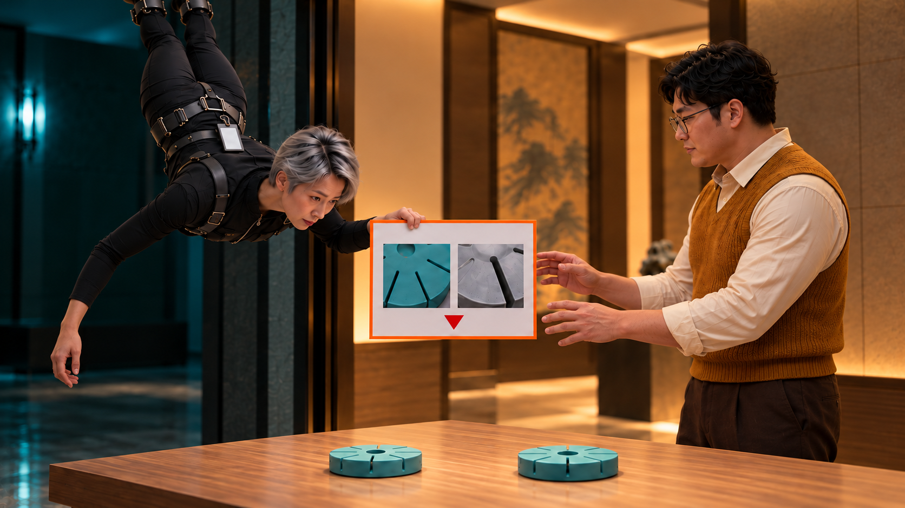
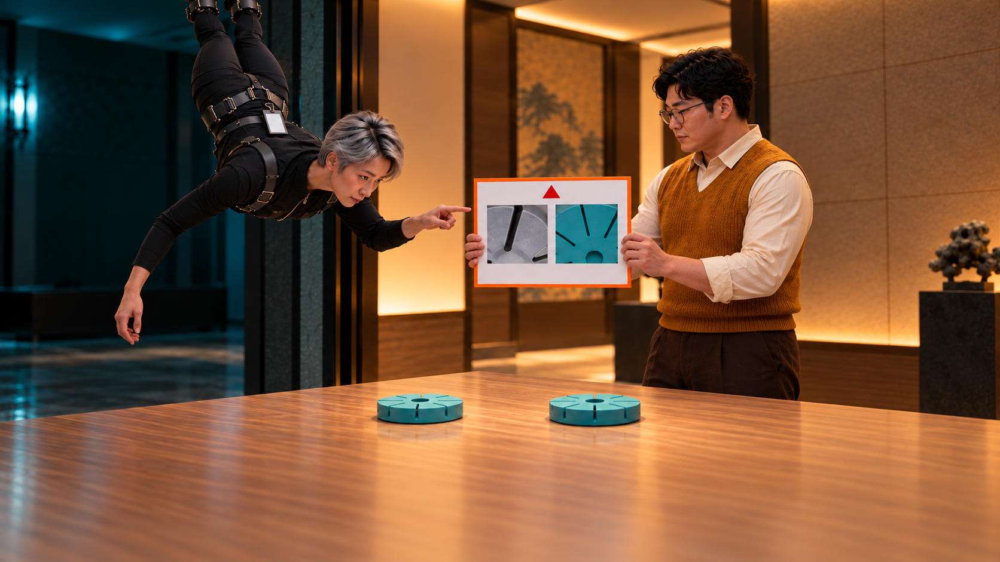

[전체 검수 목록](README.md)
# 07. 훔칠 필요가 없었다

**공개 시연 샘플을 훔치듯 집은 도둑이 열린 문을 지나 교류회에 도착하고, 샘플을 돌려준 뒤 자기 사례까지 거꾸로 공유한다.**

39초 · 10씬 / 시작 이미지10장 · 무대사 · 자막 후처리 · Flow 미생성

**핵심 메시지:** AI를 활용하며 얻은 경험은 꺼내 놓을수록 서로에게 도움이 된다.

**반전:** 10초 같은 열린 문을 지나자 동일 샘플의 공개 시연. 첫 설명은 이때 한 번만. → 22초 퇴장하는 줄 알았던 TH가 자기 판을 꺼내3초 만에 귀환. → 28초 진지한 공유 직전 판만180도 돌아간다. TH의 몸은 계속 거꾸로.

첫 이미지는 동작 전 상태입니다. 영상 동작·후합성·최종 편집 검증까지 끝난 것은 아닙니다.

## 인물과 연출

- **TH**: 50대 한국인 여성, 날렵한 체형, 은색 짧은 픽시 커트, 각진 얼굴, 맨얼굴. 먹색 긴팔 점프슈트, 검정 부츠, 무광 회색 허리·발목 와이어 장비, 손은 맨손. 초반 숨을 참는 과도한 집중 → 들킨 당황 → 자기 사례를 보여주려는 자부심. 전 구간 거꾸로 유지.

- **HO**: 30대 한국인 남성, 넓은 체격, 짧은 검정 곱슬머리, 둥근 안경. 겨자색 니트 조끼, 아이보리 셔츠, 짙은 갈색 바지. 손님을 평범하게 맞이하는 침착함. 몸이 거꾸로여도 공유 내용에 먼저 관심.

## C07_K01 · 0–3초

**첫 상태:** A 전실. TH가 거꾸로 매달려 오른손을 샘플 위 15cm에 멈춘다. 샘플은 받침대에 온전히 놓여 있다. 오른쪽 열린 문과 상단 화면 밖으로 이어지는 두 수직 케이블, 문 옆 검정 가방이 함께 보인다.

**동작:** 와이어가 TH를 정확히 10cm 천천히 내린다. 빈 오른손은 샘플 위 15cm→5cm에서 멈추며 끝까지 접촉하지 않는다. 3초 안에 동작을 완료하고 손 근접으로 넘긴다.

**후처리 자막:** 없음

| 항목 | 내용 |
|---|---|
| 대사·내레이션 | 없음 |
| 음악·효과음·정적 | 낮은 현악 펄스와 얇은 와이어 마찰음 선택. 음성 없음. |
| 구도 | 50mm 측면 미디엄. 열린 문을 배경 오른쪽에 남겨 두고 10cm 정도만 전진. |
| 전환 | 닿기 직전 오른손으로 컷. |
| 웃음·정보 의도 | 비밀작전처럼 과잉 집중하는 인물과 이미 열린 통로의 불균형. 첫 이미지에서 샘플을 쥐면 안 된다. |

## C07_K02 · 3–6초

**첫 상태:** TH의 빈 오른손이 A 청록 샘플 위5cm. 왼손은 받침대 옆면에 아직 닿지 않았다.

**동작:** 오른손을 남은5cm 내려 샘플 양옆을 잡아10cm 들어 올린다. 왼손은 받침대 옆면에 얹는다. 접근3초+집기3초, 첫6초 안에 완료한다.

**후처리 자막:** 없음

| 항목 | 내용 |
|---|---|
| 대사·내레이션 | 없음 |
| 음악·효과음·정적 | 들어 올리는 순간 가느다란 금속음. 음악 긴장은 계속. |
| 구도 | 85mm 손·뒤집힌 얼굴 근접. 샘플 8슬롯과 빈 받침대가 동시에 보이는 각도. |
| 전환 | 왼손이 받침대에 닿은 상태로 연결. |
| 웃음·정보 의도 | 거대한 작전의 목표가 손바닥 크기라는 대비. 절도 성공의 보상이 아니라 다음 오해의 준비. |

## C07_K03 · 6–10초

**첫 상태:** TH는 청록 샘플을 오른손에 쥐고 왼손으로 고정 받침대의 왼쪽 위 모서리를 잡았다. 몸은 받침대의 왼쪽 위, 열린 문 앞 A 쪽이며 문을 아직 넘지 않았다.

**동작:** TH가 왼손으로 고정 받침대 모서리를 자기 몸 쪽으로 당겨 몸을 열린 문 방향으로 이동시킨 뒤 손을 놓는다. 받침대는 움직이지 않고 인물과 두 수직 케이블이 함께 오른쪽으로 이동한다. TH만 계획 밖 이동에 놀란다. 밀기 동작으로 바꾸지 않는다.

**후처리 자막:** 없음

| 항목 | 내용 |
|---|---|
| 대사·내레이션 | 없음 |
| 음악·효과음·정적 | 선택 바퀴 굴러감, 음악에 급한 타악 한 번. 필수 효과 없음. |
| 구도 | 35mm 측면 추적. 당김→손 놓기→같은 열린 문 통과를4초에 연결. 이동은1m 이내. 상부 리그와 문틀 충돌은 화면에 만들지 않는다. |
| 전환 | 문틀이 몸 일부를 가릴 때 B 쪽 카메라로 매치. |
| 웃음·정보 의도 | 도망치려던 사람의 진지한 선택이 공개 시연실 입장으로 뒤집힌다. 고정 받침대를 당기는 방향과 몸의 이동을 일치시킨다. |

## C07_K04 · 10–16초

**첫 상태:** B 시연실에서 본 열린 문. TH가 문턱 바로 안쪽에 반쯤 들어왔고, HO는 B 테이블 옆에서 화면을 가리키기 직전. 테이블 왼쪽에 TH 손과 동일한 청록 8슬롯 샘플이 놓여 있다.

**동작:** TH가 천천히 들어와 멈춘다. HO가 화면의 샘플 사진 후보 위치를 짚고 실제 테이블 샘플을 나란히 가리킨다. TH는 손의 샘플과 공개된 샘플을 번갈아 본다.

**후처리 자막:** 11.5–15.8초: AI가 표시한 후보 / 원물로 함께 확인

| 항목 | 내용 |
|---|---|
| 대사·내레이션 | 없음 |
| 음악·효과음·정적 | 도착 시 액션 음악을 가벼운 리듬으로 전환. 두 샘플 비교 순간 마지막0.5초만 음악·효과를 비운다. 음성 없음. |
| 구도 | 28mm B 와이드. 오른손 샘플과 테이블 샘플을 같은 화면에 충분히 크게 둔다. 화면 도해는 후합성. |
| 전환 | HO가 TH 쪽으로 고개를 돌리며 컷. |
| 웃음·정보 의도 | 첫 반전. 얻으려던 정보가 같은 자리에서 이미 공개되고 있음을 물건 일치와 사람의 설명 행동으로 전달. |

## C07_K05 · 16–19초

**첫 상태:** HO의 오른손에 투명 클립 명찰이 들려 있고 TH 허리 하네스 앞 10cm에 있다. TH는 오른손의 샘플을 배 뒤로 숨기지 않고 눈앞에 들고 있다.

**동작:** HO가 명찰 클립을 TH 허리 하네스에 한 번 달고, 바로 빈 테이블 오른쪽 자리를 손바닥으로 안내한다. TH 눈이 커지는 반응까지3초.

**후처리 자막:** 없음

| 항목 | 내용 |
|---|---|
| 대사·내레이션 | 없음 |
| 음악·효과음·정적 | 클립 딸깍 선택. 가벼운 리듬이 멈추지 않고 이어짐. |
| 구도 | 50mm 역상 얼굴과 HO 얼굴이 함께 잡히는 투샷. 명찰 문자 생성 없이 후편집도 이름 불필요. |
| 전환 | 안내받은 테이블 오른쪽 빈자리로 시선 연결. |
| 웃음·정보 의도 | 행사에 연결되는 인간적인 환영 비트. 이 컷 자체가 공유 메시지의 결말은 아니다. |

## C07_K06 · 19–22초

**첫 상태:** TH의 오른손 샘플이 B 테이블 오른쪽 빈자리 위 10cm에 있다. 왼손은 테이블 가장자리에 아직 닿지 않았다. HO는 손을 거둔 상태.

**동작:** 첫1초에 오른손 샘플을 B 테이블 오른쪽에 내려놓는다. 왼손으로 가장자리를 가볍게 밀어 열린 문 쪽 A로 즉시 이동한다. 불필요한 빈손 확인 포즈 없이3초.

**후처리 자막:** 없음

| 항목 | 내용 |
|---|---|
| 대사·내레이션 | 없음 |
| 음악·효과음·정적 | 선택 샘플 탁1회 후 짧은 바퀴 굴림. 음악은 끊지 않고 왕복을 이어준다. |
| 구도 | 35mm 측면. 반환 접촉1초를 보인 뒤 같은 축으로 왼쪽 이동2초. B 테이블-문 거리는70cm 정도. |
| 전환 | TH가 문틀 뒤로 이동하는 방향을 유지해 A로 컷. |
| 웃음·정보 의도 | 들켜서 빈손으로 달아나는 것처럼 보이는 오해. 반환이라는 윤리·물리적 원인을 화면에서 완료한다. |

## C07_K07 · 22–25초

**첫 상태:** A 문 옆에 돌아온 TH가 오른손으로 문틀을 짚고 멈췄다. 왼손은 처음부터 걸려 있던 검정 가방 입구 위. 주황 테두리 사례판의 윗부분만 가방에서 보인다.

**동작:** TH가 오른손으로 문틀을 짚어 멈춘 상태에서 왼손으로 가방의 단판을 바로 꺼낸다. 판을 B 쪽으로 돌려 들기까지3초. 비장한 표정 대기 삭제.

**후처리 자막:** 23–24.9초: 제 것도 있습니다.

| 항목 | 내용 |
|---|---|
| 대사·내레이션 | 없음 |
| 음악·효과음·정적 | 가방 스침 소리, 비장한 현악 한 마디 선택. |
| 구도 | 50mm A 쪽 미디엄. 가방과 판의 실제 추출을 잘라내지 않는다. |
| 전환 | TH가 판을 B 쪽으로 돌려 든 시선 방향으로 컷. |
| 웃음·정보 의도 | 두 번째 반전의 원인. 도망이 아니라 자기 자료를 가져오려던 행동임을 보인다. |

## C07_K08 · 25–28초

**첫 상태:** TH가 열린 문 A 쪽에서 왼손에 주황 사례판을 완전히 꺼내 들었다. 판 앞면의 빨간 삼각형 표식이 관객 기준 아래에 있다. 오른손은 문틀에 붙어 있고 아직 밀지 않았다.

**동작:** TH가 오른손으로 문틀을 한 번 밀어 B로70cm 되돌아오며 왼손의 자기 판을 HO에게 내민다.3초. 반환→회수→재입장 합9초.

**후처리 자막:** 없음

| 항목 | 내용 |
|---|---|
| 대사·내레이션 | 없음 |
| 음악·효과음·정적 | 와이어 굴러감과 진지한 광고 음악 재개. 음성 없음. |
| 구도 | 35mm 고정. 왼쪽→오른쪽70cm 이동, 판은 같은 손. 펼치기·추가 멈춤 없음. |
| 전환 | HO가 판 가장자리에 두 손을 대기 직전 근접 컷. |
| 웃음·정보 의도 | 스파이의 재침입이 자발적 발표가 된다. 노트북 개방 대신 몸 전체의 귀환이 웃음의 행동. |

## C07_K09 · 28–34초

**첫 상태:** HO가 거꾸로 된 사례판 좌우 가장자리에 손을 대기 직전. TH는 왼손으로 판 아래쪽을 받친다. 빨간 삼각형은 관객 기준 아래, TH의 오른손은 비어 있다.

**동작:** TH가 사례판에서 손을 놓으면 HO가 반대쪽 가장자리로 손을 다시 잡은 뒤 판만180도 돌려 빨간 삼각형을 위로 보낸다. TH는 방금 판을 놓은 같은 손으로 돌아간 판의 지점을 찾아 검지를 옮긴다. TH 몸은 계속 거꾸로, HO는 진지하게 판을 받친다.

**후처리 자막:** 없음

| 항목 | 내용 |
|---|---|
| 대사·내레이션 | 없음 |
| 음악·효과음·정적 | 선택 판 스침. 회전 직후0.5초 음악·효과 정적, 이후 가벼운 리듬. AI 설명 음성 없음. |
| 구도 | 50mm 판 중심 미디엄. 전달과 반대쪽 재그립2초, 회전2초, 같은 손의 방향 수정과 역상 몸/바른 판 대비2초. |
| 전환 | 거꾸로 인물/똑바른 판 구도를 유지한 채 조금 넓혀 마지막 컷. |
| 웃음·정보 의도 | 세 번째 시각 펀치라인. 수정되는 것은 사람의 자세가 아니라 자료의 방향. AI 사례의 내용도 공유됨을 보여준다. |

## C07_K10 · 34–39초

**첫 상태:** HO는 바로 세운 판을 들고, 거꾸로 TH는 방금 판을 놓은 손의 검지가 판 옆에 머문다. 두 샘플·허리 명찰·열린 문은 그대로다.

**동작:** TH가 한 지점만 작게 짚고 HO가 끄덕인다.34초부터 행사 정보를5초 고정한다. 새 사건을 추가하지 않는다.

**후처리 자막:** 34–39초: Q-AI Fair / 품질팀 AI 성과·활용 경험 교류

| 항목 | 내용 |
|---|---|
| 대사·내레이션 | 없음 |
| 음악·효과음·정적 | 선택 음악을 부드럽게 끝냄. 로고 보이스·내레이션 없음. |
| 구도 | 40mm 안정된 투샷. 인물·판·샘플을 상단 72%에 모으고 하단 제목판 여백. |
| 전환 | 39초 종료 또는 다음 화면으로 단순 컷. |
| 웃음·정보 의도 | 비밀 입수로 시작해 공개 경험 교류로 끝난다. 후반 5초는 읽는 시간. |

## 제작 메모

- **difficulty_reason:** 동일 인물의 역상 신체·와이어·문 통과, 샘플 동일성, 판의 180도 회전 연속성이 어렵다.
- **alternative:** 천장 장비 전체 변형 대신 고정된 장비·좁은 이동·옆 추적으로 설계. 문 통과가 불안정하면 문틀이 몸을 가리는 지점에서 연결 편집하되 S03 출발과 S04 도착 방향을 보존. 판 회전은 손·판 근접 한 동작으로 분리할 수 있다.
- **avoid:** 보안 장치 파괴, 잠긴 문, 기밀 문서, 실제 조직 로고, 도난품으로 얻은 성과 주장 없음.
- **timing:** 0~6초 접근·집기,19~28초 반환·자료 회수·재입장9초,34~39초 엔딩. 각 원인 행동은 남기고 반응 대기만 제거.

[전체 명세·프롬프트](storyboards/2026-10-24_v12-rework/storyboards.json) · [실제 이미지 매핑](storyboards/2026-10-24_v12-rework/scene_manifest.json)
