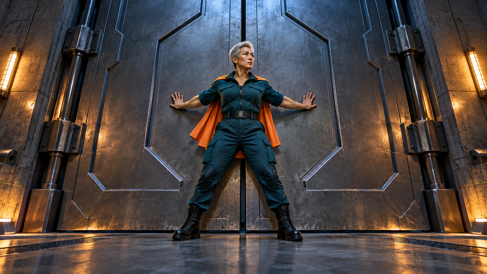
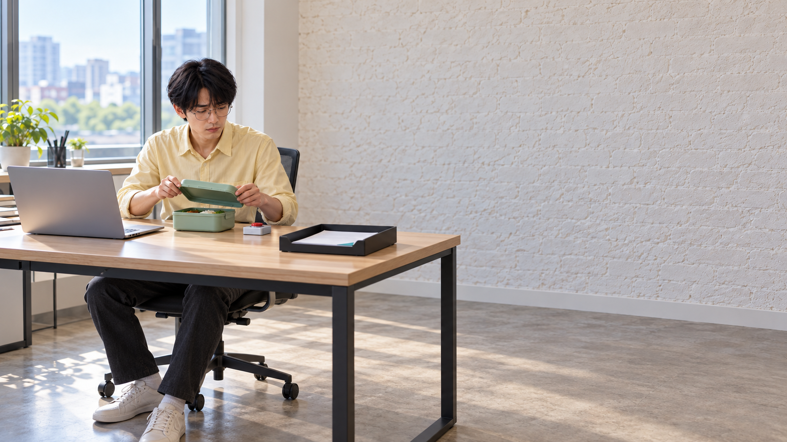
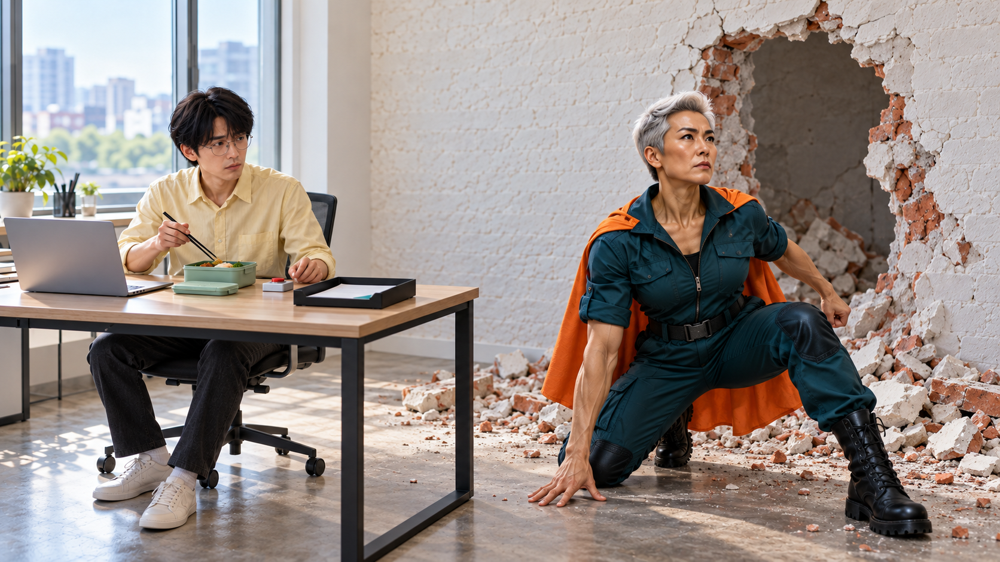
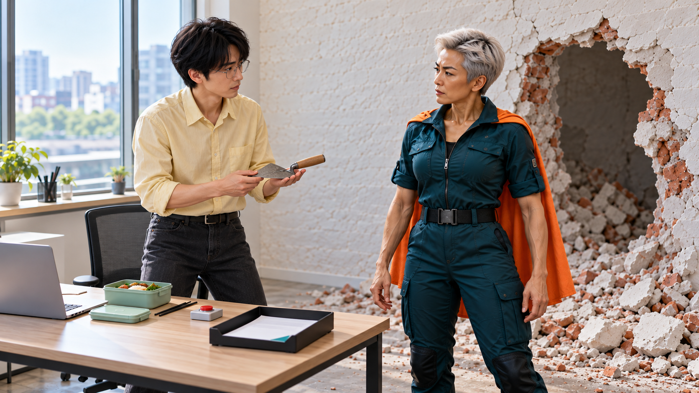
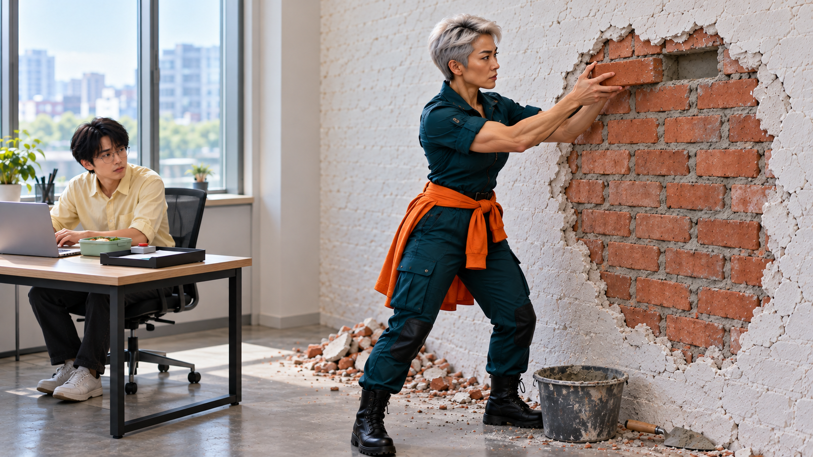
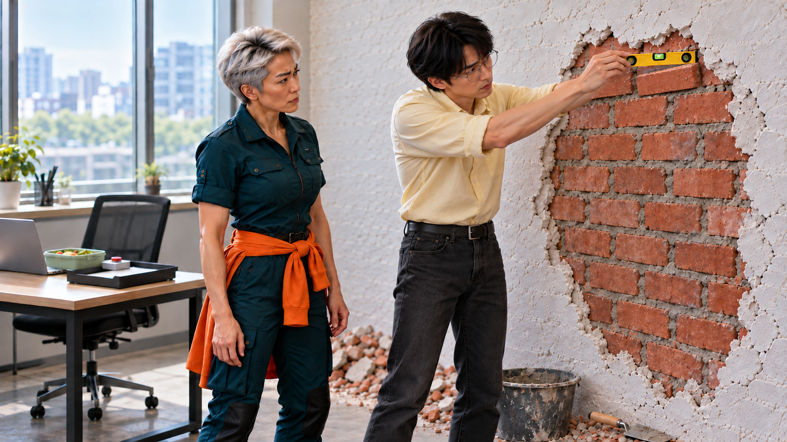
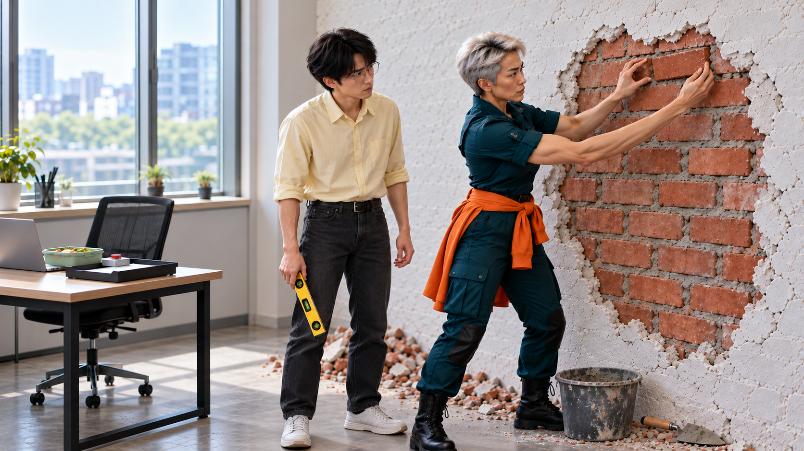

<!-- V15 LATEST -->
**2026-10-26 V15 영상 완성:** [최신 MP4](storyboards/2026-10-26_C08-C09-edit-v15/C08/C08_Q-AI_Fair_screening_v15.mp4) · **53초** · [실제 편집 구간](storyboards/2026-10-26_C08-C09-edit-v15/C08/edit_manifest.json). 아래는 생성 전 콘티이며 최신 사용 길이·테이크는 편집 기록이 우선합니다. [검수 범위와 한계](00_V15_제작_검수.md)
<!-- /V15 LATEST -->

**[V16 최신 편집본 — 하단 중앙 자막·새 음악](storyboards/2026-10-26_qrew-restyle-v16/C08/C08_Q-AI_Fair_qrew_v16.mp4)**

# C08 · 구조는 끝났습니다

거대한 출동을 준비한 해결사가 벽을 뚫고 도착하지만 직원은 공유받은 AI 활용 방법으로 일을 끝냈고, 해결사 자신이 만든 벽 결함을 다시 고치게 된다.

**40.5초 · 10씬 · 화면+자막 · 필수 음성 대사 없음 · Flow 미생성**

[새 4안 비교](00_새7-10_콘티.md) · [전체 이미지](콘티_바로보기.md)

**전달할 내용:** 누군가 직접 해본 방법의 공유가 다음 사람의 일을 실질적으로 돕는다.

**반전:** 외부의 구원자가 필요 없어졌고, 구원자의 과잉 등장이 유일하게 남은 문제를 만든다.

**후폭풍:** 거대한 출동의 주인공이 마지막에는 벽돌 한 장을 다시 맞추는 사람이 된다. 공유방법은 직원이 쉬게 했고, H는 자기 행동을 직접 끝낸다.

## 등장인물

- **H**: 50대 근육질 중년 여성, 아주 짧은 은발, 사각턱, 진한 눈썹, 낮은 중심의 당당한 자세. 짙은 청록 전술 점프수트, 주황 짧은 망토, 검정 작업화. 유명 영웅·군부대 로고 없음. 표정은 끝까지 대작 액션.
- **E**: 20대 후반 마른 남성, 둥근 안경, 길고 매끈한 검정 앞머리, 좁은 어깨. 연노랑 셔츠, 짙은 회색 바지. 따뜻하지만 현실적인 태도. 해결사를 비웃거나 꾸짖지 않음.

## 컷별 콘티

| 씬·컷 | 구간·길이 | 화면·행동·구도 | 후처리 자막 | 대사·내레이션 | BGM·효과음 | 전환 | 웃음·정보 의도 |
|---|---|---|---|---|---|---|---|
| S01 / C08_K01 | 0–2s (2s) | E가 도움 요청 버튼을 한 번 누른다. 검토서·직원 표정·도움 버튼을 함께 잡는 미디엄. | 0.2–1.95s 누가 좀 도와줘요. | 없음 | 선택: 조용한 사무실→버튼과 동시에 압도적 액션 리듬 진입. | 동일 공간 축을 유지한 하드 컷 | 업무 과잉이 아니라 한 건의 막힘을 도움 요청으로 시작해 과도한 출동과 대비. |
| S02 / C08_K02 | 2–6s (4s) | H가 무거운 출동실 문을 양옆으로 밀어 연다. 낮은 대칭 와이드. 금속문 높이는 H의2배; 군중/차량추가없음. |  | 없음 | 장대한 저음 금관/문 유압음. 실제로 없어도 화면 스케일로 전달. | 사무실로 즉시 교차 | 실제보다 엄청나게 큰 해결의 기대를 만든다. H는 스스로를 진지한 구원자로 여김. |
| S03 / C08_K03 | 6–9s (3s) | E가 자기 원문 P 파일을 이미 열린 공유 정리 양식의 입력 칸으로 한 번 옮겨 적용한다. 손과 화면·P 원문을 함께 보는 어깨너머 미디엄. 원문 카드 이동과 결과의 같은 표시를 크게. 알림 열기 단계를 추가하지 않음. | 6.2–9s 어제 공유된 그 방법. | 없음 | 출동음악은 계속, 마우스 클릭만 담담함. | 공유자료에서 실제확인 손의 근접으로 컷 | 공유 자료를 읽었다는 말만 하지 않고 자기 일에 재사용한 행동을 보여준다. AI는 후보 탐지 반복 대신 문서 정리 양식 재사용 역할. |
| S04 / C08_K04 | 9–11.5s (2.5s) | E가 원문과 정리 결과의 같은 표시를 직접 대조해 확인 체크 한 번을 적고 문서를 바로 옆 완료 트레이로 민다. 책상 위 손·원문·후보를 함께, 글자 읽기보다 같은 항목과 체크를 크게. | 9.15–11.5s 직접 확인까지, 끝. | 없음 | 음악 계속 고조. 펜소리·트레이 마찰은 작게. | 바로오른쪽벽을보이는와이드 | AI 만능 자동완료가 아니라 사람이 확인해 일을 끝냈음을 한 행동으로 표시. |
| S05 / C08_K05 | 11.5–17.5s (6s) | 오른쪽 벽 중앙이 벌어지며 H가 한 걸음 뚫고 들어와 장대한 착지 자세로 멈춘다. 사무실 고정 와이드. 사람·책상과 충돌하지 않는 오른쪽 파손영역 전체를 보임. |  | 없음 | 액션최고조+세트파손. H착지직후음악끊음0.7초. 비명/고통소리없음. | 동일 공간 축을 유지한 하드 컷 | 진짜 도착을 보여준 뒤 다음 컷에서 이미끝난업무와 충돌. 파손은 후속수리 원인. |
| S06 / C08_K06 | 17.5–20.5s (3s) | E가 H에게 완료 트레이를 가볍게 가리킨다. H측면/E정면 투샷. 파손구멍은오른쪽후경으로유지. | 17.75–20.4s 끝났는데요. | 없음 | 젓가락 작은 클릭,0.5초정적뒤H망토펄럭임만. | 동일 공간 축을 유지한 하드 컷 | 영화적 도착의 쓸모가 사라지는 즉각적 반전. E는 비웃지 않음. |
| S07 / C08_K07 | 20.5–24.5s (4s) | E가 흙손을 건네고 H가 받아 오른쪽 파손벽을 돌아본다. 흙손·두표정·벽구멍을한화면에. 교환방향왼쪽E→오른쪽H. | 21–24.3s 여기는 아직이네요. | 없음 | 작은 흙손금속음. 액션음악을아주작은타악리듬으로축소. | 동일 공간 축을 유지한 하드 컷 | 문제해결자가 문제의 소유자가 되는 두번째 전환. |
| S08 / C08_K08 | 24.5–29.5s (5s) | H가 마지막 벽돌을 양손으로 놓지만 오른쪽 끝을 조금 높게 얹는다. 오른쪽수리벽미디엄. 바닥에동일흙손·모르타르통; 직원도시락은좌측후경. | 24.7–26.2s 잠시 후 | 없음 | 아주비장한한박금관+벽돌툭. 음악은다시엄숙해짐. | 직원의수평계근접으로하드컷 | 큰 동작에 대한 과잉 확신을 아주 작은 결함으로 되돌린다. 수리전체가순간완료된척하지않음. |
| S09 / C08_K09 | 29.5–34.5s (5s) | E가 수평계를 같은 벽돌 윗면에 놓아 오른쪽으로 치우친 기포를 보고 그 한 장만 가리킨다. 수평계·벽돌·H얼굴이읽히는고정미디엄. 수평계수치가아니라기포위치로전달. | 30.7–34.3s 이 한 장만, 다시요. | 없음 | 음악한박늦게멈춤. 수평계플라스틱툭. 소리꺼도기울기와지적이읽힘. | 동일 공간 축을 유지한 하드 컷 | AI도구의만능설명이아닌확인의태도, 큰해결사는마지막한장앞에서멈춤. |
| S10 / C08_K10 | 34.5–40.5s (6s) | H가 양손으로 그 한 장을 살짝 들어 오른쪽 끝을 낮춰 수평으로 다시 놓고 두 손을 뗀다. K08와같은오른쪽벽구도. 왼쪽넓은완성벽에제목공간. 얼굴과정밀손동작을가리지않음. | 35.1–40.5s 한 사람의 방법이, 여러 사람의 실력이 되는 곳. Q-AI Fair | 없음 | 장대한음악을작은실내악한음으로마침. 새음성없음. | 동일 공간 축을 유지한 하드 컷 | 거대한구조에서한장의수리로크기와지위가뒤집힌마지막행동. 직원은공유방법덕분에여유를찾음. |

## 씬별 실제 첫 프레임

이미지는 동작 직전 상태입니다. 행사명·문서·폰 UI·자막은 영상 생성 뒤 별도 합성합니다.

### C08_K01 · 0–2초

**시작:** E가 책상 앞에서 미해결 검토서 한 장을 보고 있다. 도시락은 닫혔고 오른손은 도움 요청 기기 위에 닿기 전.

**동작:** E가 도움 요청 버튼을 한 번 누른다.

**끝 상태:** 요청 전송 표시. 직원은 아직 일하는 중이며 책상/도시락 그대로.

**후처리:** 자막 외 없음

### C08_K02 · 2–6초

**시작:** 지하 출동실 H가 거대한 금속문 앞에서 양손을 대고 있다. 주황 망토는 뒤로, 문은 닫힘.

**동작:** H가 무거운 출동실 문을 양옆으로 밀어 연다.

**끝 상태:** 문이 열리고 바깥빛이 들어온다. H는 출동 직전의 전신 자세.

**후처리:** 자막 외 없음

### C08_K03 · 6–9초

**시작:** 노트북에 동료가 공유한 AI 정리 양식이 이미 열려 있다. 왼쪽 원문 파일 카드 P에는 청록 삼각 탭과 두 번째 행 검은 별표. 아직 양식 오른쪽의 빈 입력 칸에 들어가지 않았다. 책상에 같은 P 원문과 닫힌 도시락.

**동작:** E가 자기 원문 P 파일을 이미 열린 공유 정리 양식의 입력 칸으로 한 번 옮겨 적용한다.

**끝 상태:** 자기 P가 입력 칸에 들어가고 오른쪽 결과에 같은 청록 탭·같은 두 번째 행 별표가 정리되어 나타남. 확인 체크는 아직 없음.

**후처리:** 노트북 정적 헤더 Q-AI Fair · 공유 AI 정리 양식. 왼쪽 P 원문 카드→오른쪽 빈 적용 칸으로 이동 후 같은 행을 정리한 결과 1개. 헤더·카드·별표·탭은 후합성. 자동 검증 완료/정확도 수치 없음.

### C08_K04 · 9–11.5초

**시작:** K03의 청록 탭 P 원문과 노트북 정리 결과가 같은 두 번째 행의 검은 별표를 보여준다. E의 펜은 원문 확인 칸에 닿기 전.

**동작:** E가 원문과 정리 결과의 같은 표시를 직접 대조해 확인 체크 한 번을 적고 문서를 바로 옆 완료 트레이로 민다.

**끝 상태:** 자기 P가 체크된 채 완료 트레이에 있음. E의 손은 도시락 쪽으로 이동할 수 있게 비어 있다.

**후처리:** 같은 P 원문/정리 결과의 검은 별표 한 개·청록 탭 한 개. 원문에 작은 확인 체크. 길고 읽을 수 없는 가짜 문장 금지.

### C08_K05 · 11.5–17.5초

**시작:** E는 왼쪽 책상에서 이미 도시락 뚜껑을 열고 있다. 오른쪽 경량벽은 멀쩡하고 그 앞 공간은 비어 있음.

**동작:** 오른쪽 벽 중앙이 벌어지며 H가 한 걸음 뚫고 들어와 장대한 착지 자세로 멈춘다.

**끝 상태:** 한 사람 크기 구멍, 바닥 붉은 벽돌, H의 주황 망토. E와 책상에는 파편이 닿지 않음.

**후처리:** 자막 외 없음

### C08_K06 · 17.5–20.5초

**시작:** H가 영웅 자세로 멈춘 전경, E는 후경에서 도시락 젓가락을 들고 있다. 완료 트레이가 E 옆에 보임.

**동작:** E가 H에게 완료 트레이를 가볍게 가리킨다.

**끝 상태:** H가 서서히 E의 도시락과 완료 트레이를 본다.

**후처리:** 자막 외 없음

### C08_K07 · 20.5–24.5초

**시작:** E가 수리 흙손을 손잡이부터 내밀기 직전. H는 빈손, 뒤에는 자기가 뚫은 구멍.

**동작:** E가 흙손을 건네고 H가 받아 오른쪽 파손벽을 돌아본다.

**끝 상태:** H 손에 흙손, E는 도시락으로 복귀할 준비.

**후처리:** 자막 외 없음

### C08_K08 · 24.5–29.5초

**시작:** 시간 생략 뒤 같은 벽 구멍이 거의 메워졌고 오른쪽 상단 마지막 한 칸만 비어 있다. H의 망토는 허리에 묶음. 양손에 마지막 벽돌. 흙손은 모르타르 통 옆 바닥에 놓여 있음.

**동작:** H가 마지막 벽돌을 양손으로 놓지만 오른쪽 끝을 조금 높게 얹는다.

**끝 상태:** 마지막 벽돌 오른쪽 끝이 약간 높은 채 H 두 손은 떨어짐. 흙손은 계속 바닥. 벽 구멍은 이제 완전히 막힘.

**후처리:** 초반 1.2초 작은 잠시 후. K05의 동일 구멍 윤곽과 수리 영역 유지.

### C08_K09 · 29.5–34.5초

**시작:** E가 노란 수평계를 마지막 벽돌 위에 얹기 직전. 오른쪽 끝이 높은 같은 벽돌. H 두 손은 비어 있고 흙손은 바닥.

**동작:** E가 수평계를 같은 벽돌 윗면에 놓아 오른쪽으로 치우친 기포를 보고 그 한 장만 가리킨다.

**끝 상태:** 수평계 기포는 오른쪽 높은 쪽. E가 수평계를 들어 옆 빈손으로 옮겨 벽돌 윗면을 비워 준 상태. H는 마지막 벽돌에 다시 손을 대기 직전.

**후처리:** 자막 외 없음

### C08_K10 · 34.5–40.5초

**시작:** 수평계는 E가 옆으로 들어 두었고 H 두 손이 오른쪽 상단 벽돌을 잡기 직전. 비뚤어진 벽돌은 그대로, 흙손은 바닥 모르타르 통 옆.

**동작:** H가 양손으로 그 한 장을 살짝 들어 오른쪽 끝을 낮춰 수평으로 다시 놓고 두 손을 뗀다.

**끝 상태:** 벽돌이 수평으로 놓였고 H의 두 손은 빈 채 몸 옆으로 내려옴. E는 고개 한 번으로 수용. 흙손은 처음 놓은 바닥 위치, 새 도구를 손에 쥐지 않음.

**후처리:** 자막 외 없음

## 제작 메모

난이도: 높음. 안전한 벽 돌파와 동일규모 수리, 날아온 벽돌의 손상/동선, 마지막 비뚤어진 벽돌을 정확히 유지해야 함.

실제 사람/구조체 없는 분리된 경량벽 세트로 설계. 돌파가 불안정하면 벽 파편이 먼저 살짝 벌어짐→H 한 걸음 진입을 두 단위로 나누되 멀쩡한 벽에서 열린 구멍으로 순간전환 금지.

[정확 프롬프트·이미지 매핑](storyboards/2026-10-25_C07-C10-rewrite-v13/scene_manifest.json)

시작 이미지 검수는 실제 영상의 동작 성공·관객 반응 검증을 대신하지 않습니다.
