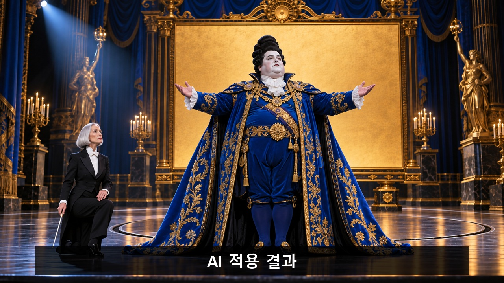
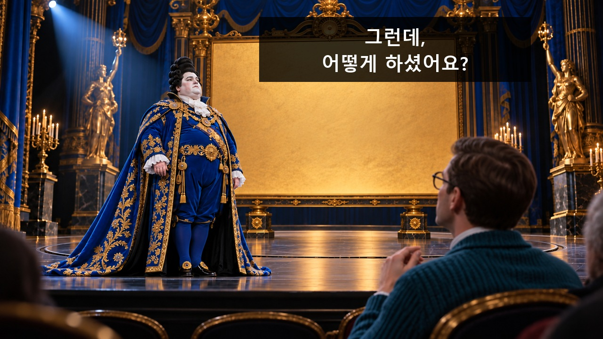
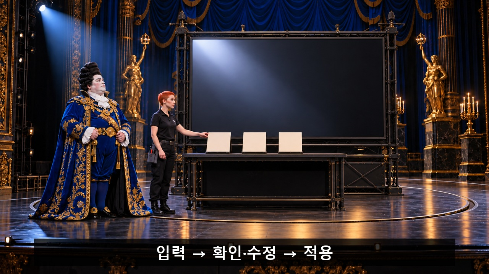
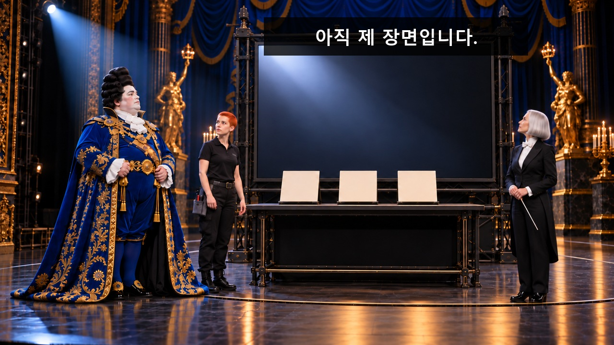
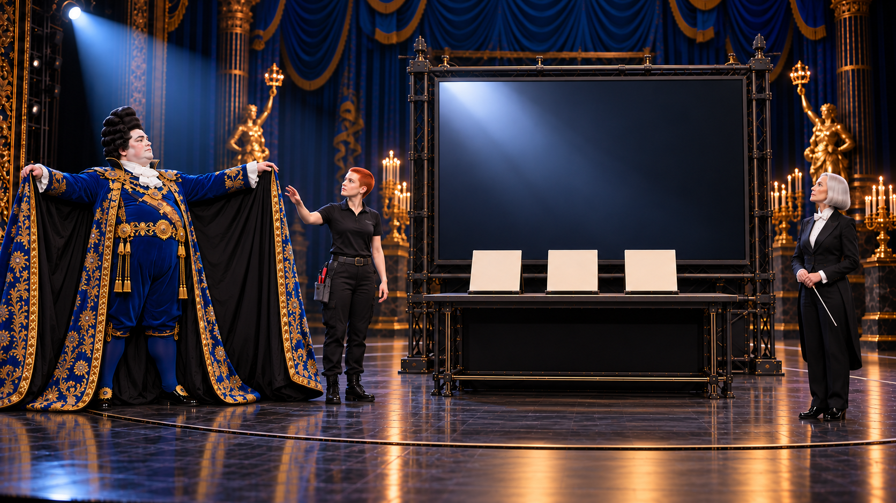
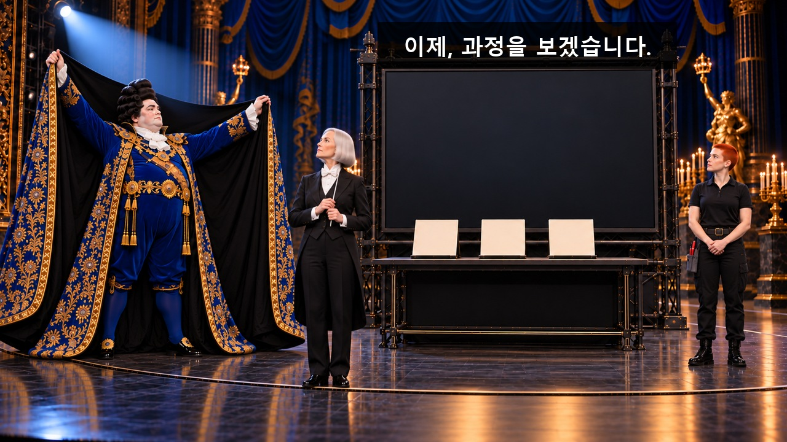
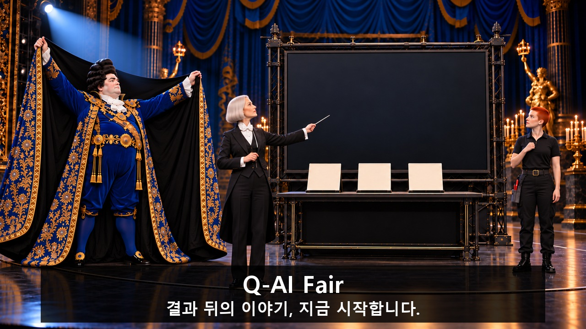

[검수 목록으로](README.md) · [← 이전 안](07_결투_시간을_뺏긴_여자.md) · [다음 안 →](09_지구인은_질문이_많다.md)

# 08. 이 오페라는 끝났습니다

**커튼콜을 독점하려던 오페라 주역이 무대 뒤를 가리켰다가 과정이 주인공이 되고, 재등장용 망토까지 과정 화면의 차광막으로 쓰인다.**

**C08 · V10 · 현장 도입 · 41초 · 8개 시작 이미지**

**전달할 내용:** 잘 보이는 결과 다음에는 직접 시도하고 고친 과정을 함께 본다.

**웃음의 전개:** 피날레라고 믿은 스타에게 과정 질문 → 직접 가리킨 뒤편이 새 무대가 됨 → 다시 관심을 끌려고 펼친 망토가 남의 화면을 돕는 도구가 됨.

화면과 후처리 자막으로 전달하는 검수용 콘티입니다. 아래 이미지는 동작의 시작 상태이며, 자막이 있는 컷은 그 첫 이미지 위에 자막 위치를 얹은 정지 예시입니다. 실제 동작 완료 화면이나 생성 영상은 아닙니다.

등장인물·연출 보기

- **OP**: 40대 남성 오페라 주역. 매우 큰 원형 체격, 둥근 얼굴, 매끈한 흰 무대분장, 수염 없음. 높게 말아 올린 검정 롤가발, 금빛 장식의 로열블루 큰 의상, 바닥까지 넓게 흐르는 로열블루·금빛 겉감 망토와 무광 검정 안감. C04의 마르고 수염 긴 자주색 사령관과 완전히 다른 실루엣.
- **ST**: 20대 여성 제작담당. 넓은 어깨와 짧은 운동형 체격, 진한 주근깨, 붉은 버즈컷, 검정 반소매 작업복과 검정 바지, 가는 회색 공구 벨트. 큰 망토에도 주눅 들지 않는 침착한 표정.
- **CO**: 70대 여성 지휘자. 작고 여윈 몸, 날카로운 삼각 턱, 턱선 길이의 반듯한 은색 직모 보브, 안경 없음. 검정 연미복·흰 하이칼라, 가는 흰 지휘봉. C06의 큰 체형·안경·비대칭 숏컷 직원과 구분.
- **AU**: 질문 관객 1. 30대 남성, 작은 얼굴과 둥근 검정 뿔테, 정돈된 밤색 짧은 머리, 청록 니트. 객석 앞줄의 한 사람만 개별 식별하며 나머지는 먼 뒷머리 세 개 이하로 제한.

**형식:** 장엄한 커튼콜에서 무대 뒤 과정 공개로 넘어가는 무대 코미디

**연출:** 고급 오페라 무대, 로열블루·금빛·검정 대비, 과장된 몸짓을 진지하게 찍는다. 작업 담당은 빠르고 실용적이며 주역은 절대 윙크하지 않는다. 객석 질문 뒤에도 장르의 격을 낮추지 않는다.

## 컷별 스토리보드

### C08_K01 · 0–4초 · 4초

**첫 상태:** 금빛 결과판 앞에 OP가 양팔을 크게 벌린 채 인사하기 직전. CO는 앞무대 왼쪽에서 지휘봉을 내리고 한쪽 무릎을 낮추려 한다. 망토 겉감이 넓게 보이고 뒤 작업 공간은 전혀 보이지 않는다.

**이어질 동작:** OP가 과장된 큰 인사를 한 번 한다. CO도 진지하게 몸을 낮춘다. OP가 천천히 일어나 피날레가 끝났다는 얼굴을 만든다.

**후처리 자막**

- **0.4–3.68초:** AI 적용 결과

**웃음·정보 의도:** 주역이 커튼콜의 영광을 독점하려는 목표와 진짜 오페라의 진지함을 첫 장면에서 이해시킨다.

대사·음악·효과음·구도·전환

| 항목 | 내용 |
|---|---|
| 대사·내레이션 | 없음. 의미는 화면과 후편집 자막으로 전달. |
| 음악·효과음·정적 | 선택 BGM은 오페라 피날레 같은 무가사 오케스트라. 질문 때 마지막 화음을 길게 유지해 피날레가 끝나지 않는 느낌. 회전판 모터와 무대 구두, 차광막 전환 때 0.5초 악기 중단. 지휘자가 과정 화면을 가리키면 담백한 시작 리듬. 노래·음성은 필수 정보가 아님. 이 컷: 무가사 오케스트라 마지막 화음, 큰 망토의 마찰. |
| 구도 | 무대 전체의 정면 와이드. 커다란 주역과 작은 지휘자의 크기 대비를 살리고 금빛 결과판 중앙은 비워 둠. |
| 전환 | OP가 객석을 바라보는 시선에서 앞줄 질문 관객으로 컷. |

[자막 없는 시작 PNG 원본](storyboards/2026-10-23_v10-ten-concepts/images/C08/S01_v2.png)

### C08_K02 · 4–9초 · 5초

**첫 상태:** AU가 객석 앞줄에서 한 손을 가슴 높이로 들기 직전. 화면 후경 왼쪽 OP가 퇴장 방향으로 발을 돌린 상태지만 아직 떠나지 않았다.

**이어질 동작:** AU가 손을 들고 OP를 본다. OP는 발을 멈추고 자신 있게 엄지로 막 뒤를 가리킨다. 입을 움직여 설명하지 않는다.

**후처리 자막**

- **4.4–8.7초:** 그런데, / 어떻게 하셨어요?

**웃음·정보 의도:** 관객의 질문이 결과와 커튼콜을 종료점으로 삼던 주역의 계획을 바꾼다.

대사·음악·효과음·구도·전환

| 항목 | 내용 |
|---|---|
| 대사·내레이션 | 없음. 의미는 화면과 후편집 자막으로 전달. |
| 음악·효과음·정적 | 선택 BGM은 오페라 피날레 같은 무가사 오케스트라. 질문 때 마지막 화음을 길게 유지해 피날레가 끝나지 않는 느낌. 회전판 모터와 무대 구두, 차광막 전환 때 0.5초 악기 중단. 지휘자가 과정 화면을 가리키면 담백한 시작 리듬. 노래·음성은 필수 정보가 아님. 이 컷: 마지막 화음이 길게 유지. 질문 음성 없이 자막만. |
| 구도 | 질문자의 옆얼굴과 멀리 보이는 OP의 가리키는 팔을 읽는 객석 측면 미디엄 와이드. |
| 전환 | OP 손가락 방향으로 무대 조작 위치 컷. |

[자막 없는 시작 PNG 원본](storyboards/2026-10-23_v10-ten-concepts/images/C08/S02_v2.png)

### C08_K03 · 9–13초 · 4초

**첫 상태:** ST가 고정 앞무대 왼쪽 조작 버튼 위에 손을 대기 직전. 중앙 회전 세트는 여전히 금빛 앞면. OP는 왼쪽 고정 앞무대에서 망토를 모아 들고 있다.

**이어질 동작:** ST가 버튼을 누르자 회전 세트가 약45도 돌아가기 시작한다. OP는 고정 앞무대에서 한 걸음 옮겨 자기 정면을 객석에 다시 맞추려 하지만 시선은 돌아가는 세트를 따라간다. 뒤 작업 책상 일부만 나타나며 전체는 다음 컷에 공개한다.

**후처리 자막:** 없음. 행동과 표정으로 전달.

**웃음·정보 의도:** 작은 질문이 무대의 앞뒤를 실제로 바꾸는 큰 사건. 변신이나 순간이동 없이 회전 기구의 규칙을 보인다.

대사·음악·효과음·구도·전환

| 항목 | 내용 |
|---|---|
| 대사·내레이션 | 없음. 의미는 화면과 후편집 자막으로 전달. |
| 음악·효과음·정적 | 선택 BGM은 오페라 피날레 같은 무가사 오케스트라. 질문 때 마지막 화음을 길게 유지해 피날레가 끝나지 않는 느낌. 회전판 모터와 무대 구두, 차광막 전환 때 0.5초 악기 중단. 지휘자가 과정 화면을 가리키면 담백한 시작 리듬. 노래·음성은 필수 정보가 아님. 이 컷: 무거운 회전판 모터. 음악은 장엄하게 유지. |
| 구도 | 원형 바닥 경계·ST·OP·세트 전체를 함께 보는 고정 와이드. 회전 방향은 시계 방향. |
| 전환 | 회전 진행 중 같은 방향을 유지하며 180도 완료 상태로 컷. 완전 회전을 단일 생성에 강요하지 않음. |

[자막 없는 시작 PNG 원본](storyboards/2026-10-23_v10-ten-concepts/images/C08/S03_v2.png)

### C08_K04 · 13–18초 · 5초

**첫 상태:** 회전이 완료되어 뒷면 작업 책상과 큰 작업 화면이 객석을 향한다. ST는 세 개의 무지 작업 카드 앞에 손을 들기 직전. OP는 화면 왼쪽 옆으로 돌아와 있고, 고정 왼쪽 조명의 반사가 화면 한쪽을 밝게 가린다.

**이어질 동작:** ST가 첫 시도·수정 표시·적용본에 해당하는 세 카드를 한 번 차례로 짚는다. 후편집 화면에는 최소 단계 그래픽이 나타난다. CO와 AU의 시선은 OP에서 작업 화면으로 이동한다.

**후처리 자막**

- **13.33–17.83초:** 입력 → 확인·수정 → 적용

**웃음·정보 의도:** 뒷이야기를 긴 설명이 아닌 시도·수정 흔적의 실물로 보여준다. 여기의 반사가 망토를 차광막으로 쓰게 될 원인.

대사·음악·효과음·구도·전환

| 항목 | 내용 |
|---|---|
| 대사·내레이션 | 없음. 의미는 화면과 후편집 자막으로 전달. |
| 음악·효과음·정적 | 선택 BGM은 오페라 피날레 같은 무가사 오케스트라. 질문 때 마지막 화음을 길게 유지해 피날레가 끝나지 않는 느낌. 회전판 모터와 무대 구두, 차광막 전환 때 0.5초 악기 중단. 지휘자가 과정 화면을 가리키면 담백한 시작 리듬. 노래·음성은 필수 정보가 아님. 이 컷: 작업 카드 한 번 탁. 오케스트라는 피날레 대신 얇은 지속음. |
| 구도 | 뒷면 작업 세트 정면 미디엄 와이드. 화면 왼쪽 반사와 오른쪽 읽을 부분을 분리. OP는 화면 옆 외곽. |
| 전환 | OP가 그 시선을 되찾으려는 큰 동작으로 컷. |

[자막 없는 시작 PNG 원본](storyboards/2026-10-23_v10-ten-concepts/images/C08/S04.png)

### C08_K05 · 18–23초 · 5초

**첫 상태:** OP가 작업 화면 왼쪽 옆에서 망토 양끝을 손에 모아 쥔 상태. ST는 반사 때문에 화면을 보다가 OP 쪽으로 고개만 돌린다. CO는 작업 화면에 집중한다.

**이어질 동작:** OP가 한 걸음 앞으로 나서며 망토를 거대한 부채처럼 펼친다. 검정 안감이 드러나고 ST의 눈이 그 넓은 어두운 면을 본다. 망토는 작업 화면 앞을 가로막지 않는다.

**후처리 자막**

- **19.1–22.7초:** 아직 제 장면입니다.

**웃음·정보 의도:** 주역이 관심을 되찾으려 스스로 펼친 망토가 다음 역할 전환의 재료가 된다.

대사·음악·효과음·구도·전환

| 항목 | 내용 |
|---|---|
| 대사·내레이션 | 없음. 의미는 화면과 후편집 자막으로 전달. |
| 음악·효과음·정적 | 선택 BGM은 오페라 피날레 같은 무가사 오케스트라. 질문 때 마지막 화음을 길게 유지해 피날레가 끝나지 않는 느낌. 회전판 모터와 무대 구두, 차광막 전환 때 0.5초 악기 중단. 지휘자가 과정 화면을 가리키면 담백한 시작 리듬. 노래·음성은 필수 정보가 아님. 이 컷: 큰 천이 퍼지는 소리. 승리 팡파르를 짧게 올리다 유지. |
| 구도 | OP 전신과 ST, 화면 왼쪽 경계를 읽는 고정 와이드. OP의 앞 걸음은 화면 옆 공간 안에서만. |
| 전환 | 검정 안감과 ST의 손을 함께 보는 다음 구도. |

[자막 없는 시작 PNG 원본](storyboards/2026-10-23_v10-ten-concepts/images/C08/S05_v2.png)

### C08_K06 · 23–29초 · 6초

**첫 상태:** OP가 양팔을 벌려 망토를 크게 펼친 상태. ST의 손은 관객 쪽 자유 망토 끝에 닿기 직전. 왼쪽 위 빛이 아직 작업 화면에 반사되고 있다.

**이어질 동작:** ST가 망토의 자유 끝 하나를 조금 돌려 검정 안감이 조명과 작업 화면 사이에 서도록 한다. OP는 놀랐지만 팔을 유지한다. 같은 화면의 반사가 사라지고 작업 카드가 또렷해진다.

**후처리 자막:** 없음. 행동과 표정으로 전달.

**웃음·정보 의도:** 조명을 받으려던 주역이 조명을 가려 주는 인력으로 바뀌는 핵심 물리 반전. 말로 차광막이라고 해설하지 않는다.

대사·음악·효과음·구도·전환

| 항목 | 내용 |
|---|---|
| 대사·내레이션 | 없음. 의미는 화면과 후편집 자막으로 전달. |
| 음악·효과음·정적 | 선택 BGM은 오페라 피날레 같은 무가사 오케스트라. 질문 때 마지막 화음을 길게 유지해 피날레가 끝나지 않는 느낌. 회전판 모터와 무대 구두, 차광막 전환 때 0.5초 악기 중단. 지휘자가 과정 화면을 가리키면 담백한 시작 리듬. 노래·음성은 필수 정보가 아님. 이 컷: 천 살짝 끌리는 소리 뒤 음악 0.5초 중단. 관객 반응 음성 필요 없음. |
| 구도 | 관객이 화면을 정면으로 보면서 왼쪽에 세워진 망토의 옆면과 조명 방향을 함께 확인하는 미디엄 와이드. |
| 전환 | 깨끗해진 화면으로 향하는 CO 지휘봉에 컷. |

[자막 없는 시작 PNG 원본](storyboards/2026-10-23_v10-ten-concepts/images/C08/S06.png)

### C08_K07 · 29–33초 · 4초

**첫 상태:** CO가 망토를 들고 있는 OP와 작업 화면 사이 앞무대에 서 있다. 지휘봉은 가슴 높이에서 멈춰 있고 아직 어느 쪽도 가리키지 않는다. ST는 작업 화면 옆에 준비.

**이어질 동작:** CO가 OP 대신 작업 화면을 지휘봉으로 정중하게 가리킨다. OP가 지휘봉 끝을 따라 보다가 양팔을 조금 더 높여 망토를 팽팽하게 만든다.

**후처리 자막**

- **29.8–32.84초:** 이제, 과정을 보겠습니다.

**웃음·정보 의도:** 지휘자도 스타의 복귀를 돕지 않고 과정의 진행자가 된다. 주역은 새 역할을 여전히 장엄하게 수행.

대사·음악·효과음·구도·전환

| 항목 | 내용 |
|---|---|
| 대사·내레이션 | 없음. 의미는 화면과 후편집 자막으로 전달. |
| 음악·효과음·정적 | 선택 BGM은 오페라 피날레 같은 무가사 오케스트라. 질문 때 마지막 화음을 길게 유지해 피날레가 끝나지 않는 느낌. 회전판 모터와 무대 구두, 차광막 전환 때 0.5초 악기 중단. 지휘자가 과정 화면을 가리키면 담백한 시작 리듬. 노래·음성은 필수 정보가 아님. 이 컷: 지휘봉 작은 휙. 담백한 시작 리듬으로 이동. |
| 구도 | CO 전경·OP 왼쪽·읽을 수 있는 작업 화면 오른쪽의 삼각 구도. 인원 추가 없음. |
| 전환 | 높아진 OP 턱과 작업 공간을 살리는 넓은 엔딩 구도. |

[자막 없는 시작 PNG 원본](storyboards/2026-10-23_v10-ten-concepts/images/C08/S07.png)

### C08_K08 · 33–41초 · 8초

**첫 상태:** OP가 망토를 차광막으로 유지하며 턱을 높이고 있다. ST는 화면 옆에서 한 손을 가슴 가까이 두고 아직 엄지 표시를 하지 않았다. CO의 지휘봉은 작업 화면을 가리킨다.

**이어질 동작:** ST가 OP에게 짧게 엄지를 보여 준다. OP는 관객의 환호를 받은 것처럼 턱을 더 높여 위엄 있게 받아들인다. 작업 화면과 망토 위치는 끝까지 유지한다.

**후처리 자막**

- **36.1–40.8초:** Q-AI Fair / 결과 뒤의 이야기, 지금 시작합니다.

**웃음·정보 의도:** 주역의 욕망을 없애지 않고 뜻밖의 유용한 역할에서 체면을 유지하게 끝낸다. 행사 도입이 과정 화면의 시작과 맞물림.

대사·음악·효과음·구도·전환

| 항목 | 내용 |
|---|---|
| 대사·내레이션 | 없음. 의미는 화면과 후편집 자막으로 전달. |
| 음악·효과음·정적 | 선택 BGM은 오페라 피날레 같은 무가사 오케스트라. 질문 때 마지막 화음을 길게 유지해 피날레가 끝나지 않는 느낌. 회전판 모터와 무대 구두, 차광막 전환 때 0.5초 악기 중단. 지휘자가 과정 화면을 가리키면 담백한 시작 리듬. 노래·음성은 필수 정보가 아님. 이 컷: 짧은 오케스트라 마침, 선택적 소프트 타악. 환호·대사 없음. |
| 구도 | OP의 과잉 의전 표정과 실제 작업 화면을 함께 담는 고정 미디엄 와이드. 상단 빈 무대 공간에 제목. |
| 전환 | 행사명 약 4.7초 유지 후 실제 진행으로 종료. |

[자막 없는 시작 PNG 원본](storyboards/2026-10-23_v10-ten-concepts/images/C08/S08.png)

---

[검수 목록으로](README.md) · [← 이전 안](07_결투_시간을_뺏긴_여자.md) · [다음 안 →](09_지구인은_질문이_많다.md)

정확한 행사 날짜·장소·참석 방법은 아직 기입하지 않았습니다. 실제 영상 제작 뒤 움직이는 소품·자막 가림·읽는 시간·편집 호흡을 재확인합니다.
