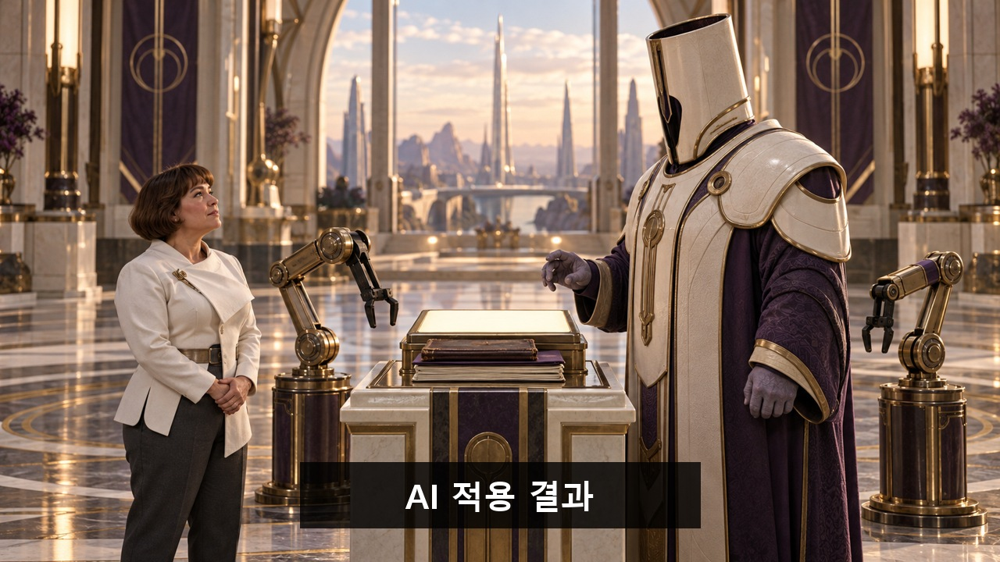
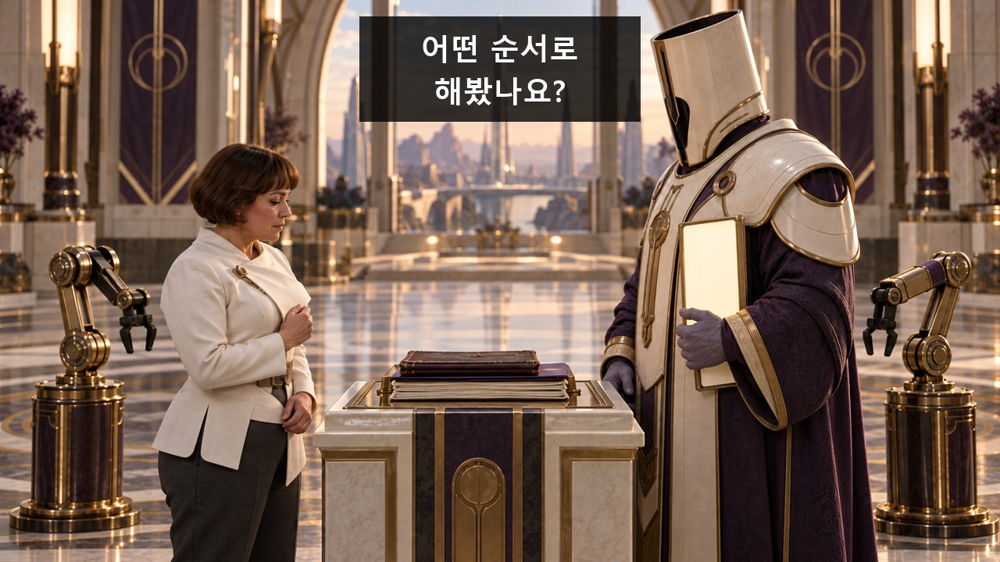
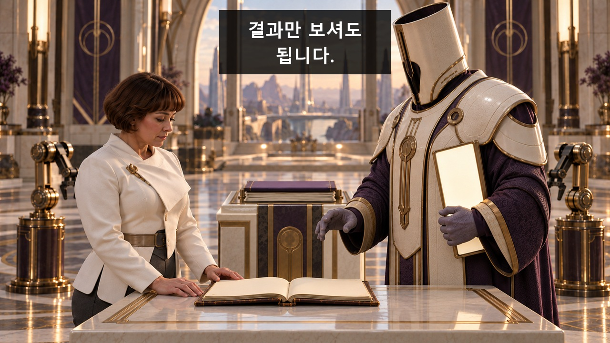
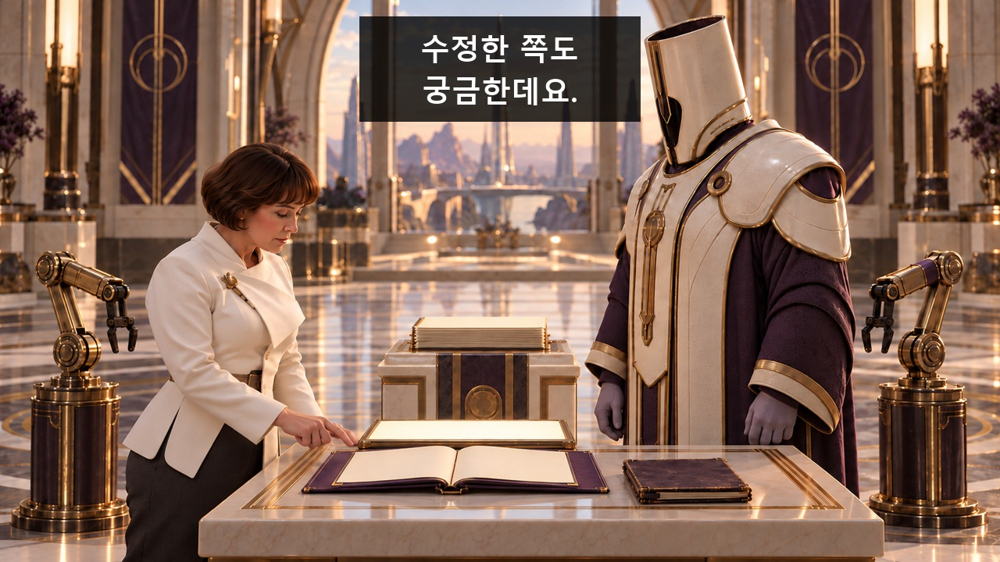
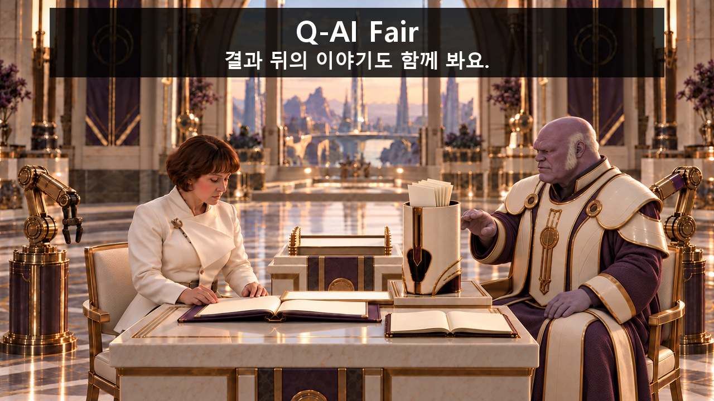

[검수 목록으로](README.md) · [← 이전 안](08_이_오페라는_끝났습니다.md) · [다음 안 →](10_개막을_허가하지_않는_기계.md)

# 09. 지구인은 질문이 많다

**결과만 건네려던 사절이 과정을 가리려고 손바닥을 펼칠수록 보조팔이 기록을 더 내밀고, 끝내 투구까지 서류꽂이로 쓰인다.**

**C09 · V11 · 참석 독려·혼합 · 44초 · 9개 시작 이미지**

**전달할 내용:** 결과 다음에 해본 순서와 고친 이유를 함께 묻는다.

**웃음의 전개:** 손바닥을 펴면 자료를 내미는 친절한 규칙 → 과정을 가리려 편 손도 주문으로 처리됨 → 투구를 벗은 사절이 마지막 위엄을 세우지만 그 투구마저 자료 꽂이가 됨.

화면과 후처리 자막으로 전달하는 검수용 콘티입니다. 아래 이미지는 동작의 시작 상태이며, 자막이 있는 컷은 그 첫 이미지 위에 자막 위치를 얹은 정지 예시입니다. 실제 동작 완료 화면이나 생성 영상은 아닙니다.

등장인물·연출 보기

- **AL**: 중년 외계 사절. 넓고 낮은 몸, 보랏빛 피부, 넓고 납작한 얼굴, 작은 검은 눈, 짧은 흰 구레나룻. 상아색 단단한 어깨 의전복과 회보라 소매. 거대하고 키 큰 상아색 원통 투구를 씀. 투구는 상단과 하단이 열린 견고한 원통이며 전면의 어두운 좁은 시야창과 안쪽 검정 가림 때문에 착용 중 얼굴은 보이지 않는다. 벗으면 투구가 작아지거나 몸이 변하지 않는다.
- **HU**: 40대 인간 여성. 낮은 체구와 다부진 몸, 짙은 눈썹, 넓은 코, 짧은 밤색 페이지보이컷, 흰 비대칭 재킷과 차콜 바지. 안경 없음. 두 손을 크게 흔들지 않고 궁금한 기록을 차분히 가리킨다.
- **AR_L**: 의전 팔 L. 자료 받침대 왼편 이동식 의전 받침대에 부착된 황동색 3관절 기계팔, 검정 고무의 두 갈래 얇은 집게. K01 결과판, K05 다음 폴더만 전달. 다른 컷에서는 접힌 휴지 상태.
- **AR_R**: 의전 팔 R. 오른편 이동식 의전 받침대의 동일 구조 기계팔, 관절에 작은 보라색 띠로 L과 구별. K03 첫 수첩, K08 투구 안 자료 정리만 수행. 두 팔은 동시에 움직이지 않는다.

**형식:** 외계 최초접촉의 장엄한 하사가 과잉 의전 서비스로 무너지는 코미디

**연출:** 상아색·황동·짙은 보라의 정교한 외계 의전실. 광택 큰 투구와 낮은 인간의 계시 구도로 시작하고 마지막에는 실용적인 책상 눈높이가 된다. 팔은 분명한 기계이며 마법의 빛으로 자료를 생성하지 않는다.

## 컷별 스토리보드

### C09_K01 · 0–4초 · 4초

**첫 상태:** AL이 큰 투구를 쓴 채 오른쪽 높은 의전 자리에서 빈 오른손을 펴기 직전. 뒤 열린 받침대 맨 위에는 빛나는 무지 결과판, 아래에는 낡은 수첩과 폴더 가장자리가 보인다. AR_L은 결과판 바로 옆에서 대기, AR_R은 접힘. HU는 왼쪽 아래에 선다.

**이어질 동작:** AL이 빈 손바닥을 보인다. AR_L이 받침대 맨 위 결과판을 집어 AL의 손 앞에 정중하게 내민다. AL이 받아 자신의 앞에 세운다. 다른 팔은 움직이지 않는다. HU의 시선은 하사되는 결과판을 지나 받침대의 낡은 기록으로 향한다. 열린 손을 먼저0.4초 보여준 뒤 팔이 출발한다.

**후처리 자막**

- **2.0–3.87초:** AI 적용 결과

**웃음·정보 의도:** 의전의 위엄과 구체적인 서비스 규칙을 같은 첫 행동에 심는다. 아래 낡은 자료를 관객이 먼저 봄.

대사·음악·효과음·구도·전환

| 항목 | 내용 |
|---|---|
| 대사·내레이션 | 없음. 의미는 화면과 후편집 자막으로 전달. |
| 음악·효과음·정적 | 선택 BGM은 느린 SF 합창 질감의 무가사 패드와 낮은 금관. 팔이 정중히 자료를 내밀 때 작은 서보음과 벨 한 번. K05 사절 손 앞에 또 자료가 놓이는 순간 음악을 0.5초 비운다. 투구가 서류꽂이 되는 때 무겁게 울리던 의전음이 종이 소리로 바뀜. 대사 없음. 이 컷: 손바닥에 맞춘 작은 벨, L 서보음. 말 없음. |
| 구도 | 낮은 HU 어깨 너머로 사절·두 팔·열린 자료 받침대를 보는 대칭 와이드. 큰 투구의 상단 원통 형태가 보임. 한 숏 내 두 받침대의 위치는 시작 PNG 그대로 고정. |
| 전환 | HU가 결과보다 아래 기록을 보는 시선으로 컷. |

[자막 없는 시작 PNG 원본](storyboards/2026-10-23_v11-production-lock/images/C09/S01.png)

### C09_K02 · 4–8초 · 4초

**첫 상태:** AL이 결과판을 왼손으로 HU 쪽에 내밀기 직전. HU는 결과판 아래로 보이는 낡은 수첩을 보고 있으며 오른손은 가슴 가까이 모아져 있다. 두 보조팔은 접혀 있다.

**이어질 동작:** AL이 결과판을 하사하듯 앞으로 내민다. HU는 받는 대신 낡은 수첩을 가리키고 같은 빈 손바닥을 조심스럽게 편다.

**후처리 자막**

- **4.4–7.84초:** 어떤 순서로 / 해봤나요?

**웃음·정보 의도:** 인간은 결과를 부정하지 않고 과정을 궁금해한다. 같은 손바닥 동작이 다음 서비스를 불러옴.

대사·음악·효과음·구도·전환

| 항목 | 내용 |
|---|---|
| 대사·내레이션 | 없음. 의미는 화면과 후편집 자막으로 전달. |
| 음악·효과음·정적 | 선택 BGM은 느린 SF 합창 질감의 무가사 패드와 낮은 금관. 팔이 정중히 자료를 내밀 때 작은 서보음과 벨 한 번. K05 사절 손 앞에 또 자료가 놓이는 순간 음악을 0.5초 비운다. 투구가 서류꽂이 되는 때 무겁게 울리던 의전음이 종이 소리로 바뀜. 대사 없음. 이 컷: 의전 금관 지속. 손짓·시선이 의미를 담당. |
| 구도 | 두 인물 옆얼굴과 결과판·받침대 자료가 보이는 고정 미디엄 와이드. 한 숏 내 두 받침대의 위치는 시작 PNG 그대로 고정. |
| 전환 | 인간 손 앞의 빈 공간으로 다가오는 R 방향 컷. |

[자막 없는 시작 PNG 원본](storyboards/2026-10-23_v11-production-lock/images/C09/S02.png)

### C09_K03 · 8–13초 · 5초

**첫 상태:** HU가 빈 오른손을 편 상태. AR_R 집게는 받침대 맨 위 낡은 수첩을 집기 직전. AL은 결과판을 들고 굳어 있다. L은 접힘.

**이어질 동작:** AR_R이 낡은 수첩 하나를 집어 HU의 손 앞에 내민다. HU가 수첩을 받으면 R이 놓고 물러난다. AL은 결과판을 조금 높이 들며 수첩 쪽 시선을 가린다.

**후처리 자막:** 없음. 행동과 표정으로 전달.

**웃음·정보 의도:** 질문이 실제 기록을 꺼낸다. 위엄을 돕던 서비스가 자기 뜻대로만 움직이지 않음을 사절이 깨닫기 시작.

대사·음악·효과음·구도·전환

| 항목 | 내용 |
|---|---|
| 대사·내레이션 | 없음. 의미는 화면과 후편집 자막으로 전달. |
| 음악·효과음·정적 | 선택 BGM은 느린 SF 합창 질감의 무가사 패드와 낮은 금관. 팔이 정중히 자료를 내밀 때 작은 서보음과 벨 한 번. K05 사절 손 앞에 또 자료가 놓이는 순간 음악을 0.5초 비운다. 투구가 서류꽂이 되는 때 무겁게 울리던 의전음이 종이 소리로 바뀜. 대사 없음. 이 컷: R 서보음과 수첩 가죽 소리. 과장 경고음 없음. |
| 구도 | 수첩의 출처와 이동 경로, 두 얼굴/투구를 읽는 고정 미디엄. 가리는 결과판이 사람 얼굴 전체를 덮지 않음. 한 숏 내 두 받침대의 위치는 시작 PNG 그대로 고정. |
| 전환 | HU가 수첩을 펼친 뒤 AL의 가리는 손으로 컷. |

[자막 없는 시작 PNG 원본](storyboards/2026-10-23_v11-production-lock/images/C09/S03.png)

### C09_K04 · 13–17초 · 4초

**첫 상태:** HU가 받은 수첩을 책상 위에 펼쳤다. AL은 왼손에 결과판을 들고 오른손을 아직 모은 채 수첩 앞을 가리려 한다. 팔들은 접혀 있다.

**이어질 동작:** AL이 기록 앞을 가리려고 빈 오른손바닥을 활짝 편다. HU가 손 옆으로 고개를 조금 기울여 기록을 계속 본다. 마지막 약0.4초에 손바닥을 유지하고 서비스 표시등만 후편집으로 켠다. 두 보조팔은 이 컷 끝까지 접힌 채 정지한다. 팔의 출발은 다음 K05에서 한 번만 보여준다.

**후처리 자막**

- **13.32–16.12초:** 결과만 보셔도 / 됩니다.

**웃음·정보 의도:** 사절이 상황을 숨기려 선택한 바로 그 제스처가 앞서 심은 서비스 호출과 같아 다음 실수를 직접 만든다.

대사·음악·효과음·구도·전환

| 항목 | 내용 |
|---|---|
| 대사·내레이션 | 없음. 의미는 화면과 후편집 자막으로 전달. |
| 음악·효과음·정적 | 선택 BGM은 느린 SF 합창 질감의 무가사 패드와 낮은 금관. 팔이 정중히 자료를 내밀 때 작은 서보음과 벨 한 번. K05 사절 손 앞에 또 자료가 놓이는 순간 음악을 0.5초 비운다. 투구가 서류꽂이 되는 때 무겁게 울리던 의전음이 종이 소리로 바뀜. 대사 없음. 이 컷: K01과 같은 작은 벨 한 번. 소리 없이도 반복 손바닥 모양이 보임. |
| 구도 | 수첩·가리는 빈 손·투구의 수평 시선창을 읽는 미디엄. 손이 인간에게 닿지 않음. 한 숏 내 두 받침대의 위치는 시작 PNG 그대로 고정. |
| 전환 | 펴진 손바닥을 유지한 채 다음 폴더가 다가오는 역구도. |

[자막 없는 시작 PNG 원본](storyboards/2026-10-23_v11-production-lock/images/C09/S04.png)

### C09_K05 · 17–22초 · 5초

**첫 상태:** AL의 오른손이 기록 앞에서 활짝 펴져 있다. AR_L 집게는 받침대의 수정 폴더 앞에 멈춰 있고 AR_R은 접힘. HU는 손 옆으로 수첩을 보고 있다.

**이어질 동작:** 앞 컷의 손바닥 호출을 이어 AR_L이 시작 즉시 한 번 출발해 실제 수정 폴더를 집고 AL의 펼친 손 앞에 정중하게 내민다. AL은 가리는 손을 유지하려다 폴더를 받을 수밖에 없고 결과판과 기록을 양손에 나눠 든다. AR_R은 접힌 채 정지. 다시 손을 펴거나 두 번째 출발·대기를 반복하지 않는다.

**후처리 자막:** 없음. 행동과 표정으로 전달.

**웃음·정보 의도:** 막으려는 손이 더 많은 과정을 받아 드는 작은 물리 반전. 보조팔은 자기 규칙대로 친절할 뿐.

대사·음악·효과음·구도·전환

| 항목 | 내용 |
|---|---|
| 대사·내레이션 | 없음. 의미는 화면과 후편집 자막으로 전달. |
| 음악·효과음·정적 | 선택 BGM은 느린 SF 합창 질감의 무가사 패드와 낮은 금관. 팔이 정중히 자료를 내밀 때 작은 서보음과 벨 한 번. K05 사절 손 앞에 또 자료가 놓이는 순간 음악을 0.5초 비운다. 투구가 서류꽂이 되는 때 무겁게 울리던 의전음이 종이 소리로 바뀜. 대사 없음. 이 컷: L 서보음 뒤 0.5초 음악 정지. 종이 한 번. |
| 구도 | AL 상반신·열린 손·폴더 이동과 HU의 옆얼굴을 함께 보는 미디엄 와이드. 한 숏 내 두 받침대의 위치는 시작 PNG 그대로 고정. |
| 전환 | 두 물건을 책상에 내려놓은 다음 상태로 컷. 내려놓는 시간을 생략. |

[자막 없는 시작 PNG 원본](storyboards/2026-10-23_v11-production-lock/images/C09/S05_v2.png)

### C09_K06 · 22–26초 · 4초

**첫 상태:** 결과판과 수정 폴더가 낮은 책상에 놓였다. HU가 수정 폴더 첫 페이지를 펼친 채 손끝을 대기 직전. AL은 거대한 투구를 쓴 채 책상을 내려다보려 하지만 곧게 서 있다.

**이어질 동작:** HU가 수정 흔적 한 곳을 가리킨다. AL이 거대 투구째 몸을 조금 앞으로 기울여 보려다 불편해 멈춘다. 두 손을 투구 양옆으로 가져갈 준비를 한다.

**후처리 자막**

- **22.32–25.76초:** 수정한 쪽도 / 궁금한데요.

**웃음·정보 의도:** 권위를 세우던 큰 투구가 가까운 기록을 함께 보는 데 걸림돌이라는 구체적 이유를 만들어 탈착을 연결.

대사·음악·효과음·구도·전환

| 항목 | 내용 |
|---|---|
| 대사·내레이션 | 없음. 의미는 화면과 후편집 자막으로 전달. |
| 음악·효과음·정적 | 선택 BGM은 느린 SF 합창 질감의 무가사 패드와 낮은 금관. 팔이 정중히 자료를 내밀 때 작은 서보음과 벨 한 번. K05 사절 손 앞에 또 자료가 놓이는 순간 음악을 0.5초 비운다. 투구가 서류꽂이 되는 때 무겁게 울리던 의전음이 종이 소리로 바뀜. 대사 없음. 이 컷: 기록 페이지 한 번, 의전복 작은 마찰. |
| 구도 | 낮은 책상과 높은 투구가 대비되는 측면 미디엄 와이드. 충돌이나 목 꺾임 없음. 한 숏 내 두 받침대의 위치는 시작 PNG 그대로 고정. |
| 전환 | AL이 투구 양옆을 잡은 다음 첫 상태로 컷. |

[자막 없는 시작 PNG 원본](storyboards/2026-10-23_v11-production-lock/images/C09/S06_v2.png)

### C09_K07 · 26–31초 · 5초

**첫 상태:** AL이 원통 투구 양옆을 두 손으로 잡고 아직 머리에 쓴 상태. 작은 옆 탁자는 비어 있다. HU는 낮은 책상 옆 의자에 앉아 기록을 보며 기다린다. 두 보조팔은 접힘.

**이어질 동작:** AL이 원통 투구를 똑바로 위로 들어 실제 보라 얼굴을 드러내고, 열린 상단이 위를 향하도록 옆 탁자에 세운다. 자료 전달이나 팔 작동은 없다.

**후처리 자막:** 없음. 행동과 표정으로 전달.

**웃음·정보 의도:** 투구 아래도 기록을 함께 볼 존재였다는 크기 대비. 거대 얼굴이 작은 얼굴로 변하는 마법이 아니라 분리 가능한 외장 소품.

대사·음악·효과음·구도·전환

| 항목 | 내용 |
|---|---|
| 대사·내레이션 | 없음. 의미는 화면과 후편집 자막으로 전달. |
| 음악·효과음·정적 | 선택 BGM은 느린 SF 합창 질감의 무가사 패드와 낮은 금관. 팔이 정중히 자료를 내밀 때 작은 서보음과 벨 한 번. K05 사절 손 앞에 또 자료가 놓이는 순간 음악을 0.5초 비운다. 투구가 서류꽂이 되는 때 무겁게 울리던 의전음이 종이 소리로 바뀜. 대사 없음. 이 컷: 투구 가벼운 분리 마찰, 탁자에 둔 둔탁한 소리. 놀람 음성 없음. |
| 구도 | AL 얼굴·양손·투구의 물리적 분리와 옆 탁자를 모두 보는 고정 미디엄 와이드. 한 숏 내 두 받침대의 위치는 시작 PNG 그대로 고정. |
| 전환 | 빈 원통과 앉은 사절의 다음 구도로 컷. |

[자막 없는 시작 PNG 원본](storyboards/2026-10-23_v11-production-lock/images/C09/S07_v2.png)

### C09_K08 · 31–36초 · 5초

**첫 상태:** 투구를 벗은 AL이 HU와 비슷한 눈높이의 의자에 앉아 있고, 보라색 넓고 납작한 얼굴과 짧은 흰 구레나룻이 처음 선명히 보인다. 투구는 옆 탁자에 빈 원통으로 서 있다. AL이 다시 쓰려 원통 위로 빈 손을 펼치기 직전이며, AR_R은 받침대에 남은 얇은 자료 묶음 앞에서 대기.

**이어질 동작:** AL이 투구를 잡으려 원통 위 서비스 범위에 빈 손을 펼친다. 약0.4초 뒤 AR_R 하나가 남은 얇은 자료 묶음을 집어 그 손 앞으로 내민다. AL이 손을 빼면 R은 바로 아래 열린 원통 안에 자료를 세우고 물러난다. AL이 멈춘 손 그대로 천천히 팔을 본다. L과 추가 자료는 움직이지 않는다.

**후처리 자막:** 없음. 행동과 표정으로 전달.

**웃음·정보 의도:** 투구를 되찾으려는 손바닥이 같은 과잉 서비스를 또 부른다. 실제로 빈 용기에 자료를 세워 넣는 동작이며 새로운 물체를 만들지 않는다. 마지막 위엄의 소품이 실용 수납품으로 바뀐다.

대사·음악·효과음·구도·전환

| 항목 | 내용 |
|---|---|
| 대사·내레이션 | 없음. 의미는 화면과 후편집 자막으로 전달. |
| 음악·효과음·정적 | 선택 BGM은 느린 SF 합창 질감의 무가사 패드와 낮은 금관. 팔이 정중히 자료를 내밀 때 작은 서보음과 벨 한 번. K05 사절 손 앞에 또 자료가 놓이는 순간 음악을 0.5초 비운다. 투구가 서류꽂이 되는 때 무겁게 울리던 의전음이 종이 소리로 바뀜. 대사 없음. 이 컷: R 서보음, 원통 속 종이 사각. 무거운 의전 음악을 이 종이 소리에서 비움. |
| 구도 | AL 얼굴 기준이 되는 눈높이 미디엄. 빈 원통 안과 자료 출처가 함께 보이며 HU는 왼쪽. 한 숏 내 두 받침대의 위치는 시작 PNG 그대로 고정. |
| 전환 | 멈춘 손이 투구를 인간 쪽으로 미는 동작으로 이어짐. |

[자막 없는 시작 PNG 원본](storyboards/2026-10-23_v11-production-lock/images/C09/S08_v2.png)

### C09_K09 · 36–44초 · 8초

**첫 상태:** 자료가 꽂힌 투구가 두 사람 사이 탁자 위에 서 있다. AL의 손은 원통 옆에 닿기 직전, HU는 기록을 내려다보고 있다. 두 팔은 접힘.

**이어질 동작:** 36–37초 AL이 자료가 든 투구를 HU 쪽으로 조금 밀고 턱을 든다. 37–39초 HU가 원통 속 낱장 한 장을 뽑아 펼친다. 39–44초 AL은 새로 가리키는 동작 없이 같은 낱장을 함께 바라본다. 책상 위 기존 수첩·수정 폴더는 그대로 남는다.

**후처리 자막**

- **39.0–43.8초:** Q-AI Fair / 결과 뒤의 이야기도 함께 봐요.

**웃음·정보 의도:** 서비스 실패를 인정하는 훈화 없이, 사절이 새 용도까지 자기가 정한 의전처럼 받아들이며 끝내는 체면의 두 번째 반전.

대사·음악·효과음·구도·전환

| 항목 | 내용 |
|---|---|
| 대사·내레이션 | 없음. 의미는 화면과 후편집 자막으로 전달. |
| 음악·효과음·정적 | 선택 BGM은 느린 SF 합창 질감의 무가사 패드와 낮은 금관. 팔이 정중히 자료를 내밀 때 작은 서보음과 벨 한 번. K05 사절 손 앞에 또 자료가 놓이는 순간 음악을 0.5초 비운다. 투구가 서류꽂이 되는 때 무겁게 울리던 의전음이 종이 소리로 바뀜. 대사 없음. 이 컷: 투구 바닥 짧은 밀림, 수첩 넘김, 잔잔한 의전 마침. 음성 없음. |
| 구도 | 두 얼굴과 서류꽂이가 된 투구를 함께 보는 고정 미디엄 와이드. 상단 의전실의 단순한 벽 여백. 한 숏 내 두 받침대의 위치는 시작 PNG 그대로 고정. |
| 전환 | 몸짓 약 4초 후 행사명 4.8초 유지. |

[자막 없는 시작 PNG 원본](storyboards/2026-10-23_v11-production-lock/images/C09/S09_v2.png)

---

[검수 목록으로](README.md) · [← 이전 안](08_이_오페라는_끝났습니다.md) · [다음 안 →](10_개막을_허가하지_않는_기계.md)

정확한 행사 날짜·장소·참석 방법은 아직 기입하지 않았습니다. 실제 영상 제작 뒤 움직이는 소품·자막 가림·읽는 시간·편집 호흡을 재확인합니다.
