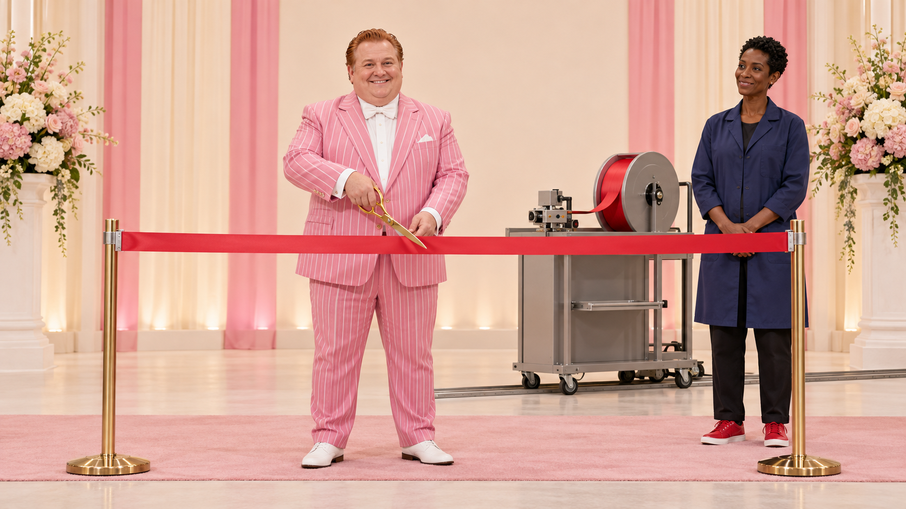
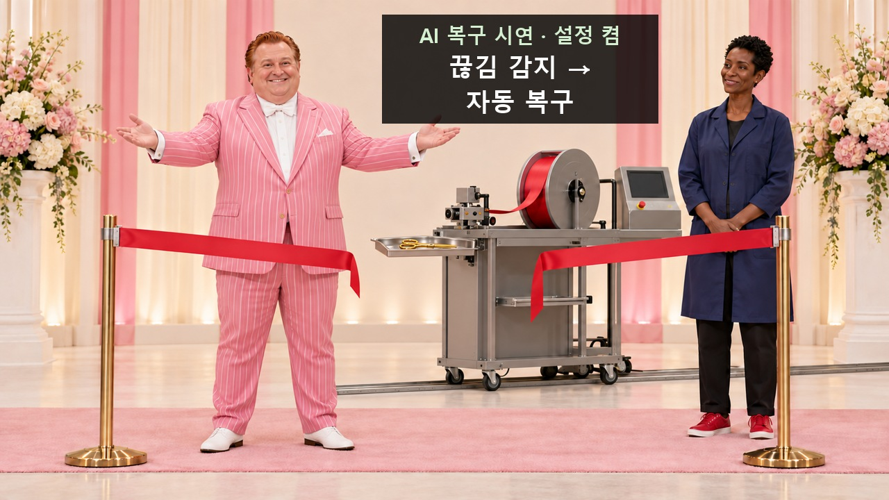
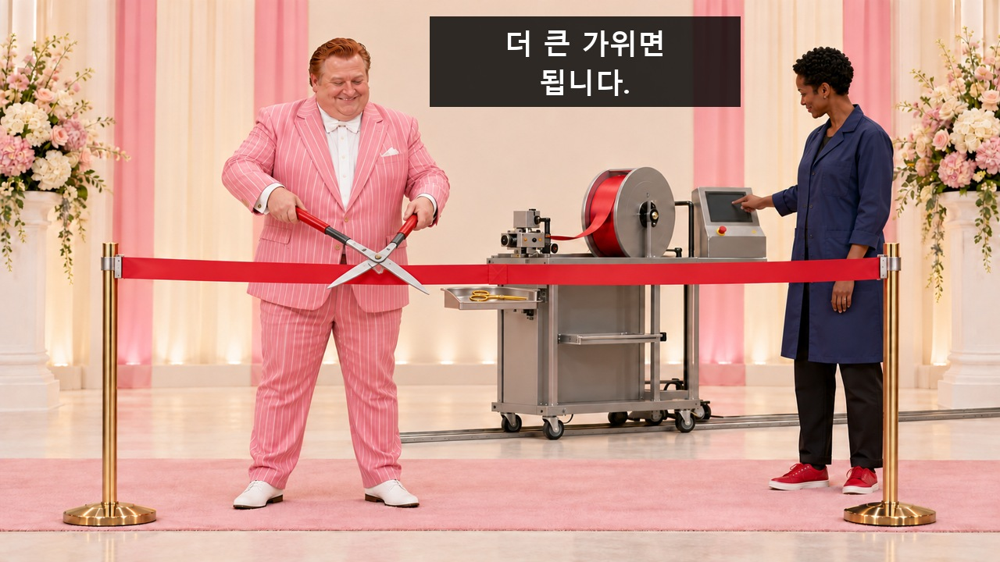
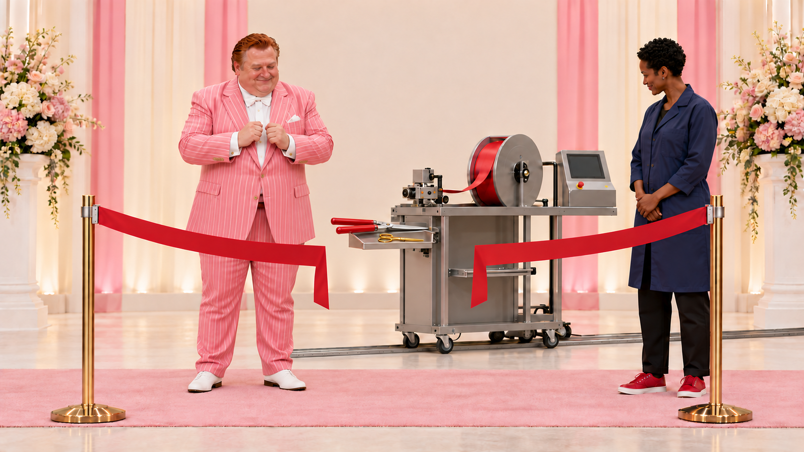
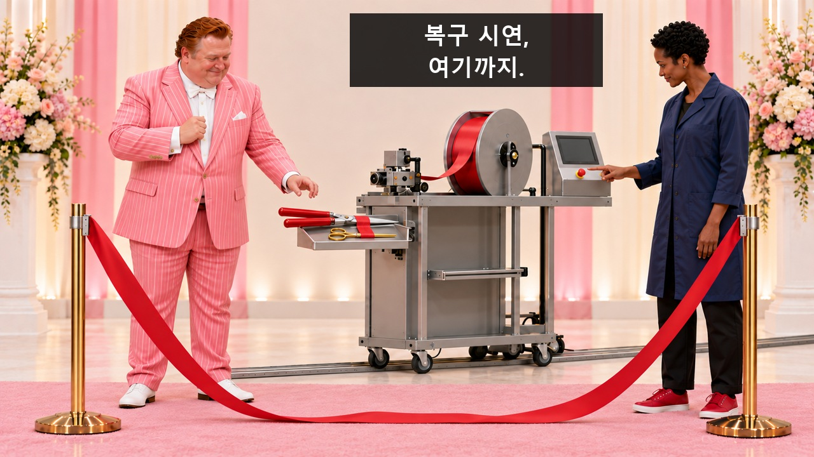
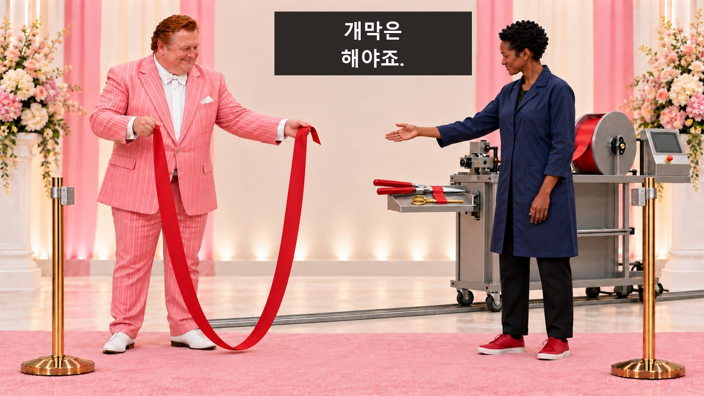
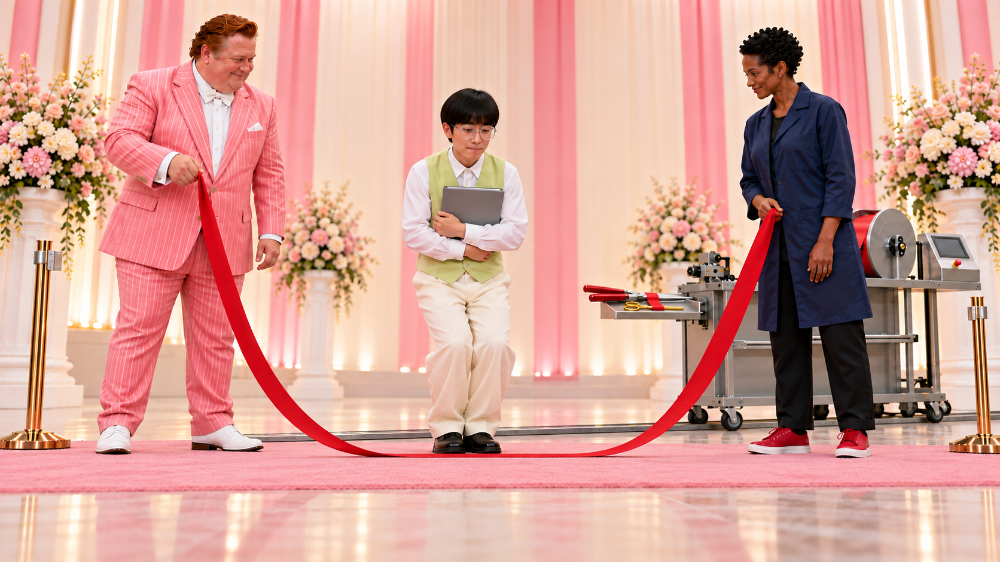
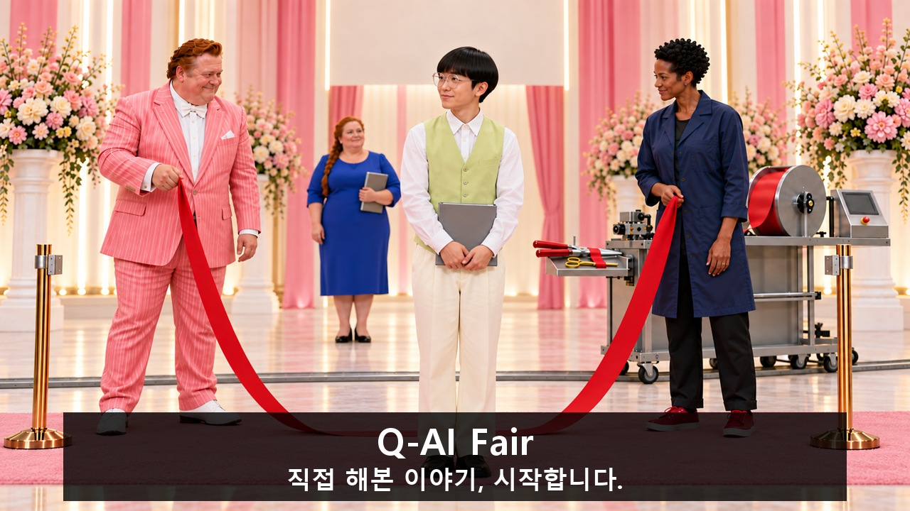

[검수 목록으로](README.md) · [← 이전 안](09_지구인은_질문이_많다.md)

# 10. 개막을 허가하지 않는 기계

**개막 리본을 자를 때마다 복구 시연 장치가 다시 잇고 가위마저 테이프에 붙자, 사회자는 길어진 리본을 줄넘기로 바꿔 첫 발표자를 입장시킨다.**

**C10 · V10 · 현장 도입 · 46초 · 9개 시작 이미지**

**전달할 내용:** 직접 실행해야 드러나는 적용 조건과 시행착오까지 이야기하며 행사를 시작한다.

**웃음의 전개:** 자르면 시작/끊기면 복구라는 두 목적의 충돌 → 더 큰 가위가 더 긴 보충 리본과 붙어버린 도구를 만듦 → 정지 후에도 의전을 포기하지 않는 사회자가 입장 방식만 줄넘기로 바꿈.

화면과 후처리 자막으로 전달하는 검수용 콘티입니다. 아래 이미지는 동작의 시작 상태이며, 자막이 있는 컷은 그 첫 이미지 위에 자막 위치를 얹은 정지 예시입니다. 실제 동작 완료 화면이나 생성 영상은 아닙니다.

등장인물·연출 보기

- **MC**: 40대 남성 사회자. 풍성한 체형, 둥근 얼굴과 짧은 코, 짧은 구리색 올백머리, 수염 없음. 분홍 세로줄 수트·흰 나비넥타이·흰 구두. C08의 거대한 흰 분장·높은 검정 가발 주역보다 작고 일상적인 얼굴. 팔벌림과 의전 미소를 끝까지 유지.
- **DV**: 30대 후반 흑인 여성 개발자. 큰 키와 긴 얼굴, 매우 짧은 검정 촘촘한 곱슬머리, 안경 없음. 종아리까지 긴 남색 작업가운, 검정 바지, 빨간 낮은 운동화. C02의 작은 한국인 곱슬머리 안경 여성과 명확히 구별. 장치를 자랑하기보다 시연 조건을 확인하고 직접 정지.
- **P1**: 20대 후반 동아시아 남성 첫 발표자. 작은 체구와 가는 팔다리, 균일하게 내려온 긴 직선 앞머리의 바가지컷, 커다란 둥근 투명안경. 파스텔 라임색 조끼·흰 셔츠·크림색 통바지·검정 낮은 구두. 두꺼운 회색 실행 기록 폴더를 가슴에 안고 등장.
- **P2**: 50대 백인 여성 다음 발표자. 큰 체격, 긴 구리색 머리를 굵게 땋아 등 뒤로 내림, 긴 타원 얼굴. 코발트색 일자 원피스·검정 낮은 신발, 작은 무지 서류철. K09에만 뒤쪽에서 무릎을 푸는 준비 동작. 두 번째 점프는 하지 않는다.
- **MACHINE**: 투박한 실물 복구 시연 장치. 뒤쪽 짧은 바닥 레일 위 회색 이동 몸체 하나, 낮은 접합 헤드, 크게 노출된 빨간 보충 테이프 롤과 빨간 공급 띠. 양쪽 의전 리본 기둥은 단순 집게형이며 사람 손으로 풀 수 있다. 사람을 향한 팔·칼·날 없음. 감지 화면과 정지 버튼은 DV 옆.

**형식:** 금가위 개막식과 자동 보충·접합 시연의 목표 충돌이 개막 줄넘기로 끝나는 B급 의전극

**연출:** 의도적으로 호화로운 소규모 개막 무대. 분홍 줄무늬 사회자의 과도한 환대와 진지한 개발자. 기계는 크고 노출된 B급 실물 소품이며 공급 롤·바닥 리본이 보인다. 점프는 대단한 스포츠가 아닌 불필요하게 장엄한 입장.

## 컷별 스토리보드

### C10_K01 · 0–3초 · 3초

**첫 상태:** MC가 양쪽 기둥 사이 빨간 천 리본에 금가위를 벌려 대기 직전. DV는 뒤 오른쪽 장치 옆에서 시연 화면을 본다. 크게 노출된 빨간 보충 롤은 아직 돌지 않음. 리본은 온전.

**이어질 동작:** MC가 금가위로 리본을 한 번 자르고 두 팔을 의전 자세로 벌린다. 잘린 두 끝이 아래로 처진다. DV는 화면에 나타난 끊김 후보를 본다.

**후처리 자막:** 없음. 행동과 표정으로 전달.

**웃음·정보 의도:** 개막은 자르는 행위로 시작된다는 익숙한 약속을 정확히 심는다. 장치는 아직 반전 행동을 하지 않음.

대사·음악·효과음·구도·전환

| 항목 | 내용 |
|---|---|
| 대사·내레이션 | 없음. 의미는 화면과 후편집 자막으로 전달. |
| 음악·효과음·정적 | 선택 BGM은 번쩍이는 개막 팡파르. 첫 복구 때 팡파르 끝음을 어색하게 반복하고, 큰 가위에는 더 큰 같은 화음. 정지 버튼 뒤 0.6초 정적. 줄넘기에는 진지한 입장 드럼, 점프 때 장엄한 상승음, 착지 직후 일상적인 종이 넘김. 대사·노래 가사 없음. 이 컷: 팡파르 상승과 가위 싹. 박수·개막 선언 음성 없음. |
| 구도 | 사회자 전신·리본 양끝·뒤 장치와 롤을 한 화면에 담는 고정 와이드. 하단 바닥이 충분히 보임. |
| 전환 | 처진 리본과 장치의 접합 헤드로 같은 축 컷. |

[자막 없는 시작 PNG 원본](storyboards/2026-10-23_v10-ten-concepts/images/C10/S01.png)

### C10_K02 · 3–8초 · 5초

**첫 상태:** 잘린 리본 두 끝이 처져 있다. 접합 헤드는 두 끝 사이로 이동하기 직전이고 큰 빨간 롤에서 공급 띠가 헤드까지 이어져 있다. MC는 팔을 벌린 개막 미소, 금가위는 트레이.

**이어질 동작:** 3–4.5초: 보이는 롤의 접합 띠로 잘린 리본을 다시 잇는다. 4.5초: MC가 벌린 팔과 미소를 유지한 채 눈만 접합부로 내린다. 4.7초 뒤 짧은 시연 자막. 복구 동작을 먼저 보여준다.

**후처리 자막**

- **4.7–7.8초:** AI 복구 시연 · 설정 켬 / 끊김 감지 → / 자동 복구

**웃음·정보 의도:** 자르기와 복구라는 목적 충돌의 첫 반전. AI가 모든 복구를 마법으로 수행했다는 그림을 피함.

대사·음악·효과음·구도·전환

| 항목 | 내용 |
|---|---|
| 대사·내레이션 | 없음. 의미는 화면과 후편집 자막으로 전달. |
| 음악·효과음·정적 | 선택 BGM은 번쩍이는 개막 팡파르. 첫 복구 때 팡파르 끝음을 어색하게 반복하고, 큰 가위에는 더 큰 같은 화음. 정지 버튼 뒤 0.6초 정적. 줄넘기에는 진지한 입장 드럼, 점프 때 장엄한 상승음, 착지 직후 일상적인 종이 넘김. 대사·노래 가사 없음. 이 컷: 롤 도르륵, 접합 탁. 끝난 줄 알았던 팡파르 끝음 반복. |
| 구도 | 리본 접합부·공급 롤·MC 얼굴이 함께 보이는 미디엄 와이드. 눈앞 결과와 재료 출처를 한 화면. |
| 전환 | MC의 멈춘 미소에서 더 큰 가위를 든 다음 준비 상태로 컷. |

[자막 없는 시작 PNG 원본](storyboards/2026-10-23_v10-ten-concepts/images/C10/S02_v2.png)

### C10_K03 · 8–12초 · 4초

**첫 상태:** 리본의 작은 접합 패치가 보인다. MC가 큰 정원 가위를 두 손으로 벌려 패치에 대기 직전이며 금가위는 아래 트레이에 남아 있다. DV는 장치 화면의 고정 시연 설정을 보고 있다.

**이어질 동작:** MC가 벌린 큰 정원 가위를 패치 쪽으로 짧게 오른쪽으로 옮긴 뒤 같은 리본을 한 번 넓게 자른다. 리본 두 끝이 더 멀리 벌어지고 MC는 가위를 닫아 트레이 쪽으로 내린다. 장치가 움직이는 과정은 다음 컷에 둔다.

**후처리 자막**

- **8.33–10.4초:** 더 큰 가위면 / 됩니다.

**웃음·정보 의도:** 성격을 드러내는 잘못된 해결 선택. 기계와 싸우기보다 의전의 크기로 문제를 누르려 한다.

대사·음악·효과음·구도·전환

| 항목 | 내용 |
|---|---|
| 대사·내레이션 | 없음. 의미는 화면과 후편집 자막으로 전달. |
| 음악·효과음·정적 | 선택 BGM은 번쩍이는 개막 팡파르. 첫 복구 때 팡파르 끝음을 어색하게 반복하고, 큰 가위에는 더 큰 같은 화음. 정지 버튼 뒤 0.6초 정적. 줄넘기에는 진지한 입장 드럼, 점프 때 장엄한 상승음, 착지 직후 일상적인 종이 넘김. 대사·노래 가사 없음. 이 컷: 큰 가위 척, 더 큰 같은 팡파르 화음. |
| 구도 | MC 상반신·큰 가위·작은 금가위와 넓어진 리본 틈을 보는 미디엄 와이드. |
| 전환 | 가위를 내린 뒤 리본 틈과 롤의 두 번째 동작 컷. |

[자막 없는 시작 PNG 원본](storyboards/2026-10-23_v10-ten-concepts/images/C10/S03_v2.png)

### C10_K04 · 12–18초 · 6초

**첫 상태:** 두 번째로 잘린 리본 끝이 더 멀리 처져 있다. 닫힌 금가위와 정원 가위가 얕은 트레이에 나란히 놓였다. 접합 헤드는 새 공급을 시작하기 직전이며 롤의 남은 빨간 띠가 충분히 보인다.

**이어질 동작:** 장치가 같은 롤에서 눈에 띄게 긴 접합 띠를 공급해 두 끝을 잇는다. 과한 여유분이 부드러운 U자로 바닥까지 늘어진다. 주 리본과 이미 잘려 분리된 짧은 접합 테이프 자투리가 아래 트레이에 떨어져 닫힌 두 가위 날을 함께 붙인다. 주 리본에는 가위가 연결되지 않는다. MC는 트레이를 보고 의전 미소를 버티며 손을 멈춘다.

**후처리 자막:** 없음. 행동과 표정으로 전달.

**웃음·정보 의도:** 큰 해결책이 더 큰 부작용을 만든다. 재료의 생성이나 리본의 마법 같은 길이 변화 없이 실제 롤 공급이 확대를 설명.

대사·음악·효과음·구도·전환

| 항목 | 내용 |
|---|---|
| 대사·내레이션 | 없음. 의미는 화면과 후편집 자막으로 전달. |
| 음악·효과음·정적 | 선택 BGM은 번쩍이는 개막 팡파르. 첫 복구 때 팡파르 끝음을 어색하게 반복하고, 큰 가위에는 더 큰 같은 화음. 정지 버튼 뒤 0.6초 정적. 줄넘기에는 진지한 입장 드럼, 점프 때 장엄한 상승음, 착지 직후 일상적인 종이 넘김. 대사·노래 가사 없음. 이 컷: 두 번째 롤 도르륵을 조금 길게. 바닥 띠의 툭, 음악도 과하게 한 번 더 반복. |
| 구도 | 롤 회전·공급 띠·접합부·바닥의 길어진 여유분·트레이를 한 화면에 보이는 고정 와이드. 사람의 손은 장치 경로 밖. |
| 전환 | 눈에 띄는 긴 리본을 보던 DV의 정지 버튼으로 컷. |

[자막 없는 시작 PNG 원본](storyboards/2026-10-23_v10-ten-concepts/images/C10/S04_v2.png)

### C10_K05 · 18–22초 · 4초

**첫 상태:** 긴 주 리본이 바닥에 늘어지고, 별도로 잘려 떨어진 짧은 빨간 접착 자투리가 트레이 위 두 가위의 닫힌 날을 함께 붙였다. 주 리본과 트레이 사이에 연결 띠는 없다. DV의 손가락은 정지 버튼 직전, MC는 가위 손잡이를 보고 있다.

**이어질 동작:** DV가 정지 버튼을 누른다. 장치와 롤이 완전히 멈춘다. MC는 두 가위가 함께 들리는 손잡이를 잠깐 확인한 뒤 다시 내려놓고 태연하게 리본을 본다.

**후처리 자막**

- **19.12–21.76초:** 복구 시연, / 여기까지.

**웃음·정보 의도:** 사람이 시연을 중지하는 판단을 보여주고, 가위의 다음 확대 대신 목적을 달성할 다른 의전을 고르게 한다.

대사·음악·효과음·구도·전환

| 항목 | 내용 |
|---|---|
| 대사·내레이션 | 없음. 의미는 화면과 후편집 자막으로 전달. |
| 음악·효과음·정적 | 선택 BGM은 번쩍이는 개막 팡파르. 첫 복구 때 팡파르 끝음을 어색하게 반복하고, 큰 가위에는 더 큰 같은 화음. 정지 버튼 뒤 0.6초 정적. 줄넘기에는 진지한 입장 드럼, 점프 때 장엄한 상승음, 착지 직후 일상적인 종이 넘김. 대사·노래 가사 없음. 이 컷: 버튼 딸깍 후 모터 정지, 0.6초 정적. |
| 구도 | DV·정지 버튼·고정된 롤·붙은 도구를 보는 미디엄 와이드. MC 얼굴도 포함. |
| 전환 | 0.6초 정적 뒤 열린 기둥 집게와 자유 리본을 든 다음 상태로 컷. |

[자막 없는 시작 PNG 원본](storyboards/2026-10-23_v10-ten-concepts/images/C10/S05.png)

### C10_K06 · 22–26초 · 4초

**첫 상태:** 장치는 뒤 오른쪽에 멈춰 있다. 양쪽 의전 기둥의 집게가 실제로 열려 있고, MC는 기둥과 공급 롤에서 완전히 분리된 부드러운 리본 두 끝을 손에 들었다. DV가 한 끝을 받으려 빈손을 내민다. 별개 접착 자투리로 붙은 가위 두 개는 뒤 트레이에 남고, 주 리본과 연결되지 않는다.

**이어질 동작:** MC가 DV에게 리본 한 끝을 정중히 건네고 반대 끝은 자신이 잡는다. 둘이 입구 좌우로 한 걸음 벌려 서며 MC가 의전처럼 팔을 가볍게 푼다. 리본 가운데는 바닥에 느슨하게 놓인다.

**후처리 자막**

- **22.33–25.2초:** 개막은 / 해야죠.

**웃음·정보 의도:** 의전을 끝내야 한다는 성격을 유지한 채 용도를 바꾼다. 줄넘기라고 자막으로 먼저 설명하지 않는다.

대사·음악·효과음·구도·전환

| 항목 | 내용 |
|---|---|
| 대사·내레이션 | 없음. 의미는 화면과 후편집 자막으로 전달. |
| 음악·효과음·정적 | 선택 BGM은 번쩍이는 개막 팡파르. 첫 복구 때 팡파르 끝음을 어색하게 반복하고, 큰 가위에는 더 큰 같은 화음. 정지 버튼 뒤 0.6초 정적. 줄넘기에는 진지한 입장 드럼, 점프 때 장엄한 상승음, 착지 직후 일상적인 종이 넘김. 대사·노래 가사 없음. 이 컷: 천 마찰과 사회자의 옷 소리, 입장 드럼이 낮게 시작. |
| 구도 | 열린 기둥 집게·분리된 리본·두 사람 전신이 보이는 정면 와이드. 중앙 입장 통로 확보. 손에서 끝을 건네는 상반신 중심 연결로 짧게 사용하고, 줄의 전체 길이는 K07 와이드 기준으로 맞춘다. K06에서 길어지는 변형을 생성하지 않는다. |
| 전환 | 같은 축으로 후경 입구에서 대기하는 첫 발표자에게 컷. |

[자막 없는 시작 PNG 원본](storyboards/2026-10-23_v10-ten-concepts/images/C10/S06_v2.png)

### C10_K07 · 26–32초 · 6초

**첫 상태:** MC 왼쪽과 DV 오른쪽이 자유 리본 한 끝씩 잡고 첫 큰 회전을 시작하기 직전. 리본 뒤 후경 입구 쪽에는 P1이 회색 실행 기록 폴더를 가슴에 안고 발을 나란히 모은 채 기다린다. 리본 가운데는 아직 바닥.

**이어질 동작:** 둘이 리본을 한 번 큰 원호로 돌려 박자를 보인다. P1이 그 박자에 두 번 움찔하지만 뛰지 못한다. MC는 미소를 유지하고 다시 낮은 출발 위치로 리본을 돌린다.

**후처리 자막:** 없음. 행동과 표정으로 전달.

**웃음·정보 의도:** 새 입장 의전의 정체가 화면으로 드러나고, 발표자가 박자를 못 맞추는 작은 망설임이 점프의 기대를 만든다.

대사·음악·효과음·구도·전환

| 항목 | 내용 |
|---|---|
| 대사·내레이션 | 없음. 의미는 화면과 후편집 자막으로 전달. |
| 음악·효과음·정적 | 선택 BGM은 번쩍이는 개막 팡파르. 첫 복구 때 팡파르 끝음을 어색하게 반복하고, 큰 가위에는 더 큰 같은 화음. 정지 버튼 뒤 0.6초 정적. 줄넘기에는 진지한 입장 드럼, 점프 때 장엄한 상승음, 착지 직후 일상적인 종이 넘김. 대사·노래 가사 없음. 이 컷: 진지한 입장 드럼 2박, 천이 도는 소리. 재촉하는 대사 없음. |
| 구도 | 리본 원호 전체·P1 전신·두 끝을 잡은 사람들의 손이 모두 보이는 고정 와이드. 발과 바닥이 잘리지 않음. 카메라는 무대 안쪽에서 후경 입구를 보는 같은 축을 유지한다. MC는 화면 왼쪽, DV와 정지 장치는 오른쪽. P1은 후경 대기 위치에서 리본을 넘어 카메라 쪽 전경 발표 위치로 이동한다. K09에서 180도 역방향으로 카메라를 바꾸지 않는다. |
| 전환 | 동일 축에서 P1이 점프 준비를 하는 조금 낮은 구도로 컷. |

[자막 없는 시작 PNG 원본](storyboards/2026-10-23_v10-ten-concepts/images/C10/S07.png)

### C10_K08 · 32–38초 · 6초

**첫 상태:** P1이 폴더를 두 팔로 안고 무릎을 살짝 굽혔다. 리본은 발 앞 낮은 위치에서 다음 회전을 시작하기 직전. MC와 DV의 손은 양옆에 있고 중앙 위 공간은 비어 있다.

**이어질 동작:** P1이 낮게 지나가는 리본을 한 번 과장되게 높이 뛰어넘어 카메라 쪽 전경 발표 위치로 착지한다. MC와 DV는 리본 속도를 줄여 멈추고, P1은 폴더를 떨어뜨리지 않는다. 공중 정지나 두 번째 점프는 없다.

**후처리 자막:** 없음. 행동과 표정으로 전달.

**웃음·정보 의도:** 평범한 발표 입장에 지나치게 장엄한 한 번의 몸개그를 부여한다. 리본이 사람을 때리거나 묶는 웃음은 쓰지 않는다.

대사·음악·효과음·구도·전환

| 항목 | 내용 |
|---|---|
| 대사·내레이션 | 없음. 의미는 화면과 후편집 자막으로 전달. |
| 음악·효과음·정적 | 선택 BGM은 번쩍이는 개막 팡파르. 첫 복구 때 팡파르 끝음을 어색하게 반복하고, 큰 가위에는 더 큰 같은 화음. 정지 버튼 뒤 0.6초 정적. 줄넘기에는 진지한 입장 드럼, 점프 때 장엄한 상승음, 착지 직후 일상적인 종이 넘김. 대사·노래 가사 없음. 이 컷: 장엄한 상승음 뒤 낮은 착지 툭. 성공 환호 음성 없음. |
| 구도 | P1 전신과 낮은 리본·착지 공간을 보는 로앵글 와이드. 높이는 과장하되 실제 착지 방향이 보임. 카메라는 무대 안쪽에서 후경 입구를 보는 같은 축을 유지한다. MC는 화면 왼쪽, DV와 정지 장치는 오른쪽. P1은 후경 대기 위치에서 리본을 넘어 카메라 쪽 전경 발표 위치로 이동한다. K09에서 180도 역방향으로 카메라를 바꾸지 않는다. |
| 전환 | 착지 직후 종이를 펼치는 정상 눈높이 구도로 하드 컷. |

[자막 없는 시작 PNG 원본](storyboards/2026-10-23_v10-ten-concepts/images/C10/S08.png)

### C10_K09 · 38–46초 · 8초

**첫 상태:** P1이 이미 리본 앞 카메라 쪽 전경 발표 위치에 착지해 회색 폴더를 펼치기 직전. MC와 DV는 리본을 느슨하게 잡고 정지해 있다. 뒤쪽 입구에는 P2가 서류철을 옆구리에 끼고 발을 모은 상태로 처음 등장.

**이어질 동작:** P1이 아무 일도 없었던 듯 기록 폴더를 펼친다. 뒤에서 P2가 진지하게 무릎을 한 번 굽혀 준비 운동한다. MC는 그쪽을 향해 의전 미소를 유지한다. 다음 점프는 하지 않는다.

**후처리 자막**

- **41.0–45.8초:** Q-AI Fair / 직접 해본 이야기, 시작합니다.

**웃음·정보 의도:** 몸개그 직후 발표자의 담담함으로 장르 온도를 낮추고, 다음 발표자의 준비가 새 의전이 정착됐다는 두 번째 웃음. 기록 공개가 실제 행사 시작과 맞물림.

대사·음악·효과음·구도·전환

| 항목 | 내용 |
|---|---|
| 대사·내레이션 | 없음. 의미는 화면과 후편집 자막으로 전달. |
| 음악·효과음·정적 | 선택 BGM은 번쩍이는 개막 팡파르. 첫 복구 때 팡파르 끝음을 어색하게 반복하고, 큰 가위에는 더 큰 같은 화음. 정지 버튼 뒤 0.6초 정적. 줄넘기에는 진지한 입장 드럼, 점프 때 장엄한 상승음, 착지 직후 일상적인 종이 넘김. 대사·노래 가사 없음. 이 컷: 착지 직후 일상적인 종이 넘김. 음악은 가볍게 마침, 필수 음성 없음. |
| 구도 | 같은 축의 미디엄 와이드. 전경 P1 기록과 얼굴, 후경 P2 무릎 준비가 보임. 앞 3초 동작을 보여준 뒤 하단 제목판을 표시해 얼굴과 무릎을 가리지 않는다. 카메라는 무대 안쪽에서 후경 입구를 보는 같은 축을 유지한다. MC는 화면 왼쪽, DV와 정지 장치는 오른쪽. P1은 후경 대기 위치에서 리본을 넘어 카메라 쪽 전경 발표 위치로 이동한다. K09에서 180도 역방향으로 카메라를 바꾸지 않는다. |
| 전환 | 앞 3초 기록 펼침·무릎 준비, 뒤 4.8초 제목 유지 후 실제 진행 연결. |

[자막 없는 시작 PNG 원본](storyboards/2026-10-23_v10-ten-concepts/images/C10/S09.png)

---

[검수 목록으로](README.md) · [← 이전 안](09_지구인은_질문이_많다.md)

정확한 행사 날짜·장소·참석 방법은 아직 기입하지 않았습니다. 실제 영상 제작 뒤 움직이는 소품·자막 가림·읽는 시간·편집 호흡을 재확인합니다.
