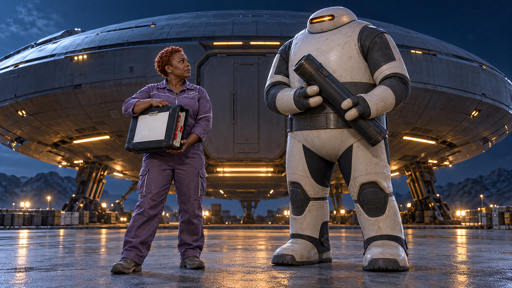
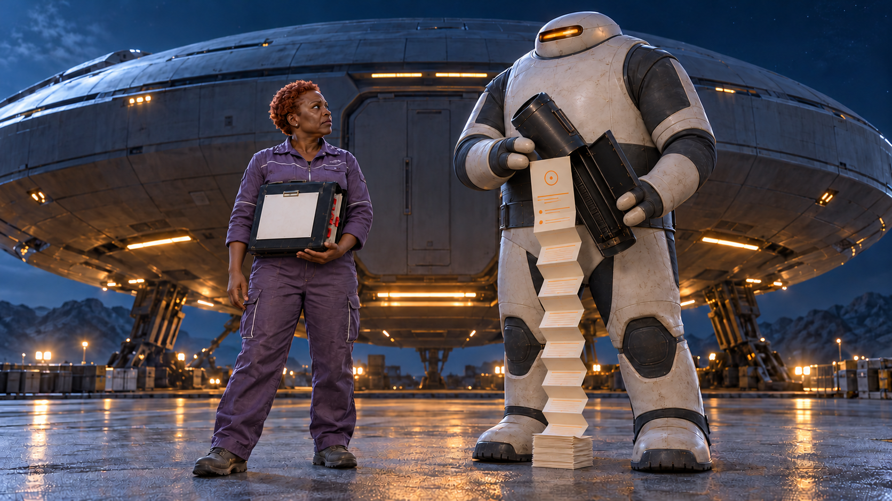
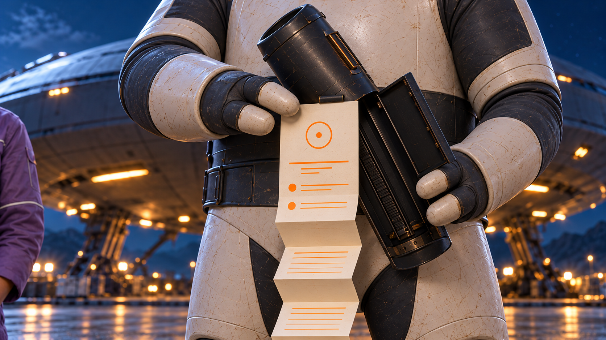
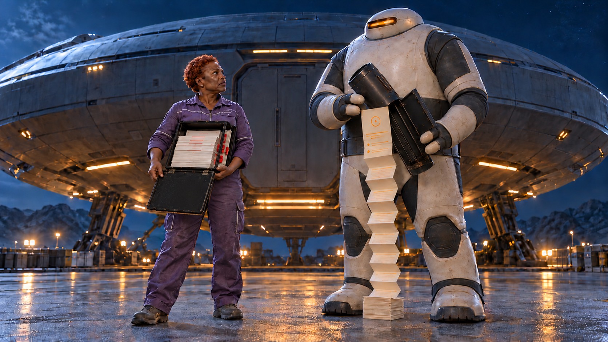
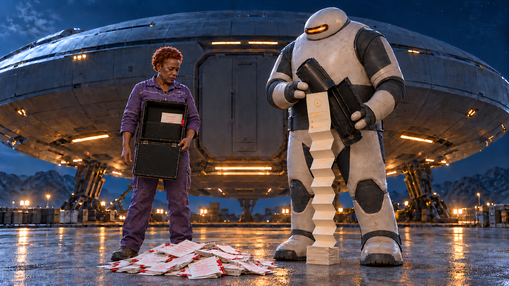
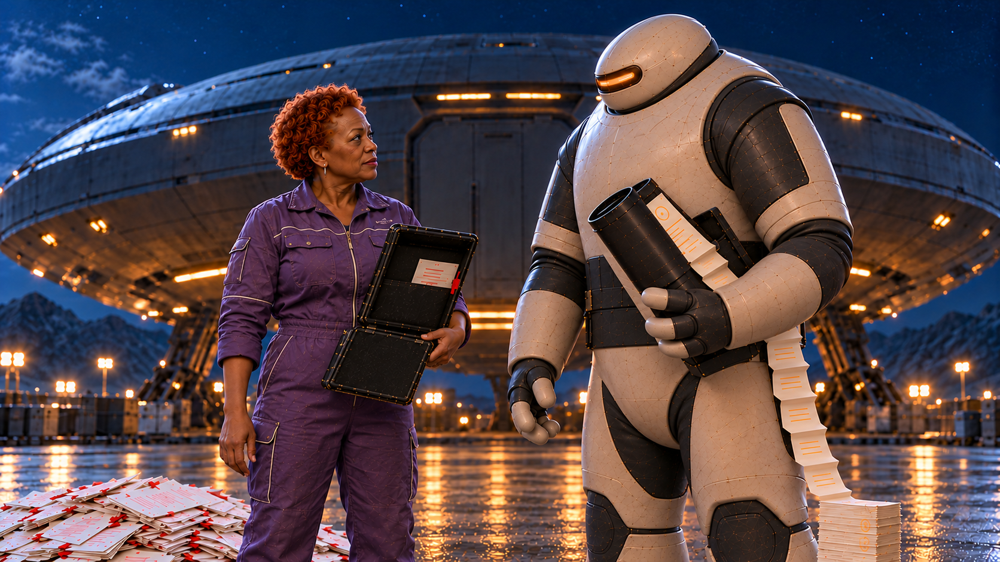

# C10 · 지구 대표, 질문 있습니다

외계인의 무기 같은 원통에서 오답 기록이 쏟아지고, 질문은 첫 줄부터다. 지구 대표가 자기 기록을 보여주려 폴리오를 열자 더 큰 수정 기록 더미가 쏟아진다. 두 사람은 서로의 첫 페이지를 돌려 보여 준다.

**야간 외계 첫접촉 SF의 규모를 한 줄 질문으로 뒤집는 짧은 코미디 · 38초 · 동작 영상 8개 + 후처리 엔딩 5초**

핵심 메시지: 해본 사람끼리, 통하는 이야기.

음성 대사 없이 화면과 후처리 자막으로 전달합니다. 아래 이미지는 각 씬의 동작 전 첫 프레임입니다. Flow 영상은 아직 만들지 않았습니다.

## 등장인물

- **HU**: 50대 중반 흑인 여성, 작고 단단한 체형, 둥글고 넓은 얼굴, 아주 짧은 구리색 천연 곱슬머리, 깊고 집중한 눈. 안경 없음. 먼지빛 보라색 두꺼운 기술자 점프수트, 흰색 파이핑, 회색 평평한 작업화. 헬멧·기관 로고 없음.
- **AL**: 키 약2.2m의 독창적인 비인간 외계인. 넓은 둥근 원통형 몸통, 목 없이 이어지는 작은 납작한 타원 머리, 진주색 단단한 얼굴면과 가로로 긴 호박색 눈창 하나. 인간 입·코 없음. 양손 각각 두꺼운 손가락 세 개. 무광 아이보리-차콜 일체형 탐사복, 허리에 넓은 가로 띠, 단순한 넓은 부츠. 기존 유명 외계인/로봇/우주복과 닮지 않음.

## 컷별 콘티

| 씬·컷 | 구간 | 화면·행동·구도 | 후처리 자막 | 대사·내레이션 | BGM·효과음·정적 | 전환 | 의도 |
|---|---|---|---|---|---|---|---|
| S01 / C10_K01 | 0–4초 | HU가 케이스 앞면의 깔끔한 성공 페이지를 AL 쪽으로 들어 보여 준다. 케이스 앞 덮개는 아직 닫혀 수납 기록을 지지한다. 로우 와이드, 두 인물과 정지 우주선. HU 케이스를 얇은 A4폴더처럼 숨기지 않고 두께/붉은 탭을 관객이 볼 수 있게. | 0.6–3.8초: 지구의 AI 활용 사례입니다. | 없음 | 0–4초 낮은 신시사이저와 절제된 호른. 진짜 첫접촉의 긴장, 음성0. | AL의 원통으로 하드 컷. | 성공을 들고 등장한 지구 대표와 거대한 외계 문명. 두꺼운 케이스가 나중 물량 반전의 정직한 복선. |
| S02 / C10_K02 | 4–10초 | AL이 힌지 덮개를 열자 안에 접힌 유한한 오답 기록이 중력으로 바로 아래에 짧게 떨어져 작은 접힘 더미를 만든다. 원통 입구부터 바로 아래 바닥까지 잡는 고정 미디엄 와이드. 종이가 바닥을 따라 스스로 멀리 펼쳐지지 않음. |  | 없음 | 4초 금속 힌지,4.8–8초 유한한 종이 사각거림. 장대한음악은7초 한음만 남기며 민망하게 잦아듦. | 길게 펼쳐진 종이와 HU를 함께 잡는 시선 컷. | 위협적인 장치를 자기 오답 기록통으로 바꾸는 첫 반전. 수평 장거리 자동 전개 물리 제거. |
| S03 / C10_K03 | 10–13초 | HU가 원통 첫 페이지와 아래의 작은 기록 더미를 본 뒤 오른손을 펴 어느 부분인지 묻는다. 두인물 미디엄, AL작은더미 전경과 아직닫힌HU케이스의 두께 같이. | 10.3–12.8초: 어느 부분이…? | 없음 | 10.8–11.8초1초정적, 차가운공기음만. | AL의 손끝과 출력지 맨 위를 근접 컷. | 상대가 어려운 지점까지 도달했을 것이라는 기대를 먼저 만들기. |
| S04 / C10_K04 | 13–16초 | AL이 자기 시도 기록의 첫 줄만 오른손으로 정확히 짚는다. 한손가락/첫행 큰 근접, 숫자나 긴 문장 없이 위치로 의미전달. | 13.25–15.85초: 첫 줄부터요. | 없음 | 13.5초 낮은목관한음,14–15초1초정적. | HU의 성공 페이지 아래로 컷. | 큰 외교 장치가 첫 줄에서 막혔다는 두 번째박. 단위 정답을 묻는 줄거리 아님. |
| S05 / C10_K05 | 16–20초 | HU가 성공 페이지가 붙은 전면덮개를 바깥쪽 아래로 열어 자기 수정 기록을 보여주려 한다. 케이스가 조금 앞으로 기울며 내부 종이들이 입구까지 밀리기 시작한다. 깊이와 실제수납량이 보이는3/4근접. 종이갑작스런새생성 없이닫힌면이열림. | 16.2–19.8초: 저도 거기서 시작했어요. | 없음 | 16초 따뜻한피아노두음,덮개열림19초부터종이마찰이수상하게커짐. | 같은 케이스 전면이 열린 동작을 이어 받아 종이 낙하로 매치 컷. | 경험을 공유하려는 자신감에서 더 큰 기록량의 반전으로 연결하는 실제 원인. |
| S06 / C10_K06 | 20–25초 | 케이스 속 유한한 붉은수정기록들이 몇 차례의 묶음으로 중력에 따라 HU 바로 아래에 쏟아져, AL의 더미보다 눈에 띄게 넓고 큰 더미를 만든다. 두캐릭터허리부터바닥까지보이는고정와이드,왼큰더미/오른작은더미를비교. 얼굴반응은다음컷. |  | 없음 | 20–23.5초 종이와종이부딪힘,음악의작은상승이물량에눌림.23.5초음악정지,마지막종이떨어지는소리만. | 큰 더미/작은 더미가 보이는 표정 비교 컷. | 인간이 상대를가르치는구도를뒤집는실제새사건. 말로'나도실패했다'고설명하는대신수정기록물량이몸앞으로드러남. |
| S07 / C10_K07 | 25–28초 | AL이 자기 작은 더미와 HU의 큰 더미를 번갈아 본 뒤 HU에게 전보다 훨씬 공손하게 몸을 조금 기울인다. HU는 작게 어깨를 으쓱한다. 두표정/상체와두더미비교동시에. 추가공격·절·넘어짐없음. |  | 없음 | 25–26초1초정적.26초이후 작은피아노한음. 승리팡파르/웃음소리없음. | 서로의 기록 면이 보이는 대화 각도로 컷. | 물량반전의감정결과. 거대문명과인간의지식서열을가볍게뒤집되두사람모두존중. |
| S08 / C10_K08 | 28–33초 | HU가 자기 첫수정페이지를 AL이 읽을 수 있게 돌려 오른손으로 자신의 수정 지점을 가리킨다. 이어 AL도 자기 첫페이지를 HU에게 돌려 자기 막힌 지점을 짚는다. HU 상체 앞 3/4와 AL을 함께 보는 미디엄. HU 해부학적 왼팔이 열린 케이스를 지지하고 오른손은 비워 아래로 내려 동작 시작 전임이 분명하다. AL도 왼팔 원통 지지/빈 오른손. 각자 자기 문서를 상대에게 돌리기 전, 서로를 바라본다. | 28.4–32.8초: 그럼, 서로 첫 장부터. | 없음 | 28초부터따뜻하고작은현악/피아노대화형두음. 새음성/외계어없음. | 33초 별도 전체 화면 엔딩 카드. | 기록을보여주는것이행사의공유행동으로실제완결. 모여공부·필기엔딩과구분. |
| S09 / C10_K09 | 33–38초 | 고정카드5초. 상하안전여백8%,3줄후처리활자. | 33–38초: 해본 사람끼리, 통하는 이야기. Q-AI Fair 품질팀 AI 성과 교류회 | 없음 | 33초 웅장한저음위작은피아노한음.37.5–38초페이드. | 끝. | 성공결과와막힌기록모두를가진사람끼리이야기하는행사라는메시지5초. |

## 씬별 첫 프레임

### S01 · 0–4초

정지 우주선 앞. HU 왼팔에 깊이14cm 문서케이스를 받쳐 첫 성공 페이지 제시 직전. 옆 틈으로 붉은 수정 기록의 충분한 수납량이 보임. AL 오른쪽 양손 원통.

**동작:** HU가 케이스 앞면의 깔끔한 성공 페이지를 AL 쪽으로 들어 보여 준다. 케이스 앞 덮개는 아직 닫혀 수납 기록을 지지한다.

**후합성:** 성공 페이지 큰 제목 'AI 실행 결과', 단순한 결과 도식. 수치·정확도·기관명 없음.

### S02 · 4–10초

AL 양손 닫힌 원통, 바로 아래 바닥 비어 있음. HU 깊은 문서케이스는 닫힘/수납량 유지.

**동작:** AL이 힌지 덮개를 열자 안에 접힌 유한한 오답 기록이 중력으로 바로 아래에 짧게 떨어져 작은 접힘 더미를 만든다.

**후합성:** 주황 불일치/수정 표식과 회색행, 첫페이지 상단 '시도 기록'. 정확한 단위/같은 업무 데이터 없음.

### S03 · 10–13초

AL 문서통 아래 작은 접힘 기록 더미, 첫페이지 입구고정. HU 왼팔 깊은 케이스, 오른손 비움.

**동작:** HU가 원통 첫 페이지와 아래의 작은 기록 더미를 본 뒤 오른손을 펴 어느 부분인지 묻는다.

**후합성:** 자막 별도

### S04 · 13–16초

AL 원통 첫페이지/맨첫행, 오른손 한 손가락이 닿기 전. HU케이스 닫힌 채 옆.

**동작:** AL이 자기 시도 기록의 첫 줄만 오른손으로 정확히 짚는다.

**후합성:** 첫행 주황 수정 흔적. '입력 단위:mm' 삭제. HU사례와 다른 문서 구조.

### S05 · 16–20초

HU의 깊은 문서케이스 근접. 닫힌 앞 덮개 바깥면에 성공 페이지, 옆틈으로 붉은수정기록양 명확. 왼팔바닥/뒤판지지, 오른손전면덮개윗모서리.

**동작:** HU가 성공 페이지가 붙은 전면덮개를 바깥쪽 아래로 열어 자기 수정 기록을 보여주려 한다. 케이스가 조금 앞으로 기울며 내부 종이들이 입구까지 밀리기 시작한다.

**후합성:** 성공페이지와 그뒤붉은취소선/수정표식. 단위값·태블릿 UI 없음.

### S06 · 20–25초

동일HU케이스전면덮개가아래로열려 있고 살짝앞으로기울어져 수납기록맨앞끝이튀어나옴. HU아래바닥비움,AL아래작은더미는오른쪽.

**동작:** 케이스 속 유한한 붉은수정기록들이 몇 차례의 묶음으로 중력에 따라 HU 바로 아래에 쏟아져, AL의 더미보다 눈에 띄게 넓고 큰 더미를 만든다.

**후합성:** HU기록붉은수정표식,AL기록주황표식으로 다른사례 구분.

### S07 · 25–28초

왼HU큰붉은더미/오른AL작은주황더미가비교되는미디엄와이드. HU열린케이스지지,AL왼팔원통/오른손비움.

**동작:** AL이 자기 작은 더미와 HU의 큰 더미를 번갈아 본 뒤 HU에게 전보다 훨씬 공손하게 몸을 조금 기울인다. HU는 작게 어깨를 으쓱한다.

**후합성:** 자막 별도

### S08 · 28–33초

HU왼팔열린케이스뒷판의첫수정페이지,AL왼팔원통첫페이지. 둘다서로에게돌리기직전,오른손비움. 서로다른문서색/구조.

**동작:** HU가 자기 첫수정페이지를 AL이 읽을 수 있게 돌려 오른손으로 자신의 수정 지점을 가리킨다. 이어 AL도 자기 첫페이지를 HU에게 돌려 자기 막힌 지점을 짚는다.

**후합성:** HU '제 사례·수정 기록' 붉은메모 / AL '제 시도 기록' 주황메모, 서로다른문서구조. 단위정답맞춤·완료체크·동일성공화면없음.

## 기록

[정확한 생성 프롬프트·참조·이미지 검수](storyboards/2026-10-26_C01-C07-C10-rewrite-v15/manifests/C10_images.json) · [콘티 검토](storyboards/2026-10-26_C01-C07-C10-rewrite-v15/review_rounds.json) · [실제 이미지 교차 검토](storyboards/2026-10-26_C01-C07-C10-rewrite-v15/image_review.json)

실제 관객 반응을 측정한 결과는 아닙니다. 영상의 손·소품·물리적 동작은 향후 생성 후 다시 확인합니다. 행사 일시·장소·신청·성과 수치를 창작하지 않았습니다.
