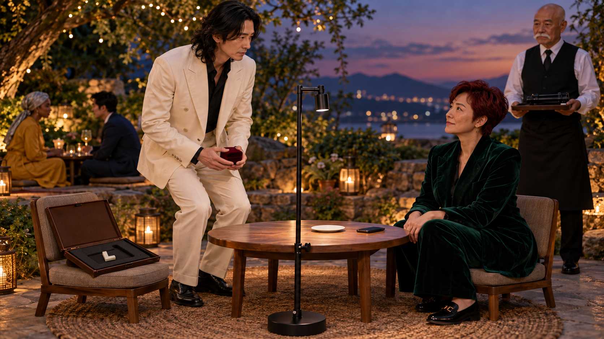
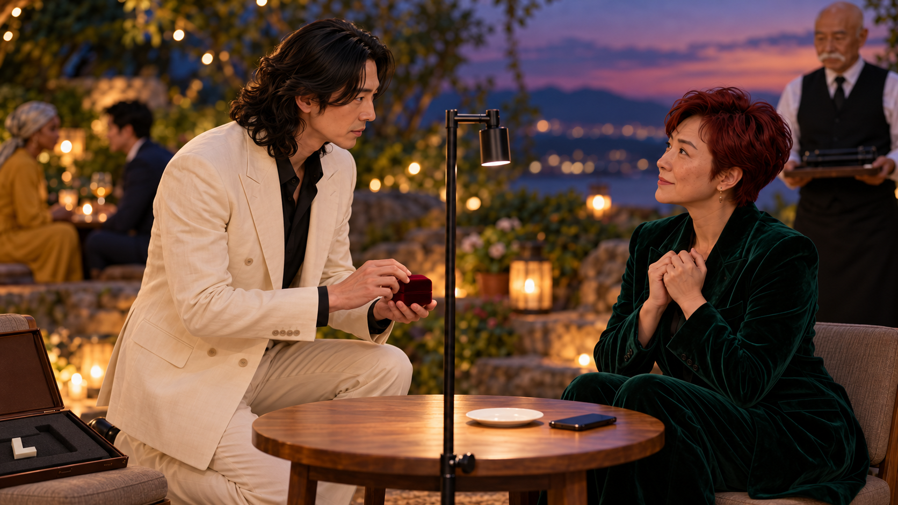
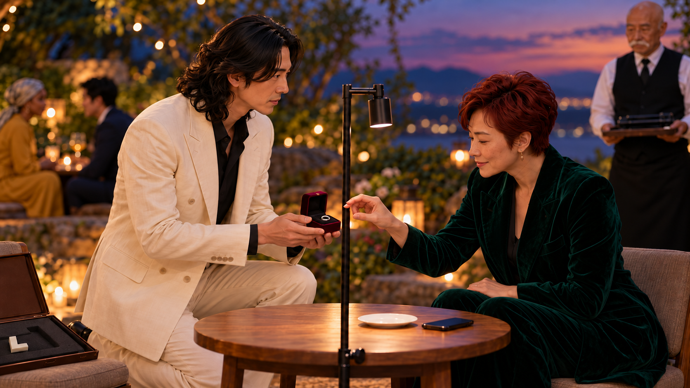
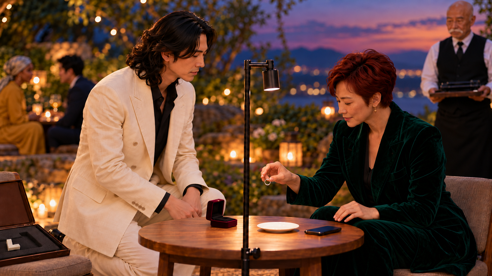
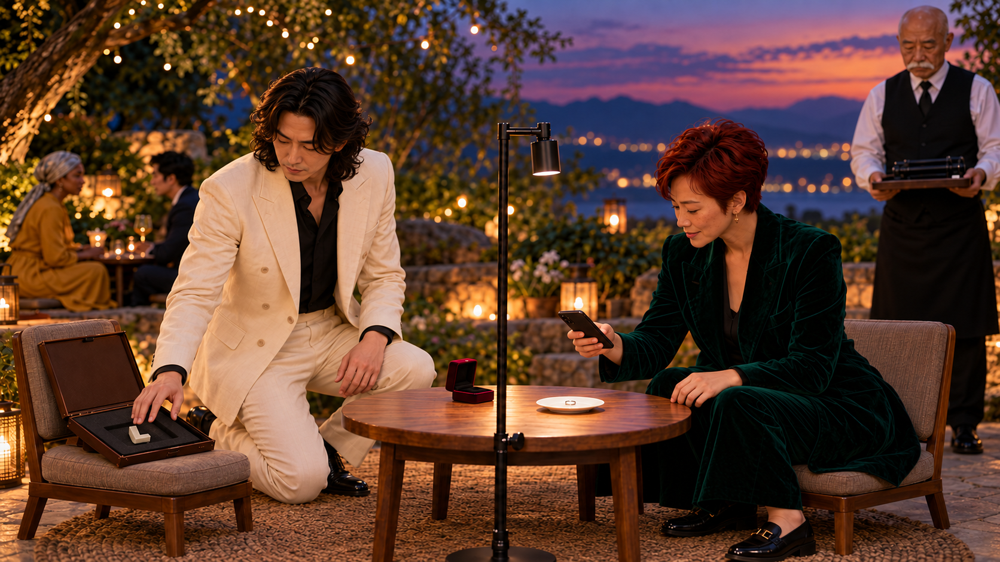
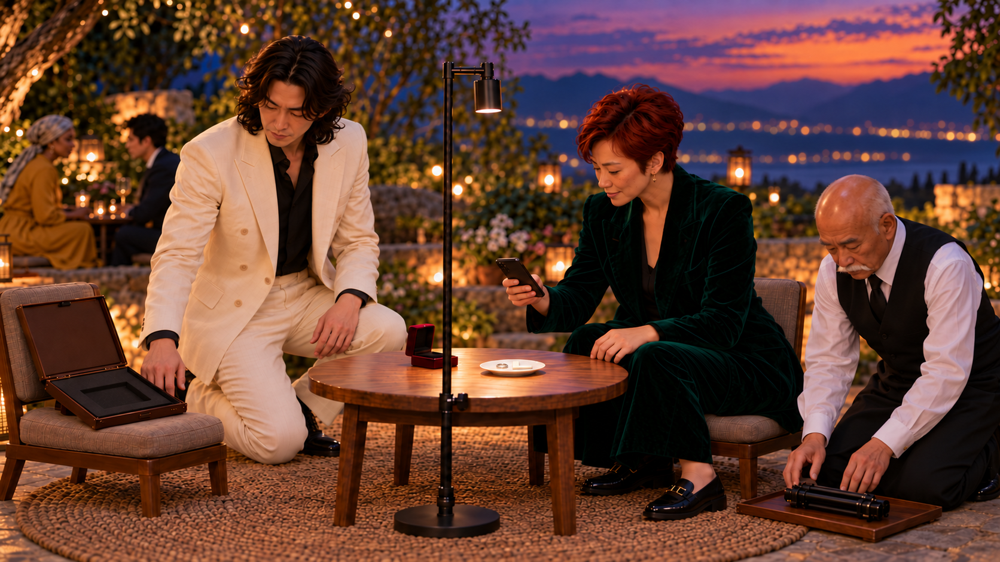
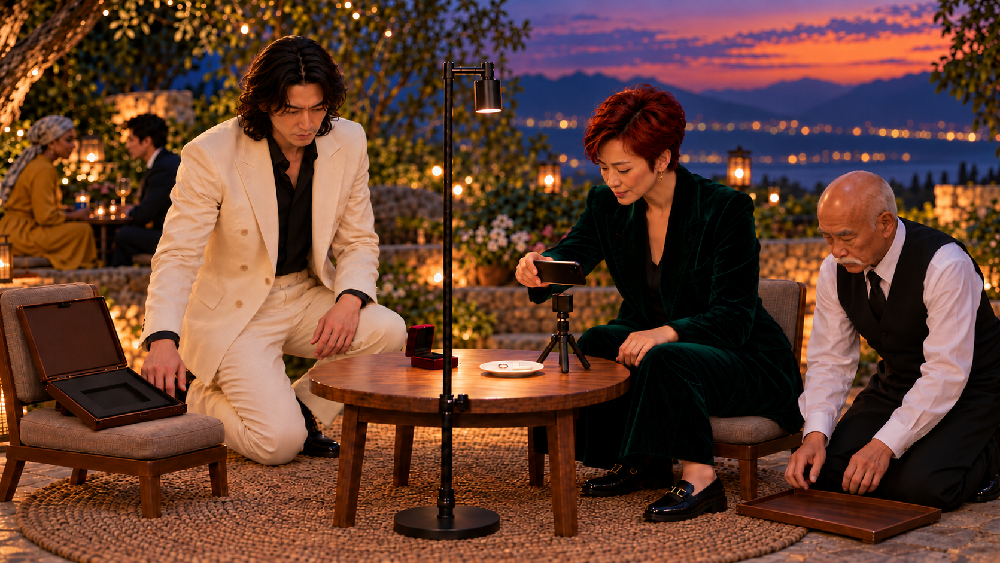
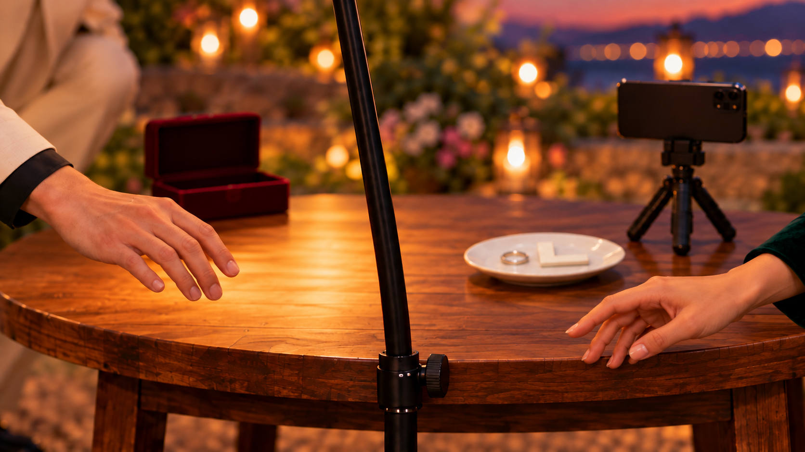
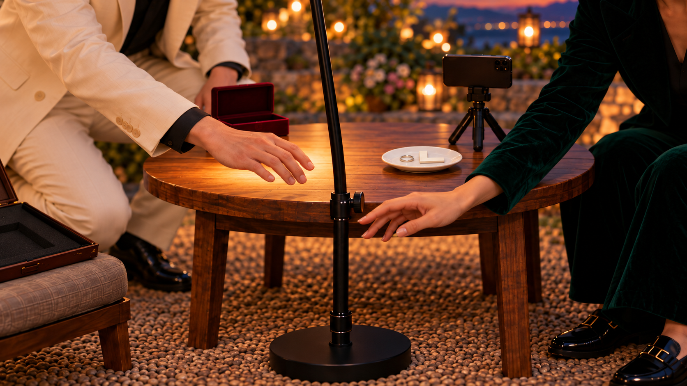
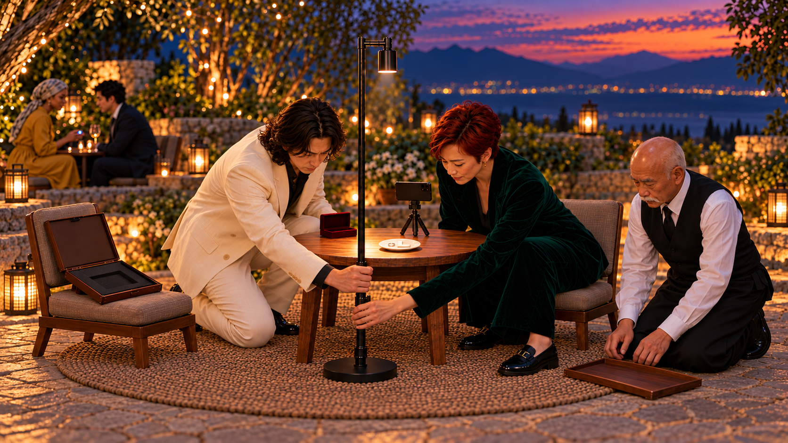

[전체 검수 목록](README.md)
# 10. 청혼은 없었습니다

**청혼처럼 내민 고리를 상대가 촬영하자 남성도 다른 샘플을 바로 보탠다. 마지막 가까워지는 두 손은 풀려 기울어진 조명 기둥을 함께 받친다.**

41초 · 10씬 / 시작 이미지10장 · 무대사 · 자막 후처리 · Flow 미생성

**핵심 메시지:** 직접 활용해 본 경험을 펼치면 서로의 이야기가 이어진다.

**반전:** 6.5초 고리를 끼는 대신 빛 아래 관찰. → 15초 상심한 듯 내려간 시선의 목표는 자기 샘플. 남성은 선언 없이 다른 샘플을 접시에 보탬. → 19초 무릎 꿇은 웨이터가 미니삼각대를 폄. 후방의 같은 자세도 촬영 높이. → 25.5초 빛이 이탈한 문제를 본 두 사람이 손을 내밀어, 서로 대신 같은 낮은 조명 연결부를 받침.

첫 이미지는 동작 전 상태입니다. 영상 동작·후합성·최종 편집 검증까지 끝난 것은 아닙니다.

## 인물과 연출

- **MN**: 30대 중반 한국인 남성, 어깨까지 오는 긴 검정 웨이브 머리, 키 크고 유연한 체형, 수염 없음. 아이보리 리넨 더블 재킷·바지, 검정 오픈칼라 셔츠. 청혼처럼 긴장→상심한 듯 시선 하강→자기 다른 샘플을 말없이 바로 보태는 열의. 별도 사례판 발표 선언 없음.

- **WM**: 40대 한국인 여성, 짧은 진한 붉은 픽시 커트, 주근깨, 단단한 체격. 짙은 에메랄드 벨벳 디너 수트, 검정 로퍼. 감격한 듯 눈빛이 빛남 → 물건을 관찰할 때 더 큰 호기심 → 동료의 경험에 활짝 웃음. 두 사람 기술적 관심이 동등.

- **WT**: 60대 동아시아 남성, 민머리·풍성한 흰 콧수염, 작은 키. 흰 셔츠, 검정 조끼, 검정 긴 앞치마. 로맨스를 돕는 웨이터처럼 극도로 공손하게 무릎을 꿇었다가 촬영 높이를 맞추는 전문가의 진지함.

- **BG1**: 40대 흑인 여성, 은회색 머리 스카프. 겨자색 긴 드레스. 후방 자기 테이블에서 폰 촬영 높이를 맞춘다.

- **BG2**: 30대 동아시아 남성, 짧은 검정 곱슬머리. 짙은 남색 정장. BG1과 같은 낮은 테이블에서 샘플을 받쳐 든다.

## C10_K01 · 0–3초

**첫 상태:** MN은 왼쪽에서 닫힌 벨벳 상자를 양손에 들고 무릎을 굽히기 직전. WM 오른쪽 낮은 의자. 열린 갈색 샘플 케이스는 MN 의자 위, 흰 L형 샘플이 홈에 있다. 후방 BG1/BG2는 처음부터 무릎 자세로 마주함. 조명 기둥 수직, 낮은 연결부 존재.

**동작:** MN이 한쪽 무릎을 바닥에 대고 닫힌 상자를 WM에게 올린다. WM이 두 손을 가슴으로 모은다.3초, 자세를 잡은 뒤 긴 대기 없음.

**후처리 자막:** 없음

| 항목 | 내용 |
|---|---|
| 대사·내레이션 | 없음 |
| 음악·효과음·정적 | 서정적 피아노 선택, 음성 없음. |
| 구도 | 50mm 로맨틱 투샷, 후경 둘과 열린 케이스는 초점 밖. 낮은 조명 연결부를 자연스럽게 포함. |
| 전환 | 닫힌 벨벳 상자로 근접. |
| 웃음·정보 의도 | 청혼 기대를 짧고 진심으로 세움. |

## C10_K02 · 3–6.5초

**첫 상태:** MN 한쪽 무릎, 닫힌 상자 밑을 왼손으로 받치고 오른손 뚜껑 끝. WM 양손 가슴, 조명 기둥 수직.

**동작:** MN이 상자를 열어 은색 고리를 보여준다. WM 오른손이 고리로 향하고 왼손은 무릎으로 내린다.3.5초, 준비 합6.5초.

**후처리 자막:** 없음

| 항목 | 내용 |
|---|---|
| 대사·내레이션 | 없음 |
| 음악·효과음·정적 | 현악 기대감 선택. |
| 구도 | 85mm 상자·얼굴 일부. 보석 없는 고리, 뚜껑 뒤로. |
| 전환 | WM 오른손이 고리에 닿기 직전, 같은 손의 근접으로 컷. |
| 웃음·정보 의도 | 기술 자막 없이 청혼 기대를 완성. |

## C10_K03 · 6.5–11초

**첫 상태:** 열린 상자 안 고리, WM 오른손 엄지·검지 접촉 직전. 왼손은 무릎. 조명은 접시 중앙오른쪽을 비춤.

**동작:** WM이 고리를 집어 손가락 대신 등 아래로 옮겨 한 번 돌려 본다. MN은 빈 상자를 테이블 왼쪽에 내려놓는다.4.5초.

**후처리 자막:** 없음

| 항목 | 내용 |
|---|---|
| 대사·내레이션 | 없음 |
| 음악·효과음·정적 | 로맨스 음악 유지 선택. |
| 구도 | 65mm 측면, 고리 이동과 빈 상자 접촉을 같은 화면. |
| 전환 | WM 시선이 폰으로 향할 때 컷. |
| 웃음·정보 의도 | 첫 반전은 물건을 쓰는 방향으로 전달. |

## C10_K04 · 11–15초

**첫 상태:** WM 오른손 고리는 빈 접시 위, 폰은 테이블에 있다. MN은 빈손으로 내려다본다. 기둥 수직.

**동작:** WM이 오른손의 고리를 접시에 놓고 같은 오른손으로 폰을 들어 맞춘다. 빈 왼손으로 후보 표시 후합성 화면과 실물의 같은 부분을 비교한다.4초. 손 사이에 고리를 전달하지 않는다.

**후처리 자막:** 12–14.9초: AI 검출 후보 · 원물 확인

| 항목 | 내용 |
|---|---|
| 대사·내레이션 | 없음 |
| 음악·효과음·정적 | 셔터1회 선택, 피아노 유지. |
| 구도 | 65mm 놓기1초·폰 들기1초·비교2초. 필수 정보는 큰 후처리 자막. |
| 전환 | MN의 잠깐 내려간 눈으로 컷. |
| 웃음·정보 의도 | 고리 관찰의 AI 맥락 확정. 후속 다른 샘플을 보탤 여지. |

## C10_K05 · 15–19초

**첫 상태:** MN이 시선을 내리깔고 오른손을 왼쪽 의자의 열린 갈색 케이스 안 흰 L형 샘플 위에 둔다. 샘플은 아직 폼 홈에 있다. 접시에는 고리만. WM 폰은 오른손.

**동작:** MN이 흰 L형 샘플을 바로 집어 같은 접시의 고리 옆에 보탠다. WM이 폰 구도를 조금 넓히자 MN 표정이 밝아진다. 말이나 사례판 펼침 없음. WT는 배경에서 쟁반을 내려두며 무릎을 낮춘다.4초.

**후처리 자막:** 없음

| 항목 | 내용 |
|---|---|
| 대사·내레이션 | 없음 |
| 음악·효과음·정적 | 샘플 탁·밝아진 피아노 선택, 음성 없음. |
| 구도 | 50mm MN의 시선→실물 집기→접시 추가를 한 동선. 열린 케이스는 의자에 그대로. |
| 전환 | 배경에서 무릎을 낮춘 WT와 접힌 미니삼각대로 컷. |
| 웃음·정보 의도 | 상심한 줄 알았는데 관찰에 보탤 다른 샘플을 찾던 것. '나도 사례' 선언 반복 제거. |

## C10_K06 · 19–21.5초

**첫 상태:** WT 낮은 자세, 접힌 미니삼각대가 쟁반 위. 두 손이 삼각대 양옆에 닿기 직전. 폰은 WM 오른손, 접시에는 두 샘플.

**동작:** WT가 접힌 미니삼각대를 들어 한 번에 다리를 펴 테이블 앞오른쪽에 놓는다.2.5초. 폰 장착은 다음 컷.

**후처리 자막:** 없음

| 항목 | 내용 |
|---|---|
| 대사·내레이션 | 없음 |
| 음악·효과음·정적 | 삼각대 탁1회 선택. |
| 구도 | 65mm 손·삼각대·진지한 얼굴. 한번 펴기만, 조절 반복 없음. |
| 전환 | 빈 폰 클립에서 WM 폰으로 연결. |
| 웃음·정보 의도 | 무릎 자세의 뜻이 촬영 높이였음을 짧게 공개. |

## C10_K07 · 21.5–25.5초

**첫 상태:** WM 오른손 폰은 빈 클립 위5cm, 낮은 의자에서 자세를 낮추기 직전. 기둥은 수직이며 낮은 클램프 조임이 덜 된 상태. 빛은 접시의 두 샘플에 있음. 후경 기존 둘은 이미 낮은 자세.

**동작:** 21.5~22.5초 WM이 폰을 클립에 고정한다.22.5~23.5초 화면이 넓어져 기존 후경의 샘플 촬영을 공개한다. WM이 손을 빼고 자세를 낮추며 낮은 조명 기둥을 가볍게 스친다.23.5~24.5초 덜 잠긴 낮은 클램프가 미끄러져 상부 기둥 전체가 왼쪽8도 기울고 빛이 접시를 벗어난다.24.5~25.5초 둘의 시선이 빛에서 같은 낮은 결합부로 동시에 내려간다.

**후처리 자막:** 없음

| 항목 | 내용 |
|---|---|
| 대사·내레이션 | 없음 |
| 음악·효과음·정적 | 선택 작은 덜컥. 사고를 소리만으로 전달하지 않음. |
| 구도 | 28mm 짧은 달리 아웃. 낮은 조인트·기둥 전체·접시 빛 이탈을 같은 프레임. 위쪽 램프 관절은 고정. 총4초. |
| 전환 | 둘의 시선이 낮은 연결부에 도착한 뒤 같은 지점을 향하는 손으로 컷. |
| 웃음·정보 의도 | 동료의 촬영을 돕는 손 접근에 실제 원인 제공. 위 힌지 처짐을 아래에서 잡는 오류 제거. |

## C10_K08 · 25.5–28.5초

**첫 상태:** 조명은 낮은 결합부에서 왼쪽으로 기울고 빛이 접시를 벗어난 상태. 두 손은 같은 낮은 연결부 양쪽에 공기 간격을 남긴다. 승인 이미지처럼 연결부 일부가 보이며, 기울어진 상부 기둥은 꺾이지 않은 한 직선이다.

**동작:** 두 사람이 같은 낮은 연결부로 손을 내민다. MN 오른손은 조인트 바로 위 상부 기둥, WM 왼손은 바로 아래 고정부를 향한다. 손이2cm 남은 지점에서 낮은 미디엄 구도로 컷.3초.

**후처리 자막:** 없음

| 항목 | 내용 |
|---|---|
| 대사·내레이션 | 없음 |
| 음악·효과음·정적 | 현악이 로맨틱하게 상승 선택. 접촉 효과 없음. |
| 구도 | 85mm 따뜻한 손 근접. 기둥의 기울어진 가장자리를 남겨 직전 원인을 유지. 손을 서로 잡게 하지 않음. |
| 전환 | 손이 같은 낮은 연결부에2cm 남은 위치에서 넓은 동일 축으로. |
| 웃음·정보 의도 | 문제를 같이 보았으므로 손이 가까워지는 이유가 성립. 로맨스 기대는 구도로만 잠깐 되살림. |

## C10_K09 · 28.5–36초

**첫 상태:** 50mm 낮은 미디엄. MN 오른손과 WM 왼손은 낮은 조인트 위·아래에 닿기 직전. 기울어진 직선 상부 기둥, 고리와 평평한 L이 있는 접시를 유지. 머리와 등 머리는 프레임 밖이어도 된다.

**동작:** 두 손이 서로 대신 같은 낮은 결합부 위·아래를 잡는다. WM이 하부를 지지하고 MN이 상부의 직선 기둥 전체를 수직으로 되돌린다(첫3초). 빛이 접시의 두 샘플로 돌아온다(다음1초). 남은3.5초 두 손이 고정부를 계속 지지하고 샘플의 안정된 빛을 보여준다. 얼굴 반응은 다음 와이드로 넘긴다.

**후처리 자막:** 없음

| 항목 | 내용 |
|---|---|
| 대사·내레이션 | 없음 |
| 음악·효과음·정적 | 빛 복귀 직후0.5초 음악·효과 정적 선택, 따뜻한 음악 재개. 음성 없음. |
| 구도 | 승인된50mm 낮은 미디엄. 낮은 조인트·직선 기둥 방향·두 손·샘플의 빛에 집중. 머리/등 머리/웨이터 표정 동시 노출은 요구하지 않는다. |
| 전환 | 기둥 수직·빛 복귀 후 같은 지지손을 유지하며 마지막 와이드. |
| 웃음·정보 의도 | 실제 문제가 있던 같은 관절을 함께 받쳐 해결. 손잡기 기대를 공동 시연 지원으로 뒤집는다. |

## C10_K10 · 36–41초

**첫 상태:** MN 오른손·WM 왼손이 같은 낮은 조인트 위·아래를 지지해 기둥 수직을 유지한다. 빛이 접시의 고리·L형 샘플에 돌아와 있다. 폰 고정, 케이스 의자. 후경 기존 사각 샘플.

**동작:** 두 사람은 조인트를 계속 받친 채 눈을 한번 맞추고 작게 웃는다. WT가 폰 화면과 실물을 비교한다.36초부터 행사 정보5초 고정. 지지손은 놓지 않는다.

**후처리 자막:** 36–41초: Q-AI Fair / 품질팀 AI 성과·활용 경험 교류

| 항목 | 내용 |
|---|---|
| 대사·내레이션 | 없음 |
| 음악·효과음·정적 | 따뜻한 피아노 마침 선택, 음성 없음. |
| 구도 | 35mm 고정 와이드. 지지손·수직 기둥·조명된 샘플을 상단72%, 하단 제목판. |
| 전환 | 41초 종료 또는 다음 화면으로 단순 컷. |
| 웃음·정보 의도 | 샘플도 관찰 조건도 서로 보태는 경험 교류로 연결. |

## 제작 메모

- **difficulty_reason:** 작은 샘플·폰 손 이동과 낮은 조명 결합부의 풀림/지지 연속성이 중요. 상부 힌지 고장은 사용하지 않는다.
- **alternative:** S07의 기둥 기울기는 낮은 조인트를 중심으로 약8도만. 한 프레임에 기둥과 접시의 빛 이탈을 보여 복잡한 파손 없이 원인 전달. S09는 두 손으로 같은 결합부 위/아래를 받쳐 기둥을 세우는 한 동작. 후경2인은 처음부터 존재하는 고정 낮은 자세.
- **avoid:** 여성은 기술을 모른다는 전제, 외모·성별 조롱, 다이아몬드/보석 판매광고, 갑자기 생기는 손님·테이블 없음.
- **timing:** 청혼 준비6.5초/삼각대2.5초/폰 고정·후경 공개·빛 이탈4초. 손 접근3초 뒤 실제 복구7.5초. 최종41초.

[전체 명세·프롬프트](storyboards/2026-10-24_v12-rework/storyboards.json) · [실제 이미지 매핑](storyboards/2026-10-24_v12-rework/scene_manifest.json)
