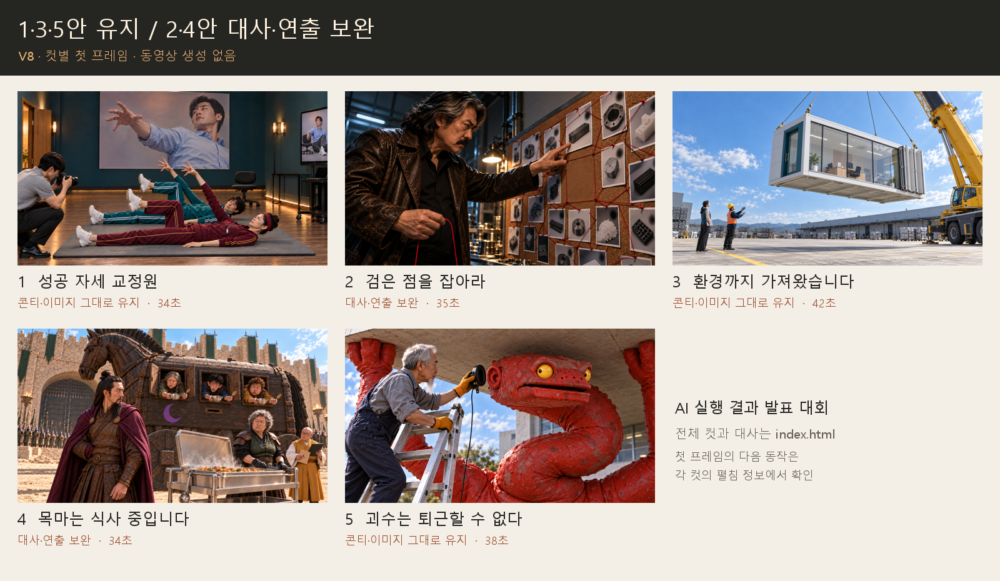

# AI 실행 결과 발표 대회 · 영상 기획

## [전체 이미지 콘티 바로보기 →](콘티_바로보기.md)

최신 **V8**입니다. 위 링크에서 **43장의 이미지와 대사**를 함께 읽을 수 있습니다.
1·3·5번은 유지했고, 2·4번은 대사·호흡과 인물의 체면을 지키는 행동을 보완했습니다.

| 찾는 자료 | 바로가기 |
| --- | --- |
| 이미지와 대사를 한 화면에서 보기 | [전체 이미지 콘티](콘티_바로보기.md) |
| 이전에 전달한 형태의 HTML 원본 | [V8 index.html](storyboards/2026-10-19_tone-polish-v8/index.html) |
| PNG 원본·HTML·프롬프트 전체 | [V8 폴더](storyboards/2026-10-19_tone-polish-v8/) |
| 시간·자막·음향까지 포함한 컷 표 | [전체 컷 표](storyboards/2026-10-19_tone-polish-v8/STORYBOARDS.md) |
| 바로 이전 V7 HTML | [V7 index.html](storyboards/2026-10-19_keep135-rebuild-v7/index.html) |
| 이전에 완성한 1번 영상 | [36초 최종본 MP4](storyboards/2026-10-17_C01-voicefix-v07/C01_recut_v07_36s.mp4) |
| 이전 버전과 원자료 안내 | [이전 README 기록](README_before_v8.md) |

HTML은 원본 파일로 보관합니다. 브라우저에서 열 때는 해당 버전의 폴더를 이미지 폴더와 함께 내려받아 index.html을 여세요. 저장소 안에서 바로 읽으려면 맨 위 **전체 이미지 콘티 바로보기**를 이용하세요.

비공개 저장소를 유지합니다. 이번 작업은 콘티와 첫 프레임까지이며 Flow 업로드·동영상·음원 생성은 하지 않았습니다.
