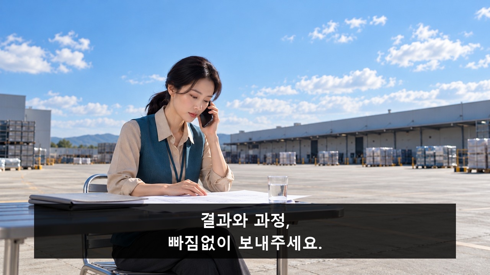
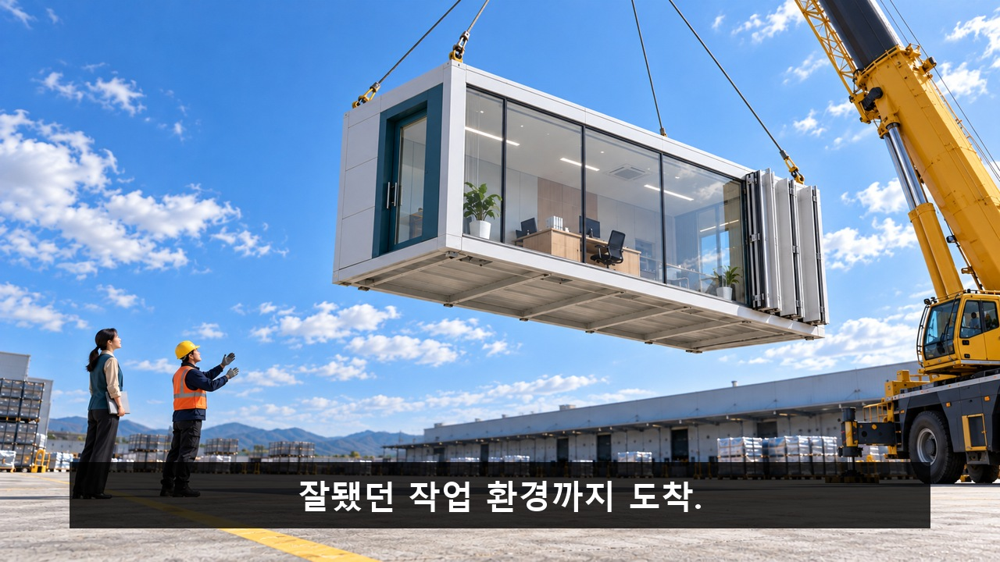
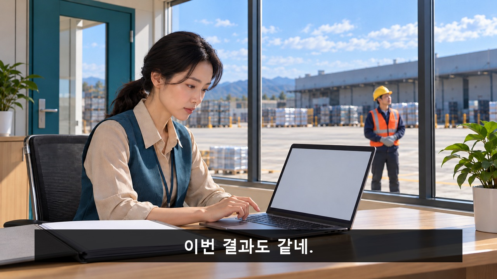
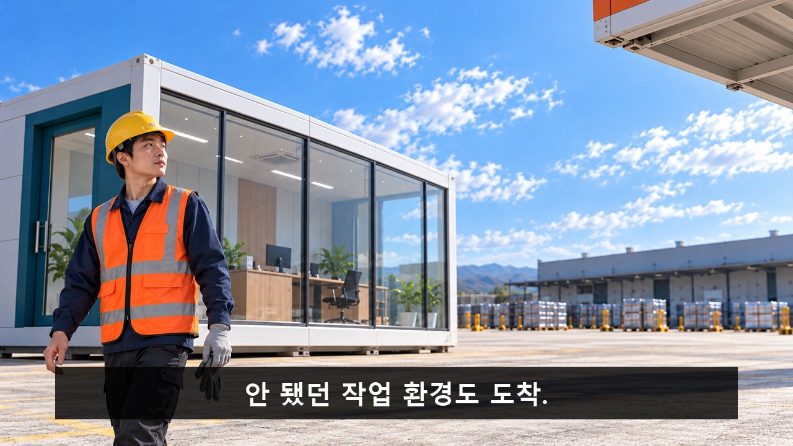
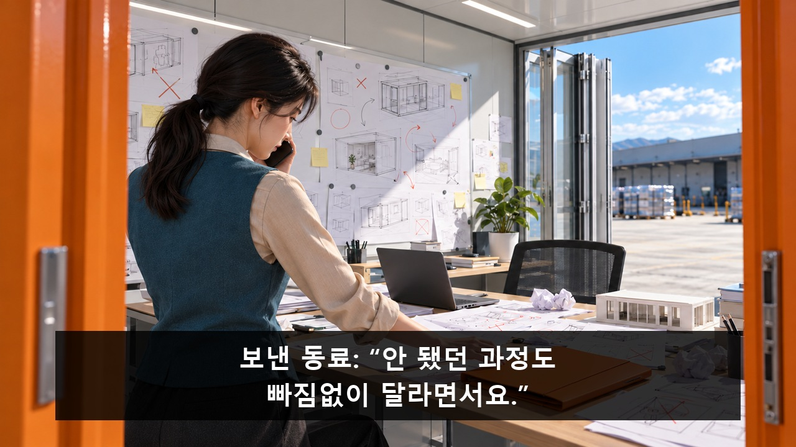
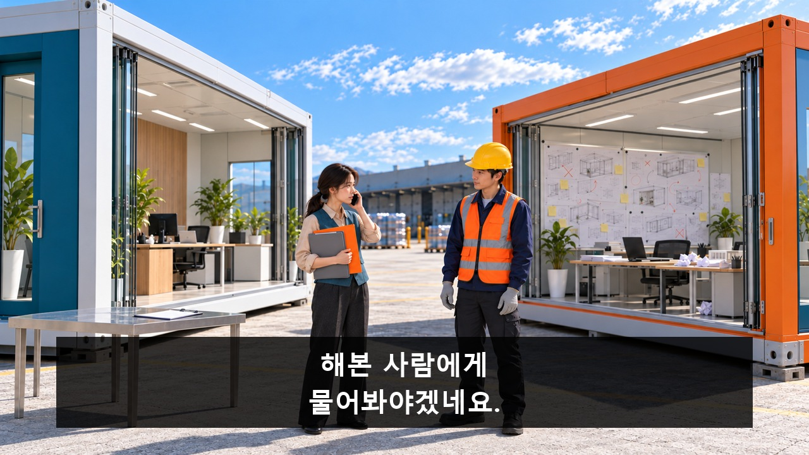
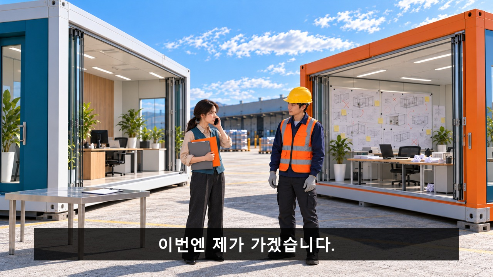
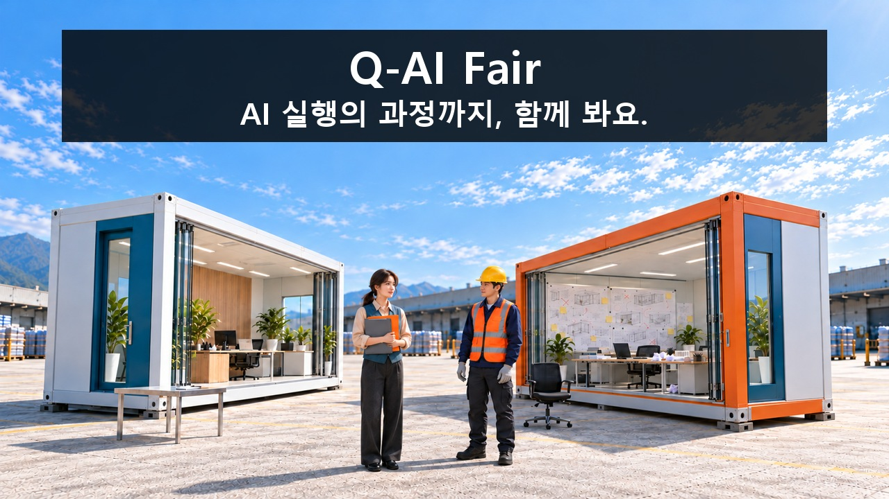

> **V12 제작 상태:** [현재 원본·채택 구간·후처리](00_영상제작_현재상태.md)를 먼저 확인하세요. 아래 V11 콘티보다 실제 채택 구간과 최신 5·6·3번 편집 기록이 우선합니다.

[검수 목록으로](README.md) · [← 이전 안](02_검은_점을_잡아라.md) · [다음 안 →](04_목마는_식사_중입니다.md)

# 03. 환경까지 가져왔습니다

**과정을 빠짐없이 보내 달랬더니 성공한 사무실이 통째로 온다. 끝인 줄 알자 실패했던 사무실도 온다.**

**C03 · V11 · 참석 독려 · 44.75초 · 8개 시작 이미지**

**전달할 내용:** 잘됐던 결과와 안됐던 과정까지 함께 보면 내 작업의 실마리가 된다.

**웃음의 전개:** 성실한 공유의 문자 그대로 과잉 실행→성공 뒤 실패 사무실 2차 배송→또 옮길 준비하는 기사 앞에서 사람과 기록만 이동.

화면과 후처리 자막으로 전달하는 검수용 콘티입니다. 아래 이미지는 동작의 시작 상태이며, 자막이 있는 컷은 그 첫 이미지 위에 자막 위치를 얹은 정지 예시입니다. 실제 동작 완료 화면이나 생성 영상은 아닙니다.

등장인물·연출 보기

- **R**: 30대 한국인 여성. 묶은 검은 머리, 베이지 블라우스·청록 얇은 조끼·짙은 회색 바지. 놀라다가도 기록의 단서를 관찰. 실제 승인 이미지의 좁은 타원 얼굴과 뾰족한 턱선, 관자놀이 옆으로 내려오는 가는 앞머리·낮은 묶음머리, 좁은 어깨와 긴 통바지 실루엣을 유지. 새 C06의 큰 어깨·각진 안경·비대칭 숏컷 직원과 분리.
- **T**: 40대 한국인 남성 기사. 노란 안전모·남색 재킷·주황 반사 조끼·검정 바지. 흰 운송장. 일을 끝내고 싶은 감정이 드러남. 실제 승인 이미지의 P보다 둥근 타원 얼굴·짧은 옆머리·부드러운 볼선과 노란 안전모, 몸통이 곧은 단단한 작업복 실루엣 유지. P처럼 볼륨 큰 웨이브와 셔츠 소매 걷은 외형으로 바꾸지 않음.
- **S**: 보내는 동료는 화자를 표시한 짧은 자막. 얼굴·필수 전화 음성 없음.

**형식:** 초대형 물류 광고의 과잉 실행과 두 번째 배송

**연출:** 밝은 하늘, 노란 정밀 크레인·흰 모듈·유리와 금속. 높이·거리를 크게 바꾸는 산업 광고 구도.

## 컷별 스토리보드

### C03_K01 · 0–6초 · 6초

**첫 상태:** 직원은 통화 중, 자료 위 손. 위 사무실은 안 보이고 정상 햇빛.

**이어질 동작:** 요청 자막을 먼저 읽힘. 자료 위 컵 수면이 떨림→실제 공간을 지나는 그림자→위로 시선. 발화 불필요.

**후처리 자막**

- **0.2–3.8초:** 결과와 과정, / 빠짐없이 보내주세요.

**웃음·정보 의도:** 평범한 부탁이 어떻게 받아들여질지 기대.

대사·음악·효과음·구도·전환

| 항목 | 내용 |
|---|---|
| 대사·내레이션 | 없음. 필요한 의미는 caption_cues로 전달. |
| 음악·효과음·정적 | 선택 BGM/SFX: 배송 리듬, 착지·파일·버클·의자. 기존 음성은 비정보적 공간음과 분리 가능. 대사/내레이션 없음; 소리를 꺼도 필수 정보 유지. |
| 구도 | 조용한 50mm 미디엄, 넓은 하늘 배경. |
| 전환 | 공간 축·물리 상태를 이어 하드 컷. 자막 종료 뒤 다음 정보. |

[자막 없는 시작 PNG 원본](../../storyboards/2026-10-23_v11-production-lock/images/C03/S01.png)

### C03_K02 · 6–10초 · 4초

**첫 상태:** 청록 문틀 A가 공중에 고정, 케이블 팽팽. 직원·기사 옆 안전선 밖.

**이어질 동작:** 모듈 조금 하강. 사람 위 이동 없음.

**후처리 자막**

- **6.3–9.8초:** 잘됐던 작업 환경까지 도착.

**웃음·정보 의도:** 과정 공유가 공간 전체 배송으로 확대.

대사·음악·효과음·구도·전환

| 항목 | 내용 |
|---|---|
| 대사·내레이션 | 없음. 필요한 의미는 caption_cues로 전달. |
| 음악·효과음·정적 | 선택 BGM/SFX: 배송 리듬, 착지·파일·버클·의자. 기존 음성은 비정보적 공간음과 분리 가능. 대사/내레이션 없음; 소리를 꺼도 필수 정보 유지. |
| 구도 | 24mm 낮은 극와이드, 모듈·하늘이 대부분. |
| 전환 | 공간 축·물리 상태를 이어 하드 컷. 자막 종료 뒤 다음 정보. |

[자막 없는 시작 PNG 원본](../../storyboards/2026-10-23_v11-production-lock/images/C03/S02.png)

### C03_K03 · 10–13.5초 · 3.5초

**첫 상태:** 직원이 회색 파일 옆에서 실행 전. 기사 양손 장갑, 종료 대기.

**이어질 동작:** 큰 단순 도식 결과가 기준과 일치→R 끄덕임→기사의 장갑 벗은 끝 상태로 편집 가능. 정확한 장갑 탈착 전체를 필수 생성 요구로 삼지 않음.

**후처리 자막**

- **10.2–12.8초:** 이번 결과도 같네.

**웃음·정보 의도:** 첫 배송이 목표를 달성해 2차 배송이 반전.

대사·음악·효과음·구도·전환

| 항목 | 내용 |
|---|---|
| 대사·내레이션 | 없음. 필요한 의미는 caption_cues로 전달. |
| 음악·효과음·정적 | 선택 BGM/SFX: 배송 리듬, 착지·파일·버클·의자. 기존 음성은 비정보적 공간음과 분리 가능. 대사/내레이션 없음; 소리를 꺼도 필수 정보 유지. |
| 구도 | 모듈 안 측면 미디엄. 전경의 큰 도식 둘·직원 얼굴·창 밖 기사 모두 같은 화면. 도식 인서트 없음. |
| 전환 | 공간 축·물리 상태를 이어 하드 컷. 자막 종료 뒤 다음 정보. |

[자막 없는 시작 PNG 원본](../../storyboards/2026-10-23_v11-production-lock/images/C03/S03.png)

### C03_K04 · 13.5–20.5초 · 7초

**첫 상태:** 설치 A왼쪽, 기사 벗은 장갑 소지. B아랫모서리 막 프레임 진입.

**이어질 동작:** B 공개→기사가 장갑을 다시 준비하고 커프를 당겨 고정. 이미 확보한 실제 장갑 동작·상태 생략 허용, 전체 착용 재생성을 필수로 삼지 않음.

**후처리 자막**

- **14.1–17초:** 안 됐던 작업 환경도 도착.

**웃음·정보 의도:** 끝난 줄 알았는데 실패 과정까지 배송.

대사·음악·효과음·구도·전환

| 항목 | 내용 |
|---|---|
| 대사·내레이션 | 없음. 필요한 의미는 caption_cues로 전달. |
| 음악·효과음·정적 | 선택 BGM/SFX: 배송 리듬, 착지·파일·버클·의자. 기존 음성은 비정보적 공간음과 분리 가능. 대사/내레이션 없음; 소리를 꺼도 필수 정보 유지. |
| 구도 | 기사 전경·B 후경 깊은 초점. A왼쪽 유지. |
| 전환 | 공간 축·물리 상태를 이어 하드 컷. 자막 종료 뒤 다음 정보. |

[자막 없는 시작 PNG 원본](../../storyboards/2026-10-23_v11-production-lock/images/C03/S04.png)

### C03_K05 · 20.5–25초 · 4.5초

**첫 상태:** B 내부 이미 보임. R 왼손 평평한 검정 무선 스마트폰 귀에, 오른손 닫힌 주황 파일에 닿아 집기 직전. 꼬인 선·유선 수화기 없음.

**이어질 동작:** R이 전화 상대 설명을 듣는 자세에서 주황 파일을 들어 기록을 살핀다. 보내는 동료 자막을 읽힌 뒤 기사 쪽으로 몸을 돌림. 질문·답변 립싱크 불필요.

**후처리 자막**

- **20.8–24.8초:** 보낸 동료: “안 됐던 과정도 / 빠짐없이 달라면서요.”

**웃음·정보 의도:** 과잉 배송도 부탁을 성실히 해석한 결과.

대사·음악·효과음·구도·전환

| 항목 | 내용 |
|---|---|
| 대사·내레이션 | 없음. 필요한 의미는 caption_cues로 전달. |
| 음악·효과음·정적 | 선택 BGM/SFX: 배송 리듬, 착지·파일·버클·의자. 기존 음성은 비정보적 공간음과 분리 가능. 대사/내레이션 없음; 소리를 꺼도 필수 정보 유지. |
| 구도 | 문틀 너머 직원 오버숄더, 기록 밀도. |
| 전환 | 공간 축·물리 상태를 이어 하드 컷. 자막 종료 뒤 다음 정보. |

[자막 없는 시작 PNG 원본](../../storyboards/2026-10-23_v11-production-lock/images/C03/S05.png)

### C03_K06 · 25–30.75초 · 5.75초

**첫 상태:** R은 이미 주황 파일을 손에 들고 일부 펼친 상태, 회색 파일은 테이블에 열려 있고 T가 운송장을 들고 있다. R에게 펜이 없다. 주황 표지 무늬는 내부 조건 기록의 증거가 아니다.

**이어질 동작:** 주황 안쪽 기록을 회색 안쪽 기록과 비교. 일치 조건을 2초 유지한 뒤 운송장을 받지 않고 파일을 더 안는다. 펜·운송장 주고받기 없음.

**후처리 자막**

- **28–30.6초:** 안 된 과정에도 / 단서가 있네?

**웃음·정보 의도:** 불필요했던 실패 기록이 자기 문제 단서.

대사·음악·효과음·구도·전환

| 항목 | 내용 |
|---|---|
| 대사·내레이션 | 없음. 필요한 의미는 caption_cues로 전달. |
| 음악·효과음·정적 | 선택 BGM/SFX: 배송 리듬, 착지·파일·버클·의자. 기존 음성은 비정보적 공간음과 분리 가능. 대사/내레이션 없음; 소리를 꺼도 필수 정보 유지. |
| 구도 | 운송장·파일·얼굴 근접. 조건 비교2초. |
| 전환 | 공간 축·물리 상태를 이어 하드 컷. 자막 종료 뒤 다음 정보. |

[자막 없는 시작 PNG 원본](../../storyboards/2026-10-23_v11-production-lock/images/C03/S06.png)

### C03_K07 · 30.75–36.75초 · 6초

**첫 상태:** 처음부터 열린 마주 보는 패널. 직원은 표시된 회색·주황 파일 두 개를 이미 팔에 안고 통화 중. 기사는 벨트에 손 뻗기 전.

**이어질 동작:** 직접 만나 확인하겠다는 자막에 기사가 두 방을 보며 벨트를 조인다. 직원은 두 파일을 한 팔에 유지하고 전화기를 든 손도 그대로 둔 채 몸을 출구로 돌린다. 이번에는 본인이 가겠다는 자막 뒤 기사의 손이 멈춘다.

**후처리 자막**

- **30.95–33.55초:** 해본 사람에게 / 물어봐야겠네요.
- **33.85–36.55초:** 이번엔 제가 가겠습니다.

이 컷의 다음 자막 배치 보기

**웃음·정보 의도:** 다시 공간을 옮길 예상이 사람의 선택으로 끝남.

대사·음악·효과음·구도·전환

| 항목 | 내용 |
|---|---|
| 대사·내레이션 | 없음. 필요한 의미는 caption_cues로 전달. |
| 음악·효과음·정적 | 선택 BGM/SFX: 배송 리듬, 착지·파일·버클·의자. 기존 음성은 비정보적 공간음과 분리 가능. 대사/내레이션 없음; 소리를 꺼도 필수 정보 유지. |
| 구도 | 두 모듈 출입구와 직원·기사가 함께 보이는 측면 와이드. 직원과 기사 반응을 한 구도에서 읽음. |
| 전환 | 공간 축·물리 상태를 이어 하드 컷. 자막 종료 뒤 다음 정보. |

[자막 없는 시작 PNG 원본](../../storyboards/2026-10-23_v11-production-lock/images/C03/S07.png)

### C03_K08 · 36.75–44.75초 · 8초

**첫 상태:** 마주 보는 패널이 열린 두 방. 직원은 두 질문 기록을 안고 전경으로 나가려 함. 기사는 아직 서 있음. 하늘 무문자.

**이어질 동작:** 직원이 작은 파일 두 개만 안고 퇴장한 뒤 기사가 기존 의자에 앉는다. 안전모는 머리에 유지하며 턱끈 조작은 요구하지 않는다. 제목 후편집.

**후처리 자막**

- **38.75–44.55초:** Q-AI Fair / AI 실행의 과정까지, 함께 봐요.

**웃음·정보 의도:** 큰 환경과 작은 기록을 한 프레임에서 참석 행동에 연결.

대사·음악·효과음·구도·전환

| 항목 | 내용 |
|---|---|
| 대사·내레이션 | 없음. 필요한 의미는 caption_cues로 전달. |
| 음악·효과음·정적 | 선택 BGM/SFX: 배송 리듬, 착지·파일·버클·의자. 기존 음성은 비정보적 공간음과 분리 가능. 대사/내레이션 없음; 소리를 꺼도 필수 정보 유지. |
| 구도 | 안정된 눈높이 와이드. 모듈·나가는 직원·기사와 의자를 한 프레임, 상단 하늘 여백. 실제 첫 프레임의 구도를 기준으로 유지. |
| 전환 | 행사명·초대 문구 읽기 시간 뒤 종료. |

[자막 없는 시작 PNG 원본](../../storyboards/2026-10-23_v11-production-lock/images/C03/S08_v2.png)

---

[검수 목록으로](README.md) · [← 이전 안](02_검은_점을_잡아라.md) · [다음 안 →](04_목마는_식사_중입니다.md)

정확한 행사 날짜·장소·참석 방법은 아직 기입하지 않았습니다. 실제 영상 제작 뒤 움직이는 소품·자막 가림·읽는 시간·편집 호흡을 재확인합니다.
