> **V12 제작 상태:** [현재 원본·채택 구간·후처리](00_영상제작_현재상태.md)를 먼저 확인하세요. 아래 V11 콘티보다 실제 채택 구간과 최신 5·6·3번 편집 기록이 우선합니다.

[검수 목록으로](README.md) · [← 이전 안](03_환경까지_가져왔습니다.md) · [다음 안 →](05_괴수는_퇴근할_수_없다.md)

# 04. 목마는 식사 중입니다

**아무도 없는 선물이라던 트로이목마가 AI 문서 대조에서 식사 요청의 모순을 드러내고, 현장 확인 중 병사들의 밥그릇과 지휘관의 숟가락까지 쏟아진다.**

**C04 · V11 · 현장 도입 · 37초 · 9개 시작 이미지**

**전달할 내용:** AI로 모순 후보를 좁히고 사람이 원문과 현장에서 확인하는 실행 사례를 함께 본다.

**웃음의 전개:** 숨소리 금지 명령 직후 꼬르륵과 급식 메모 → AI 대조가 찾은 탑승자 없음 신고·급식 요청의 충돌에 이 말이 수저를 쓰는지 질문 → 원문 확인 후 완강한 부인 → 끝까지 전쟁 음악이 이어지다 그릇 돌출 순간 끊김 → 지휘관도 당당하게 먼저 달라며 숟가락을 내밈

화면과 후처리 자막으로 전달하는 검수용 콘티입니다. 아래 이미지는 동작의 시작 상태이며, 자막이 있는 컷은 그 첫 이미지 위에 자막 위치를 얹은 정지 예시입니다. 실제 동작 완료 화면이나 생성 영상은 아닙니다.

등장인물·연출 보기

- **GU**: 수비대장. 50대 후반 한국인 여성, 넓고 큰 체격, 풍성한 짧은 회색 곱슬머리, 넓은 얼굴과 깊은 눈가 주름. 짙은 녹색 누빔 조끼·구리색 어깨 보호대·검정 작업 장갑. 기록을 맹신하지 않고 직접 확인한다.
- **CM**: 목마를 내부 탑승자 없는 선물이라고 신고해 호송한 지휘관. 40대 한국인 남성, 마른 장신, 뾰족하고 긴 검정 수염, 날카로운 광대, 뒤로 묶은 검정 머리. 짙은 자주색 망토·낡은 갈색 갑옷. 비밀을 지키고 싶지만 허기를 숨기지 못한다.
- **RC**: 기록담당. 60대 한국인 남성, 대머리·둥근 검정 안경, 짧고 둥근 체형, 옅은 흰 콧수염. 겨자색 긴 작업 조끼와 흰 소매. 현대 태블릿과 원문 서류를 다룬다.
- **S1**: 목마 안 병사1. 50대 여성, 한쪽으로 길게 땋은 회색 머리, 넓은 턱. 올리브색 소매. 마지막에 은색 그릇과 나무 숟가락을 내민다.
- **S2**: 목마 안 병사2. 20대 마른 남성, 큰 귀와 짧은 검정 머리. 진한 파랑 소매. 마지막에 같은 크기 은색 그릇과 숟가락.
- **S3**: 목마 안 병사3. 40대 둥근 체격 남성, 짧은 갈색 곱슬머리와 넓은 코. 황토색 소매. 마지막에 같은 크기 은색 그릇과 숟가락. 병사 수는 화면 연속성 값이며 AI가 인원을 추론한 결과가 아니다.

**형식:** 트로이목마의 비밀 작전과 현대식 반입 문서 분석·배식 수레가 한 성문 앞에 공존하는 시대착오 코미디

**연출:** 큰 목조 트로이목마와 거친 석조 성문, 햇빛·먼지·가죽 복장. 같은 공간에 현대 태블릿·스캐너·스테인리스 보온 배식 수레를 태연하게 사용한다. 의도적인 시대착오이며 타임슬립 설명은 하지 않는다.

## 컷별 스토리보드

### C04_K01 · 0–5초 · 5초

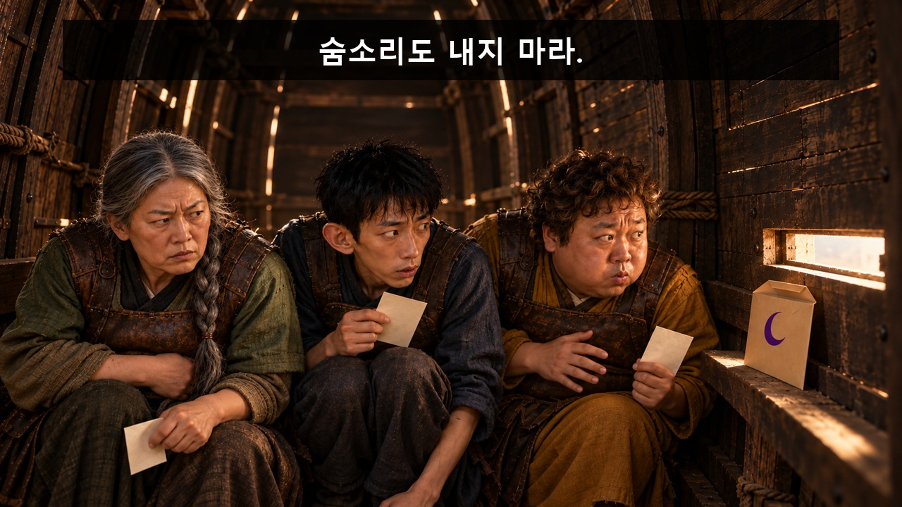

**첫 상태:** 병사 셋 긴장. 한 명의 빈손이 배 바로 위에서 누르기 직전. 다른 둘이 눈치를 볼 구도. 급식메모·초승달봉투는 무릎 높이. 그릇·숟가락 없음.

**이어질 동작:** 한 병사가 배를 누르고 나머지 둘이 그를 쳐다본다. 꼬르륵 자막 뒤 급식 메모를 봉투에 넣음. 5초에서 복잡하면 마지막 메모 한 장 넣기만 보여 나머지는 이미 든 상태로 생략. 그릇·숟가락 비공개.

**후처리 자막**

- **0.2–2초:** 숨소리도 내지 마라.
- **2.6–4.7초:** 꼬르륵…

이 컷의 다음 자막 배치 보기

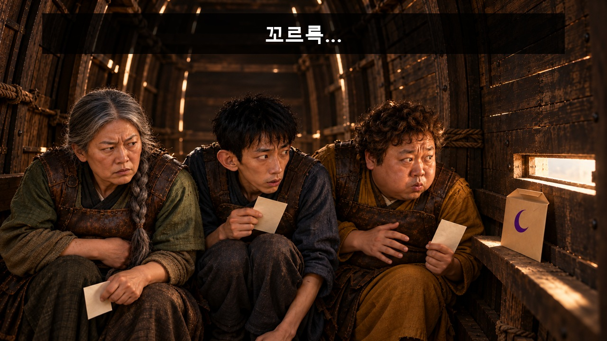

**웃음·정보 의도:** 침묵을 명령하는 진짜 작전의 긴장과 감출 수 없는 허기를 즉각 충돌시킨다. 메모 유입 경로는 그대로.

대사·음악·효과음·구도·전환

| 항목 | 내용 |
|---|---|
| 대사·내레이션 | 없음. 필요한 의미는 caption_cues로 전달. |
| 음악·효과음·정적 | 선택 BGM/SFX: 진지한 전쟁 음악, 목재·뚜껑·그릇. K08 첫 그릇 창경계 통과 때 음악 중단. 대사/내레이션 없음; 소리를 꺼도 필수 정보 유지. |
| 구도 | 좁은 목마 내부 압축 미디엄 와이드. 몸을 구겨 숨은 세 병사의 얼굴·목재 갈비뼈·눈치가 우선. 메모와 봉투는 그 앞의 작은 행동. 그릇·숟가락은 어디에도 없음. |
| 전환 | 공간 축·물리 상태를 이어 하드 컷. 자막 종료 뒤 다음 정보. |

[자막 없는 시작 PNG 원본](../../storyboards/2026-10-23_v11-production-lock/images/C04/S01.png)

### C04_K02 · 5–8초 · 3초

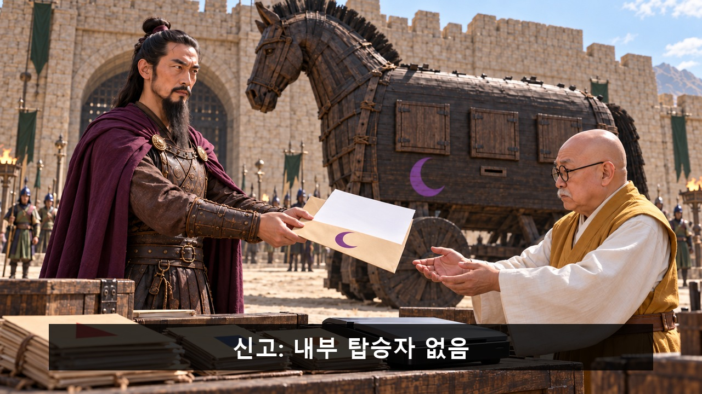

**첫 상태:** CM 손의 신고서·초승달 봉투가 RC 손 앞에 있다. 표지의 내부 탑승자 없음 문구를 후편집할 한 줄 영역. RC는 받기 전, 책상에는 다양한 다른 반입물 서류가 쌓여 있다.

**이어질 동작:** CM이 봉투를 주고 RC가 원문을 책상에 두어 스캔 입력한다. 원본은 버리지 않는다.

**후처리 자막**

- **5.2–7.8초:** 신고: 내부 탑승자 없음

**웃음·정보 의도:** 왜 수비대가 병사의 요청을 읽을 수 있는지 경로를 닫는다.

대사·음악·효과음·구도·전환

| 항목 | 내용 |
|---|---|
| 대사·내레이션 | 없음. 필요한 의미는 caption_cues로 전달. |
| 음악·효과음·정적 | 선택 BGM/SFX: 진지한 전쟁 음악, 목재·뚜껑·그릇. K08 첫 그릇 창경계 통과 때 음악 중단. 대사/내레이션 없음; 소리를 꺼도 필수 정보 유지. |
| 구도 | 밝은 외부 미디엄 와이드. 성문 사무실 책상·CM·RC·여러 문서·뒤 목마의 표식. |
| 전환 | 공간 축·물리 상태를 이어 하드 컷. 자막 종료 뒤 다음 정보. |

[자막 없는 시작 PNG 원본](../../storyboards/2026-10-23_v11-production-lock/images/C04/S02.png)

### C04_K03 · 8–11초 · 3초

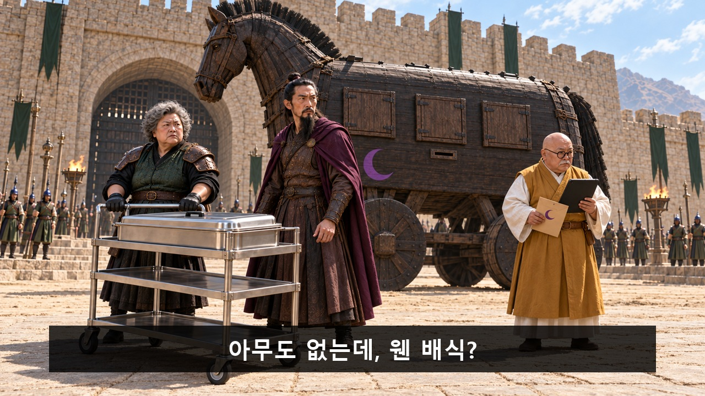

**첫 상태:** GU 손은 수레 손잡이, CM은 앞을 막기 직전. RC 태블릿은 아직 가슴 쪽을 향해 화면 내용 비공개.

**이어질 동작:** CM이 수레 앞을 막고 근거를 요구하는 표정. RC가 태블릿을 돌린다. 한 줄 자막, 발화 없음.

**후처리 자막**

- **8.3–10.8초:** 아무도 없는데, 웬 배식?

**웃음·정보 의도:** 은폐하려는 질문이 실제 실행 근거를 공개하게 만든다.

대사·음악·효과음·구도·전환

| 항목 | 내용 |
|---|---|
| 대사·내레이션 | 없음. 필요한 의미는 caption_cues로 전달. |
| 음악·효과음·정적 | 선택 BGM/SFX: 진지한 전쟁 음악, 목재·뚜껑·그릇. K08 첫 그릇 창경계 통과 때 음악 중단. 대사/내레이션 없음; 소리를 꺼도 필수 정보 유지. |
| 구도 | 성문 밖 고정 미디엄 와이드. 닫힌 목마 패널3개·수레 뚜껑·GU·CM·RC. 아직 그릇 없음. |
| 전환 | 공간 축·물리 상태를 이어 하드 컷. 자막 종료 뒤 다음 정보. |

[자막 없는 시작 PNG 원본](../../storyboards/2026-10-23_v11-production-lock/images/C04/S03.png)

### C04_K04 · 11–16초 · 5초

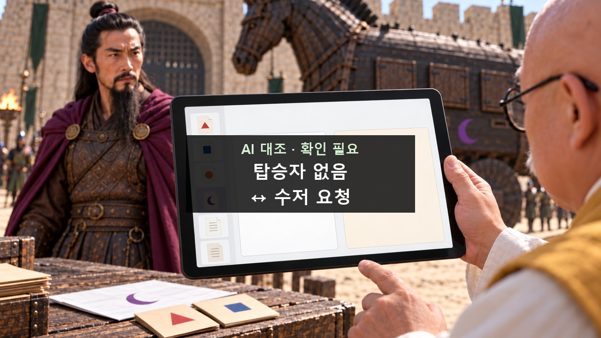

**첫 상태:** 태블릿 왼쪽 가장자리는 여러 반입물 목록, 가운데 큰 신고 원문 내부 탑승자 없음과 오른쪽 첨부 요청 식사·물·수저가 이미 나란히 보인다. AI 문서 대조의 확인 후보일 뿐 판정은 없음. RC 손가락은 두 구절을 짚기 직전.

**이어질 동작:** RC가 태블릿의 모순 후보 두 곳만 차례로 짚는다. 작은 머리말 AI 대조·확인 필요와 큰 대조 카드 탑승자 없음↔수저 요청을 동시에 유지. CM이 목마 쪽을 곁눈질한다. 발화 없음.

**후처리 자막**

- **11.2–15.8초:** AI 대조 · 확인 필요 / 탑승자 없음 / ↔ 수저 요청

**웃음·정보 의도:** 이미 병사를 본 관객에게 정답을 길게 설명하지 않는다. 은폐를 깨는 수저 요청만 남겨 다음 말 농담과 배식 행동으로 넘긴다. AI 후보 뒤 원문·현장 확인은 유지.

대사·음악·효과음·구도·전환

| 항목 | 내용 |
|---|---|
| 대사·내레이션 | 없음. 필요한 의미는 caption_cues로 전달. |
| 음악·효과음·정적 | 선택 BGM/SFX: 진지한 전쟁 음악, 목재·뚜껑·그릇. K08 첫 그릇 창경계 통과 때 음악 중단. 대사/내레이션 없음; 소리를 꺼도 필수 정보 유지. |
| 구도 | RC 손과 태블릿 중심 미디엄. 주변에 원문3장이 놓여 화면과 종이의 출처 관계를 보임. 긴 보고서 읽기 없음. |
| 전환 | 공간 축·물리 상태를 이어 하드 컷. 자막 종료 뒤 다음 정보. |

[자막 없는 시작 PNG 원본](../../storyboards/2026-10-23_v11-production-lock/images/C04/S04.png)

### C04_K05 · 16–19초 · 3초

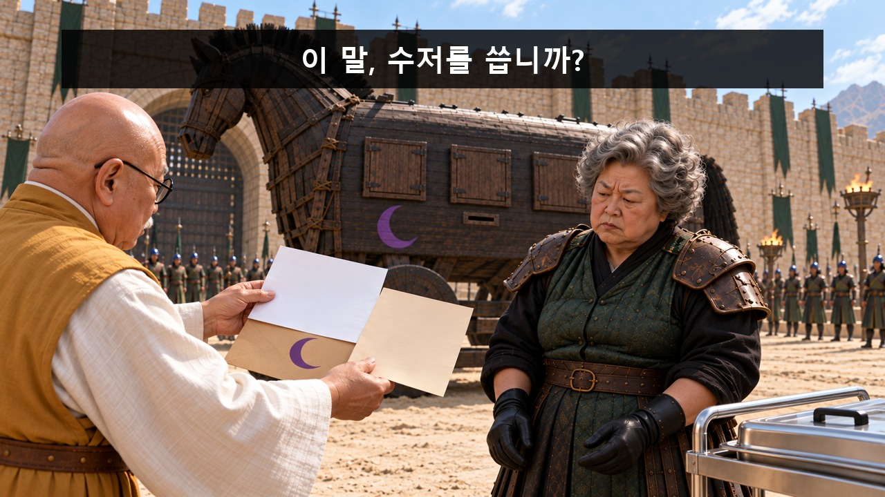

**첫 상태:** 실제 신고서와 급식 메모는 RC 손에 이미 펼쳐져 있다. 봉투·목마 초승달이 함께 보이고 GU는 원문을 보고 있다. GU가 원문 내용과 실물 표식을 확인하기 직전.

**이어질 동작:** 이미 펼친 원문 두 장 유지. GU가 원문과 초승달을 확인한 뒤 수레를 봄. 다시 펼치거나 말하지 않음.

**후처리 자막**

- **16.2–18.8초:** 이 말, 수저를 씁니까?

**웃음·정보 의도:** 신고·요청은 실제 원문과 같으며 음식 요청이 수레 선택으로 연결된다. 아직 사람 존재는 미확정.

대사·음악·효과음·구도·전환

| 항목 | 내용 |
|---|---|
| 대사·내레이션 | 없음. 필요한 의미는 caption_cues로 전달. |
| 음악·효과음·정적 | 선택 BGM/SFX: 진지한 전쟁 음악, 목재·뚜껑·그릇. K08 첫 그릇 창경계 통과 때 음악 중단. 대사/내레이션 없음; 소리를 꺼도 필수 정보 유지. |
| 구도 | 원문·봉투·GU 손과 후경 목마 초승달을 함께 보는 미디엄. |
| 전환 | 공간 축·물리 상태를 이어 하드 컷. 자막 종료 뒤 다음 정보. |

[자막 없는 시작 PNG 원본](../../storyboards/2026-10-23_v11-production-lock/images/C04/S05.png)

### C04_K06 · 19–22초 · 3초

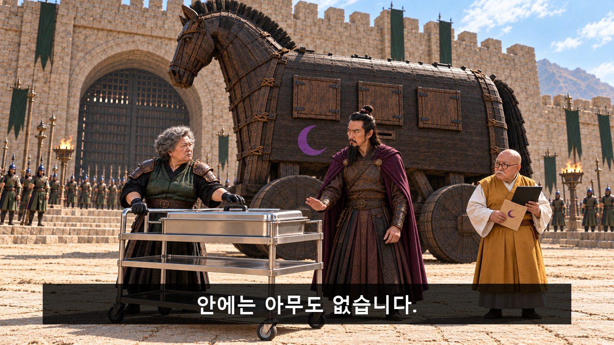

**첫 상태:** 수레 뚜껑은 닫혀 있고 GU 손은 손잡이 앞. CM의 막는 손은 아직 허리 높이.

**이어질 동작:** CM이 손바닥으로 막으며 고개를 젓는다. 부인 자막을 읽힌 뒤 GU가 뚜껑 손잡이를 잡음. 패널은 닫힘.

**후처리 자막**

- **19.1–21.8초:** 안에는 아무도 없습니다.

**웃음·정보 의도:** AI를 증거만능으로 쓰지 않고 현장 확인을 준비한다. 부인 직후 물리 반전을 위한 압력.

대사·음악·효과음·구도·전환

| 항목 | 내용 |
|---|---|
| 대사·내레이션 | 없음. 필요한 의미는 caption_cues로 전달. |
| 음악·효과음·정적 | 선택 BGM/SFX: 진지한 전쟁 음악, 목재·뚜껑·그릇. K08 첫 그릇 창경계 통과 때 음악 중단. 대사/내레이션 없음; 소리를 꺼도 필수 정보 유지. |
| 구도 | 목마 옆구리와 닫힌 수레가 큰 고정 와이드. 패널3개는 끝까지 닫히고 병사 손·그릇 비공개. |
| 전환 | 공간 축·물리 상태를 이어 하드 컷. 자막 종료 뒤 다음 정보. |

[자막 없는 시작 PNG 원본](../../storyboards/2026-10-23_v11-production-lock/images/C04/S06.png)

### C04_K07 · 22–25초 · 3초

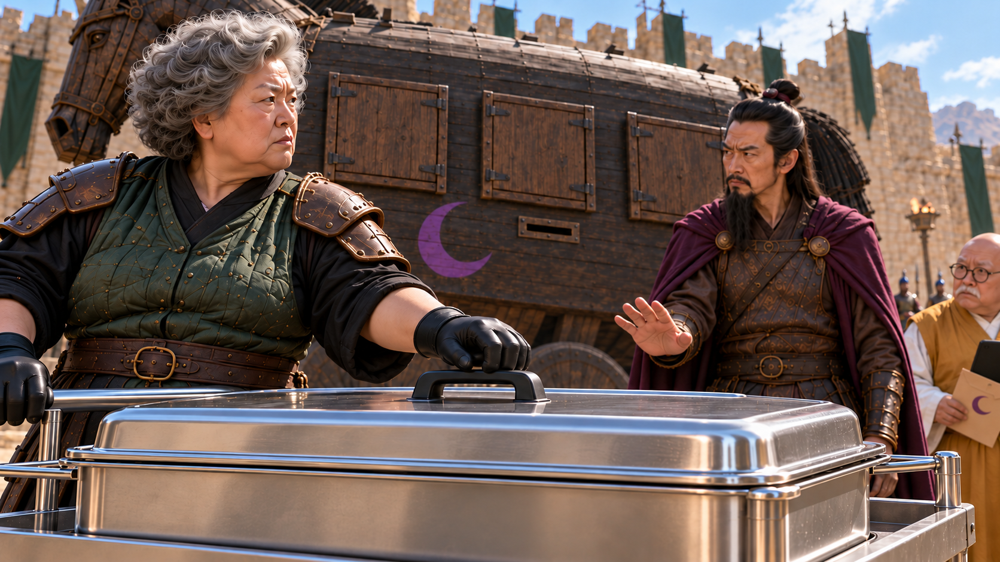

**첫 상태:** GU가 닫힌 뚜껑 손잡이를 잡고 아직 열기 전. CM은 목마 쪽을 보며 음식에 반응하기 전.

**이어질 동작:** GU가 뚜껑을 열어 김이 난다. CM 코가 미세하게 움직이고 목마 안의 숨소리가 겹친다.

**후처리 자막:** 없음. 행동과 표정으로 전달.

**웃음·정보 의도:** 현장 확인을 강의 대신 냄새와 허기로 실행한다. 센 그릇 그림은 다음 컷 한 번에 공개.

대사·음악·효과음·구도·전환

| 항목 | 내용 |
|---|---|
| 대사·내레이션 | 없음. 필요한 의미는 caption_cues로 전달. |
| 음악·효과음·정적 | 선택 BGM/SFX: 진지한 전쟁 음악, 목재·뚜껑·그릇. K08 첫 그릇 창경계 통과 때 음악 중단. 대사/내레이션 없음; 소리를 꺼도 필수 정보 유지. |
| 구도 | 수레와 GU 장갑의 미디엄. 후경 목마 패널3개는 아직 닫혀 있다. 음식 냄비만 보이고 개인 그릇·숟가락은 없음. |
| 전환 | 공간 축·물리 상태를 이어 하드 컷. 자막 종료 뒤 다음 정보. |

[자막 없는 시작 PNG 원본](../../storyboards/2026-10-23_v11-production-lock/images/C04/S07.png)

### C04_K08 · 25–29초 · 4초

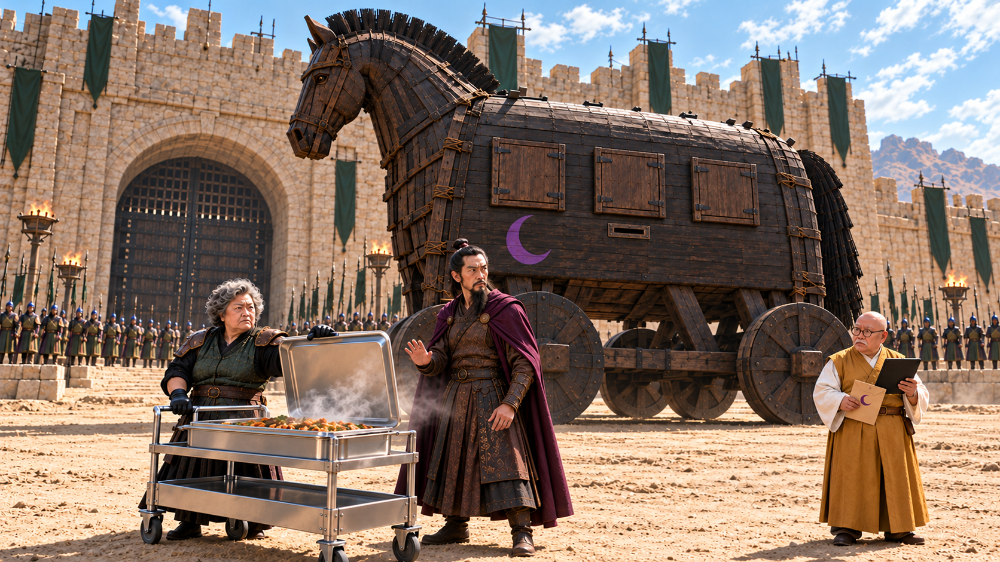

**첫 상태:** 세 패널은 완전히 닫혀 있고 손·그릇·숟가락은 아직 안에 있다. 열린 수레에서만 김이 난다.

**이어질 동작:** 정확히 창3개가 열리고 병사3명 각각 두 팔로 그릇1개·숟가락1개를 내민다. 총6팔·3그릇·3숟가락. 추가 사람/손 없음. CM은 부인하던 손을 못 내린다. 첫 그릇이 창 경계 밖으로 나오는 때가 음악 중단점이다.

**후처리 자막:** 없음. 행동과 표정으로 전달.

**웃음·정보 의도:** 끝까지 실제 군사 작전처럼 유지한 기대를 그릇이 나오는 순간의 음향 절단으로 깨뜨린다. 원문 후보는 이 현장 행동으로 확인되며 공성 장치가 배식창으로 보인다.

대사·음악·효과음·구도·전환

| 항목 | 내용 |
|---|---|
| 대사·내레이션 | 없음. 필요한 의미는 caption_cues로 전달. |
| 음악·효과음·정적 | 선택 BGM/SFX: 진지한 전쟁 음악, 목재·뚜껑·그릇. K08 첫 그릇 창경계 통과 때 음악 중단. 대사/내레이션 없음; 소리를 꺼도 필수 정보 유지. |
| 구도 | 성문·목마 전신·수레를 살리는 큰 와이드. 세 창과 팔6개·그릇3개·숟가락3개가 겹치지 않게 좌우 간격 확보. |
| 전환 | 공간 축·물리 상태를 이어 하드 컷. 자막 종료 뒤 다음 정보. |

[자막 없는 시작 PNG 원본](../../storyboards/2026-10-23_v11-production-lock/images/C04/S08.png)

### C04_K09 · 29–37초 · 8초

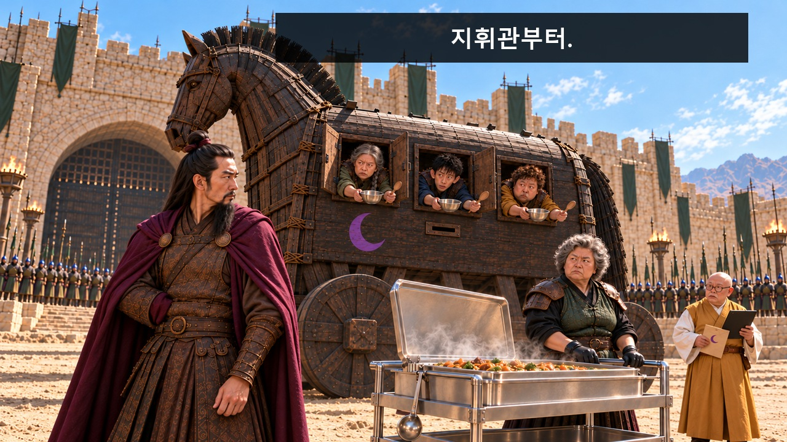

**첫 상태:** V7 S09_v2의 CM 전경·세 배식창·수레·인물 배치 유지. 병사 그릇3개는 이미 창밖. CM의 손은 망토 안에 있어 자기 숟가락은 아직 보이지 않는다. CM 시선은 GU를 향하고 턱은 정면의 권위 있는 자세이며 아직 더 들기 전. GU 국자는 수레 옆에 내려져 있다.

**이어질 동작:** CM이 자기 숟가락을 망토에서 꺼내 턱을 듦. 공개 뒤 지휘관부터 자막. GU는 국자를 드는 시작만. 뒤 4.8초 행사명·시작 문구, 인물 무언.

**후처리 자막**

- **29.8–31.8초:** 지휘관부터.
- **32–36.8초:** Q-AI Fair / AI 실행 사례, 지금 시작합니다.

이 컷의 다음 자막 배치 보기

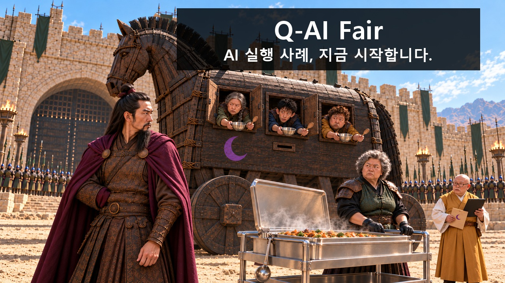

**웃음·정보 의도:** 들켰는데도 지휘관의 질서를 배식 순서에 적용하며 체면을 지킨다. GU는 논쟁 대신 국자를 드는 시작만 보여주고 실제 행사 안내로 넘긴다.

대사·음악·효과음·구도·전환

| 항목 | 내용 |
|---|---|
| 대사·내레이션 | 없음. 필요한 의미는 caption_cues로 전달. |
| 음악·효과음·정적 | 선택 BGM/SFX: 진지한 전쟁 음악, 목재·뚜껑·그릇. K08 첫 그릇 창경계 통과 때 음악 중단. 대사/내레이션 없음; 소리를 꺼도 필수 정보 유지. |
| 구도 | CM의 얼굴·망토 손을 전경에 두고 목마의 세 배식창을 후경에 유지하는 미디엄 와이드. 작은 나무 숟가락이 밝은 수레 앞에서 읽힐 크기. 행사명은 실제 복합 배경의 우상단에 대비 패널로 배치. |
| 전환 | 행사명·시작 문구 유지 후 실제 진행 연결. |

[자막 없는 시작 PNG 원본](../../storyboards/2026-10-23_v11-production-lock/images/C04/S09.png)

---

[검수 목록으로](README.md) · [← 이전 안](03_환경까지_가져왔습니다.md) · [다음 안 →](05_괴수는_퇴근할_수_없다.md)

정확한 행사 날짜·장소·참석 방법은 아직 기입하지 않았습니다. 실제 영상 제작 뒤 움직이는 소품·자막 가림·읽는 시간·편집 호흡을 재확인합니다.
