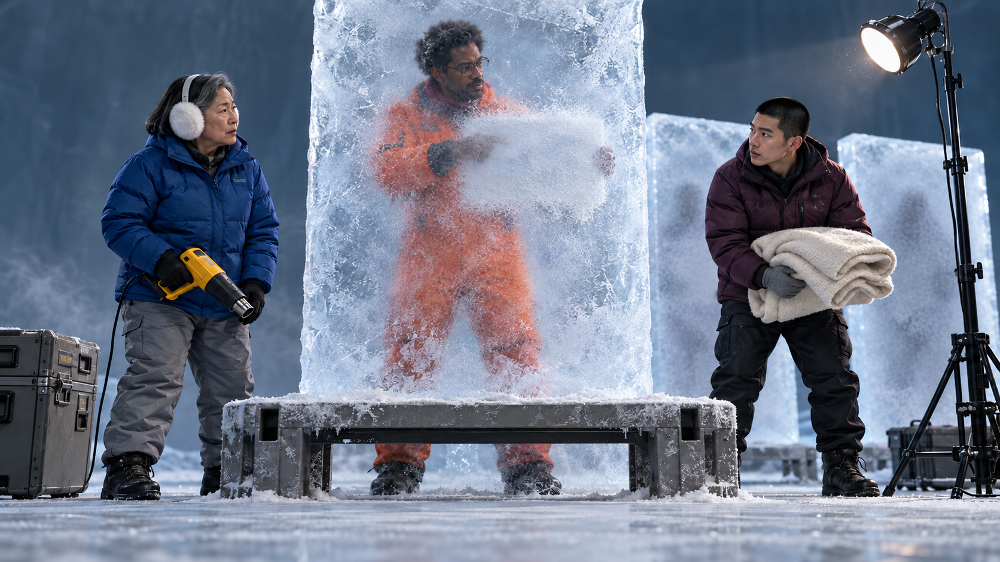
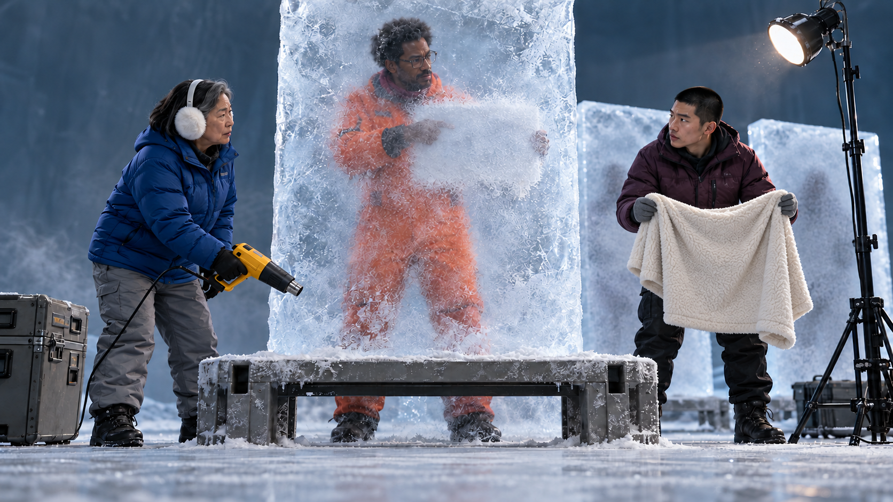
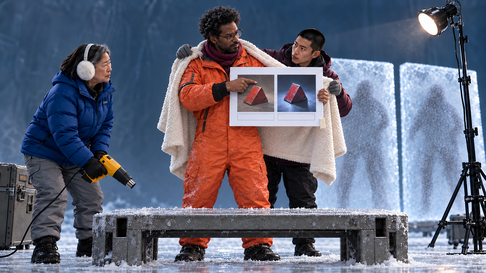
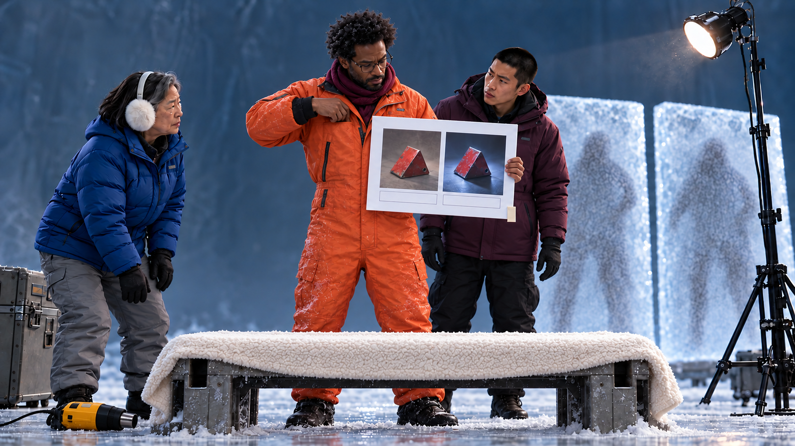
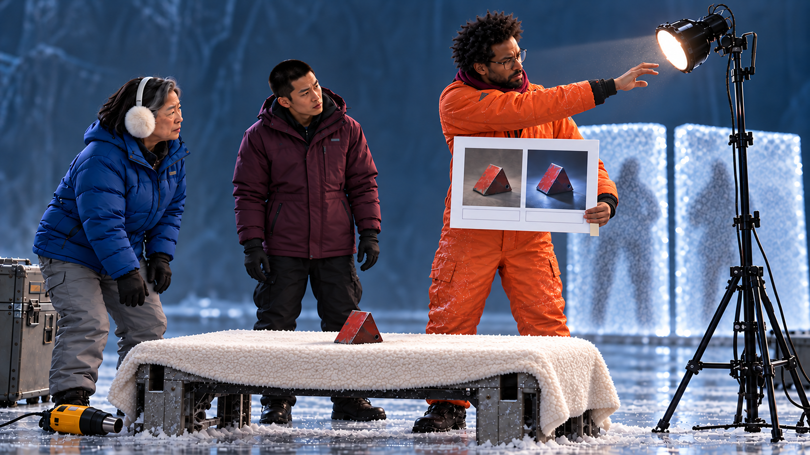
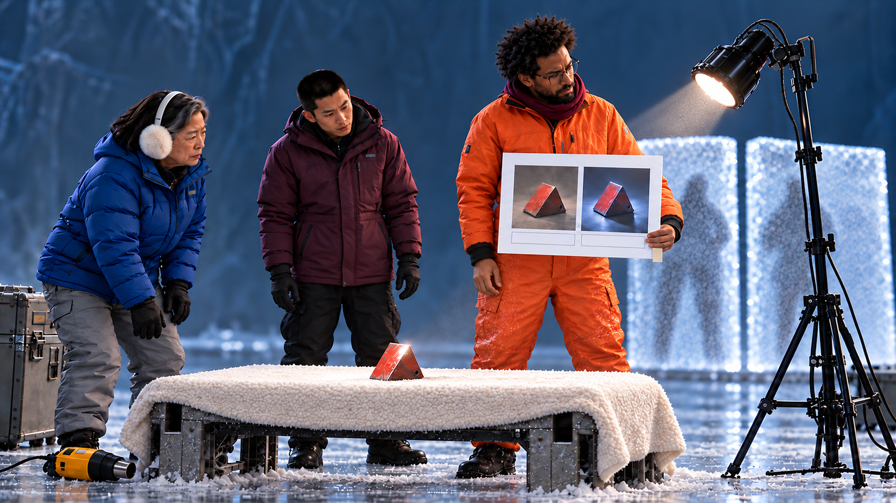
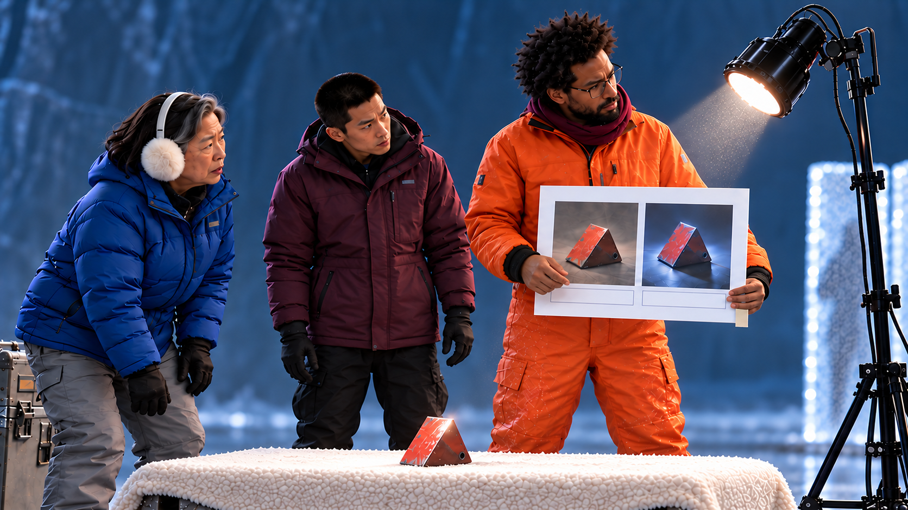
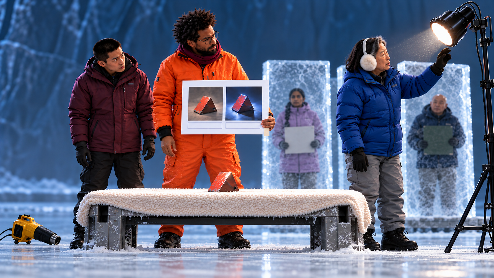
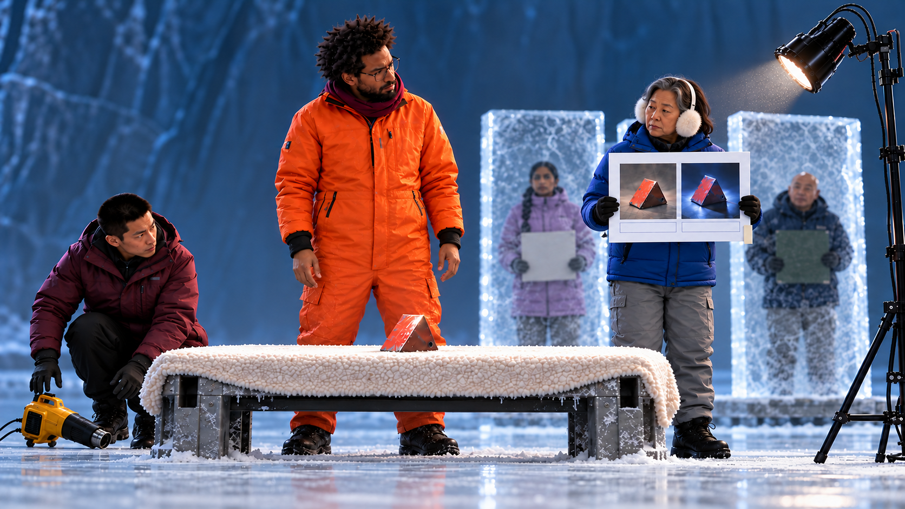
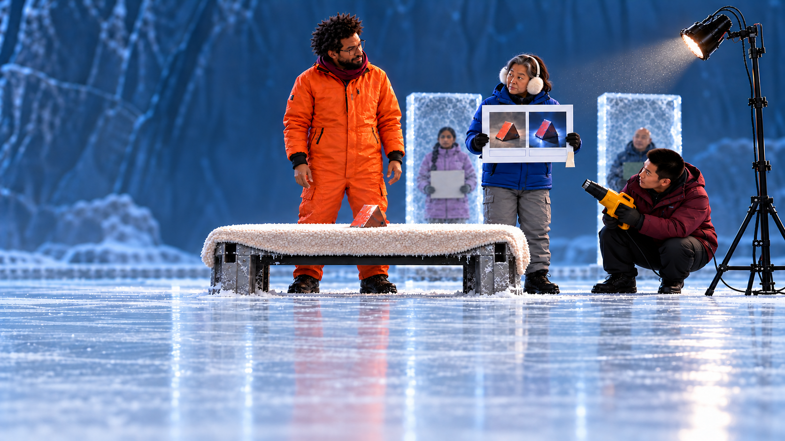

[전체 검수 목록](README.md)
# 08. 해동하자마자 발표

**얼음 속에서 자료를 가리키던 발표자가 구조 장비를 시연 도구로 바꾸자, 구조대장이 같은 자료의 조건을 바꿔 함께 비교하고 공유 줄에 합류한다.**

42초 · 10씬 / 시작 이미지10장 · 무대사 · 자막 후처리 · Flow 미생성

**핵심 메시지:** 꺼내 놓을 활용 경험이 있다면 누구나 서로의 발표자가 된다.

**반전:** 3.5초 서리가 걷히자 손의 목표가 처음부터 왼손에 든 자료판이었다. → 8초 조수가 몸을 덮으려던 담요를 탁자 배경으로 가로챔. 준비3컷8초. → 25.5초 대장이 같은 샘플의 조명 조건을 바꿔 함께 비교하고 같은 판을 들고 줄 합류. → 32.5초 조수가 얼지도 않은 대장의 자료판 천 탭을 송풍.

첫 이미지는 동작 전 상태입니다. 영상 동작·후합성·최종 편집 검증까지 끝난 것은 아닙니다.

## 인물과 연출

- **PR**: 30대 후반 흑인 남성, 키 크고 긴 팔다리, 둥근 짧은 아프로, 네모난 얇은 안경. 선명한 주황색 보온 작업복, 버건디 짧은 목도리, 검정 방한화. 얼음 속 왼손 자료판과 오른손 검지의 목표 위치를 해동까지 고정. 절박해 보이는 표정은 설명에 몰입한 표정. 이후 도구 전용에 집중.

- **RL**: 50대 후반 한국인 여성, 작고 단단한 체격, 회색이 섞인 검정 일자 단발. 코발트 파랑 패딩 재킷, 회색 방한 바지, 흰색 귀마개. 구조 전문가→같은 샘플의 다른 조명 조건을 직접 제안하는 공동 실험자→같은 비교판을 들고 공유 줄에 합류.

- **RA**: 20대 한국인 남성, 마른 체격, 검정 버즈컷. 자두색 패딩 재킷, 검정 바지, 회색 장갑. 성실하게 도우려다 도구가 전용되는 광경에 당황. 마지막까지 구조 업무의 논리로 반응.

- **F1**: 40대 남아시아 여성, 긴 한 갈래 검정 땋은 머리. 라일락 보온 코트. 뒤 얼음 판 안에서 자기 흰 자료판을 양손으로 든 포즈를 유지.

- **F2**: 60대 동아시아 남성, 대머리, 둥근 체형. 짙은 남색 보온 코트. 뒤 얼음 판 안에서 자기 초록 자료판을 옆으로 든 포즈를 유지.

## C08_K01 · 0–3.5초

**첫 상태:** 앞 얼음 판 뒤 PR은 흰 판을 왼손으로 가슴 앞에서 카메라 쪽으로 비스듬히 고정한다. 오른팔 검지는 판 왼쪽 사진 상단 위치의5cm 앞을 가리킨다. 서리가 판과 목표점을 가려 구조 손짓처럼 보인다. 판 아래오른쪽 고정 천 탭4cm도 서리 뒤. RL 오른손 열풍기, RA 담요 준비.

**동작:** RL이 열풍기를 내린 채 왼손으로 앞 얼음에 닿는다. PR 두 손·판·목표점은 움직이지 않는다.3.5초 안에 해동 컷으로 진입.

**후처리 자막:** 없음

| 항목 | 내용 |
|---|---|
| 대사·내레이션 | 없음 |
| 음악·효과음·정적 | 선택 차가운 저음·바람. 음성 없음. |
| 구도 | 35mm 낮은 각도. 손만 보이고 왼손 판·목표점은 서리로 가림. 해동 후 매치를 위해 카메라와 몸 위치 고정. |
| 전환 | RL의 시선에서 노란 열풍기로 연결. |
| 웃음·정보 의도 | 서리로 가려진 목표를 오해하게 하되 해동 뒤 손동작을 바꿔 반전을 조작하지 않음. |

## C08_K02 · 3.5–8초

**첫 상태:** PR은 S01과 정확히 같은 왼손 판·오른손 검지·목표점 위치로 얼음 뒤에 있다. RL 열풍기는 하단30cm 앞, 켜기 직전. RA 담요 양손.

**동작:** 3.5~6.8초 서리가 걷히며 왼손 자료판과 그 판을 가리키던 같은 목표점이 드러난다. PR의 팔·판을 움직이지 않는다. 끝1.2초 RA가 담요를 어깨에 걸치며 더 감싸려 한다.

**후처리 자막:** 없음

| 항목 | 내용 |
|---|---|
| 대사·내레이션 | 없음 |
| 음악·효과음·정적 | 선택 송풍. 표적 공개 마지막0.4초 음악 비우기 가능. |
| 구도 | S01 동일 높이·렌즈·몸 크기. 서리만 사라져 처음부터 있던 목표가 읽히는4.5초. |
| 전환 | 담요 어깨에 닿는 지점에서 다음 미디엄. |
| 웃음·정보 의도 | 구조 신호처럼 보인 손의 원래 목표를 공개. |

## C08_K03 · 8–11초

**첫 상태:** 해동한 PR 왼손은 같은 흰 판, 오른손은 여전히 같은 목표점. 담요는 어깨에 걸쳐 있고 RA가 양끝을 들어 몸을 감싸기 직전. 구조판 상면 비어 있음.

**동작:** RA가 담요를 몸 쪽으로 감싸려는 순간 PR이 오른손을 판에서 떼어 앞 모서리를 구조판 쪽으로 당긴다. 담요가 펴지고 RA는 몸을 감싸려던 빈 팔 자세로0.5초 남는다. RL은 꺼진 열풍기를 화면 왼쪽 RL 발 근처 바닥에 둔다.

**후처리 자막:** 없음

| 항목 | 내용 |
|---|---|
| 대사·내레이션 | 없음 |
| 음악·효과음·정적 | 천 휙 선택. 준비3컷 음악 연속. |
| 구도 | 50mm 같은 담요를 서로 다른 방향으로 당기는 순간→RA 빈 팔 반응까지3초. 큰 실랑이 없음. |
| 전환 | 담요가 펴진 구조판 중앙으로 시선 연결. |
| 웃음·정보 의도 | 준비를 압축하면서도 조수와 발표자의 목적 충돌·반응을 유지. |

## C08_K04 · 11–13.5초

**첫 상태:** 담요만 깔린 구조판. PR 오른손은 가슴 주머니 입구 위, 샘플은 안. 왼손 판과 고정 천 탭, RA는 빈 팔을 내리려 한다.

**동작:** PR이 빨간 삼각 샘플을 주머니에서 꺼내 담요 중앙에 바로 놓는다. RA가 눕는 곳으로 안내하려던 손을 멈춘다.2.5초에 추출·접촉 완료. 샘플을 놓은 뒤 PR은 등 쪽인 화면 오른쪽 뒤로 한 걸음 물러나 오른팔을 앞으로 뻗을 준비를 한다.

**후처리 자막:** 없음

| 항목 | 내용 |
|---|---|
| 대사·내레이션 | 없음 |
| 음악·효과음·정적 | 놓는 작은 탁·연속 음악 선택. |
| 구도 | 65mm 주머니→빈 담요 중앙을 같은 화면. 손이 샘플을 가리지 않는 측면. |
| 전환 | 작업등의 강한 얼굴 빛으로 연결. |
| 웃음·정보 의도 | 사람용 구조판이 실물 비교 테이블이 되는 핵심 동작만 남김. |

## C08_K05 · 13.5–16초

**첫 상태:** PR은 등 쪽인 화면 오른쪽 뒤로 한 걸음 물러나 오른팔을 앞으로 뻗어 작업등 손잡이10cm 앞에 둔다. 등은 얼굴 방향, 샘플은 어둡다. 흰 판은 왼손.

**동작:** PR이 등 머리를 아래 한 축으로 기울여 샘플을 정면 하향 조명한다. RA가 어두워진 얼굴 대신 샘플 쪽으로 고개를 따라 내린다.2.5초.

**후처리 자막:** 없음

| 항목 | 내용 |
|---|---|
| 대사·내레이션 | 없음 |
| 음악·효과음·정적 | 힌지 한번·연속 음악 선택. |
| 구도 | 50mm 옆 미디엄. 얼굴빛→샘플빛 이동과 RA 반응 한 화면. |
| 전환 | 샘플에 생긴 빛에서 처음과 같은 팔 자세로 매치. |
| 웃음·정보 의도 | 준비 합8초, 구조원의 관심까지 샘플로 전환. |

## C08_K06 · 16–21초

**첫 상태:** PR 왼손 같은 흰 비교판, 오른손은 몸 가까이. 판의 두 사진은 같은 삼각 샘플의 다른 조명 조건. 실물은 정면광으로 반사가 강함.

**동작:** PR이 첫 장면의 같은 판 목표점과 실물 반사를 차례로 짚는다. 처음 조건/바꾼 조건 사진을 보여 시행착오를 나눈다. RL이 실물 반사에서 작업등 손잡이로 시선을 옮긴다.

**후처리 자막:** 17–20.8초: AI 활용 시행착오도 공유.

| 항목 | 내용 |
|---|---|
| 대사·내레이션 | 없음 |
| 음악·효과음·정적 | 밝아진 음악 선택, 음성 없음. |
| 구도 | S01 같은 낮은 높이.5초 동안 판 목표점→실물 반사→RL 시선. 완벽한 성공 효과 없음. |
| 전환 | 오른쪽 후방으로 RL 시선이 움직이며 넓은 구도로. |
| 웃음·정보 의도 | AI 적용 중 바꿔 본 조건·시행착오 공유. 검출후보 확인 공식 반복 제거. |

## C08_K07 · 21–25.5초

**첫 상태:** PR·테이블 중간 구도. 오른쪽에 기존 뒤 얼음2개 일부. 판은 PR 왼손, RL은 뒤쪽을 보기 시작.

**동작:** 4.5초에 카메라가 넓어져 기존 F1·F2를 공개한다. 각자 자료판을 든 고정 자세. RL은 다시 PR의 실물과 작업등을 본다. 자기 상자·자료는 찾지 않는다. RL이 작업등에 닿을 수 있도록 화면 오른쪽으로 두 걸음 이동한다.

**후처리 자막:** 없음

| 항목 | 내용 |
|---|---|
| 대사·내레이션 | 없음 |
| 음악·효과음·정적 | 짧은 장엄한 음악 확대 선택. |
| 구도 | 28mm 짧은 달리 아웃·우측 팬. 후방 두 사람은 고정. |
| 전환 | RL의 시선이 도착한 작업등으로 컷. |
| 웃음·정보 의도 | 이미 있던 공유 욕구를 확대하되 대장은 공동 조건 비교로 향함. |

## C08_K08 · 25.5–32.5초

**첫 상태:** RL 왼손은 작업등 손잡이10cm 앞. 등은 정면 하향, PR 흰 판은 왼손. RL은 빈손으로 접근했고 오른손도 비어 있다. 천 탭은 판 아래오른쪽에 고정.

**동작:** 25.5~27.5초 RL이 왼손으로 등 머리를 옆30도로 돌려 같은 샘플의 조명 조건을 바꾼다.27.5~29초 둘이 실물 반사와 같은 판 사진을 비교한다.29~30.5초 PR이 같은 흰 판을 RL 양손에 건넨다.30.5~32.5초 RL이 한 걸음 뒤 공유 줄에 합류한다. 새 판 없음.

**후처리 자막:** 27–30초: 이 조건으로도 봅시다.

| 항목 | 내용 |
|---|---|
| 대사·내레이션 | 없음 |
| 음악·효과음·정적 | 힌지·천 스침·밝은 음악 선택. |
| 구도 | 35mm 작은 팬. 등→같은 판 비교→판 전달→줄까지7초. 줄까지 한 걸음. |
| 전환 | 같은 흰 판을 든 RL과 바닥 열풍기가 보이는 다음 컷. |
| 웃음·정보 의도 | 대장이 같은 조건을 바꿔보는 공동 기여자가 된다. 새 사례 꺼내기 반복 제거. |

## C08_K09 · 32.5–37초

**첫 상태:** RL은 얼음 밖 줄 끝에서 같은 흰 판을 양손에 든다. 천 탭은 아래오른쪽에 정지. RA는 화면 왼쪽 RL 발 근처 바닥의 열풍기 손잡이 앞에 손을 둔다.

**동작:** RA가 바닥의 열풍기를 집어 들고 화면 오른쪽 RL의 자료판 쪽으로 이동해 천 탭 아래를 향한다. 탭만 가볍게 펄럭인다. RL이 얼음 없는 자기 판 아래를 보고 RA에게 고개를 돌린다.4.5초. 열풍기가 순간이동하거나 천 탭 위치가 바뀌지 않는다.

**후처리 자막:** 없음

| 항목 | 내용 |
|---|---|
| 대사·내레이션 | 없음 |
| 음악·효과음·정적 | 약한 송풍 선택, 마지막0.5초 완전 정적. |
| 구도 | 50mm RA·RL 투샷. 바람은 몸이 아닌 탭 아래 허공. 탭 뿌리가 판에 고정된 것이 보임. |
| 전환 | 두 사람의 어긋난 시선이 풀릴 때 전체 구도로. |
| 웃음·정보 의도 | 얼지도 않은 공동 실험자의 자료를 해동하려는 조수의 성실한 후폭풍. |

## C08_K10 · 37–42초

**첫 상태:** PR은 실물 옆 빈손, RL은 같은 흰 비교판·천 탭을 들고 RA를 본다. RA 열풍기는 판 아래. 뒤 F1/F2·얼음 그대로.

**동작:** RA가 열풍기를 조금 내리고 RL이 판을 PR 쪽으로 살짝 기울여 둘이 같은 자료를 다시 본다.37초부터 행사 정보5초. 새 물건 없음.

**후처리 자막:** 37–42초: Q-AI Fair / 품질팀 AI 성과·활용 경험 교류

| 항목 | 내용 |
|---|---|
| 대사·내레이션 | 없음 |
| 음악·효과음·정적 | 밝은 마침 음악 선택, 음성 없음. |
| 구도 | 28mm 고정 와이드, 시연·공동 판·뒤 두 인물 상단72%. |
| 전환 | 42초 종료 또는 다음 화면으로 단순 컷. |
| 웃음·정보 의도 | 혼자 내미는 사례에서 함께 조건을 바꾸는 교류로 연결. |

## 제작 메모

- **difficulty_reason:** 얼음 해동과 의상 연속성, 다섯 인물·세 얼음 판의 고정 위치, 담요 이동이 어렵다.
- **alternative:** 해동은 전면 얼음의 투명도·물방울 효과와 짧은 백색 빛 연결로 처리할 수 있다. 복잡한 실제 파괴나 유체 시뮬레이션을 필수로 삼지 않는다. 후방 2인은 움직이지 않는 정적 포즈, 발표자/구조원 3인만 움직인다.
- **avoid:** 고대인이 AI를 썼다는 설정, 실제 구조 절차 재현, 고통·위협 연기, 갑자기 생기는 추가 얼음 판 없음.
- **timing:** K03~05 준비는 기존 순수15초에서8초로 압축(해동시간과 구분). K08 공동 조건 비교7초는 새 사건으로 보존. 최종42초.

[전체 명세·프롬프트](../../storyboards/2026-10-24_v12-rework/storyboards.json) · [실제 이미지 매핑](../../storyboards/2026-10-24_v12-rework/scene_manifest.json)
