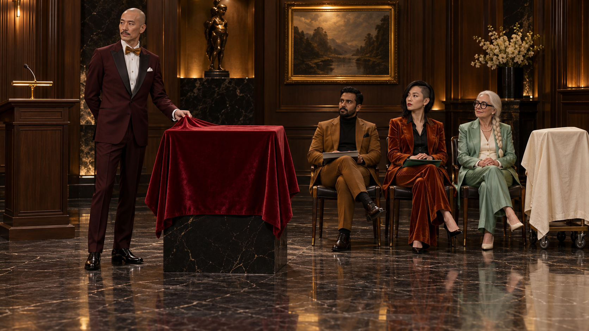
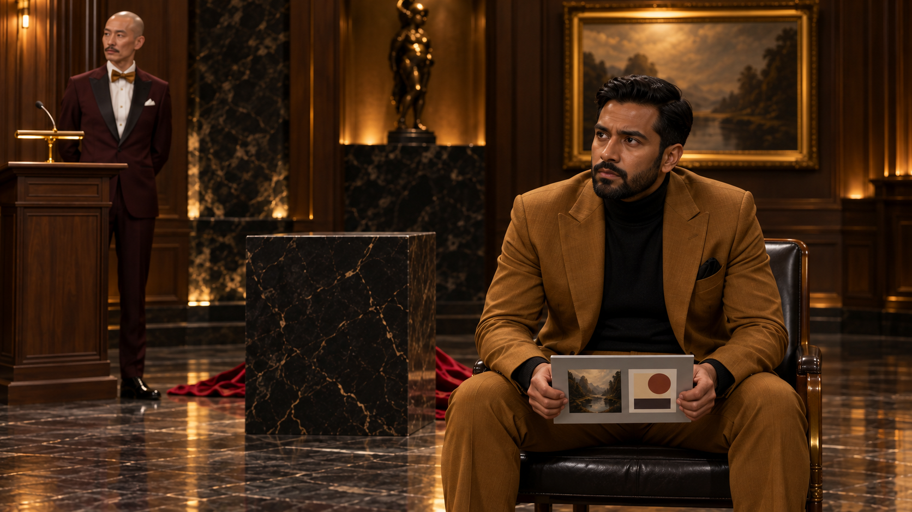
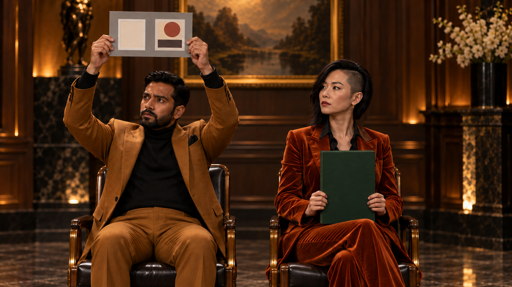
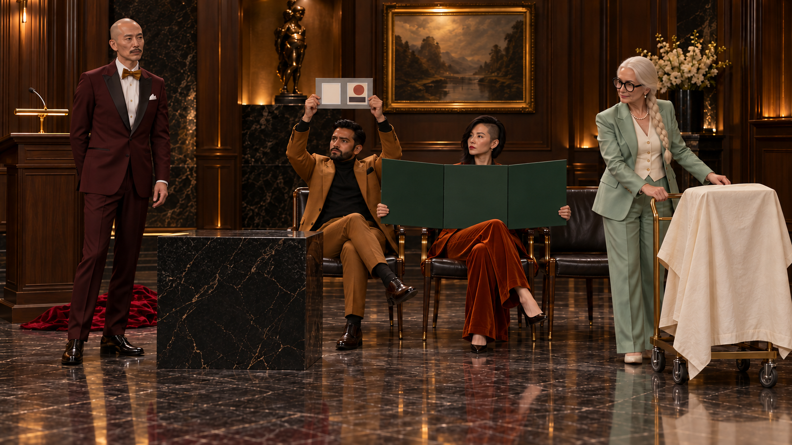
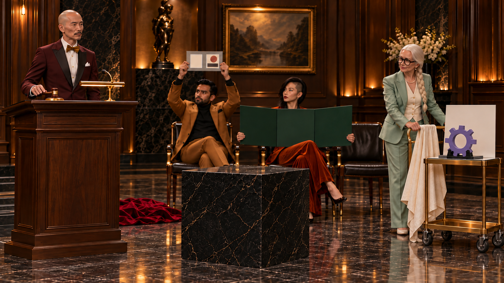
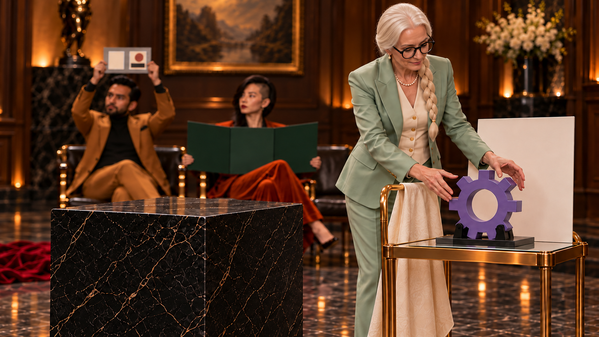
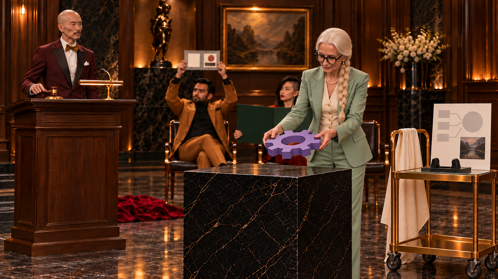
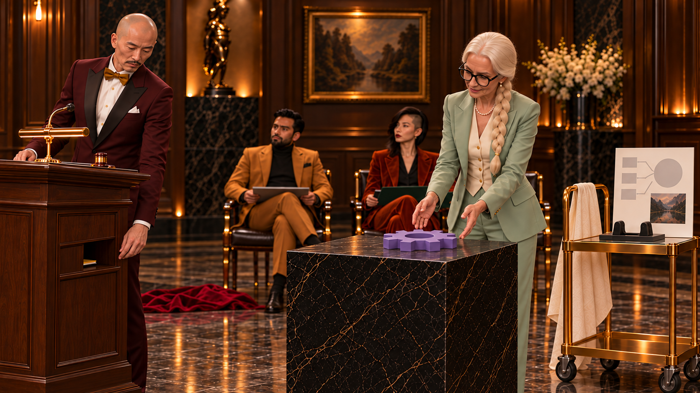
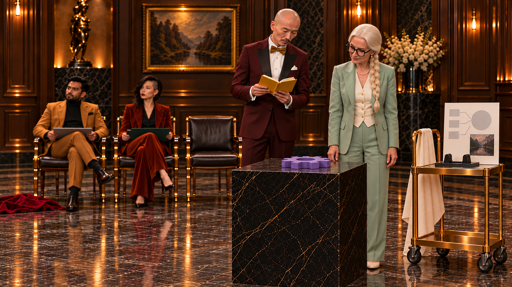
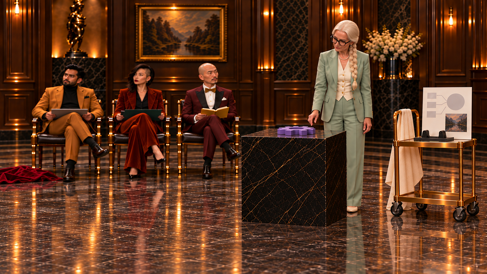

[전체 검수 목록](README.md)
# 09. 낙찰받으신 분이 공개합니다

**빈 진열대를 두고 자기 사례를 점점 크게 내미는 사람들. 낙찰자는 물건을 가져가는 대신 자기 샘플을 올리고, 경매사도 발표하고 싶어 한다.**

38초 · 10씬 / 시작 이미지10장 · 무대사 · 자막 후처리 · Flow 미생성

**핵심 메시지:** 가져갈 물건보다 가져와 나눌 경험이 주인공이다.

**반전:** 4초 빈 진열대를 놓고 작은 판→날개판→시연 카트의 세 방식으로 경쟁. → 20.5초 낙찰자가 자기 샘플을 내려놓아 공유 방향을 역전. → 24.5초 경매사도 자료를 내밀다가 기존 마지막 빈 의자로 안내.

첫 이미지는 동작 전 상태입니다. 영상 동작·후합성·최종 편집 검증까지 끝난 것은 아닙니다.

## 인물과 연출

- **AU**: 40대 중반 동아시아 남성, 매우 크고 마른 키, 민머리, 가는 콧수염. 검붉은 턱시도, 금색 보타이, 흰 셔츠. 첫 장면은 과도하게 품위 있는 경매사. 후반에는 자기 차례를 놓치기 싫어 애쓰는 참가자.

- **B1**: 30대 남아시아 남성, 탄탄하고 작은 체격, 짧은 검정머리·정돈된 짧은 수염. 황토색 정장, 검정 터틀넥. 작은 판을 높이 내미는 절박한 눈빛. 계속 품위를 지키려 함.

- **B2**: 20대 후반 동아시아 여성, 큰 키, 오른쪽 언더컷·왼쪽 긴 검정 단발. 구리색 벨벳 팬츠 수트, 검정 셔츠. 접이식 판을 양날개처럼 펼치는 확신. 옆사람보다 더 크게 보여주려는 행동.

- **BW**: 60대 백인 여성, 작은 키, 긴 백발 한 갈래 땋은 머리, 검정 원형 큰 안경. 바다녹색 실크 팬츠 수트, 진주색 조끼. 절제된 승부욕. 자기 원물을 공개할 때만 눈이 반짝이고, 경매사에게도 침착하게 기다리라는 몸짓.

## C09_K01 · 0–4초

**첫 상태:** AU가 중앙 진열대의 붉은 벨벳 덮개 끝을 왼손으로 잡고 아직 당기지 않았다. B1·B2·BW는 자기 의자에 앉아 있다. BW 카트는 덮여 있고 B1의 작은 단판은 무릎 위에 납작하게, B2의 3면판은 무릎 위에 접혀 있다. BW의 두 손은 비어 있다.

**동작:** AU가 비장하게 붉은 덮개를 한 번 벗긴다. 검정 진열대 상면은 비어 있다. 끝0.7초 AU가 빈 상면 옆에 손바닥을 펴고 멈춘다.4초.

**후처리 자막:** 없음

| 항목 | 내용 |
|---|---|
| 대사·내레이션 | 없음 |
| 음악·효과음·정적 | 선택 현악·천 스침. 마지막0.4초 음악·효과 정적. |
| 구도 | 28mm 정면 와이드. 덮인 진열대·세 자리·카트·경매대 위치를 첫 프레임에 정립. 마지막 1초 빈 상면을 충분히 보임. |
| 전환 | 빈 진열대를 보는 B1의 눈으로 컷. |
| 웃음·정보 의도 | 보여줄 것이 있을 것이라는 첫 기대를 깨되 경매사의 과도한 권위를 유지한다. |

## C09_K02 · 4–8초

**첫 상태:** B1의 회색 A5 사례판은 아직 무릎 위. 양손이 판 양옆을 잡고 있고 몸이 의자에서 약간 앞으로 기운다. 뒤쪽 AU는 손을 경매대에 둔 채 기다린다.

**동작:** B1이 작은 판을 머리 위로 번쩍 들고 팔꿈치를 끝까지 편다. AU는 눈을 가늘게 뜬다.4초, 같은 자세 반복 없음.

**후처리 자막:** 없음

| 항목 | 내용 |
|---|---|
| 대사·내레이션 | 없음 |
| 음악·효과음·정적 | 선택 빠른 현악 한 마디. 판 흔드는 바람 소리 1회만. |
| 구도 | 65mm B1 미디엄. AU의 가늘어진 눈을 배경 안에 두되 판을 가리지 않는다. |
| 전환 | 판이 최고 높이에 오른 상태에서 옆 B2로 컷. |
| 웃음·정보 의도 | 첫 과장: 작고 정갈한 사례를 몸 길이로 보충하는 절박함. 글씨가 아니라 동작으로 경쟁을 읽힌다. |

## C09_K03 · 8–12초

**첫 상태:** B2의 초록 3면판은 무릎 위에 책처럼 접혀 있다. 양손은 좌우 날개 끝을 잡기 직전. 왼쪽 가장자리 B1은 작은 판을 높이 들고 있다.

**동작:** B2가 판 좌우 날개를 한 번 펼친다. 시야를 가린 B1이 고개만 옆으로 내민다.4초.

**후처리 자막:** 없음

| 항목 | 내용 |
|---|---|
| 대사·내레이션 | 없음 |
| 음악·효과음·정적 | 선택 경첩 탁탁 두 음. 음악은 더 웅장해짐. |
| 구도 | 50mm 두 관객 미디엄. 펼친 판의 좌우 경계를 프레임 안에 남김. 날개는 사람을 치지 않음. |
| 전환 | B2의 자신만만한 눈에서 뒤 BW로 컷. |
| 웃음·정보 의도 | 두 번째 과장: 단순 높이 경쟁이 넓이 경쟁으로 바뀌고 앞 관객의 체면이 가려진다. |

## C09_K04 · 12–16초

**첫 상태:** BW는 뒤 의자에서 일어나 카트 왼쪽 손잡이를 잡고 있다. 오른손은 아이보리 카트 덮개의 모서리에 닿아 있지만 덮개는 그대로. 카트는 자기 의자 옆 원위치다.

**동작:** BW가 덮개를 벗겨 손잡이에 걸고, 공개한 카트를 통로로40cm 민다.4초. B1/B2는 판을 든 채 눈만 돌아본다. 카트가 공개되는 끝부터 동일한 비교판 도해를 후합성한다.

**후처리 자막:** 없음

| 항목 | 내용 |
|---|---|
| 대사·내레이션 | 없음 |
| 음악·효과음·정적 | 선택 천 휙·바퀴 짧은 드르륵. 음악 최고조. |
| 구도 | 35mm 낮은 미디엄 와이드. 카트 전체와 BW 상반신. 복잡한 바퀴 회전 대신 짧은 직진. |
| 전환 | AU가 BW를 보며 경매봉을 드는 컷으로. |
| 웃음·정보 의도 | 세 번째 과장: 종이 크기 경쟁에 실제 시연물 전체로 들어온다. 서로 다른 행동 3회를 보존. |

## C09_K05 · 16–18초

**첫 상태:** AU가 경매대 위 작은 경매봉을 들어 올리기 직전. BW는 공개한 카트 뒤에서 기다린다. 중앙 진열대는 여전히 완전히 비어 있다.

**동작:** AU가 봉을 한 번 두드리고 곧바로 BW를 지목한다. BW의 짧은 끄덕임까지만2초. 관객의 추가 실망 반응은 생략.

**후처리 자막:** 없음

| 항목 | 내용 |
|---|---|
| 대사·내레이션 | 없음 |
| 음악·효과음·정적 | 선택 봉 탁 1회. 소리를 꺼도 손짓과 반응으로 선정이 보임. |
| 구도 | 50mm AU·빈 진열대·BW를 한 화면. 봉 동작과 지목을2초에 연결. |
| 전환 | BW의 손이 샘플로 향하는 방향으로 컷. |
| 웃음·정보 의도 | 낙찰된 사람이 무엇을 가져갈지 기대를 다시 세운다. 가격이나 실제 운영 규칙은 없다. |

## C09_K06 · 18–20.5초

**첫 상태:** BW가 카트 옆에 서서 보라색 샘플의 좌우에 두 손을 대기 직전. 샘플 밑면은 아직 카트 받침에 놓여 있다. 빈 진열대까지 한 걸음 거리.

**동작:** BW가 경량 샘플을 두 손으로 들어 가슴 높이에서 지지하고 진열대 앞으로 한 걸음 이동한다.2.5초. 내려놓지는 않는다.

**후처리 자막:** 없음

| 항목 | 내용 |
|---|---|
| 대사·내레이션 | 없음 |
| 음악·효과음·정적 | 선택 샘플 들어 올리는 부드러운 마찰·한 걸음. 음악은 궁금증을 유지. |
| 구도 | 50mm 측면. 카트→진열대 한 걸음만, 이동 전 손 접촉과 끝 운반 상태를 모두 보임. |
| 전환 | 샘플이 빈 상면 위로 오는 다음 컷에 매치. |
| 웃음·정보 의도 | 소유 방향을 뒤집을 준비. 카트에서 가져온 물건임을 출발부터 보여준다. |

## C09_K07 · 20.5–24.5초

**첫 상태:** BW가 보라색 샘플을 양손으로 빈 진열대 상면 위 10cm에서 잡고 있다. 샘플은 아직 상면에 닿지 않았다. AU·B1·B2가 바라본다.

**동작:** 첫1초에 BW가 자기 샘플을 빈 진열대에 평평하게 내려놓는다. 다음3초에 카트 비교판의 AI 요약 한 항목과 실물의 대응 부분을 차례로 가리킨다. 관객은 추가 과장 반응 없이 앞으로 기울여 본다. B1과 B2는 새 발표자인 BW 쪽으로 시선을 돌린다. 새 받침대는 생기지 않는다.

**후처리 자막:** 21.3–24.5초: AI 요약 + 실물 근거

| 항목 | 내용 |
|---|---|
| 대사·내레이션 | 없음 |
| 음악·효과음·정적 | 선택 놓는 탁 이후 음악이 부드럽게 반전. 음성 없음. |
| 구도 | 50mm 상면 접촉→카트의 요약 비교판→자기 실물을4초에 연결. 비교판은 여러 무명 검토자료의 요약을 후합성, 새 벽 화면 없음. |
| 전환 | AU의 감탄하는 표정으로 연결. |
| 웃음·정보 의도 | 낙찰받은 사람이 가져가는 대신 근거까지 가져와 공유. AI의 역할은 검출이 아닌 여러 자료의 요약·비교. |

## C09_K08 · 24.5–29초

**첫 상태:** AU가 자기 경매대 아래 선반을 내려다본다. 왼손은 선반 입구에 닿기 직전. 노랑 작은 사례책 모서리만 보인다. BW는 샘플 옆에서 설명 중.

**동작:** AU가 아래 선반의 노랑 사례책을 꺼내 펼치고 BW 옆으로 반 걸음 들어온다.4.5초. 추가 감탄 반응은 짧은 눈빛만.

**후처리 자막:** 25.7–28.7초: 제 사례도 잠깐만…

| 항목 | 내용 |
|---|---|
| 대사·내레이션 | 없음 |
| 음악·효과음·정적 | 선택 책 펼침 파락. 음악이 잠깐 기대를 부풀림. |
| 구도 | 65mm AU 미디엄. 책의 추출→펼침 한 동선을 보이며 몸 이동은 반 걸음뿐. |
| 전환 | BW의 기다리라는 손바닥이 들어오는 방향으로 컷. |
| 웃음·정보 의도 | 세 번째 반전. 권위를 가진 진행자도 나누고 싶은 경험을 숨겨두고 있었다. |

## C09_K09 · 29–33초

**첫 상태:** AU는 열린 노랑 사례책을 들고 BW 옆에 서 있다. BW의 왼손은 아직 몸 옆. 뒤오른쪽 BW가 비운 의자가 보인다.

**동작:** BW가 잠깐 기다리라는 손바닥을 들어 뒤 빈 의자를 바로 가리킨다(1초). AU가 책을 가슴에 안고 두 걸음 뒤 의자에 앉는다(3초). 앉은 뒤 반응 대기 없음.

**후처리 자막:** 없음

| 항목 | 내용 |
|---|---|
| 대사·내레이션 | 없음 |
| 음악·효과음·정적 | 선택 짧은 발걸음·의자 삐걱. 착석 직전 음악을0.3초 비우고 엔딩으로. |
| 구도 | 35mm 고정 와이드, 의자까지 두 걸음. 안내1초·이동/착석3초. 총4초. |
| 전환 | AU가 앉은 뒤 BW의 설명을 보는 전체 구도로. |
| 웃음·정보 의도 | 진행자도 같은 공유 욕구를 가진 참가자. 마지막 빈자리로 이동하는 실제 행동이 권위의 콜백을 끝낸다. |

## C09_K10 · 33–38초

**첫 상태:** BW가 진열대 옆에, B1·B2·AU는 기존 세 의자에 앉아 있다. AU는 노랑 책을 무릎에 펼친 채 몸을 꼿꼿이 세운다. 샘플은 진열대 위.

**동작:** BW가 자기 샘플을 작게 가리킨다. AU는 무릎의 사례책을 보며 듣는다.33초부터 행사 정보5초 고정.

**후처리 자막:** 33–38초: Q-AI Fair / 품질팀 AI 성과·활용 경험 교류

| 항목 | 내용 |
|---|---|
| 대사·내레이션 | 없음 |
| 음악·효과음·정적 | 선택 고급스러운 현악 마침. 음성 없음. |
| 구도 | 35mm 안정된 전체 구도. 진열대와 네 사람은 상단 72%, 하단 제목판. |
| 전환 | 38초 종료 또는 다음 화면으로 단순 컷. |
| 웃음·정보 의도 | 빈 진열대를 서로의 경험으로 채웠다는 결말. 엔딩은 정보 읽는 5초를 확보한다. |

## 제작 메모

- **difficulty_reason:** 네 인물의 고정 위치, 3면판 힌지, 큰 샘플의 두 손 운반이 주요 부담. 군중은 네 명으로 제한.
- **alternative:** 접이판은 좌우 두 날개만 한 번 펴며 반복 접기 없음. 카트 이동은 40cm 직선. 샘플 운반과 올려놓기를 별도 컷으로 확보. 후반 경매사는 빈 의자까지 짧게 이동하는 한 동작만.
- **avoid:** 가격·입찰액·낙찰 금액·수상 특전·행사 발표 운영 규칙을 문자로 제시하지 않음.
- **timing:** 낙찰 지목2초/한 걸음 운반2.5초/놓기·데모4초/착석4초. 원인 구간을 삭제하지 않고 반복 반응을 줄여38초.
- **required_post_composite:** 카트 판은 K04 덮개 해제 직후부터 K10까지 같은 보라 기어/원자료→AI 요약 도해로 후합성. S05/S06 빈 면과 S07 이후 풍경 임시이미지도 모두 교체. B1 판 S02/S03도 같은 도해로 통일. 생성된 풍경판을 최종 정보로 사용하지 않는다.

[전체 명세·프롬프트](../../storyboards/2026-10-24_v12-rework/storyboards.json) · [실제 이미지 매핑](../../storyboards/2026-10-24_v12-rework/scene_manifest.json)
