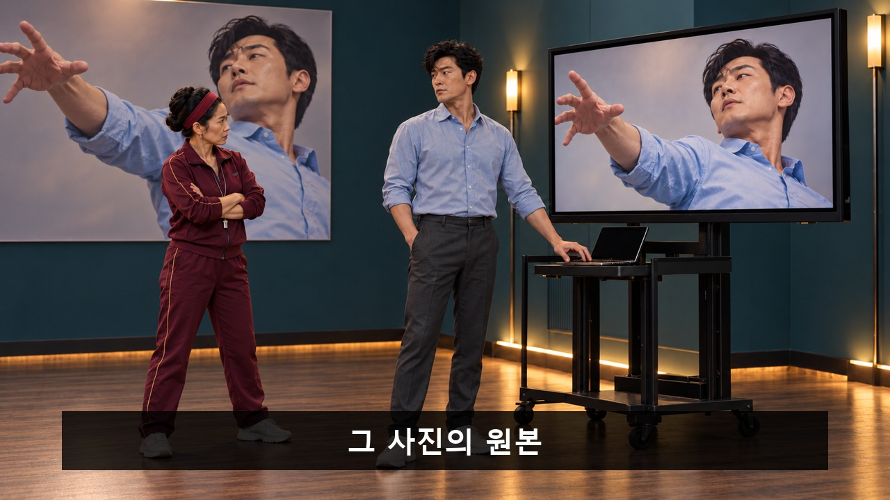
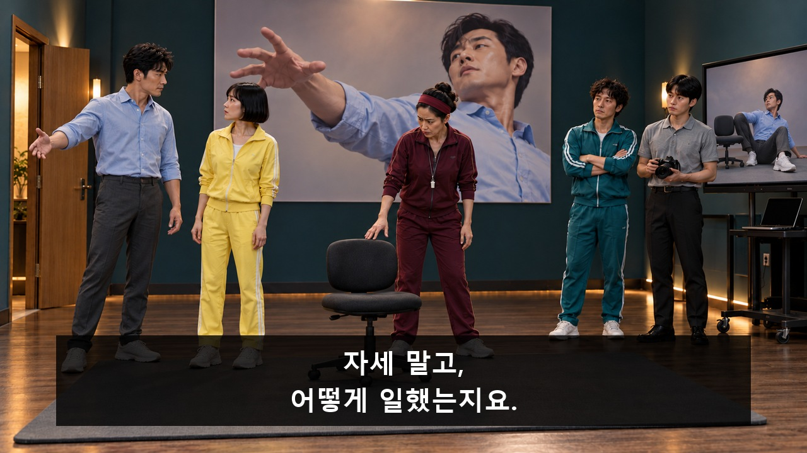
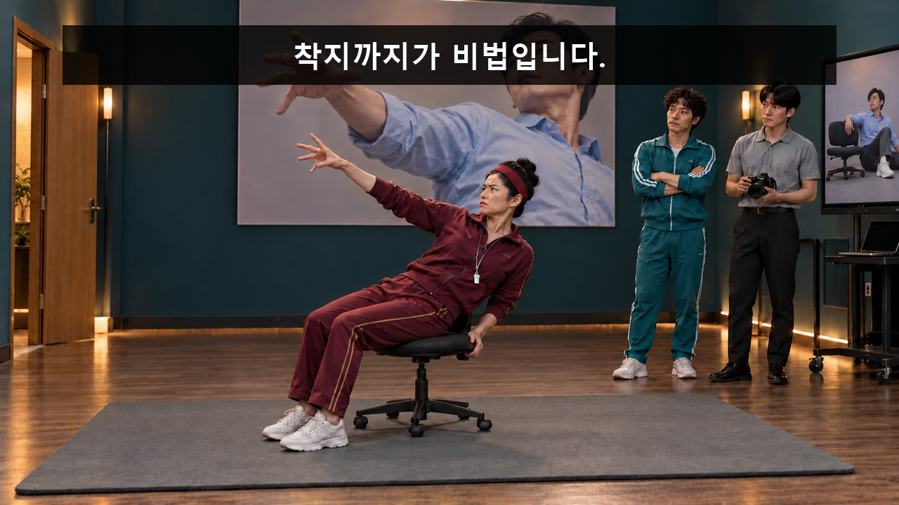
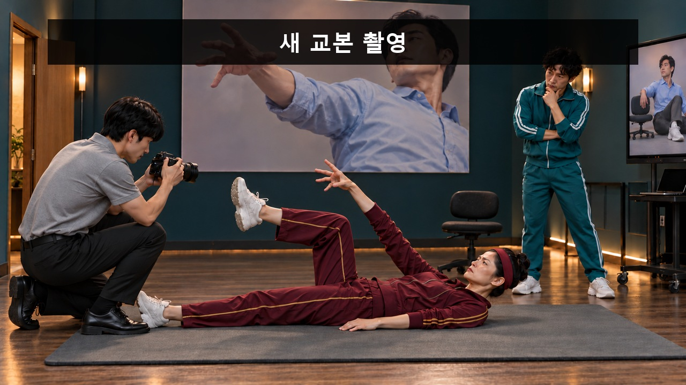
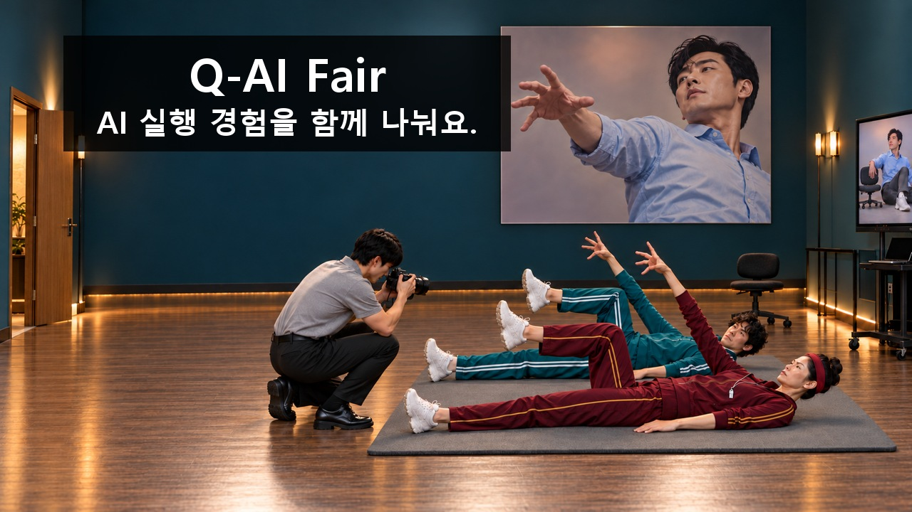
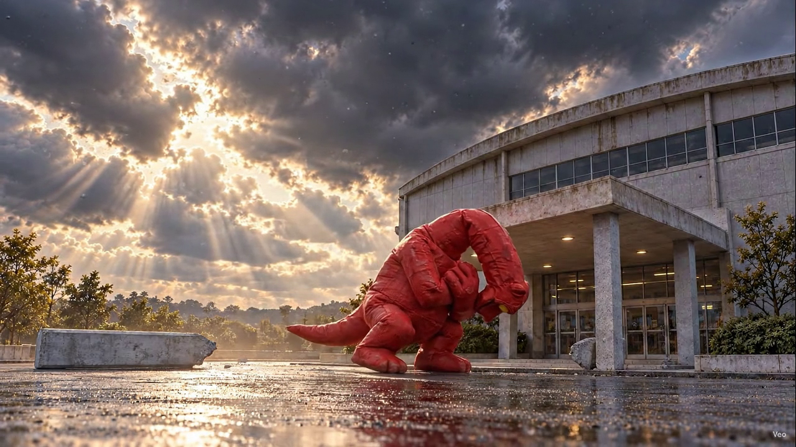
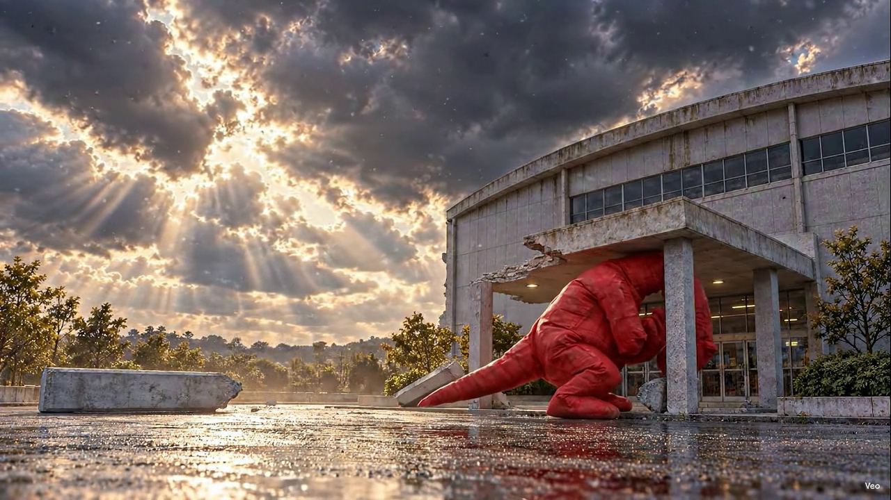
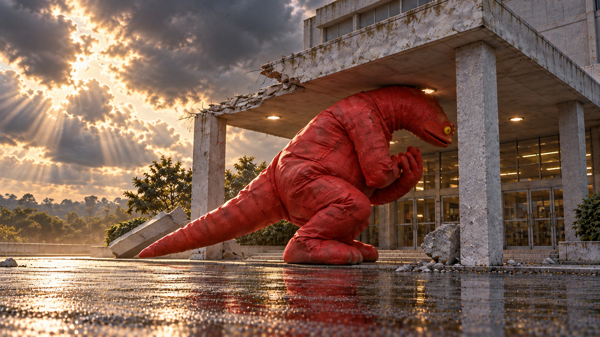
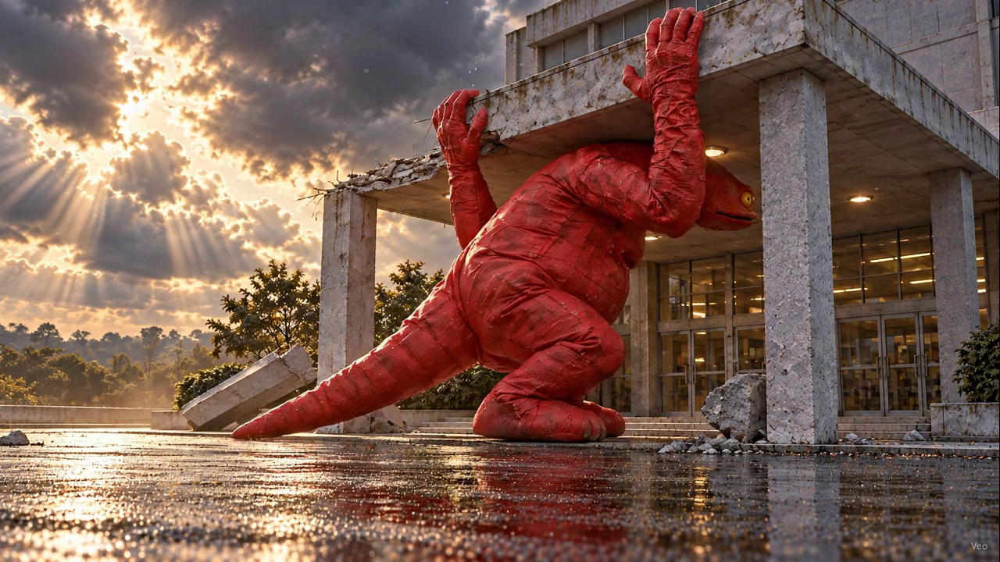
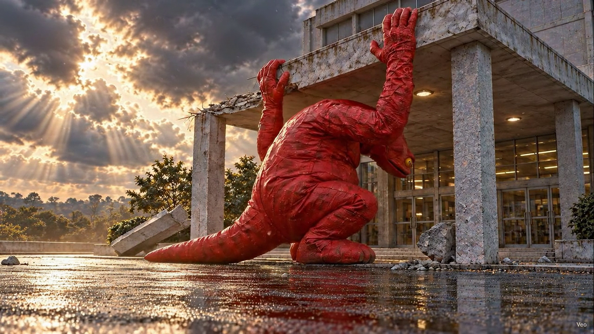

# Q-AI Fair · 전체 이미지 콘티

[최신 상태·콘티 목록](README.md)

1~6번은 기존 V11 기획을 기반으로 한 자료이며, 실제 선택 영상의 구간과 5번 인과 보완은 최신 제작 상태가 우선합니다. 7~10번은 새 V12의 선정 첫 이미지40장입니다. 자막은 후처리합니다.

## 성공 자세 교정원

[컷별 동작·자막·음향 보기](01_성공_자세_교정원.md)

## 검은 점을 잡아라

[컷별 동작·자막·음향 보기](02_검은_점을_잡아라.md)

## 환경까지 가져왔습니다

[컷별 동작·자막·음향 보기](03_환경까지_가져왔습니다.md)

## 목마는 식사 중입니다

[컷별 동작·자막·음향 보기](04_목마는_식사_중입니다.md)

## 괴수는 퇴근할 수 없다

[컷별 동작·자막·음향 보기](05_괴수는_퇴근할_수_없다.md)

## 퇴근 좀 해주세요

[컷별 동작·자막·음향 보기](06_퇴근_좀_해주세요.md)

## 훔칠 필요가 없었다

[컷별 동작·자막·음향 보기](07_훔칠_필요가_없었다.md)

## 해동하자마자 발표

[컷별 동작·자막·음향 보기](08_해동하자마자_발표.md)

## 낙찰받으신 분이 공개합니다

[컷별 동작·자막·음향 보기](09_낙찰받으신_분이_공개합니다.md)

## 청혼은 없었습니다

[컷별 동작·자막·음향 보기](10_청혼은_없었습니다.md)

## 5번 인과 보완 입력

[실제 편집 흐름과 영상](../../storyboards/2026-10-24_C05-causal-edit-v05/README.md)

