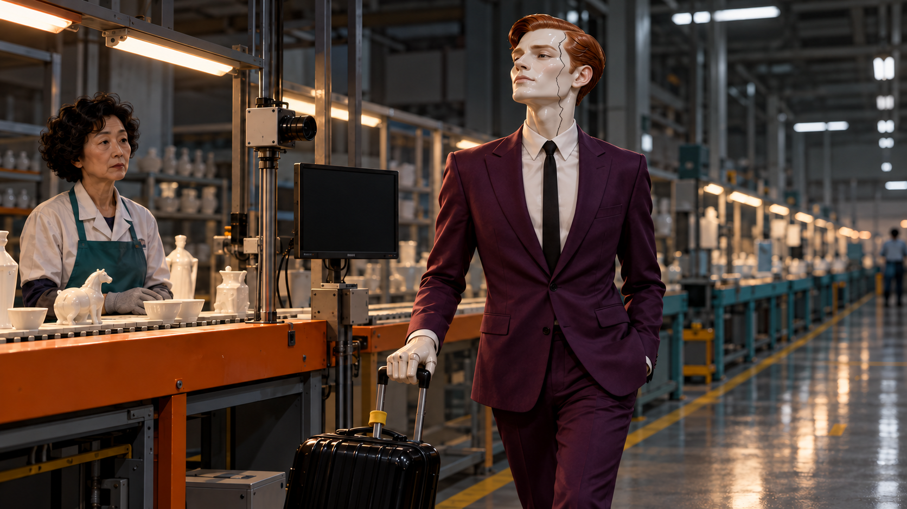
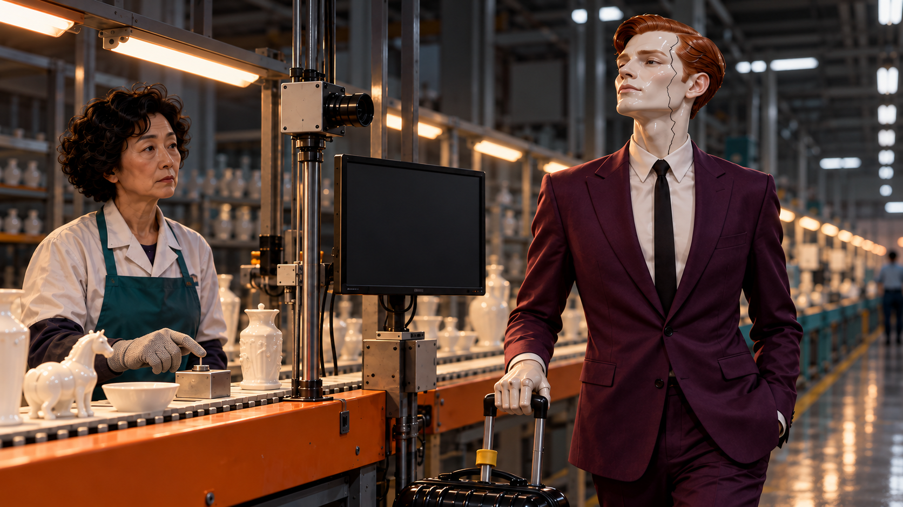
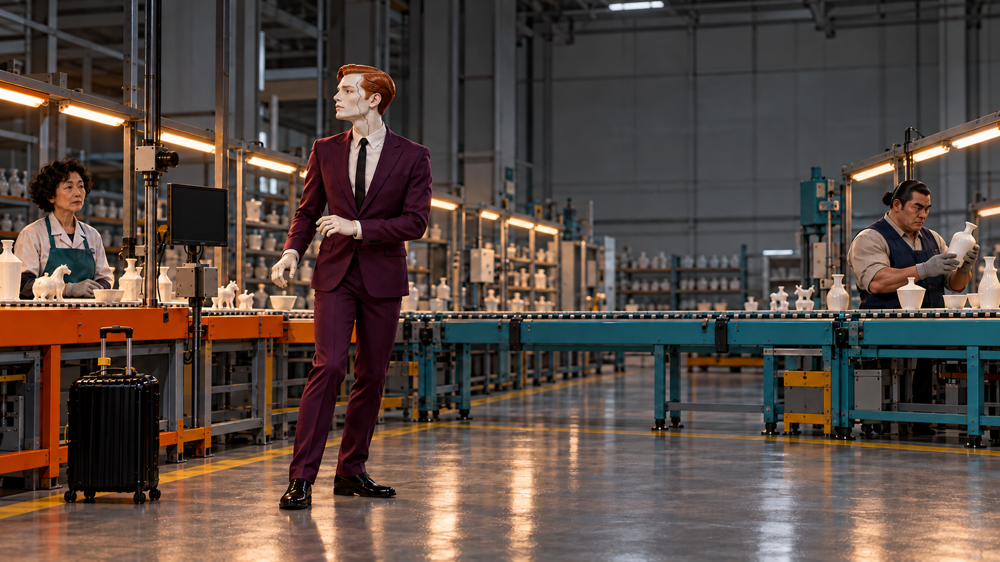
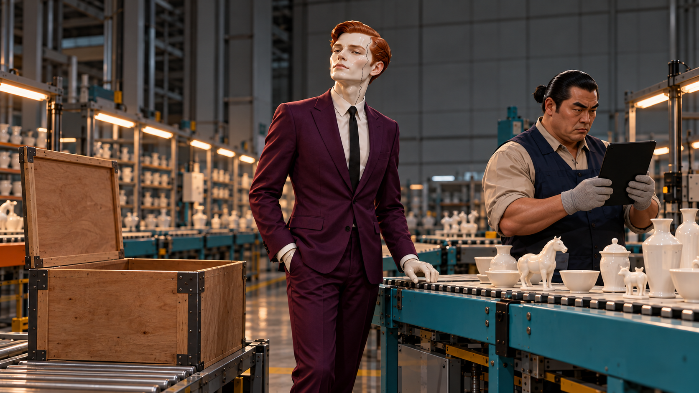
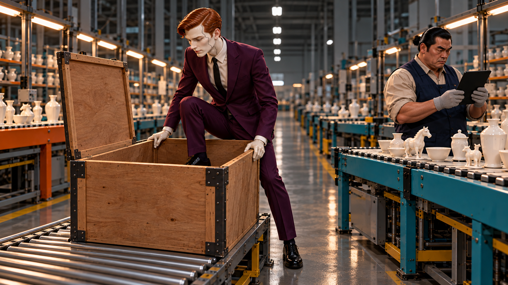
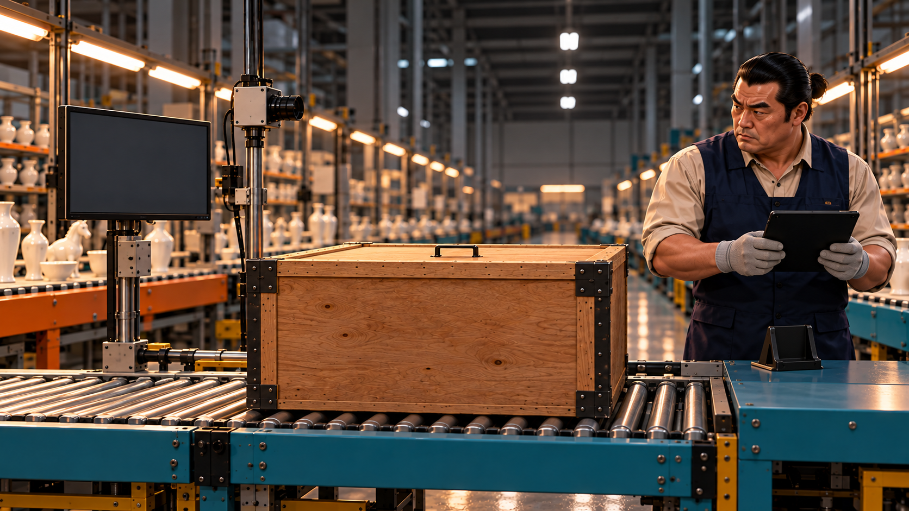
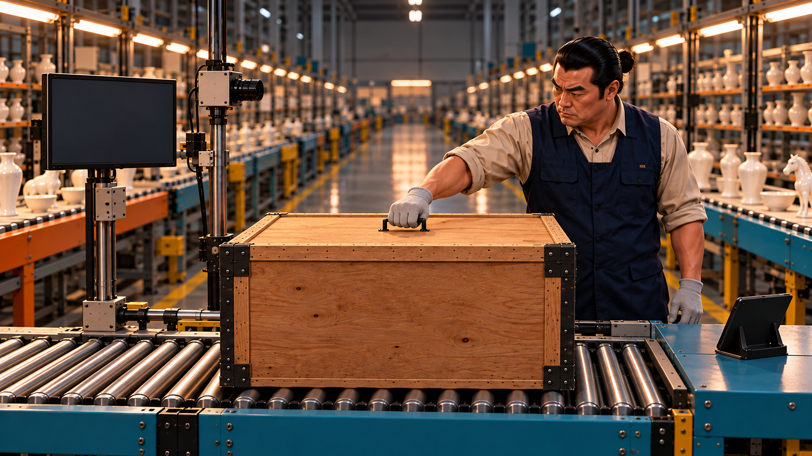
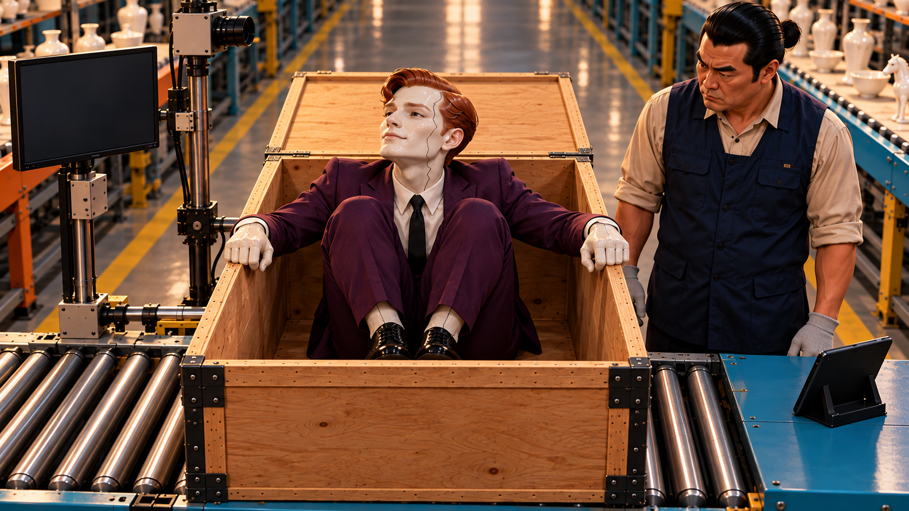
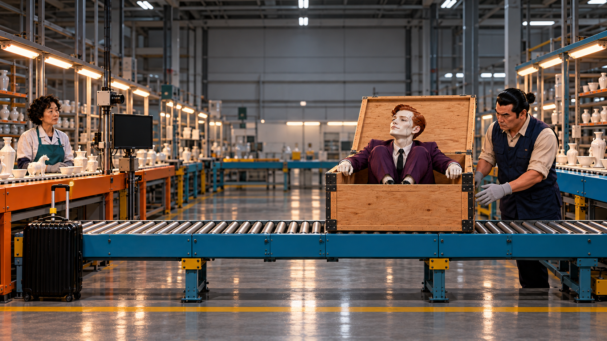
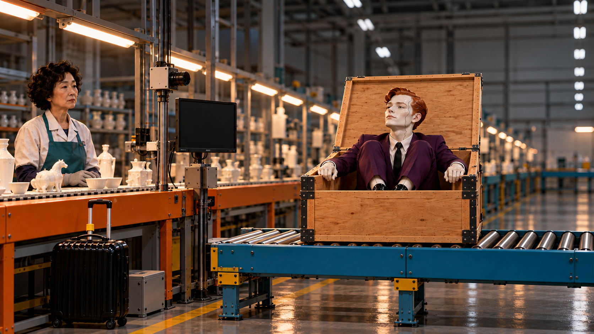

# C07 · 불량도 이직합니다

검출을 피해 다른 팀으로 달아난 불량이, 자신보다 먼저 도착한 공유 사례 때문에 스스로 들어간 은신 상자째 원래 검사대로 돌아온다.

**40.5초 · 10씬 · 화면+자막 · 필수 음성 대사 없음 · Flow 미생성**

[새 4안 비교](../../00_새7-10_콘티.md) · [전체 이미지](../../콘티_바로보기.md)

**전달할 내용:** 성공한 검출 방법뿐 아니라 못 봤던 조건도 함께 나누면 다음 팀의 확인이 달라진다.

**반전:** 다른 팀에서도 자신이 알려져 있는 데서 끝나지 않고, AI가 보지 못하는 불투명 상자를 선택한 그의 다음 계략을 사람이 공유된 확인 경험으로 푼다.

**후폭풍:** 도망자가 직접 접어 넣은 긴 다리 때문에 상자에서 한 번 일어나려다 주저앉는다. 그 뒤 밀려가는 상자는 자신이 택한 은신처의 후폭풍이며, 같은 가방·같은 고정 검사 카메라 앞에서 여행이 끝난다.

## 등장인물

- **D**: 실제 직원이 아닌 도자기 불량의 의인화. 30대처럼 보이는 마른 장신 남성, 붉은 옆가르마, 길고 각진 얼굴. 얼굴·목·손 전체가 유약 광택의 연한 아이보리 도자기이며 목 둘레와 손가락 마디에 얇은 접합선이 보인다. 왼쪽 관자놀이에서 볼로 내려가는 회색 지그재그 표면 균열 한 줄. 피부 상처·피·혐오 표현 없음. 잘 맞는 자주색 양복, 검정 얇은 타이, 광택 검정 구두. 작은 검정 바퀴 여행가방. 자신을 능숙한 탈주 영화 주인공으로 여김.
- **IA**: 50대 중반 마른 여성, 짧고 촘촘한 검정 곱슬머리, 좁은 어깨와 긴 타원형 얼굴. 침착한 검사자. C08의 은발 근육질 해결사와 머리색·실루엣을 분명히 구분. 흰 작업재킷, 청록 앞치마, 회색 검사 장갑. 팀A 주황 작업대.
- **IB**: 40대 중반 남성, 굵은 검정 눈썹, 뒤로 짧게 묶은 검정 머리, 넓은 어깨. IA와 다른 얼굴·머리·실루엣. 베이지 작업 셔츠, 짙은 남색 조끼, 회색 장갑. 팀B 푸른 작업대.

## 컷별 콘티

| 씬·컷 | 구간·길이 | 화면·행동·구도 | 후처리 자막 | 대사·내레이션 | BGM·효과음 | 전환 | 웃음·정보 의도 |
|---|---|---|---|---|---|---|---|
| S01 / C07_K01 | 0–3.5s (3.5s) | D가 가방을 끌며 검사 위치로 자신 있게 한 걸음 들어온다. 손·목·얼굴까지 포함한 낮은 미디엄 트래킹. 마지막0.7초 고정. 구두만 오래 보이지 않음. | 0.4–3.5s 더 넓은 곳으로. | 없음 | 선택: 묵직한 도주극 베이스, 가방 바퀴. 소리로 균열 의미를 알리지 않음. | 동일 공간 축을 유지한 하드 컷 | 영화적인 자신감으로 출발시키고 검사실이라는 목적지를 뒤늦게 보여줌. |
| S02 / C07_K02 | 3.5–7s (3.5s) | IA가 도자기 표면 균열 표시와 D의 같은 균열을 대조해 확인 버튼을 한 번 누른다. D와 IA·모니터를 함께 잡는 미디엄. 얼굴을 판정하는 실존 인식 시스템처럼 긴 UI를 만들지 않음. | 4–7s 잡혔다. | 없음 | 베이스 순간 끊김0.4초 후 짧은 경보 한 번. 필수정보는 모니터 표시/표정. | 동일 공간 축을 유지한 하드 컷 | 출국의 당당함이 불량 도주였음을 공개. 사람의 실물 확인이 마지막 단계. |
| S03 / C07_K03 | 7–10.5s (3.5s) | D만 오른쪽 B대 방향으로 서둘러 빠져나간다. 같은 복도 축을 지킨 옆 와이드. 별도 외부 장소로 바꾸지 않음. | 7.4–10.5s 다른 팀이면 모르겠지. | 없음 | 추격 비트가 다시 시작되나 뒤쫓는 사람은 없음. | 동일 공간 축을 유지한 하드 컷 | 인물의 다음 전략을 한 줄로 심고 그 전략을 다음 컷에서 무너뜨림. |
| S04 / C07_K04 | 10.5–14s (3.5s) | IB가 D에게 태블릿을 돌려 이미 공유된 같은 균열 사진을 보여준다. 고정 투샷. D 얼굴·태블릿·빈 상자를 같은 시선선 위에 배치. | 11–14s 사례가 먼저 도착했다. | 없음 | 추격음악은 계속되되 화면 인물은 느긋함. 작은 태블릿 클릭. | 동일 공간 축을 유지한 하드 컷 | 추격자가 아니라 공유된 경험이 더 빨랐다는 반전. 새 은신처를 화면 안에 미리 심음. |
| S05 / C07_K05 | 14–19s (5s) | D가 나머지 다리를 접어 상자 안으로 숨고 손으로 뚜껑을 닫는다. 측면 고정 미디엄. 상자 전체와 바닥 접점을 보이며 안으로 들어가는 경로를 숨기지 않음. |  | 없음 | 음악 최고조→나무 뚜껑 닫힘에 고음만 제거. | 같은 상자와 카메라를 보이는 다음 정면 검사 컷 | 기계의 시야를 막는 새 전략. 자신의 선택이 결말의 반송수단을 만듦. |
| S06 / C07_K06 | 19–22s (3s) | IB가 시야 가림 표시를 보고 들고 있던 태블릿을 바로 옆 받침에 내려놓으며 뚜껑 손잡이로 손을 옮긴다. 카메라·닫힌 상자·모니터·IB 손을 한 미디엄 안에. 개봉 전 결과를 보여주지 않음. | 19.2–21.8s 안 보이면, 열어서 확인. | 없음 | 경보 없음. 아주 작은 장갑 마찰, 음악 낮춤. | 동일 공간 축을 유지한 하드 컷 | AI 투시가 아니라 공유받은 검증 조건을 사람이 실행하게 함. 읽기 세 단계가 아닌 손의 선택. |
| S07 / C07_K07 | 22–25.5s (3.5s) | IB가 뚜껑을 한 번 열어 웅크린 D를 드러낸다. 살짝 높은 정면 미디엄. 뚜껑 상승뿐 아니라 접힌 무릎·발·상자 가장자리의 위치를 보여 다음 실패의 원인을 미리 읽게 함. |  | 없음 | 뚜껑이 열린 뒤0.6초 음악과 효과음 모두 비움. D의 여행객 미소만 남김. 추가 인사 동작 없이 다음 시도로 넘김. | 동일 공간 축을 유지한 하드 컷 | 새 전략의 실패를 설명 문장 없이 얼굴로 공개. 검사자보다 도망자의 감정만 과장. |
| S08 / C07_K08 | 25.5–29.5s (4s) | D가 상자 윗변을 짚고 한 번 일어서려 하지만 접힌 무릎 때문에 발을 중심 아래로 놓지 못해 상체만 들썩였다가 그대로 엉덩방아를 찧고 앉는다. K07과 같은 약한 하이앵글 미디엄, 얼굴·무릎·손·상자 전체가 한 프레임. 발이 바닥으로 순간이동하거나 상자가 저절로 움직이는 컷 금지. |  | 없음 | 짧은 야심 찬 탈출 음악 한 박자→가벼운 나무 삐걱과 앉는 둔탁음. 마지막0.5초 정적. 고통 신음 없음. | 실패한 앉은 자세를 그대로 받는 K09 옆 와이드 | 개봉 후 탈출할 수 있다는 인과의 구멍을 실제 한 번의 실패로 닫는다. 자기가 고른 은신처와 긴 다리의 잘못된 접기가 자기 여행을 막음. |
| S09 / C07_K09 | 29.5–34.5s (5s) | IB가 상자를 왼쪽 A 방향으로 밀어 보낸다. 동일 복도 옆 와이드. B→A의 오른쪽에서 왼쪽 이동을 실제로 보여줌. |  | 없음 | 출국풍 음악과 삐걱거리는 롤러 리듬. 위험한 고속운송 없음. | 동일 공간 축을 유지한 하드 컷 | 달아난 방향을 상자에 실려 그대로 되돌아오는 시각적 후폭풍. |
| S10 / C07_K10 | 34.5–40.5s (6s) | 상자가 멈추자 D가 자기 여행가방을 보고 천천히 고개를 들어 처음의 IA와 눈을 맞춘다. 처음 검사대와 같은 정면 구도. 짧은 충격 과장 대신 여행이 원점으로 끝났음을 한 프레임에. | 35.2–40.5s 잘된 방법도. 놓쳤던 조건도. Q-AI Fair | 없음 | 우아한 여행음악 한 박자 길게 끝남. 대사 없음. 엔딩5.3초 읽기. | 동일 공간 축을 유지한 하드 컷 | 처음 장면의 같은 검사자·같은 가방으로 돌아오는 완결. 행사명은 경험이 먼저 전달된 사건의 출처. |

## 씬별 실제 첫 프레임

이미지는 동작 직전 상태입니다. 행사명·문서·폰 UI·자막은 영상 생성 뒤 별도 합성합니다.

### C07_K01 · 0–3.5초

**시작:** D가 A 검사대 앞에 도착하기 한 걸음 전. 검정 여행가방의 노란 손잡이띠를 잡은 도자기 손의 유약 광택·마디 접합선, 셔츠 위 도자기 목의 접합선과 왼쪽 볼의 균열이 함께 보임. 후경 IA는 마른 체형·짧은 검정 곱슬머리, 주황 작업대 옆.

**동작:** D가 가방을 끌며 검사 위치로 자신 있게 한 걸음 들어온다.

**끝 상태:** D가 카메라 앞에 섰고 가방은 왼쪽 A대 옆.

**후처리:** 자막 외 없음

### C07_K02 · 3.5–7초

**시작:** D의 도자기 목·손·볼 균열이 고정 산업카메라 옆에 보인다. 모니터는 같은 도자기 표면의 균열 확대와 실물 비교 영역. IA 손은 확인 버튼 위.

**동작:** IA가 도자기 표면 균열 표시와 D의 같은 균열을 대조해 확인 버튼을 한 번 누른다.

**끝 상태:** 도자기 표면 균열 확대에 확인 표시. D가 도자기 손으로 남겨 둔 가방 손잡이를 놓고 굳는다. IA는 쫓지 않음.

**후처리:** 모니터 정확 문구: 도자기 표면 검사 / AI 균열 후보. 동일 왼쪽 균열 부위만 확대 표시; IA 버튼 뒤 확인 완료 아이콘 한 개. 얼굴 신원·직원 능력·불량 직원 같은 문구, 성능 수치 없음.

### C07_K03 · 7–10.5초

**시작:** D가 A대를 등지고 오른쪽 복도 쪽으로 몸을 틀기 직전. 가방은 A 다리 옆에 세워져 있고 IA는 추격하지 않음.

**동작:** D만 오른쪽 B대 방향으로 서둘러 빠져나간다.

**끝 상태:** D가 B대 앞에 도착하기 직전. A와 가방은 멀리 왼쪽 후경.

**후처리:** 자막 외 없음

### C07_K04 · 10.5–14초

**시작:** B대 IB가 태블릿을 이미 들고 있다. D는 태블릿 뒷면 쪽에서 접근하여 아직 화면을 못 봄.

**동작:** IB가 D에게 태블릿을 돌려 이미 공유된 같은 균열 사진을 보여준다.

**끝 상태:** D가 자기 사진을 확인하고 옆 불투명 상자 쪽으로 눈만 돌림.

**후처리:** 태블릿: Q-AI Fair / 공유 사례. 같은 도자기 표면 균열 사진, 보조 메모 가려진 면은 열어서 확인. 사진과 메모는 다음 개봉 행동의 동기이며 긴 절차표 없음.

### C07_K05 · 14–19초

**시작:** D가 열린 상자에 한 발을 넣었고 다른 발은 바닥. 뚜껑은 뒤 경첩으로 열려 있다. IB는 B대에 그대로 있음.

**동작:** D가 나머지 다리를 접어 상자 안으로 숨고 손으로 뚜껑을 닫는다.

**끝 상태:** 불투명 상자가 완전히 닫힘. 외부에 몸/손/발이 남지 않음.

**후처리:** 자막 외 없음

### C07_K06 · 19–22초

**시작:** 닫힌 상자가 카메라 정면. 모니터에는 불투명한 상자 외관만 보이고 내부 실루엣은 전혀 없음.

**동작:** IB가 시야 가림 표시를 보고 들고 있던 태블릿을 바로 옆 받침에 내려놓으며 뚜껑 손잡이로 손을 옮긴다.

**끝 상태:** IB 손이 뚜껑 손잡이를 잡았지만 아직 열리지 않음.

**후처리:** 모니터 큰 상태: 시야 가림 / 확인 필요. 내용은 상자 외관 그대로.

### C07_K07 · 22–25.5초

**시작:** IB가 뚜껑 손잡이를 잡고 닫힌 상자 앞에 서 있다.

**동작:** IB가 뚜껑을 한 번 열어 웅크린 D를 드러낸다.

**끝 상태:** 뚜껑이 완전히 열린 상자 속에 D의 무릎이 가슴 앞에 접혀 있고 두 발은 몸 아래가 아니라 앞벽 쪽에 포개져 있다. D는 태연한 여행객 미소. IB는 손을 뚜껑에서 놓고 한 발 물러남.

**후처리:** 자막 외 없음

### C07_K08 · 25.5–29.5초

**시작:** 상자는 정지해 있고 뚜껑은 뒤로 열림. D는 가슴 앞에 두 무릎을 접은 채 상자 윗변에 도자기 두 손을 얹었다. 발을 몸 아래로 옮기지 못한 상태. IB의 두 손은 상자에서 떨어져 있다.

**동작:** D가 상자 윗변을 짚고 한 번 일어서려 하지만 접힌 무릎 때문에 발을 중심 아래로 놓지 못해 상체만 들썩였다가 그대로 엉덩방아를 찧고 앉는다.

**끝 상태:** D가 같은 웅크린 자세로 주저앉아 한숨 대신 무표정한 체념을 보임. 두 손은 상자 윗변, 뚜껑은 열린 채. 상자는 아직 움직이지 않음.

**후처리:** 자막 외 없음

### C07_K09 · 29.5–34.5초

**시작:** K08 실패 직후. D는 접힌 무릎 위로 몸을 낮춰 두 손으로 열린 상자 윗변을 잡고 있다. IB 두 손이 이제 상자 뒤 모서리에 닿기 직전. 직선 롤러는 A 방향으로 이어짐.

**동작:** IB가 상자를 왼쪽 A 방향으로 밀어 보낸다.

**끝 상태:** 상자가 A 쪽으로 천천히 이동. D는 다시 일어서려 하지 않고 자신이 고른 상자 안에 여행객처럼 실려 간다.

**후처리:** 자막 외 없음

### C07_K10 · 34.5–40.5초

**시작:** 상자가 A대 앞의 처음 검사 위치로 천천히 들어오는 마지막 거리. 짧은 검정 곱슬머리 IA, K02의 같은 고정 산업카메라와 노란 띠 검정 가방이 원래 자리에 보임. D는 아직 가방을 못 봄.

**동작:** 상자가 멈추자 D가 자기 여행가방을 보고 천천히 고개를 들어 처음의 IA와 눈을 맞춘다.

**끝 상태:** D는 열린 상자 안에서 처음의 고정 카메라 정면을 바라본다. 가방은 A대 왼쪽 바닥, IA는 처음과 똑같이 고정 카메라 옆에 서 있다. 손에는 새 장비 없음.

**후처리:** 자막 외 없음

## 제작 메모

난이도: 높음. 동일 균열 얼굴·상자·복도 좌우 축 유지, 상자 숨기와 개봉 동작이 핵심. 군중은 필요 없음.

은신 동작은 상자 안에 한쪽 발을 넣은 중간 자세부터 1회. 원본이 못 따라가면 들어가는 동작/뚜껑 닫기를 두 제작 단위로 분리. 반송은 수동 저속 롤러로 단순화하며 순간이동 컷으로 대체하지 않음.

[정확 프롬프트·이미지 매핑](../../storyboards/2026-10-25_C07-C10-rewrite-v13/scene_manifest.json)

시작 이미지 검수는 실제 영상의 동작 성공·관객 반응 검증을 대신하지 않습니다.
