# C10 · 비법 공개 금지

작은 링 세 개를 거창한 비법처럼 공개한 마술사가 실패 기록을 숨기자, 실무자가 무대를 돌려 AI 촬영 조건과 수정 과정을 공개하고 마술사를 검정 배경을 잡아주는 보조로 남긴다.

**42초 · 10씬 · 화면+자막 · 필수 음성 대사 없음 · Flow 미생성**

[새 4안 비교](../../00_새7-10_콘티.md) · [전체 이미지](../../콘티_바로보기.md)

**전달할 내용:** 보기 좋은 결과만이 아니라 실패한 촬영 조건과 수정 기록도 나누어 다른 사람이 실제로 써볼 수 있게 한다.

**반전:** 단순히비밀장비를폭로하는것이아니라, 무대가실제로돌면서보여줄가치의중심과인물의위치가바뀜. 스타의장막은실무자의배경도구가됨.

**후폭풍:** 스타가특수효과로주도권을되찾으려해도실무자가WORK조명으로돌려놓고, 스타는자신의장막높이를맞추는보조를계속한다.

## 등장인물

- **MG**: 50대 마른 장신 남성, 어깨아래로곧게내린긴은색머리,긴코,가는턱수염,호리호리한손. C07붉은단발과완전히구분. 자주색연미복,은색베스트,검정바지. 별모양장식한개. 실제마술사/배우인물모사없음. 화려한자기연출에집착.
- **PR**: 40대짙은갈색피부의큰체구여성,짧고촘촘한검정곱슬머리,넓은어깨,부드러운둥근얼굴. 인종/체형을개그대상으로삼지않음. 코발트작업점프수트,갈색도구벨트. 침착하고유능하며공개할과정과시연목적을가짐.

## 컷별 콘티

| 씬·컷 | 구간·길이 | 화면·행동·구도 | 후처리 자막 | 대사·내레이션 | BGM·효과음 | 전환 | 웃음·정보 의도 |
|---|---|---|---|---|---|---|---|
| S01 / C10_K01 | 0–4s (4s) | MG가 장엄한 손짓으로 긴 은색 실크를 계속 걷어 앞 하단 선반 쪽으로 흘려 보내 손바닥만 한 링 세 개를 공개한다. 처음1초 손과 길게 흐르는 실크, 이어 작은 링 세 개와 거대한 MG 제스처를 함께 읽는 고정 정면 미디엄 와이드. 원형 바닥 가장자리와 두 천을 구분. | 0.4–3.7s 이것이, 비법입니다. | 없음 | 선택금관팡파르/작은무대효과. 관객박수없어도공개몸짓으로읽힘. | 동일 공간 축을 유지한 하드 컷 | 작은 결과에 과도하게 긴 공개 의식을 붙이는 첫 시각 개그. 은색 실크의 길이와 작은 링의 대비를 말 없이 보임. |
| S02 / C10_K02 | 4–8s (4s) | MG가 기록 책을 받아 검정 천 하단을 책으로 조금 밀어 올리며 바로 뒤 상판 가장자리(-0.25,+0.10)에 밀어 넣어 감춘다. 가까운 두 사람과 책이 천 하단을 통과해 뒤 상판에 닿는 경로를 보이는 약한 측면 미디엄. 손만3m 늘어나거나 천 속으로 책이 소멸하지 않음. | 4.5–7.7s 과정은 비공개입니다. | 없음 | 팡파르여운. 종이쓱소리하나. | PR발판쪽시선에맞춰컷 | 사라지는기록으로스타의욕망을보여주고실무자의반격동기를만듦. |
| S03 / C10_K03 | 8–11s (3s) | PR이 왼쪽으로 실제 두 걸음 걸어 회전대 밖 고정 바닥으로 나간 뒤 페달을 한 번 누른다. 발만 클로즈업하지 않고 PR의 원 안 시작점→테두리 통과→원 밖 페달을 한 낮은 와이드에서 보여줌. |  | 없음 | 작은클릭→무대모터. 말로회전설명안함. | 동일 공간 축을 유지한 하드 컷 | 비밀공개가저절로일어나는것이아니라실무자가주도권을선택함. |
| S04 / C10_K04 | 11–17s (6s) | 원형무대가 같은 시계방향으로 남은175도를 연속 회전해 총180도에서 완전히 멈춘다. MG는 모서리와 함께 뒤로 돌아간다. 처음과같은고정와이드. 회전중카메라축을바꾸지않아앞뒤이동을관객이추적. |  | 없음 | 모터와길게버티는팡파르가우스운대비. 끝에서음악뚝0.5초. | 동일 공간 축을 유지한 하드 컷 | 결과를가리던장막이작업대의배경이되는물리반전. 스타는장치가움직인만큼주연자리에서밀려남. |
| S05 / C10_K05 | 17–24s (7s) | PR이 정지한 무대의 앞 통로를 실제로 돌아 작업대 오른쪽(+0.9,-0.45)에 걸어 들어와 공개할 기록 앞에 선다. 처음3.5~4초 객석 고정 와이드로 PR의 실제 보행 경로를 전부 보임. 도착 뒤 같은 장면의 기록 근접 편집 인서트 약3초: 이미 펼쳐진 실패 사진과 광원 방향 수정 스케치, 새 행동 생성 필요 없음. | 18–24s AI가 놓친 조건까지. 같이 봅시다. | 없음 | 조용한작업등버즈/링금속음. 새설명음성없음. | 동일 공간 축을 유지한 하드 컷 | 원 밖에서 순간이동하지 않고 작업의 주도권을 실제로 가져온다. 공개하는 것은 AI가 놓친 촬영 조건과 고쳐 본 기록, 결과에 붙인 신비가 아님. |
| S06 / C10_K06 | 24–29s (5s) | PR이 가까운 오른쪽 아래 가로봉 끝를 MG의 빈손으로 직접 넘긴다. MG는 같은 자리에서 몸통을 관객 쪽으로 돌려 받으며 하단 가로봉 양끝를1.12m 높이로 들게 된다. 옆 미디엄 와이드로 실제 모서리 이동·MG 제자리 몸통 회전·얼굴/손/발을 함께. 목이나 팔을 천으로 묶지 않음. | 25–28.8s 그대로 잡아주세요. | 없음 | 장막천마찰. 아주작은조명보조콜같은리듬. 음성0. | 동일 공간 축을 유지한 하드 컷 | 스타의자기은폐도구가남의작업보조가되고손을빼고다시스타가될수없음. |
| S07 / C10_K07 | 29–31s (2s) | MG가 손을 놓지 않고 발끝으로 바로 옆 FX를 한 번 누른다. 얼굴·하단 양손·아래 드러난 발끝·FX가 읽히는 약한 측면 전신. 장막이 발을 가리지 않게 하단 높이 유지. |  | 없음 | FX발판딸깍, 다음컷에과잉효과예고. | 발판눌림에효과켜짐매치컷 | 노골적인악역이아니라끝까지쇼를포기못하는성격. 두손이보조가돼발로권력을되찾음. |
| S08 / C10_K08 | 31–34s (3s) | 작은샘플하나를위해분홍·보라조명과얇은무대연무가과도하게켜진다. 처음와이드보다살짝가까운정면. 불꽃/폭발/무대붕괴없음. 샘플과사람이가려질정도로연무를채우지않음. |  | 없음 | 거대한 팡파르3초. 다음 WORK 눌림에 즉시 음악을 자름. 효과음 없이도 과장 조명과 작은 링의 비율로 전달. | 동일 공간 축을 유지한 하드 컷 | 반전뒤에도같은허세가새형태로재발. 과장효과가검사에도움안되는그림이웃음. |
| S09 / C10_K09 | 34–36s (2s) | PR이 손 닿는 WORK 스위치를 한 번 누른다. PR 손·물리 스위치·작업등·링을 한 프레임. 먼 곳 스위치를 누르는 공간 압축 없음. |  | 없음 | 팡파르 즉시 컷→작은 작업등 클릭. 마지막0.7초 정적. | 차분해진작업와이드로전환 | 권력은가장큰효과가아니라무엇을보이게할지정하는사람에게있음. |
| S10 / C10_K10 | 36–42s (6s) | MG는 얼굴이 고정 상단 위로 남는 범위에서 무릎을 작게 굽히고 팔을 내려 하단 가로봉 양끝을 함께1.12m에서0.78m로 낮춘다. 봉은 수평을 유지해 흰 틈 전체를 검정 천으로 덮고 그 자세를 유지한다. 정면 미디엄 와이드. 낮추기 전 밝은 틈→하단 하강→같은 부분이 검정으로 막히는 변화를 한 프레임에서 보임. 행사명과 문구는 좌상단 검정 배경의3줄, 얼굴·손·흰 틈·봉 하강을 가리지 않음. | 36.7–42s 신기한 결과에서, 써볼 수 있는 방법으로. Q-AI Fair | 없음 | 작은실내악한음과작업장의정적. 더큰효과재반복없음. | 동일 공간 축을 유지한 하드 컷 | 마지막 개그는 말로 설명한 조연 전락이 아니라 직접 무릎을 굽혀 남의 작업 배경 높이를 맞추는 몸동작. 공개한 실패 조건이 그 자리에서 고쳐져 Q-AI Fair의 과정 공유 목적과 연결. |

## 씬별 실제 첫 프레임

이미지는 동작 직전 상태입니다. 행사명·문서·폰 UI·자막은 영상 생성 뒤 별도 합성합니다.

### C10_K01 · 0–4초

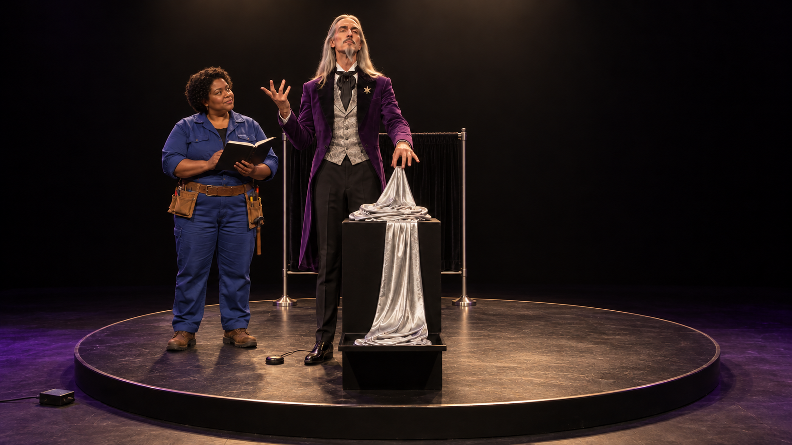

**시작:** MG가 앞 진열대 위에 과도하게 접힌 폭0.35m·길이4m 은색 실크 S의 맨끝을 잡기 직전. 실크의 반대 끝은 앞 하단 선반에 이미 닿아 있고 작은 링 세 개는 아직 덮여 있다. 뒤 검정 장막 B는 별개. PR은 MG 가까운 왼쪽(-0.8,-0.65)에서 기록을 들고 대기.

**동작:** MG가 장엄한 손짓으로 긴 은색 실크를 계속 걷어 앞 하단 선반 쪽으로 흘려 보내 손바닥만 한 링 세 개를 공개한다.

**끝 상태:** 실크 전체가 앞 하단 선반에 은색 더미로 놓이고 MG의 두 손은 비어 있음. 작은 링 세 개만 진열대 한 줄. 검정 장막 B는 뒤 작업대를 계속 가림.

**후처리:** 자막 외 없음

### C10_K02 · 4–8초

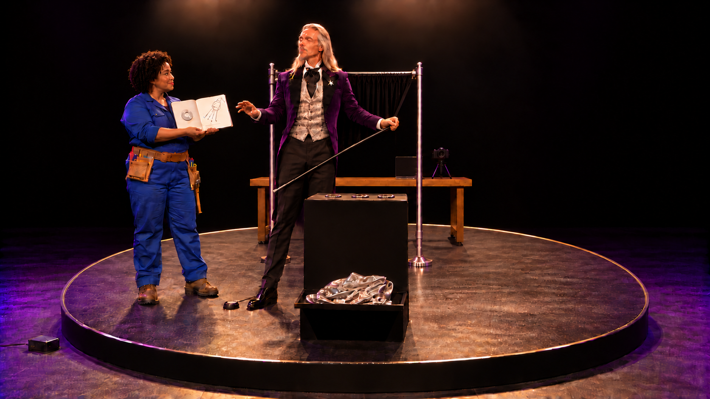

**시작:** MG는 같은 자리에서 검정 장막의 회전 전 오른쪽 아래 가로봉 끝(x=+0.60)를 한손으로 들었다. PR은0.84m 이내 왼쪽에서 실패 사진/수정 기록을 펼쳐 내민다. MG 빈손은 기록에 닿기 전.

**동작:** MG가 기록 책을 받아 검정 천 하단을 책으로 조금 밀어 올리며 바로 뒤 상판 가장자리(-0.25,+0.10)에 밀어 넣어 감춘다.

**끝 상태:** 같은 기록 책이 실제 뒤 상판에 열린 채 놓임. MG 한손은 하단 가로봉 끝, 다른 손은 비어 있음. PR 손이 비고 왼쪽 원 밖 페달을 봄.

**후처리:** 기록 표지의 작은 후합성 제목 AI 촬영 조건·수정 기록. 내지에는 빛 반사로 링 윤곽이 날아간 실패 사진과 방향을 바꾼 촬영 스케치 한 쌍. 이 컷에서 읽기 설명을 요구하지 않음.

### C10_K03 · 8–11초

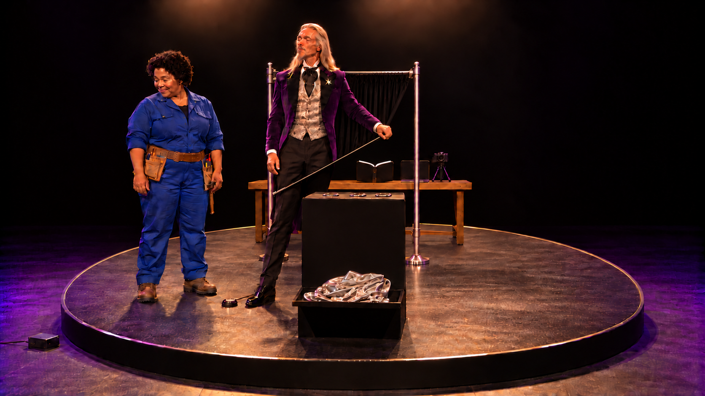

**시작:** PR이 기록에서 손을 뗀 위치(-0.8,-0.65)에 서 있다. 왼쪽 원 밖(-2.2,-0.65)에 회전 페달, 원형 테두리는 아직0도. MG는 장막 한 하단 가로봉 끝를 유지.

**동작:** PR이 왼쪽으로 실제 두 걸음 걸어 회전대 밖 고정 바닥으로 나간 뒤 페달을 한 번 누른다.

**끝 상태:** PR의 두 발은 원 밖. 무대만 시계방향으로5도 움직인 상태. MG·FX·세트는 그5도만큼 함께 이동.

**후처리:** 회전 페달의 작은 시계방향 반원 화살표만 후합성. FX와 다른 모양.

### C10_K04 · 11–17초

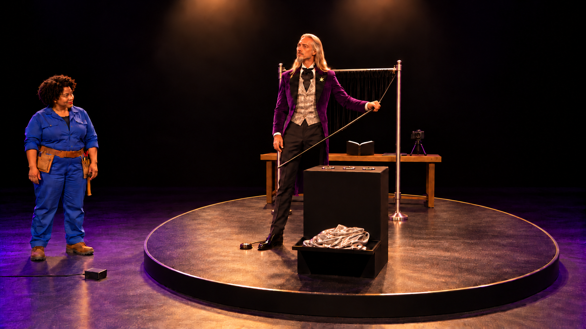

**시작:** K03에서 이미 시계방향5도 돌아간 상태. PR은(-2.2,-0.65) 원 밖 고정. MG·FX·진열대·장막·작업대·책·실크 선반은 동일5도 좌표 변환.

**동작:** 원형무대가 같은 시계방향으로 남은175도를 연속 회전해 총180도에서 완전히 멈춘다. MG는 모서리와 함께 뒤로 돌아간다.

**끝 상태:** 작업대 중심(0,-0.65)이 앞, 장막(0,0), MG(0,+0.4), 진열대(0,+1.0)가 뒤. FX(+0.30,+0.50), WORK(+0.55,-0.45). PR은 아직 원 밖(-2.2,-0.65), 손을 작업대에 대지 않음.

**후처리:** 자막 외 없음

### C10_K05 · 17–24초

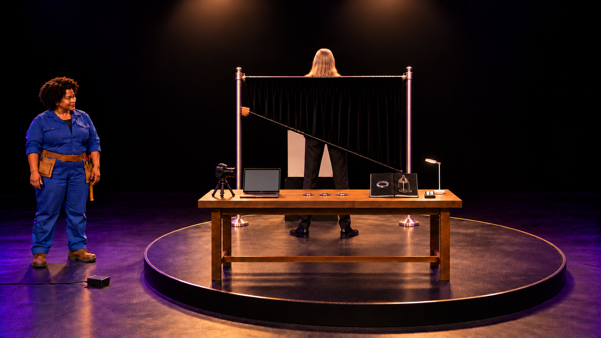

**시작:** 무대는180도에서 정지. 앞에 드러난 작업대에는 처음부터 있던 카메라·링·노트북과 열린 실패 촬영 기록. PR은 아직 원 밖 왼쪽(-2.2,-0.65). MG는 뒤에서 한 하단 가로봉 끝를 든 채 옆/뒤모습.

**동작:** PR이 정지한 무대의 앞 통로를 실제로 돌아 작업대 오른쪽(+0.9,-0.45)에 걸어 들어와 공개할 기록 앞에 선다.

**끝 상태:** PR이 작업대 오른쪽에 안정적으로 서고 오른손은 기록 가까운 테두리에 놓임. 열린 기록과 노트북에 실패 촬영 조건/수정 기록이 보임. MG는 같은 뒤 좌표에서 이를 지켜봄.

**후처리:** 노트북/기록: AI 촬영 조건·수정 기록. 왼쪽 반사 때문에 윤곽이 날아간 링 사진, 오른쪽 광원 방향을 바꾸고 검정 배경을 둔 스케치. 실패 원인 단어 반사, 수정 단어 빛의 방향. 성과 수치/만능 인식/세 단계 교육표 없음.

### C10_K06 · 24–29초

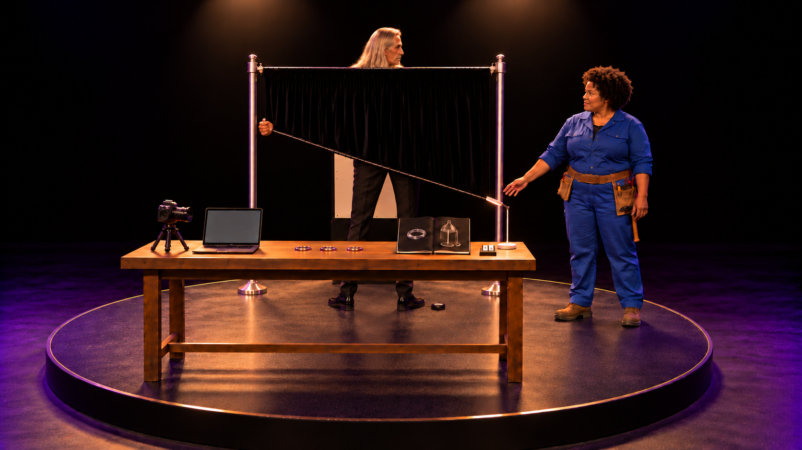

**시작:** PR은 작업대 오른쪽(+0.9,-0.45). 손 닿는 거리0.55m 안에 회전 후 장막의 자유로운 오른쪽 아래 가로봉 끝(x=+0.60). MG(0,+0.4)는 반대쪽 x=-0.60 하단 가로봉 끝 하나만 잡고 있다. 상단은1.50m에 고정.

**동작:** PR이 가까운 오른쪽 아래 가로봉 끝를 MG의 빈손으로 직접 넘긴다. MG는 같은 자리에서 몸통을 관객 쪽으로 돌려 받으며 하단 가로봉 양끝를1.12m 높이로 들게 된다.

**끝 상태:** MG 두 손에 좌우 하단 가로봉 끝. 상단1.50m는 고정, 하단1.12m여서 상판0.95m 뒤로 흰 진열대 뒷면의 틈이 약0.17m 보임. 얼굴은 상단 위, 두 발은 하단 아래. PR은 손을 놓고 같은 작업대 오른쪽. 하단 가로봉 전체가 수평1.12m이며 천의 중간도 같은 높이로 접혀 흰 틈을 가리지 않는다.

**후처리:** 자막 외 없음

### C10_K07 · 29–31초

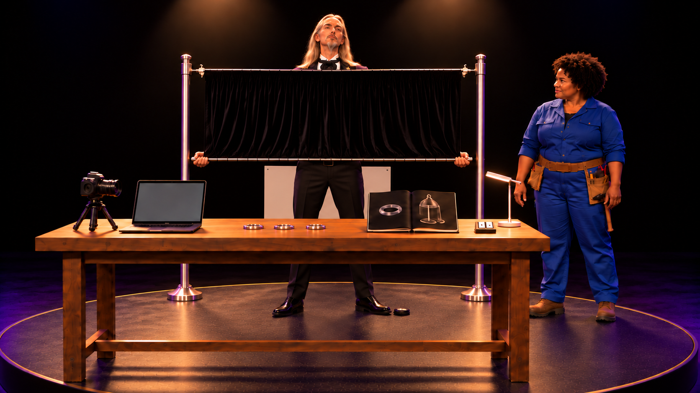

**시작:** MG는 장막 하단 가로봉 양끝를1.12m로 들고 있다. MG 발 옆 회전 후 FX(+0.30,+0.50)는 눌리기 전, PR은 같은 작업대 오른쪽. 무대는 정지.

**동작:** MG가 손을 놓지 않고 발끝으로 바로 옆 FX를 한 번 누른다.

**끝 상태:** FX가 눌림. MG 발은 제자리, 두 손은 천 하단 가로봉 끝 유지. 쇼 조명이 켜지기 시작.

**후처리:** 발판 작은FX아이콘.

### C10_K08 · 31–34초

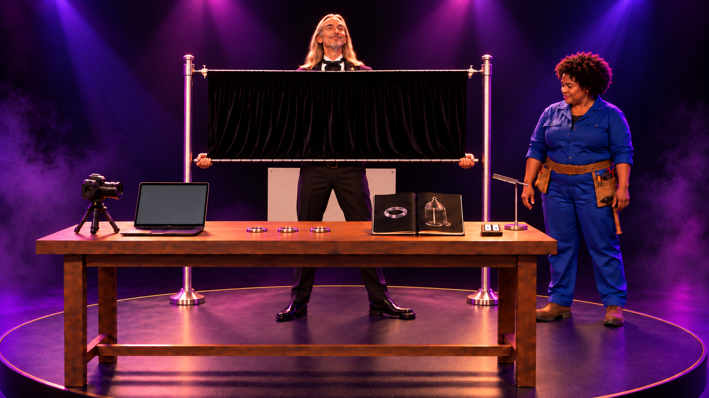

**시작:** FX를 누른 직후. 작업대 오른쪽 PR, 장막 뒤 MG와 작은 링. 작업등은 줄어들고 색조명/얇은 연무가 시작.

**동작:** 작은샘플하나를위해분홍·보라조명과얇은무대연무가과도하게켜진다.

**끝 상태:** 작은 링에 비해 무대 조명만 터무니없이 크다. PR은 바로 앞 오른쪽(+0.55,-0.45)의 WORK 스위치를 보고 손을 옮길 준비. 발 위치는(+0.9,-0.45) 그대로.

**후처리:** 자막 외 없음

### C10_K09 · 34–36초

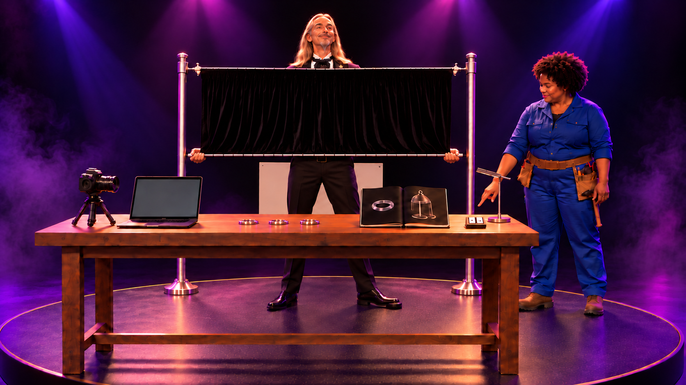

**시작:** PR 오른손이 자기 앞0.35m 거리의 WORK 스위치 위, 누르기 전. 색조명ON/작업등OFF. MG 두손은 천을 듦. 무대는 정지.

**동작:** PR이 손 닿는 WORK 스위치를 한 번 누른다.

**끝 상태:** 색조명과 연무 출력 OFF, 흰 작업등 ON. 남은 옅은 연무는 자연스럽게 잦아들고, 높은 장막 하단과 상판 사이로 기존 진열대의 흰 뒷면이 드러남.

**후처리:** 물리패널SHOW/WORK두상태, 현재WORK만작게점등. AI판정버튼처럼표현하지않음.

### C10_K10 · 36–42초

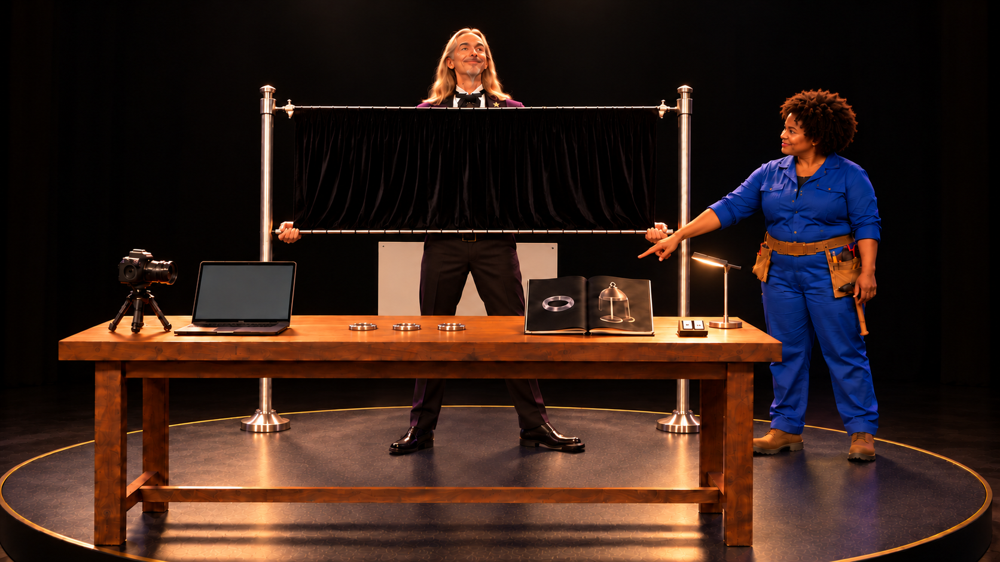

**시작:** 작업등 아래 샘플 상판0.95m. 장막 상단은1.50m에 고정, MG가 하단 가로봉 양끝를1.12m 높이로 들어 샘플 뒤0.17m 틈에 기존 흰 진열대 뒷면이 보임. PR은 그 틈을 가리키고 손바닥을 낮추는 동작 직전.

**동작:** MG는 얼굴이 고정 상단 위로 남는 범위에서 무릎을 작게 굽히고 팔을 내려 하단 가로봉 양끝을 함께1.12m에서0.78m로 낮춘다. 봉은 수평을 유지해 흰 틈 전체를 검정 천으로 덮고 그 자세를 유지한다.

**끝 상태:** 상단은1.50m 그대로, 접힌 천 하단만0.78m. 샘플 뒤 흰 틈이 사라져 검정 배경이 된다. MG 얼굴은 상단 위, 손은 좌우 밖, 발은 하단 아래. PR이 앞에서 실패 조건을 고친 시연을 계속할 수 있는 상태.

**후처리:** 자막 외 없음

### 엔딩 자막 실제 배치 확인본

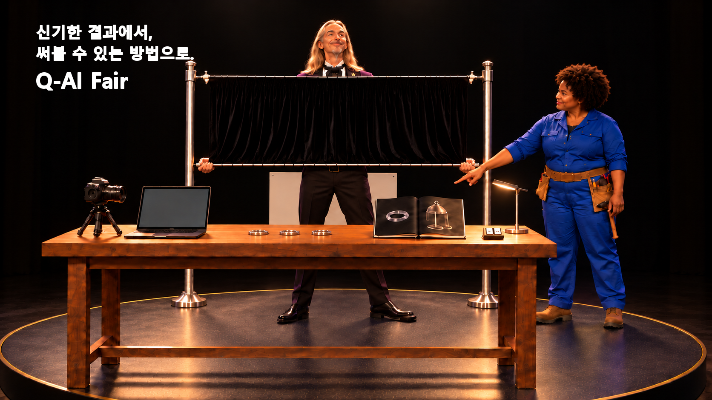

이 파일은 후처리 위치 확인용이며 Flow 시작 이미지로 사용하지 않습니다.

## 제작 메모

난이도: 높음. 회전대 전체 강체 변환, 배우의 실제 출입 동선, 상단 고정 천의 하단 접힘과 흰 틈. 4m 실크를 치우는 연속 동작도 필요. 각 변화가 웃음의 원인이어서 화면 축 생략으로 대체하기 어렵다.

회전은0→5→90→180도의 실제 움직임 원본으로 분리할 수 있다. PR 진입이7초 구간에서 불안정하면 걷기와 기록 공개를 별도 제작 단위로 확보하되 편집 콘티의 동일 시간 인과는 유지. 장막 하단의 정확 높이는 실사풍 이미지 기준 후합성 마스크 보완 가능하나 손/천 접촉이나 제자리 몸통 전환 자체를 컷으로 숨기지 않음. 실제 Flow 기능이나 성공 보장 없음.

[정확 프롬프트·이미지 매핑](../../storyboards/2026-10-25_C07-C10-rewrite-v13/scene_manifest.json)

시작 이미지 검수는 실제 영상의 동작 성공·관객 반응 검증을 대신하지 않습니다.
