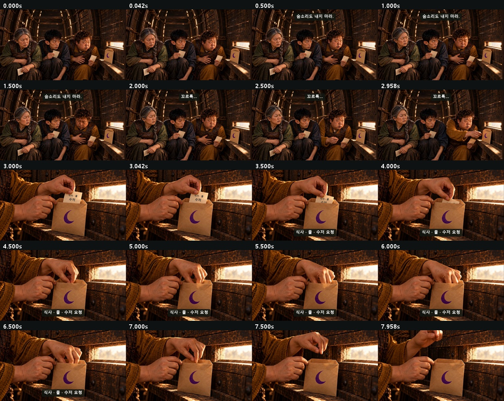
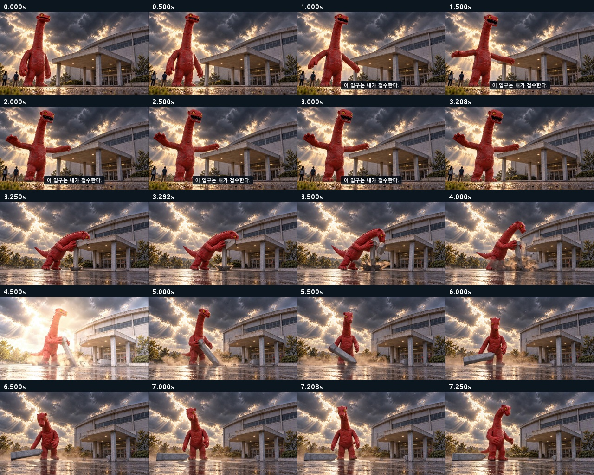
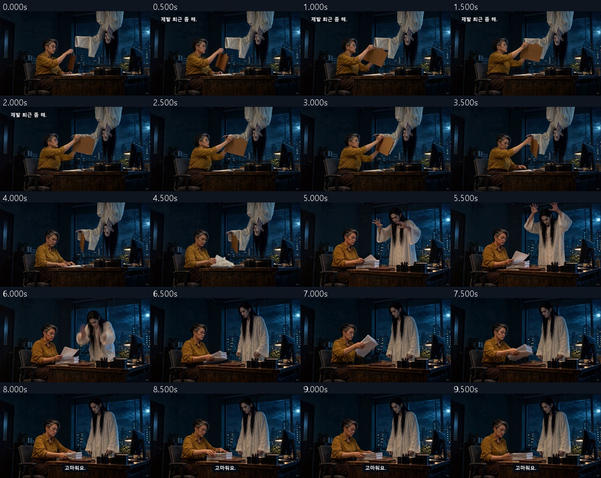

# Q-AI Fair · 최신 전체 이미지 콘티

1~6번은 실제 최종 편집본에서 뽑은 검수 화면, 7~10번은 새 영상용 첫 프레임입니다.

[6편 MP4](../../00_완성_영상.md) · [새 7~10 상세 콘티](../../00_새7-10_콘티.md)

## [C01 · 성공 자세 교정원](../../01_성공_자세_교정원.md)

## [C02 · 검은 점을 잡아라](../../02_검은_점을_잡아라.md)

## [C03 · 환경까지 가져왔습니다](../../03_환경까지_가져왔습니다.md)

## [C04 · 목마는 식사 중입니다](../../04_목마는_식사_중입니다.md)

## [C05 · 괴수는 퇴근할 수 없다](../../05_괴수는_퇴근할_수_없다.md)

## [C06 · 퇴근 좀 해주세요](../../06_퇴근_좀_해주세요.md)

## [C07 · 불량도 이직합니다](../../07_불량도_이직합니다.md)

검출을 피해 다른 팀으로 달아난 불량이, 자신보다 먼저 도착한 공유 사례 때문에 스스로 들어간 은신 상자째 원래 검사대로 돌아온다.

**C07_K01 · 0–3.5초** — D가 가방을 끌며 검사 위치로 자신 있게 한 걸음 들어온다.

자막: 0.4–3.5s 더 넓은 곳으로.

**C07_K02 · 3.5–7초** — IA가 도자기 표면 균열 표시와 D의 같은 균열을 대조해 확인 버튼을 한 번 누른다.

자막: 4–7s 잡혔다.

**C07_K03 · 7–10.5초** — D만 오른쪽 B대 방향으로 서둘러 빠져나간다.

자막: 7.4–10.5s 다른 팀이면 모르겠지.

**C07_K04 · 10.5–14초** — IB가 D에게 태블릿을 돌려 이미 공유된 같은 균열 사진을 보여준다.

자막: 11–14s 사례가 먼저 도착했다.

**C07_K05 · 14–19초** — D가 나머지 다리를 접어 상자 안으로 숨고 손으로 뚜껑을 닫는다.

자막: 없음

**C07_K06 · 19–22초** — IB가 시야 가림 표시를 보고 들고 있던 태블릿을 바로 옆 받침에 내려놓으며 뚜껑 손잡이로 손을 옮긴다.

자막: 19.2–21.8s 안 보이면, 열어서 확인.

**C07_K07 · 22–25.5초** — IB가 뚜껑을 한 번 열어 웅크린 D를 드러낸다.

자막: 없음

**C07_K08 · 25.5–29.5초** — D가 상자 윗변을 짚고 한 번 일어서려 하지만 접힌 무릎 때문에 발을 중심 아래로 놓지 못해 상체만 들썩였다가 그대로 엉덩방아를 찧고 앉는다.

자막: 없음

**C07_K09 · 29.5–34.5초** — IB가 상자를 왼쪽 A 방향으로 밀어 보낸다.

자막: 없음

**C07_K10 · 34.5–40.5초** — 상자가 멈추자 D가 자기 여행가방을 보고 천천히 고개를 들어 처음의 IA와 눈을 맞춘다.

자막: 35.2–40.5s 잘된 방법도. 놓쳤던 조건도. Q-AI Fair

## [C08 · 구조는 끝났습니다](../../08_구조는_끝났습니다.md)

거대한 출동을 준비한 해결사가 벽을 뚫고 도착하지만 직원은 공유받은 AI 활용 방법으로 일을 끝냈고, 해결사 자신이 만든 벽 결함을 다시 고치게 된다.

**C08_K01 · 0–2초** — E가 도움 요청 버튼을 한 번 누른다.

자막: 0.2–1.95s 누가 좀 도와줘요.

**C08_K02 · 2–6초** — H가 무거운 출동실 문을 양옆으로 밀어 연다.

자막: 없음

**C08_K03 · 6–9초** — E가 자기 원문 P 파일을 이미 열린 공유 정리 양식의 입력 칸으로 한 번 옮겨 적용한다.

자막: 6.2–9s 어제 공유된 그 방법.

**C08_K04 · 9–11.5초** — E가 원문과 정리 결과의 같은 표시를 직접 대조해 확인 체크 한 번을 적고 문서를 바로 옆 완료 트레이로 민다.

자막: 9.15–11.5s 직접 확인까지, 끝.

**C08_K05 · 11.5–17.5초** — 오른쪽 벽 중앙이 벌어지며 H가 한 걸음 뚫고 들어와 장대한 착지 자세로 멈춘다.

자막: 없음

**C08_K06 · 17.5–20.5초** — E가 H에게 완료 트레이를 가볍게 가리킨다.

자막: 17.75–20.4s 끝났는데요.

**C08_K07 · 20.5–24.5초** — E가 흙손을 건네고 H가 받아 오른쪽 파손벽을 돌아본다.

자막: 21–24.3s 여기는 아직이네요.

**C08_K08 · 24.5–29.5초** — H가 마지막 벽돌을 양손으로 놓지만 오른쪽 끝을 조금 높게 얹는다.

자막: 24.7–26.2s 잠시 후

**C08_K09 · 29.5–34.5초** — E가 수평계를 같은 벽돌 윗면에 놓아 오른쪽으로 치우친 기포를 보고 그 한 장만 가리킨다.

자막: 30.7–34.3s 이 한 장만, 다시요.

**C08_K10 · 34.5–40.5초** — H가 양손으로 그 한 장을 살짝 들어 오른쪽 끝을 낮춰 수평으로 다시 놓고 두 손을 뗀다.

자막: 35.1–40.5s 한 사람의 방법이, 여러 사람의 실력이 되는 곳. Q-AI Fair

## [C09 · 나 없이도 괜찮겠어요?](../../09_나_없이도_괜찮겠어요.md)

휴가를 떠나며 붙잡히길 바랐던 남자가 동료의 전화에 가방까지 들고 버스에서 내리지만, 돌아온 이유는 잘못 챙긴 충전기 한 개뿐이다.

**C09_K01 · 0–1.25초** — M이 충전기를 무심하게 집어 바로 옆 오른쪽 코트 주머니에 넣는다.

자막: 없음

**C09_K02 · 1.25–4.75초** — M이 W의 왼손을 자기 가슴 가까이 과하게 붙들고 비장한 작별 눈빛을 보낸다. W는 미소로 받아주되 손을 부드럽게 빼내며 버스 쪽을 본다.

자막: 1.6–4.6s 저 없이 괜찮겠어요?

**C09_K03 · 4.75–9.5초** — W가 자신의 분홍폰 화면에 표시된 확인 체크 하나를 M에게 보여준다.

자막: 4.9–9.5s 공유해주신 AI 방법, 제가 해보고 확인했어요.

**C09_K04 · 9.5–12.5초** — M이 오른손 가방과 함께 낮은 버스 승강대 한 단을 올라 안으로 들어간다. W는 가방이 턱을 넘는 순간만 왼손으로 도와주고 밖에 남는다.

자막: 9.7–12.5s 편히 쉬고 오세요.

**C09_K05 · 12.5–15초** — 왼손 검정폰의 동료 전화에 M이 기다렸다는 듯 웃으며 폰을 왼쪽 귀로 올린다.

자막: 13.15–14.95s 역시.

**C09_K06 · 15–18초** — M이 낮은 한 단을 내려 가방과 함께 W 앞에 멈추며 가방을 오른쪽 바닥에 똑바로 세운다.

자막: 없음

**C09_K07 · 18–21.5초** — M이 검정폰을 왼주머니에 끝까지 넣고, W의 분홍폰을 본 뒤 스스로 오른주머니를 더듬어 분홍 띠 흰 충전기를 오른손으로 꺼낸다.

자막: 18.15–21.5s 혹시 제 충전기…

**C09_K08 · 21.5–24.5초** — M이 오른손 충전기를 W 왼손에 놓고 손을 완전히 뗀다.

자막: 21.8–24.5s 고마워요. 푹 쉬세요.

**C09_K09 · 24.5–28.5초** — 버스문이닫히고버스가천천히오른쪽으로출발한다.

자막: 없음

**C09_K10 · 28.5–34초** — W가 충전기를 든 채 사옥으로 걸어간다. M은 가방 손잡이를 잡은 채 멜로 영화의 마지막 인물처럼 정류장에 그대로 남는다.

자막: 28.7–34s 내가 없어도 이어지는 방법. Q-AI Fair에서 나눕니다.

## [C10 · 비법 공개 금지](../../10_비법_공개_금지.md)

작은 링 세 개를 거창한 비법처럼 공개한 마술사가 실패 기록을 숨기자, 실무자가 무대를 돌려 AI 촬영 조건과 수정 과정을 공개하고 마술사를 검정 배경을 잡아주는 보조로 남긴다.

**C10_K01 · 0–4초** — MG가 장엄한 손짓으로 긴 은색 실크를 계속 걷어 앞 하단 선반 쪽으로 흘려 보내 손바닥만 한 링 세 개를 공개한다.

자막: 0.4–3.7s 이것이, 비법입니다.

**C10_K02 · 4–8초** — MG가 기록 책을 받아 검정 천 하단을 책으로 조금 밀어 올리며 바로 뒤 상판 가장자리(-0.25,+0.10)에 밀어 넣어 감춘다.

자막: 4.5–7.7s 과정은 비공개입니다.

**C10_K03 · 8–11초** — PR이 왼쪽으로 실제 두 걸음 걸어 회전대 밖 고정 바닥으로 나간 뒤 페달을 한 번 누른다.

자막: 없음

**C10_K04 · 11–17초** — 원형무대가 같은 시계방향으로 남은175도를 연속 회전해 총180도에서 완전히 멈춘다. MG는 모서리와 함께 뒤로 돌아간다.

자막: 없음

**C10_K05 · 17–24초** — PR이 정지한 무대의 앞 통로를 실제로 돌아 작업대 오른쪽(+0.9,-0.45)에 걸어 들어와 공개할 기록 앞에 선다.

자막: 18–24s AI가 놓친 조건까지. 같이 봅시다.

**C10_K06 · 24–29초** — PR이 가까운 오른쪽 아래 가로봉 끝를 MG의 빈손으로 직접 넘긴다. MG는 같은 자리에서 몸통을 관객 쪽으로 돌려 받으며 하단 가로봉 양끝를1.12m 높이로 들게 된다.

자막: 25–28.8s 그대로 잡아주세요.

**C10_K07 · 29–31초** — MG가 손을 놓지 않고 발끝으로 바로 옆 FX를 한 번 누른다.

자막: 없음

**C10_K08 · 31–34초** — 작은샘플하나를위해분홍·보라조명과얇은무대연무가과도하게켜진다.

자막: 없음

**C10_K09 · 34–36초** — PR이 손 닿는 WORK 스위치를 한 번 누른다.

자막: 없음

**C10_K10 · 36–42초** — MG는 얼굴이 고정 상단 위로 남는 범위에서 무릎을 작게 굽히고 팔을 내려 하단 가로봉 양끝을 함께1.12m에서0.78m로 낮춘다. 봉은 수평을 유지해 흰 틈 전체를 검정 천으로 덮고 그 자세를 유지한다.

자막: 36.7–42s 신기한 결과에서, 써볼 수 있는 방법으로. Q-AI Fair
