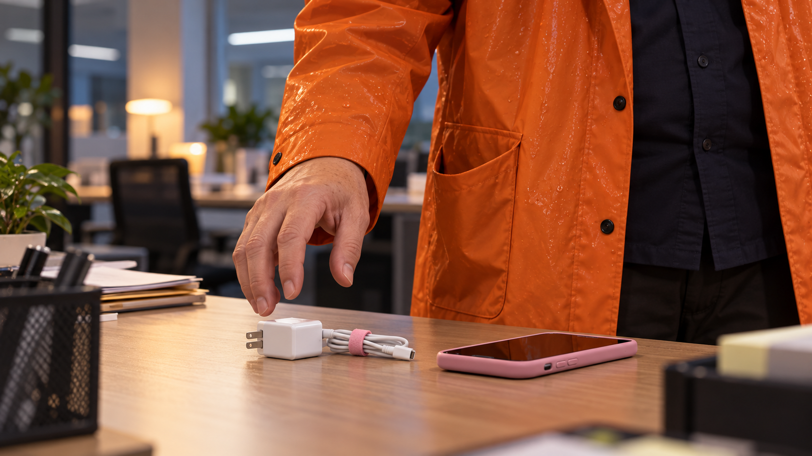
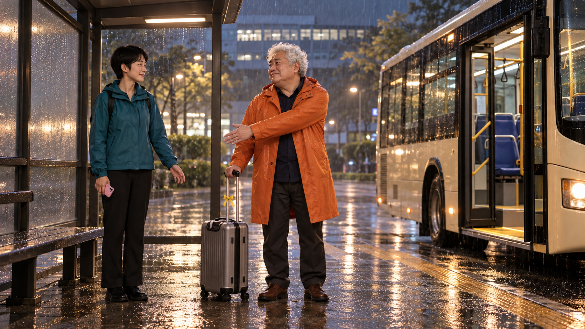
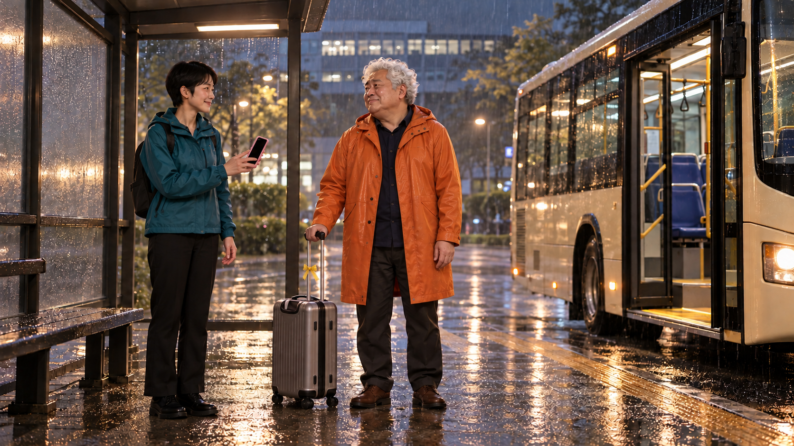
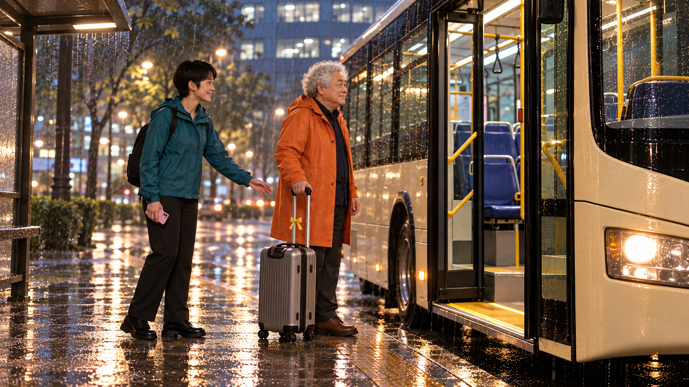
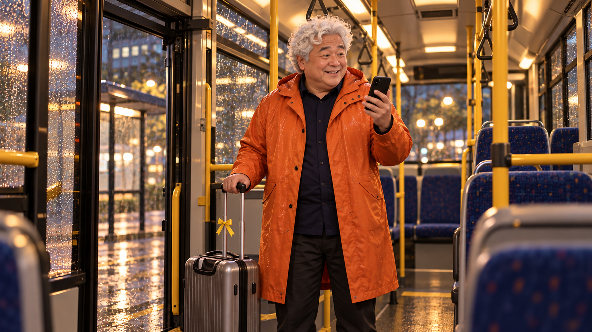
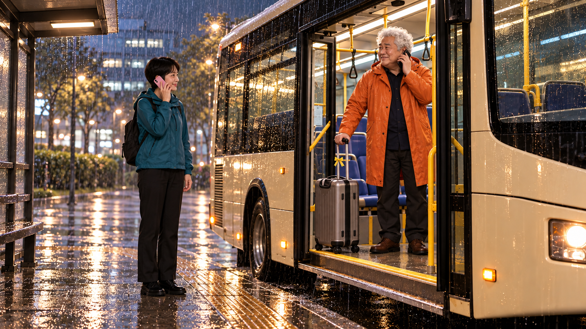
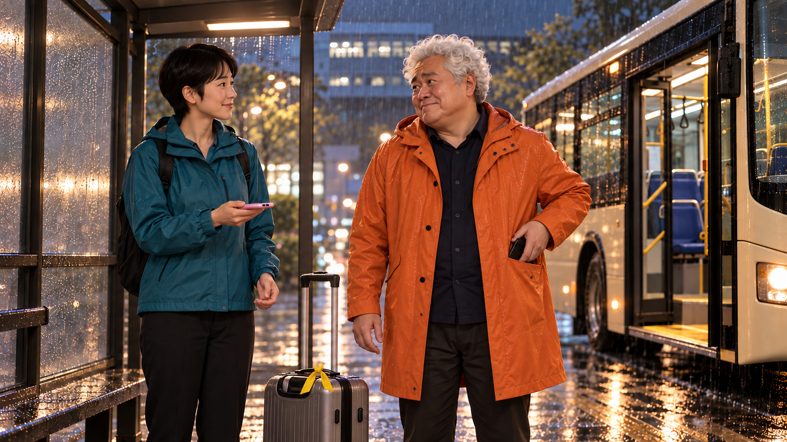
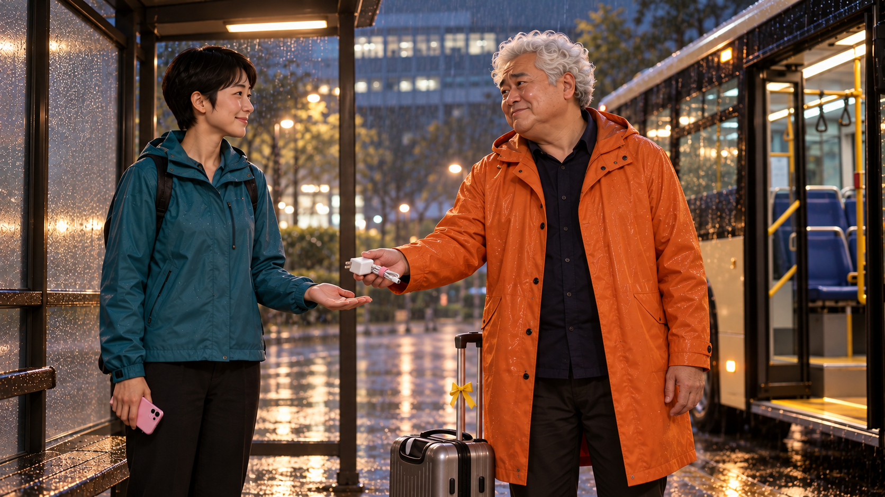
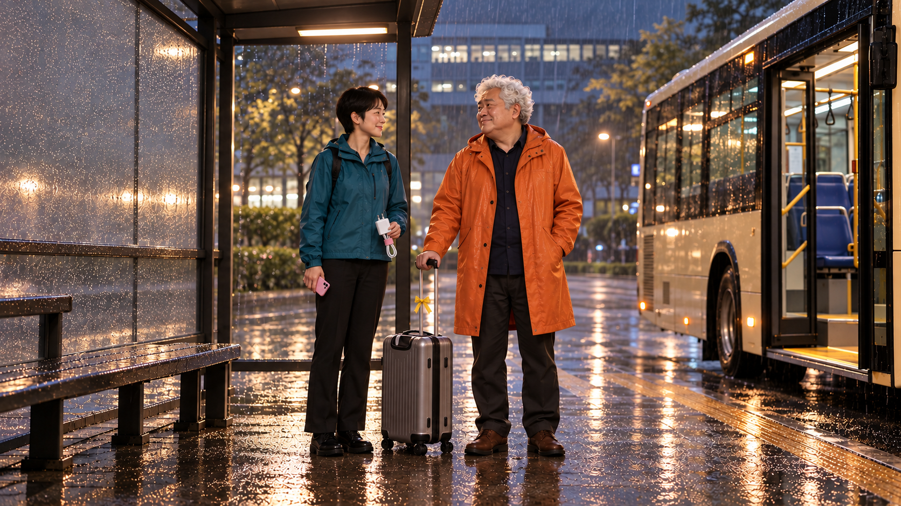
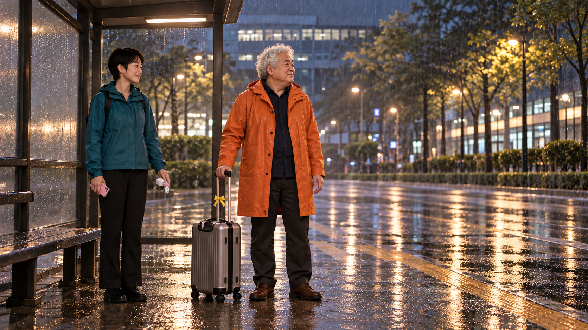

<!-- V15 LATEST -->
**2026-10-26 V15 영상 완성:** [최신 MP4](../../storyboards/2026-10-26_C08-C09-edit-v15/C09/C09_Q-AI_Fair_screening_v15.mp4) · **44초** · [실제 편집 구간](../../storyboards/2026-10-26_C08-C09-edit-v15/C09/edit_manifest.json). 아래는 생성 전 콘티이며 최신 사용 길이·테이크는 편집 기록이 우선합니다. [검수 범위와 한계](../../00_V15_제작_검수.md)
<!-- /V15 LATEST -->

# C09 · 나 없이도 괜찮겠어요?

휴가를 떠나며 붙잡히길 바랐던 남자가 동료의 전화에 가방까지 들고 버스에서 내리지만, 돌아온 이유는 잘못 챙긴 충전기 한 개뿐이다.

**34초 · 10씬 · 화면+자막 · 필수 음성 대사 없음 · Flow 미생성**

[새 4안 비교](../../00_새7-10_콘티.md) · [전체 이미지](../../콘티_바로보기.md)

**전달할 내용:** 경험을 나누면 동료는 이어서 일하고 본인은 마음 놓고 쉴 수 있다.

**반전:** 공유한방법덕분에동료는그를놓아줄수있지만, 그는업무구원요청을기대하고전화한통을과대해석한다.

**후폭풍:** 동료는충전기만돌려받고진심으로휴가를응원하며복귀. 버스를놓친이유는회사의호출이아니라자기해석. 큰가방도본인곁에남겨불필요한손실을만들지않음.

## 등장인물

- **M**: 50대 후반 남성, 풍성한 짧은 흰 곱슬머리, 둥근 코, 부드러운 이중턱, 감정이 큰 눈. 앞안의날렵한도주자와구분. 밝은 주황 레인코트, 짙은남색셔츠,갈색구두. 회색소형롤링가방과검정스마트폰. 자기만과잉이별멜로.
- **W**: 30대 초반 작은 체구 여성, 귀위로짧게자른검정머리,긴직선눈썹,단정한타원형얼굴. 청록색방수재킷,검정바지. 분홍케이스스마트폰. 휴가를진심으로축하하며차갑게버리지않음.
- **DR**: 버스운전자는필요한경우옆얼굴/실루엣만,주연추가하지않음. 로고없는회색셔츠.

## 컷별 콘티

| 씬·컷 | 구간·길이 | 화면·행동·구도 | 후처리 자막 | 대사·내레이션 | BGM·효과음 | 전환 | 웃음·정보 의도 |
|---|---|---|---|---|---|---|---|
| S01 / C09_K01 | 0–1.25s (1.25s) | M이 충전기를 무심하게 집어 바로 옆 오른쪽 코트 주머니에 넣는다. 손·충전기·분홍폰·주머니가 한 화면의 짧은 인서트. 편집 1.25초 안에 완료될 자연스러운 이동만; 안 되면 1.5초까지 확보하고 전체 시간을 재산정. |  | 없음 | 피아노 전주 한 음에서 곧바로 다음 멜로 와이드로. 충전기를 범죄 소품처럼 클로즈업 정지하지 않음. | 곧바로 빗속 과잉 작별의 넓은 화면으로 하드 컷 | 마지막반전의물리적원인을미리심는다. 도둑질연기가아닌짐을챙기는무심한동작. |
| S02 / C09_K02 | 1.25–4.75s (3.5s) | M이 W의 왼손을 자기 가슴 가까이 과하게 붙들고 비장한 작별 눈빛을 보낸다. W는 미소로 받아주되 손을 부드럽게 빼내며 버스 쪽을 본다. 영화적인 빗빛 역광 투샷. M만 감정이 과하고 W는 따뜻한 일상 태도. 과장된 얼굴·손의 대비를 첫5초 안에. | 1.6–4.6s 저 없이 괜찮겠어요? | 없음 | 멜로현악과비소리. 대사0. | 동일 공간 축을 유지한 하드 컷 | 남자의숨은욕망은휴가가아니라필요한사람이라는확인. 동료를차갑게연출하지않음. |
| S03 / C09_K03 | 4.75–9.5s (4.75s) | W가 자신의 분홍폰 화면에 표시된 확인 체크 하나를 M에게 보여준다. 두 사람 얼굴과 큰 분홍폰을 함께. 작은 화면에 여러 단계 텍스트를 읽히지 않고 자막 한 문장에 집중. | 4.9–9.5s 공유해주신 AI 방법, 제가 해보고 확인했어요. | 없음 | 멜로음악은과하게진심을유지. 전화효과음아직없음. | 동일 공간 축을 유지한 하드 컷 | 사람이불필요해진것이아니라공유덕분에안심하고쉴수있다는정서기반. |
| S04 / C09_K04 | 9.5–12.5s (3s) | M이 오른손 가방과 함께 낮은 버스 승강대 한 단을 올라 안으로 들어간다. W는 가방이 턱을 넘는 순간만 왼손으로 도와주고 밖에 남는다. 발·가방 바퀴·문을 자르지 않는 측면 와이드. 실제 한 단 승차 3초, 승차 완료를 트림으로 생략하지 않음. | 9.7–12.5s 편히 쉬고 오세요. | 없음 | 이별멜로최고조지만위험한비극효과없음. | 동일 공간 축을 유지한 하드 컷 | 작별이진짜로이루어짐. 동료는붙잡는대신짐을실어주는행동을선택. |
| S05 / C09_K05 | 12.5–15s (2.5s) | 왼손 검정폰의 동료 전화에 M이 기다렸다는 듯 웃으며 폰을 왼쪽 귀로 올린다. 버스안미디엄. 폰·M얼굴·열린문중하나는후경에유지. | 13.15–14.95s 역시. | 없음 | 선택벨소리한번. 멜로음악이희망적으로상승. 무음에서도폰발신자와표정으로전달. | 동일 공간 축을 유지한 하드 컷 | 관객이업무호출을예상하도록남자의자기해석을드러냄. |
| S06 / C09_K06 | 15–18s (3s) | M이 낮은 한 단을 내려 가방과 함께 W 앞에 멈추며 가방을 오른쪽 바닥에 똑바로 세운다. K04와 동일 문 축, 실제 하차 동작 3초. 역재생 금지. 손과 가방의 바닥 접점을 모두 보임. |  | 없음 | 희망적멜로계속. 바퀴내려오는툭한번. 무전/명령음없음. | 동일 공간 축을 유지한 하드 컷 | 그의과잉확신이휴가취소까지혼자결정하게함. 뒤에가방이남는손실을피함. |
| S07 / C09_K07 | 18–21.5s (3.5s) | M이 검정폰을 왼주머니에 끝까지 넣고, W의 분홍폰을 본 뒤 스스로 오른주머니를 더듬어 분홍 띠 흰 충전기를 오른손으로 꺼낸다. 두 사람 상반신·양쪽 주머니·자립 가방 윗부분이 보이는 미디엄. 약0.5초 왼폰 수납→약2초 오른손 충전기 찾기→약1초 발견 반응. 소유 변경을 컷으로 숨기지 않음. | 18.15–21.5s 혹시 제 충전기… | 없음 | M이충전기를보는순간멜로정지0.8초. 빗소리만남음. | 동일 공간 축을 유지한 하드 컷 | M이 스스로 기억해 잘못 챙긴 물건을 찾아낸다. 약20초에 업무 호출이라는 자기 해석이 충전기로 뒤집힘. |
| S08 / C09_K08 | 21.5–24.5s (3s) | M이 오른손 충전기를 W 왼손에 놓고 손을 완전히 뗀다. 손교환근접에서두표정도조금포함. 원테이크로소유이전완료. | 21.8–24.5s 고마워요. 푹 쉬세요. | 없음 | 충전기작은플라스틱음. 따뜻한음악한음만복귀. | 동일 공간 축을 유지한 하드 컷 | 동료의따뜻함을유지하면서그의과잉멜로만공중에남김. |
| S09 / C09_K09 | 24.5–28.5s (4s) | 버스문이닫히고버스가천천히오른쪽으로출발한다. 정류장고정와이드. 버스와사람사이안전거리,출발행동전체를보임. |  | 없음 | 문닫힘·저속차량음,과장경적없음. 멜로가다시조용히등장. | 동일 공간 축을 유지한 하드 컷 | 반환완료후떠나는버스를실제움직임으로보여인과의마지막고리를닫음. |
| S10 / C09_K10 | 28.5–34s (5.5s) | W가 충전기를 든 채 사옥으로 걸어간다. M은 가방 손잡이를 잡은 채 멜로 영화의 마지막 인물처럼 정류장에 그대로 남는다. 처음작별장면과같은넓은구도. M벤치아래빗물/안전한지붕. 새시간표수치없음. | 28.7–34s 내가 없어도 이어지는 방법. Q-AI Fair에서 나눕니다. | 없음 | 처음멜로테마를일상의소규모악기로마무리. 대사없음. | 동일 공간 축을 유지한 하드 컷 | 휴가를막는조직이아니라자기과잉해석의작은대가. 업무가그없이이어지는것은좋은결과로남김. |

## 씬별 실제 첫 프레임

이미지는 동작 직전 상태입니다. 행사명·문서·폰 UI·자막은 영상 생성 뒤 별도 합성합니다.

### C09_K01 · 0–1.25초

**시작:** 책상 근접. M 오른손이 이미 분홍폰 옆의 분홍 띠 흰 충전기를 잡기 직전이고 열린 오른쪽 코트 주머니가 바로 옆에 보임. 다른 손은 화면 밖. W의 분홍폰은 책상에 둔 채.

**동작:** M이 충전기를 무심하게 집어 바로 옆 오른쪽 코트 주머니에 넣는다.

**끝 상태:** 흰 충전기가 오른쪽 주머니 속으로 완전히 들어감. 분홍폰은 W 책상에 그대로.

**후처리:** 자막 외 없음

### C09_K02 · 1.25–4.75초

**시작:** 버스정류장 지붕 아래. M은 오른손으로 회색 가방을 세워 쥐고 왼손으로 W의 빈 왼손을 애틋하게 붙들기 직전. W 오른손에는 분홍폰. 버스는 오른쪽에 정차.

**동작:** M이 W의 왼손을 자기 가슴 가까이 과하게 붙들고 비장한 작별 눈빛을 보낸다. W는 미소로 받아주되 손을 부드럽게 빼내며 버스 쪽을 본다.

**끝 상태:** M의 왼손은 비고 오른손은 가방. W는 자기 왼손을 회수했으며 오른손 분홍폰을 보여줄 수 있음.

**후처리:** 자막 외 없음

### C09_K03 · 4.75–9.5초

**시작:** W가 오른손의 분홍폰을 M 쪽으로 돌리기 직전. 폰에는 공유받은 AI 활용 방법을 자기 업무에 적용한 단일 완료 체크 화면. M은 오른손 가방, 왼손은 빈 상태.

**동작:** W가 자신의 분홍폰 화면에 표시된 확인 체크 하나를 M에게 보여준다.

**끝 상태:** M이 체크를 보고 서운함을 삼킴. W는 폰을 오른손에 그대로 들고 버스 문을 바라봄.

**후처리:** 분홍폰: 공유 AI 방법 / 내 업무 적용, 큰 확인 체크 한 개. 별도 방법 단계·수치·추가 대사 자막 없음.

### C09_K04 · 9.5–12.5초

**시작:** 버스는 완전 정차, 문 열림. M은 오른손으로 가방을 잡고 낮은 승강대 앞. W는 문 바깥 왼쪽에 서서 분홍폰을 오른손에 들고 왼손으로 가방을 잠깐 받쳐 주기 직전.

**동작:** M이 오른손 가방과 함께 낮은 버스 승강대 한 단을 올라 안으로 들어간다. W는 가방이 턱을 넘는 순간만 왼손으로 도와주고 밖에 남는다.

**끝 상태:** M과 회색 가방 모두 버스 안. 오른손 가방, 왼손은 왼주머니 검정폰을 꺼낼 수 있는 상태. W는 바깥에서 왼손 인사.

**후처리:** 자막 외 없음

### C09_K05 · 12.5–15초

**시작:** M은 버스 안 문 가까이에 서 있으며 오른손 가방. 왼손에 방금 꺼낸 검정폰이 들려 있고 수신 반응이 시작되기 직전(휴대폰 옆 편집 배지로 표시). 문은 계속 열림.

**동작:** 왼손 검정폰의 동료 전화에 M이 기다렸다는 듯 웃으며 폰을 왼쪽 귀로 올린다.

**끝 상태:** 검정폰은 M 왼손/왼귀. 오른손 가방을 잡고 열린 문을 향함. 아직 버스 안.

**후처리:** 검정폰은 뒷면이 카메라를 향한다. 전화 화면을 뒷면에 붙이지 않는다. 휴대폰 옆 빈 공간에 편집용 수신 배지 [전화 아이콘 · 동료]를 12.5~14.95초 후합성. 실제번호없음.

### C09_K06 · 15–18초

**시작:** M이 열린 버스문 안쪽, 왼손 검정폰은 왼쪽 귀, 오른손은 회색 가방. W는 정류장 왼쪽에서 오른손 분홍폰을 귀에 댄 채.

**동작:** M이 낮은 한 단을 내려 가방과 함께 W 앞에 멈추며 가방을 오른쪽 바닥에 똑바로 세운다.

**끝 상태:** M과 가방이 정류장에 완전히 내림. 가방은 똑바로 자립하고 M 오른손은 손잡이를 놓음. 왼손 검정폰은 귀에서 내려 왼주머니 입구에 닿아 있음. W는 분홍폰을 내려 보여주려는 상태.

**후처리:** 자막 외 없음

### C09_K07 · 18–21.5초

**시작:** W는 자기 분홍폰의 충전단자 쪽을 오른손으로 보여주며 왼손은 빈 상태. M 왼손 검정폰은 왼주머니 입구에 걸쳐 있고 오른손은 빈 채, 오른쪽 바닥에 회색 가방이 자립.

**동작:** M이 검정폰을 왼주머니에 끝까지 넣고, W의 분홍폰을 본 뒤 스스로 오른주머니를 더듬어 분홍 띠 흰 충전기를 오른손으로 꺼낸다.

**끝 상태:** M 검정폰은 왼주머니, 오른손에 흰 충전기. W는 자기 폰만 들고 있으며 받을 왼손은 아직 비어 있음. 가방은 바닥 자립.

**후처리:** 자막 외 없음

### C09_K08 · 21.5–24.5초

**시작:** M 오른손의 분홍 띠 흰 충전기가 W의 빈 왼손 앞. W 오른손 분홍폰, M 검정폰은 왼주머니. 회색 가방은 자립하고 버스 문은 열림.

**동작:** M이 오른손 충전기를 W 왼손에 놓고 손을 완전히 뗀다.

**끝 상태:** W 왼손 충전기·오른손 분홍폰. M 두 손은 비고 가방은 옆 바닥. 반환 완료.

**후처리:** 자막 외 없음

### C09_K09 · 24.5–28.5초

**시작:** 반환 완료 뒤. W 왼손 충전기·오른손 분홍폰. M 곁 회색 가방은 자립, M 오른손은 손잡이 위에 다시 가볍게 놓임. 배경 버스는 문 닫기 직전 바퀴 정지.

**동작:** 버스문이닫히고버스가천천히오른쪽으로출발한다.

**끝 상태:** 버스가화면오른쪽으로빠져나간다.M은뒤늦게고개를돌림.W는충전기소지.

**후처리:** 자막 외 없음

### C09_K10 · 28.5–34초

**시작:** 버스가 사라진 정류장. W는 왼손 충전기·오른손 분홍폰을 가진 채 사옥으로 돌기 직전. M은 오른손 가방 손잡이를 잡고 떠난 쪽을 본다.

**동작:** W가 충전기를 든 채 사옥으로 걸어간다. M은 가방 손잡이를 잡은 채 멜로 영화의 마지막 인물처럼 정류장에 그대로 남는다.

**끝 상태:** M은 가방과 다음 차를 기다리며 서 있고, W는 충전기를 들고 사옥 쪽으로 돌아간다.

**후처리:** 자막 외 없음

## 제작 메모

난이도: 보통~높음. 충전기소지·주머니·손이동·버스문과가방의연속성. 감정온도차를보여야하며슬픔을조롱하지않음.

버스는한대/운전자는실루엣. 승하차는완전정차확인후각한번. 실제차량이동은와이드한컷으로별도생성. 전화UI는후합성.

[정확 프롬프트·이미지 매핑](../../storyboards/2026-10-25_C07-C10-rewrite-v13/scene_manifest.json)

시작 이미지 검수는 실제 영상의 동작 성공·관객 반응 검증을 대신하지 않습니다.
