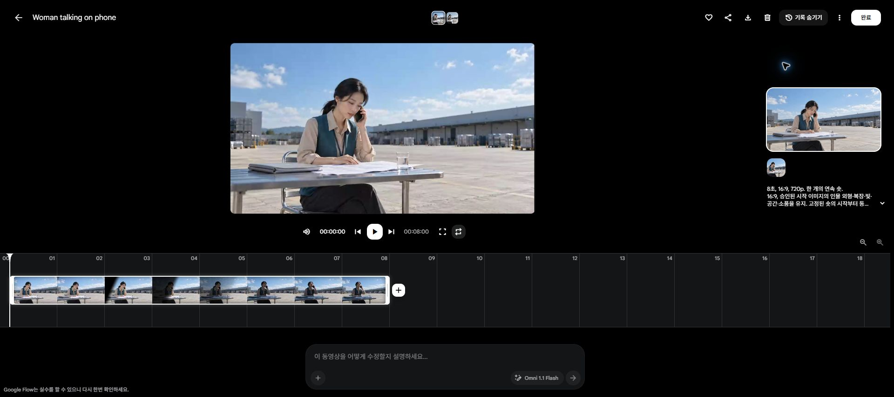

# C03 환경까지 가져왔습니다 · Flow run01

**재로그인 후 K01 한 번 재시도 성공: 원본1개 저장, 잔액50→40. 최종 채택은 편집·음성 확인 전 보류입니다.**

[원본 MP4](C03_K01_take01.mp4) · [Flow 결과](https://flow.google.com/project/c105a8ef-b295-4fc4-907c-1eb8e025245d/edit/cb7b682d-af03-4ef7-b669-53c6bad195a7) · [제출 기록](generation_log.json) · [검수 기록](review_summary.json) · [표본 프레임](C03_K01_take01_contact.jpg)

- 첫 제출은 비정상 활동 보안 오류로 실패했고 잔액50→50. 기존 실패 이력은 보존했습니다.
- 새로고침 재확인에서는 재제출하지 않았습니다. 사용자가 직접 재로그인한 뒤 2026-10-19 15:20:22 KST 한 번 재제출했습니다.
- 실제 설정: Veo3.1 Lite,10크레딧, Frames 시작만,16:9,720p,8초,x1,무음 반환OFF.
- 완료 파일: H.264 1280×720,24fps,8초,AAC 음성. 전체 디코딩 통과. 다운로드 파일과 SHA256 일치, 원본 재인코딩 없음.
- 자동전사에서는 ‘결과 말고 어떻게 했는지도요’가0~2.16초에 검출됐습니다. 실제 발음·말끝·자연스러움·립싱크 검증은 아닙니다.
- 세 명이 실제0.5초 간격 표본과 개별 PNG를 독립·교차 검토했습니다. 인물·손·전화·물컵·서류의 큰 단절이나 식별 가능한 공중방·크레인은 표본에서 발견하지 못했습니다.
- 약1.5~4.5초 검은 대각 경계가 하늘까지 가려 물리적인 그림자보다 화면 와이프처럼 읽힙니다. 채택 전 편집 보완 검증이 필요합니다.
- 고개를 드는 반응은4.5초 이후이므로 첫4초 단순 사용은 금지합니다. 약5.5~6초 사용 또는 대사를 보존하는 연결 편집을 검토합니다.
- 이번 재시도는 한 번만 실행했습니다. K02~K08과 별도 전화 음성은 미생성입니다. 다음 제작은 미생성 컷을 우선하며, K01을 이유 없이 반복하지 않습니다.
- 추가 구매·계정 전환·예약 재개 없음. 기존 V8 이야기·첫 프레임과 기존 완성 C01 영화는 유지했습니다.

