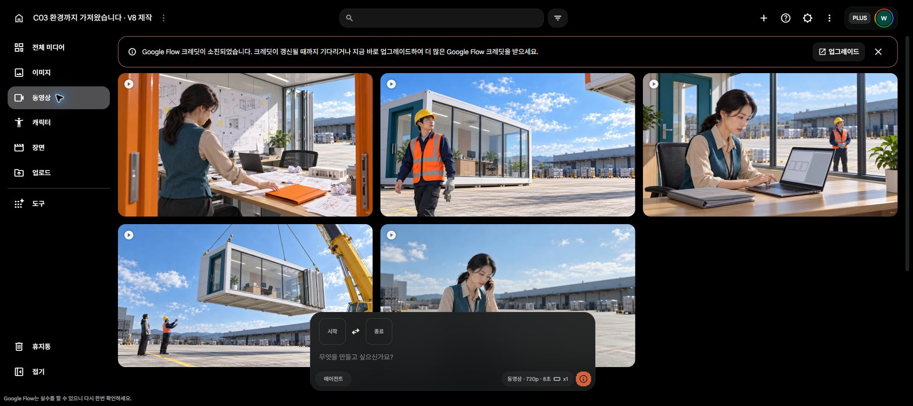

# C03 환경까지 가져왔습니다 · Flow run01

**원본 5개 확보 / 화면 계획 8컷 / 현재 잔액 0.** 이번 추가 생성은 K02~K05 네 개, Lite10씩 총40크레딧입니다. K01 그림자는 사용자가 수용했습니다.

[원본 재생 페이지](originals.html) · [Flow 프로젝트](https://flow.google.com/project/c105a8ef-b295-4fc4-907c-1eb8e025245d) · [생성 기록](generation_log.json) · [이번 4컷 검수](review_batch02.json) · [K01 검수·사용자 수용](review_summary.json)

| 컷 | 원본 | 현재 활용 판단 |
|---|---|---|
| K01 | [MP4](C03_K01_take01.mp4) | 그림자 사용자 수용. 고개 반응이4.5초 이후여서 편집 길이 조정 필요 |
| K02 | [MP4](C03_K02_take01.mp4) | 앞0~5초 시각 사용 후보 |
| K03 | [MP4](C03_K03_take01.mp4) | 결과 확인 부분 활용 후보. 오른 장갑 벗기 미구현, 음성 추가어 청취 확인 |
| K04 | [MP4](C03_K04_take01.mp4) | 대사·초반 반응 활용 가능. 두 번째 방 공개·장갑 재착용 보완 필요 |
| K05 | [MP4](C03_K05_take01.mp4) | 전화선 생성·답변 자리·파일 종점 보완 전 채택 보류 |

모든 원본은 8초·1280×720·24fps·H.264/AAC입니다. 다운로드와 SHA256 일치, 재인코딩하지 않았습니다. 전체 디코딩과 기술 검사는 통과했습니다. 세 명이 실제 0.5초 간격 표본을 독립·교차 검토했으며, 연속 재생 청취·발음·음색·립싱크 검증과 최종 편집은 아직입니다. 자동전사에서 검출된 추가어를 실제 발음 오류로 단정하지 않습니다.

남은 생성: **K06·K07·K08 화면 3컷**, 별도 **전화 답변 음성**. 현재 잔액0이므로 추가 요청을 제출하지 않았습니다. 크레딧 구매·계정 전환·예약 재개 없음. 다음에는 미생성 컷을 먼저 채우며, K01 그림자를 다시 만들지 않습니다. K03~K05의 구체적 보완은 원본 부분 편집 가능성을 확인한 뒤 판단합니다.

첫 K01 제출은 보안 오류로 실패했고50→50이었습니다. 사용자 재로그인 후 한 번 재시도 성공50→40, 이번K02~K05는40→30→20→10→0으로 모두 성공했습니다. 실패 이력과 정확 제출 프롬프트·입력 PNG·생성ID는 generation_log.json에 보존했습니다.

