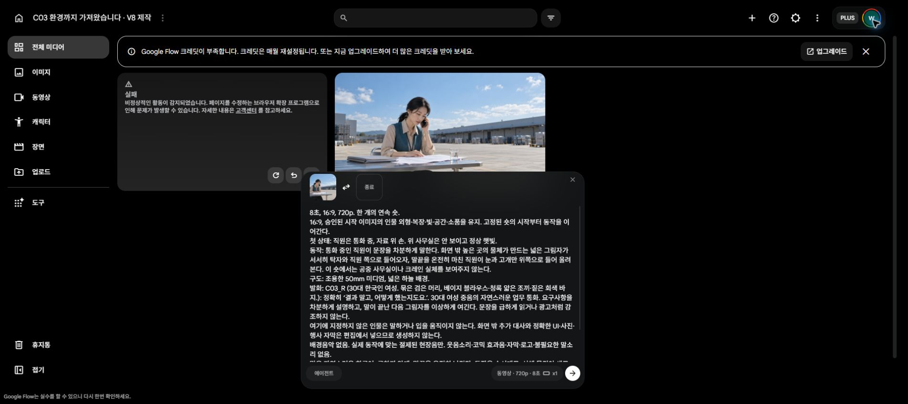

# C03 환경까지 가져왔습니다 · Flow run01

2026-10-19 사용자의 새 V8 C03 영상 제작 요청으로 착수했습니다.

**첫 요청이 Flow 보안 오류로 실패했습니다. 완성 영상은0개, 관측 잔액은50→50입니다.**

[Flow 프로젝트](https://flow.google.com/project/c105a8ef-b295-4fc4-907c-1eb8e025245d) · [상세 제출 기록](generation_log.json) · [준비한 프롬프트](prompts/)

- C03 K01의 승인 PNG는 업로드됐습니다. 이미지 업로드를 영상 완료로 계산하지 않습니다.
- Lite /10크레딧/16:9/720p/8초/x1, 무음 반환OFF를 확인하고 생성 버튼을1회 눌렀습니다.
- 카드에 ‘비정상적인 활동 감지’가 표시됐습니다. 제출 전부터 reCAPTCHA 연결 오류가 있었으며 일반 새로고침1회 후에도 재발했습니다.
- 같은 오류를 반복 제출하지 않았습니다. 실패 뒤 첫 이미지와 프롬프트를 입력창에 복원했습니다.
- 사용자에게 Chrome에서 보안·로그인 안내가 있는지 직접 확인하고 정상화 여부를 알려 달라고 요청한 상태입니다.
- 실제 실패 전후 잔액은50으로 같았습니다. 순간 차감과 환불을 따로 관측한 것은 아닙니다.
- 아직 원본 MP4, 생성 음성, 영상·청취 검수 결과는 없습니다.
- 이번 계정의 Lite 화면에는 길이 선택이 없어8초 원본으로 준비했습니다. 기존6초 권장값은 편집에 사용할 길이와 별개입니다.
- 다음 실행은 현재 Flow 결과·잔액·진행 중 요청부터 확인합니다. K01이 이미 접수/완료됐다면 다시 제출하지 않습니다.
- 새 크레딧 구매·계정 전환·예약 재개는 하지 않았습니다.

화면8컷과 전화 음성 예비1개가 전체 C03 계획입니다. 50크레딧에서 화면 K01~K05를 먼저 만들 계획이었으나 첫 요청부터 막혀 이후 컷은 제출하지 않았습니다. 다음 컷 계획에는 K06의이미열린파일/펜없음, K07의이미열린패널/두파일소지 상태를 유지합니다.

