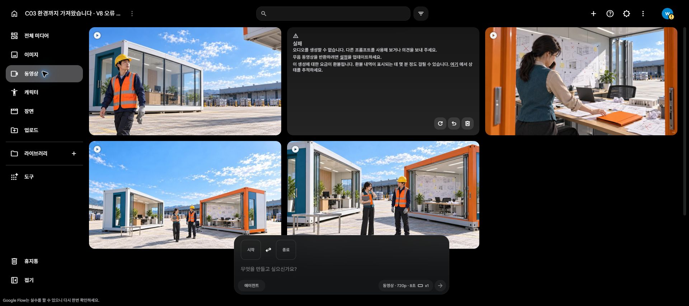

# C03 보완 원본 4개 · 2026-10-20

[원본 MP4 재생·다운로드](originals.html) · [생성·차감 기록](generation_log.json) · [검수 기록](review_summary.json) · [기술 검증](validation.json)

사용자가 직접 로그인하고 최초 권리 동의를 완료한 추가 계정(`/u/2`)에서 **Lite10 × 성공4개**, 순사용 **40크레딧**, 실제 잔액 **10**을 확인했습니다. 총5요청 중 K04 첫 요청1회는 오디오 생성 실패로 환불됐고, 무음 반환을 임시 허용한 기술 복구1회는 성공했습니다. 실제 반환 K04에는 AAC 트랙과 목표 문장 자동전사가 있습니다. 무음 반환 설정은 OFF로 복구했습니다.

| 원본 | 시각 검토 결과 | 남은 편집 확인 |
| --- | --- | --- |
| [K07 take02](C03_K07_take02.mp4) | 표본상 선글라스 오류 해소, 두 파일·조끼 유지 | 실제 대사·립싱크·반응 뒤 컷점 |
| [K08 take02](C03_K08_take02.mp4) | 조끼·검정 의자·안전모 개수 오류 해소 | 약5.5초 이후 착석을 살리고 행사명 읽기시간 확보 |
| [K05 take03](C03_K05_take03.mp4) | 전화 한 대 유지, 닫힌 파일 집어 보유 | 무언 삽입컷. 기존 질문·전화 답변·K06과 조합 검증 |
| [K04 take02](C03_K04_take02.mp4) | 두 번째 방 B 대부분 공개 | 오른손 장갑 재착용 실패. 대사·공개 중심 부분 활용 검토 |

K03 예비 보완은 **요청하지 않았습니다**. K04 오른손 재착용이 되지 않아 K03만 새로 만들어도 장갑 반복 개그가 완성되지 않습니다. 업로드·입력 준비만 했으며 입력창을 비웠고, 남은10을 보존했습니다. K04는 약3.5초 전후 컷점으로 공개를 살리는 방식을 먼저 시험합니다. 착지 완료·후속 내부 공간 연결까지 검증됐다고 기록하지 않습니다.

모두 **8초 / 1280×720 / 24fps / H.264·AAC** 원본입니다. 재인코딩하지 않았으며 다운로드 SHA256 일치와 전체 디코딩을 확인했습니다. M4A는 오디오 스트림 복사, WAV·PNG·contact·frames는 검사용 파생물입니다. 모든 제출 프롬프트와 입력 PNG 해시를 남겼습니다. K04 첫 실패의 일시적 차감은 직접 관측하지 않았으며, 사전20과 실패후20 및 환불 안내를 확인했습니다.

검수자 A·B·C가 각자 네 원본의 contact64표본과 개별 PNG를 독립 확인했습니다. 세 명의 교차 검수와 총괄 처리도 완료했으며, 지적별 처리는 review_summary.json이 기준입니다. 실제 청취·연속 재생·립싱크는 아직 검증하지 않았습니다. ASR 발화 없음은 무음·BGM 없음의 청취 확인이 아니며 PCMpeak>1도 가청 클리핑 확정이 아닙니다.

**C03 전체 원본은14개, 계획 화면8/8컷의 원본은 확보했지만 최종 영화는 미완료입니다.** K05 음성·화면 조합, K06 내부 조건 도식 및 파일 종점 생략 연결, K04 공간 연결, 엔딩 시간·타이틀·음향 편집이 남습니다. 기존 이야기·승인 PNG·이전 원본·별도 완성 C01은 보존했습니다. 구매·업스케일·다른안 생성·예약 재개·공개 게시 없음.

[이전 run02 원본5개](../2026-10-19_C03-flow-run02/originals.html) · [run01 원본5개](../2026-10-19_C03-flow-run01/originals.html) · [현재 Flow 프로젝트](https://flow.google.com/u/2/project/1b4f0913-4664-41fa-9f38-9364a71db73c)

