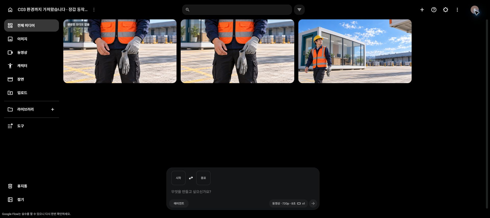

# C03 장갑 동작 보완 · run04

[원본 재생·다운로드](originals.html) · [생성 기록](generation_log.json) · [이미지 3인 검수](image_review.json) · [영상 검수](review_summary.json)

새로 로그인한 계정에서 **Lite10 한 번**, 잔액 **50→40**. 새 근접 첫 프레임으로 K04의 장갑 착용 동작만 분리했습니다. 생성은 완료됐지만 **동작 보완은 미해결**입니다.

- 원본: [C03_K04_insert_take03.mp4](C03_K04_insert_take03.mp4)
- 8초 / 1280×720 / 24fps / H.264 / **오디오 트랙 없음**. 원본 바이트 보존, 다운로드 SHA256 일치, 192프레임 전체 디코딩 통과.
- 오른손이 빈 장갑 안으로 들어가지 않고 왼손 장갑을 만집니다. 약5.2~5.5초에는 맨 오른손 표면에 장갑이 생기는 변형이 보여, 실제 착용 인서트로 채택하지 않습니다.
- 후반 양손 장갑 상태만 보이는 프레임은 있지만 정상 착용 동작의 증거가 아닙니다. 조건부 K03 벗기 요청은 제출하지 않았고, 같은 지시 반복도 하지 않았습니다. **40크레딧 보존**.
- 기존 V8 기획·43PNG·이전 C03 원본14개·별도 완성 C01은 그대로입니다. 새 원본을 포함한 C03 누적 원본은15개지만, 최종 영화 완성이나 장갑 개그 복구 완료는 아닙니다.

[0.5초 간격 전체 표본](C03_K04_insert_take03_contact.jpg) · [5.0~5.75초 세부 표본](C03_K04_insert_take03_transition.jpg) · [기술 검사](C03_K04_insert_take03_inspection.json)

첫 프레임은 기존 K04를 참조해 내장 imagegen으로 생성한 근접 인서트 한 장입니다. 단순 잘라내기가 아니며 정면 중앙 자세로 바뀌었습니다. 세 검수자가 실제 이미지 독립 확인·상호 교차 후 입력으로 수용했습니다. 영상도 세 명이 실제 추출 표본을 독립 확인하고 상호 교차 검수했습니다. 모두 착용 동작 HOLD에 동의했으며 실제 확인 범위와 지적별 처리는 review_summary.json에 기록했습니다. 연속 재생/최종 편집 연결 검증은 별도이며 이 무음 원본에 발음·립싱크 검증을 주장하지 않습니다.

Flow의 무음 반환은 이번 무언 인서트에만 임시 ON으로 사용하고 OFF로 복구했습니다. 새 구매·유료 업스케일·계정 임의 전환·예약 재개·공개 게시 없음.

[이전 보완 원본4개](../2026-10-20_C03-flow-run03/originals.html) · [현재 Flow 결과](https://flow.google.com/u/3/project/ae9e0683-9828-484b-a182-68bb08987cdb/edit/947dcdec-6810-4e16-b38f-2610d3aa5c9a)

