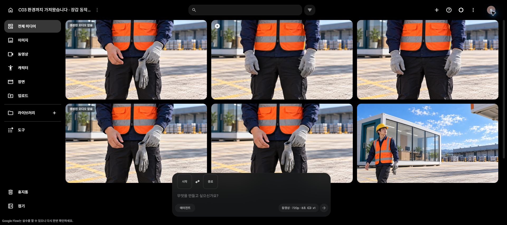

# C03 장갑 보완 run05 — 원본 2개와 7.5초 편집 대안

**장갑 탈착 동작은 미해결입니다.** 시작·끝 이미지를 함께 지정해 Lite 탈착 1회와 Fast 착용 1회를 생성했지만, 두 영상 모두 장갑 재질 변형이 남았습니다. 추가 요청을 멈추고 현재 계정의 **10크레딧을 보존**했습니다.

[원본·편집 대안 재생 페이지](originals.html)

| 파일 | 모델·비용 | 실제 결과 |
| --- | --- | --- |
| [K03 insert take02 원본](C03_K03_insert_take02.mp4) | Lite 10 · 40→30 | 8초 720p 24fps, AAC 트랙 있음. 반대 손 탈착·재질 변형으로 동작 HOLD |
| [K04 insert take04 원본](C03_K04_insert_take04.mp4) | Fast 20 · 30→10 | 8초 720p 24fps, 오디오 없음. 빈 장갑 합침·재질 생성으로 동작 HOLD |
| [7.5초 검토용 편집](C03_K03_K04_state_edit_review_7p5s.mp4) | 로컬 편집 · 추가 크레딧 0 | 7.5초 720p 24fps, 기존 음성 유지. 상태 변화만 보여주는 대안 |

## 편집 대안

기존 K03 0–2.5초 → 새 탈착본 6–6.75초 → 기존 K04 take02 0–3.5초 → 새 착용본 6–6.75초. 실제 동영상의 정상 후상태 부분을 연결했으며, 움직이는 정지 이미지로 대체하지 않았습니다. 두 장갑 동작의 성공을 뜻하지 않습니다.

오디오는 기존 K03 0–3.25초와 기존 K04 0–4.25초를 사용했습니다. K04 gain 0.7 외 새 합성·음악은 없으며, 새 인서트의 소리는 사용하지 않았습니다. 실제 청취, 발음, 립싱크, 0.75초 구간의 실시간 가독성과 코미디 호흡은 미검증입니다.

## 확인한 범위

세 검수자가 실제 추출 프레임을 독립 검토한 뒤 다른 두 의견을 교차 검증했습니다. 원본 두 개는 물리적 행동 HOLD, 편집 대안은 표본상 새 필수 시각 결함 없음입니다. 이는 최종 채택이나 C03 완성 승인이 아닙니다. 원본 각 192프레임과 편집본 180프레임 디코딩을 통과했고, 다운로드·보존 원본의 SHA256이 일치합니다.

[생성 ID·제출 프롬프트·입력 이미지·차감](generation_log.json) · [검수 ID와 처리](review_summary.json) · [편집 구간·원본 해시](edit_manifest.json)

현재 C03 원본은 총 **17개**입니다. 전체 편집, K05/K06 연결, 음성 및 행사명 가독성 검증이 남았습니다. 같은 손 동작의 무변경 반복 생성은 하지 않습니다. 현 UI는 Lite, 무음 반환 OFF, 입력창 비움으로 마쳤습니다. 계정 전환·구매·업스케일·예약 재개·공개 게시 없음. 기존 V8와 legacy C01, 이전 원본은 보존했습니다.

