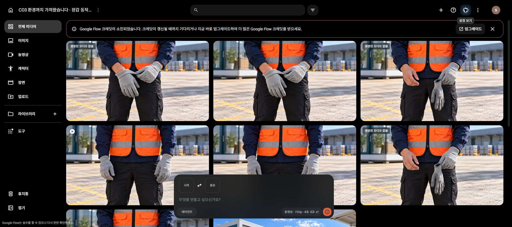

# C03 커프 정돈 보완 run06

사용자의 **“10크레딧 남았으니까 한번 더 시도해봐”** 요청으로 Lite 1회 추가했습니다. **10→0크레딧**, 실패·환불·중복 요청 없음. 새 원본 1개, C03 원본 누적 18개입니다.

[8초 원본 재생·다운로드](originals.html) · [원본 MP4](C03_K04_insert_take05.mp4)

**‘오른손 장갑 커프를 당겨 정돈하고 놓는 동작’의 사용 후보를 확보했습니다.** 세 검수자가 실제 0.25초 간격 표본과 개별 PNG를 독립 검토하고 상호 교차했습니다. 2.5–3.25초에 천 가장자리가 소매 쪽으로 이동해 손목 피부를 덮고, 약 5–5.25초에 두 손이 떨어집니다. 표본에서 이전의 장갑 합침·갑작스러운 재질 생성은 발견하지 못했습니다.

편집 추천은 **2.25–5.75초, 약 3.5초**입니다. 이번에는 원본만 보존했으며 이 구간의 별도 편집본을 만들지는 않았습니다. 실시간 호흡·연속재생은 미검증입니다.

## 변경한 입력

내장 imagegen으로 새 첫 프레임 1장을 만들었습니다. 두 손은 이미 장갑을 착용하고 오른손목 피부가 드러나며, 왼손이 오른장갑 커프를 잡습니다. 처음 계획한 손등 노출보다 짧은 동작이어서 프롬프트도 '이미 낀 장갑의 커프 정돈'으로 좁혔습니다. 시작 이미지 1장만 사용, 종료 이미지 없음, 16:9/720p/8초/x1/Lite10. 무대사 인서트의 무음 반환은 일시 ON 후 OFF로 복구했습니다.

## 판정의 한계

전체 장갑 삽입·탈착 성공은 아닙니다. K03에서 맨손이 된 다음 이 상태로 갈 때는 착용 시작 과정의 생략 편집이 필요합니다. K03 물리적 탈착, C03 전체 편집 및 다른 컷의 음성 검증은 아직 남아 있습니다. 이전 7.5초 편집 대안도 수정하지 않았습니다.

원본은 8초/1280×720/24fps/H264이며 **오디오 트랙이 없습니다**. 192프레임 디코딩 통과, 다운로드 파일과 SHA256 일치, 원본 재인코딩 없음.

[생성 ID·정확한 프롬프트·입력·차감](generation_log.json) · [3인 독립·교차 검수](review_summary.json) · [이미지 생성 프롬프트](image_prompt.txt) · [이미지 기록](image_manifest.json)

기존 V8·legacy C01·이전 원본을 보존했습니다. 구매·계정 전환·업스케일·예약 재개·공개 게시 없음.

