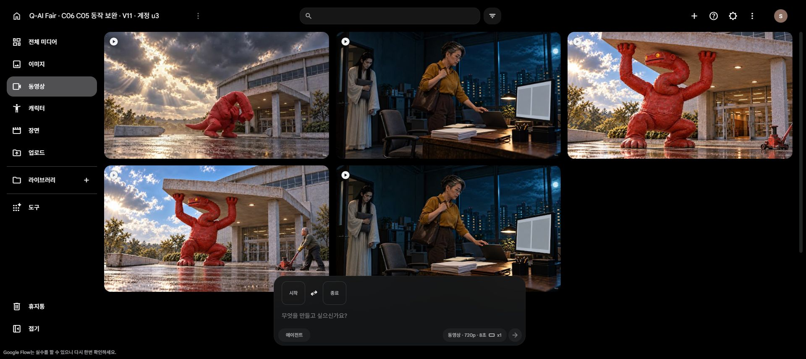

# 6번·5번 추가 20크레딧 보완

**Lite 10크레딧 요청 두 번, 원본 2개 저장 완료.** 기존 23개와 합쳐 원본은 25개(6번 11개·5번 14개)입니다. 시작·종료 프레임을 함께 지정해 이전의 동선 문제를 보완했습니다. 생성 요청의 기술적 성공과 장면의 품질 판정은 아래처럼 구분합니다.

| 컷 | 원본 | 결과 |
|---|---|---|
| 6번 K05 · 직원 퇴근 | [C06_K05_take03.mp4](C06_K05_take03.mp4) | 왼쪽 문을 실제로 통과하는 동작 확보. 최종 트림·소품 처리는 검수 기록 참고. |
| 5번 K02B · 괴수 진입 | [C05_K02B_take03.mp4](C05_K02B_take03.mp4) | 중간에 별도 처마와 화면 겹침이 발생. 연속 진입 성공본으로 채택하지 않음. |

[최종 시각 검수와 편집 조건](review_summary.json) · [제출 프롬프트·입력·계정·비용 기록](generation_log.json) · [기존 23개 원본과 다른 컷의 조건](../2026-10-23_C06-C05-flow-run01/README.md)

모두 8초·1280×720·24fps·H264/AAC이며 다운로드 원본을 재인코딩하지 않았습니다. 다운로드·저장·사용자 미리보기 사본의 SHA-256이 일치하고, 각 192프레임 전체 영상 디코딩이 성공했습니다. 실제 청취나 연속 재생을 검증한 것은 아닙니다. 자막·Q-AI Fair 행사명·정확한 화면 합성·음악과 전체 편집은 아직 완료되지 않았습니다.

## 크레딧 기록

- 시작 관측 20 → 첫 요청 완료 뒤 40 → 둘째 요청 완료 뒤 30.
- 두 요청의 제출 직전 표시 비용은 각각 10, 합계 20입니다.
- 첫 요청 중 잔액이 증가했습니다. 계정의 매일 11:21 갱신 안내와 함께 관측했으나 정확한 갱신량·개별 차감 내역은 분리 확인되지 않았습니다. 첫 요청의 실측 차감은 미확인으로 기록했습니다.
- 둘째 요청은 40→30의 10 차감을 확인했습니다. 실패·환불·대기 요청은 없습니다.
- 이 실행 종료 당시 잔액은 30이었습니다. 이후 사용자가 전체 잔액 사용을 명시해 [run03](../2026-10-23_C06-C05-flow-run03/README.md)에서 다른 계정의 50과 함께 소진했습니다. 최신 관측은 로그인 5계정 모두 0입니다.

## 확인 자료

[6번 32표본](C06_K05_take03_contact.jpg) · [5번 32표본](C05_K02B_take03_contact.jpg) · [입력 이미지 출처와 해시](input_manifest.json)

개별 프레임 PNG는 로컬 `frames/`에 보존하고 Git에는 연락판과 추출 스크립트를 넣었습니다. 기존 기획·시작 이미지·이전 테이크는 덮어쓰지 않았습니다.
