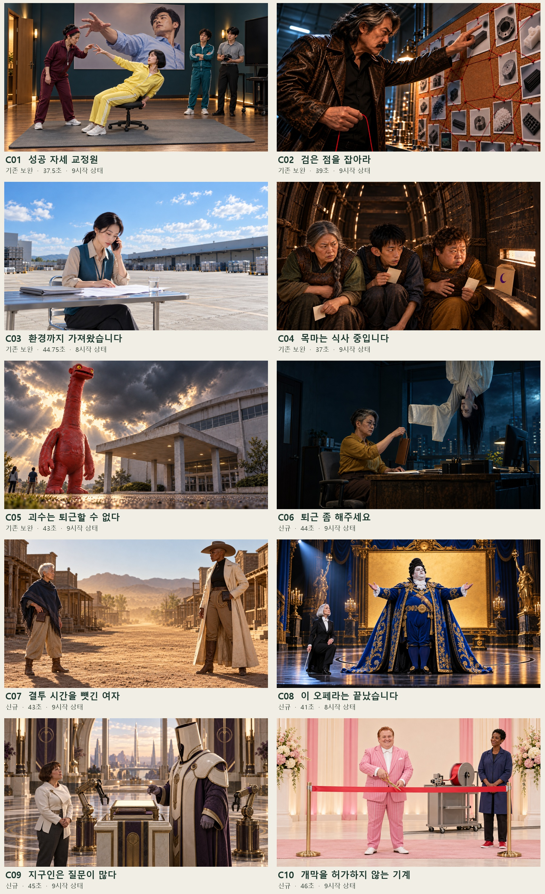

**최신 검수 시작점: [저장소 메인의 01–10번 안별 스토리보드](../../README.md).** 이 폴더는 제작 원본과 검수 이력 보관용입니다.

# Q-AI Fair · V10 선택용 패키지

**[전체 88장 이미지 콘티 보기](ALL_IMAGES.md)** · [10안 비교와 컷 표](STORYBOARDS.md) · [자막 미리보기 HTML](index.html)

기존 C01–C05는 보완하고 신규 C06–C10을 추가했습니다. 신규 시작 PNG 44장과 기존 V9에서 바이트 그대로 가져온 44장을 포함합니다. 모든 자막·행사명·정확한 문서 글자는 별도 후편집입니다. 이번 패키지에서는 Flow·영상·음원 생성을 실행하지 않았습니다.

| 자료 | 용도 |
|---|---|
| [STORYBOARDS.md](STORYBOARDS.md) | 10안 비교, 컷별 시간·행동·자막·음향·전환 |
| [ALL_IMAGES.md](ALL_IMAGES.md) | GitHub에서 모든 채택 시작 이미지를 바로 보기 |
| [index.html](index.html) | 자막 위치 전환과 후보 표시. 이미지 폴더와 함께 내려받아 열기 |
| [CASTING.md](CASTING.md) | 10안의 인물 외형과 연출 구분 |
| [PRODUCTION_NOTES.md](PRODUCTION_NOTES.md) | Flow 동작과 후편집 합성의 분담 |
| [review_summary.json](review_summary.json) | 독립·교차 검수의 실제 범위와 남은 제작 확인 |
| [scene_manifest.json](scene_manifest.json) | 채택 PNG, 원본 경로, 실제 제출 프롬프트와 참조 |
| [storyboards.json](storyboards.json) | 최신 전체 콘티의 기계 판독 명세 |

`selection_cards.json`, `new_five_draft.json`, `storyboards_before_text_review.json`은 발상·수정 이력입니다. **최신 채택본은 storyboards.json과 scene_manifest.json**을 사용합니다. images 폴더의 미채택 버전까지 전부 제작 큐로 세지 않습니다. flow_prompts는 후속 동작 초안이며 아직 제출하지 않았습니다.

길이·크레딧·실제 영상 성공은 첫 이미지 수로 확정하지 않습니다. 선택된 안만 후속 제작하고, 기존 C03 영상은 재사용을 먼저 검토합니다.
