# 전체 이미지 콘티 · Q-AI Fair 10안

기존 C01~C05를 보완하고 C06~C10을 추가했습니다. 모든 PNG는 자막 없는 업로드용 첫 상태입니다. 아래 글은 별도 후편집 자막입니다.

[10안 비교·컷 표](STORYBOARDS.md) · [인터랙티브 자막 보기](index.html) · [캐스팅](CASTING.md) · [검수 기록](review_summary.json)

## C01

**성공 자세 교정원**

성공자의 자세를 가르치던 코치가 그 자세가 의자에서 미끄러지기 직전이었다는 원본을 보고도, 바닥에 내려앉는 동작까지 새 비법으로 판다.

### C01_K01 · 0–4초

**첫 상태:** L1의 오른손 손가락이 살짝 구부러져 있고 T의 두 손가락은 아직 닿기 직전. 벽 사진에는 같은 손모양과 기울어진 상체만 크게 보이며 의자·다리·바닥은 잘려 있다.

**후속 동작:** T가 손가락만 2cm 펴 준다. L1은 숨을 참고 자세를 유지한다. 카메라는 움직이지 않는다.

**후편집 자막:** AI 잘 쓰는 사람은
자세부터 다릅니다.

### C01_K02 · 4–6.5초

**첫 상태:** 벽 사진 속 P와 L1의 상체가 같은 방향으로 기울어 있다. T의 손바닥은 L1 어깨 옆에서 각도를 표시하기 직전. 사진 속 의자나 바닥은 보이지 않는다.

**후속 동작:** L1이 상체 각도를 조금 더 기울이고 손끝을 편다. T가 엄숙히 한 번 고개를 끄덕인다.

**후편집 자막:** 무자막

### C01_K03 · 6.5–9.5초

**첫 상태:** P가 포스터와 같은 하늘색 셔츠를 입고 노트북 재생 키에 손을 올린 상태. 큰 모니터는 사진과 같은 자세로 정지해 있다. 로고·작은 UI·문구 없음.

**후속 동작:** P가 재생 키를 한 번 누른다. 모니터는 편집용 정지 상태 유지. K04 독립 원본을 후편집 합성. 발화 없음.

**후편집 자막:** 그 사진의 원본

### C01_K04 · 9.5–14.5초

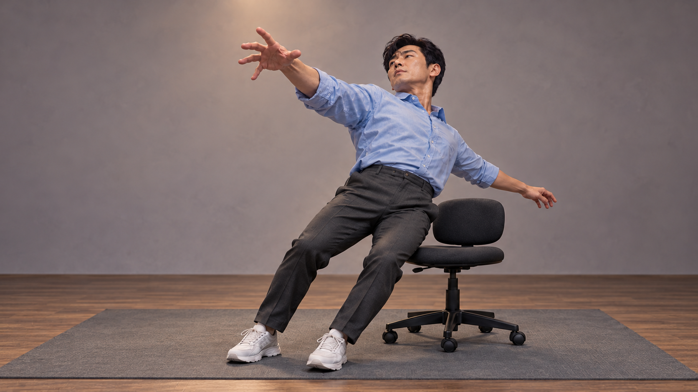

**첫 상태:** V8 S04_v2 모니터 내부와 동일 P·상체·손방향. 아직 낮은 바퀴 의자 끝에 앉은 전신, 매트·바퀴가 보이는 독립 원본 프레임. 착지 전.

**후속 동작:** 사진과 같은 자세로 시작한 P의 의자가 옆으로 밀려, 두꺼운 매트에 낮게 풀썩한다. 움직임은 모니터 내부에만 합성한다. 착지 후 설명 자막 없이 반응을 읽히며 정지 박자를 둔다.

**후편집 자막:** 무자막

### C01_K05 · 14.5–18.5초

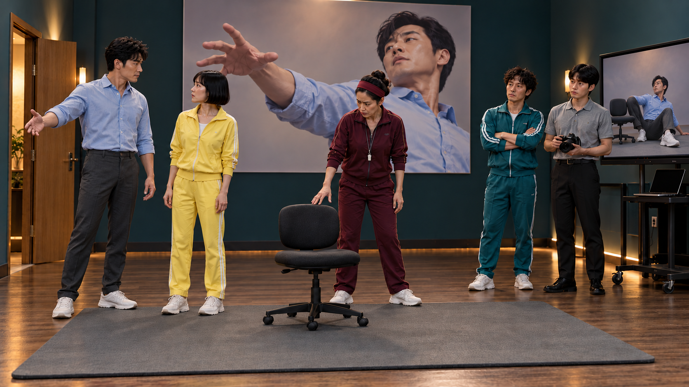

**첫 상태:** L1은 이미 일어서 P를 바라본다. 다시 일어나거나 의자에 앉지 않는다. P는 왼쪽 문 방향으로 손을 펼치고 T는 빈 의자를 본다.

**후속 동작:** 이미 서 있는 L1이 P에게 작업 방법을 묻는 태도. 자막을 읽은 뒤 둘이 왼쪽 문으로 두 걸음. T는 같은 의자를 매트 중앙으로 당긴다. 발화 없음.

**후편집 자막:** 자세 말고,
어떻게 일했는지요.

### C01_K06 · 18.5–23.5초

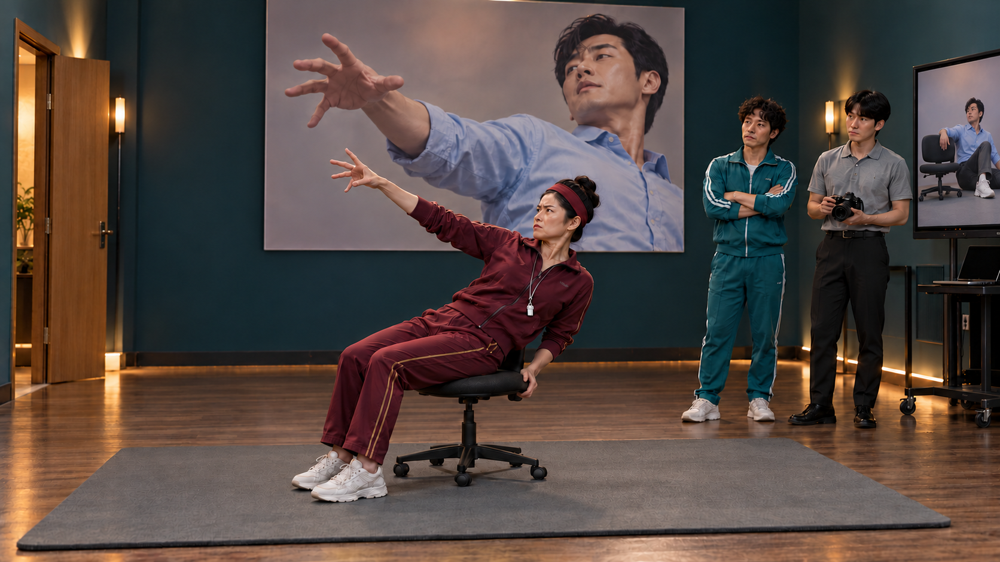

**첫 상태:** T는 아직 의자 끝에 앉아 오른손을 들고 있다. 양발은 매트 가까이, 의자는 낮고 몸 뒤로 조금 이동할 여유가 있다.

**후속 동작:** 의자가 옆으로 빠짐→T가 낮은 매트에 풀썩→오른팔·굽힌 무릎을 굳혀 권위를 유지. 착지 후 자막. 큰 부상 연기·발화 없음.

**후편집 자막:** 착지까지가 비법입니다.

### C01_K07 · 23.5–26.5초

**첫 상태:** T는 등을 매트에 대고 한 무릎을 굽혀 올린 채 오른팔을 들고 있다. A는 무릎을 꿇고 카메라를 향한다. L2는 아직 서 있지만 T의 굽힌 무릎을 유심히 보고 있다.

**후속 동작:** A가 셔터를 누른다. T는 자세를 더 굳히고 L2가 그 옆 매트로 몸을 낮추기 시작한다.

**후편집 자막:** 새 교본 촬영

### C01_K08 · 26.5–30.5초

**첫 상태:** 두 사람은 이미 나란히 매트에 등을 댄 채 오른팔과 한 무릎을 들고 있다. L2의 발끝 각도만 T와 다르다. A는 둘을 함께 촬영한다.

**후속 동작:** L2가 발끝을 T와 같은 방향으로 꺾는다. T가 눈으로 만족을 표시하고 A의 셔터가 한 번 울린다.

**후편집 자막:** 무자막

### C01_K09 · 30.5–37.5초

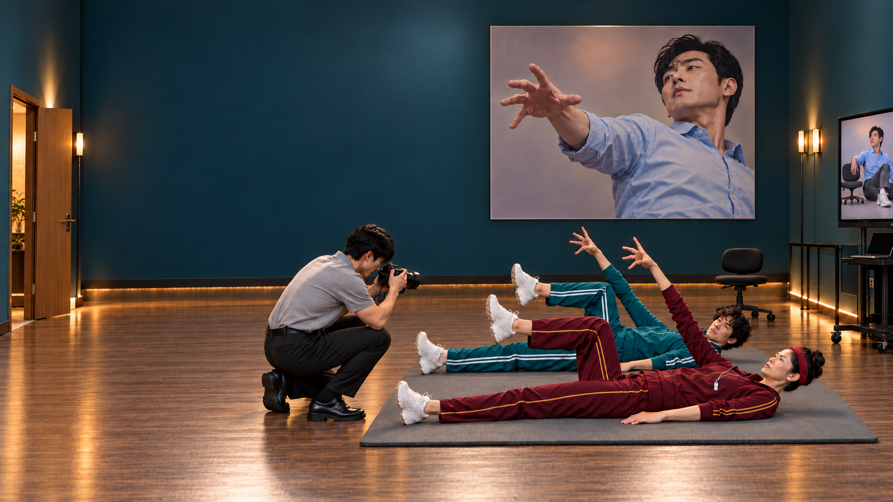

**첫 상태:** K08의 나란히 누운 T·L2와 조수. 팔과 굽힌 무릎 자세 유지, 좌상단 벽은 텍스트 없는 여백.

**후속 동작:** A가 한 장 더 찍고 T·L2는 자세를 유지한다. 왼쪽 문만 천천히 닫힌다. 카메라 고정.

**후편집 자막:** Q-AI Fair
AI 실행 경험을 함께 나눠요.

## C02

**검은 점을 잡아라**

검사 사진의 흐린 흔적을 범인 표식으로 쫓던 형사가 AI 후보 비교와 재촬영으로 원인을 듣고 카메라를 체포했다가, 자신이 만든 새 가림까지 다음 공개 사례로 올라간다.

### C02_K01 · 0–4초

**첫 상태:** 기존 DE 캐스팅·가죽 코트·사진벽 그대로, 낮은 시점에서 손가락이 전경에 크게 보인다. 손가락은 흐린 흔적 사진에 닿기 직전이고 붉은 실 끝도 아직 다음 사진에 걸리지 않았다. 중앙 빈 영역과 사진·실 배치는 유지.

**후속 동작:** DE가 사진의 흐린 흔적을 한 번 짚고 붉은 실을 다른 사진으로 당긴다. 확신에 찬 얼굴, 웃음·윙크·발화 없음.

**후편집 자막:** 제품은 다른데,
흔적은 같다.

### C02_K02 · 4–7초

**첫 상태:** DE가 트레이 앞에 들어서기 직전, IN은 모니터를 가리키기 직전. 수갑은 아직 코트 안.

**후속 동작:** TE가 트레이를 멈추자 DE가 몸을 크게 가로질러 제품 반출을 지나치게 엄숙하게 막는다. IN이 모니터를 가리키면 DE는 막은 몸을 그대로 둔 채 고개만 돌린다. 윙크·발화 없음.

**후편집 자막:** 사진부터 보시죠.

### C02_K03 · 7–13초

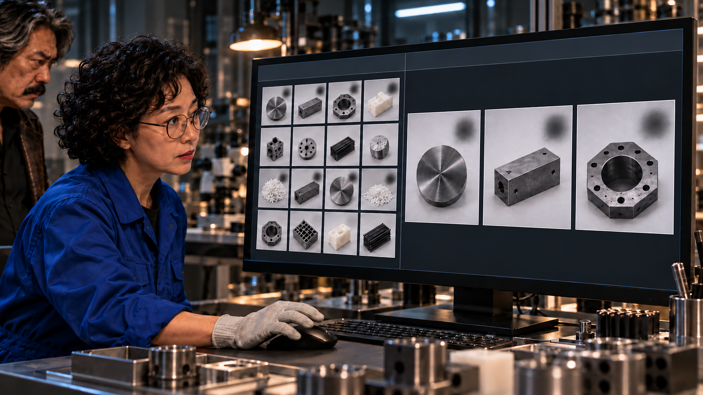

**첫 상태:** 모니터 왼쪽에는 다수의 서로 다른 제품 썸네일, 오른쪽에는 AI가 좁힌 후보 원본3장이 나란히 이미 보인다. 세 사진은 서로 다른 제품이며 같은 위치에 부드러운 어두운 가림이 있다. IN 손은 사람의 원본 겹침 조작 직전. 원인 판정은 없다.

**후속 동작:** IN이 이미 좁혀진 원본3장을 겹쳐 비교한다. 같은 위치를 지목하는 손과 DE가 장비로 돌리는 시선을 겹쳐 다음 컷으로 연결한다.

**후편집 자막:** AI가 모은 후보 3장 / 겹치니, 전부 같은 자리.

### C02_K04 · 13–17초

**첫 상태:** 천이 흐린 W 표면에 닿기 직전. 동일 시편은 지그에 고정, 모니터는 청소 전 가림이 있는 결과.

**후속 동작:** IN이 W를 닦고 촬영 버튼을 누른다. 모니터가 동일 시편의 가림 없는 결과로 바뀌며 DE가 고개를 끄덕인다.

**후편집 자막:** 닦고 다시 찍으니… 사라졌다.

### C02_K05 · 17–21초

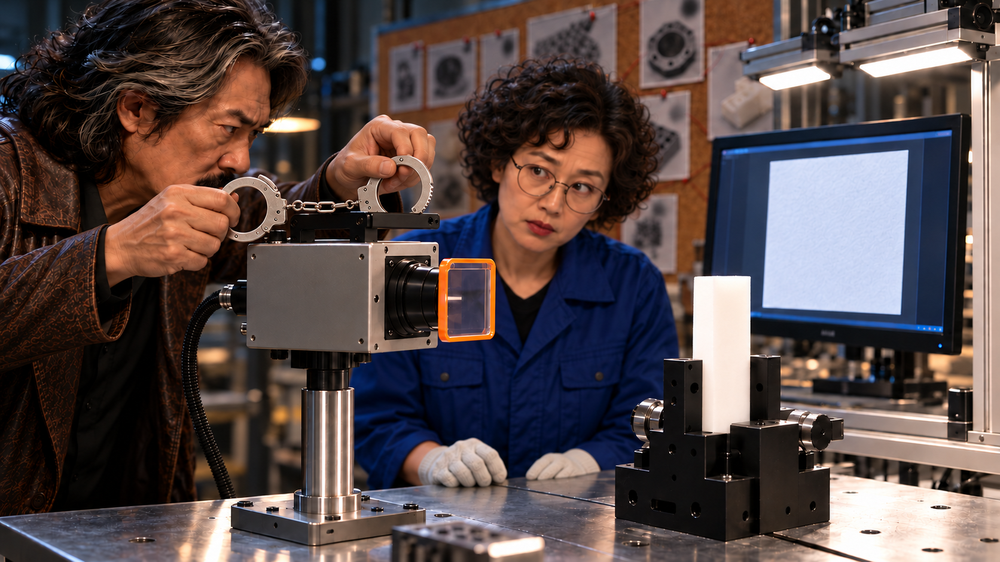

**첫 상태:** 수갑 첫 고리가 B 앞에서 열린 상태. 두 번째 고리는 DE 손에 있어 아직 W를 가리지 않는다.

**후속 동작:** DE가 첫 고리를 B에 잠그고 손을 놓는다. 다른 고리가 W 앞에 매달린다. 철컥 뒤 0.6초 무반응. H는 움직이지 않음, 발화 없음.

**후편집 자막:** 이제 못 움직여.

### C02_K06 · 21–24초

**첫 상태:** 고리가 W 앞에 걸려 있지만 모니터에는 아직 K04 깨끗한 이전 결과. IN 손은 촬영 버튼 위.

**후속 동작:** IN이 촬영하고 모니터에 새 흐린 고리 가림이 나타난다. IN이 실물 고리를 본 뒤 TE와 눈을 마주친다.

**후편집 자막:** 무자막

### C02_K07 · 24–27초

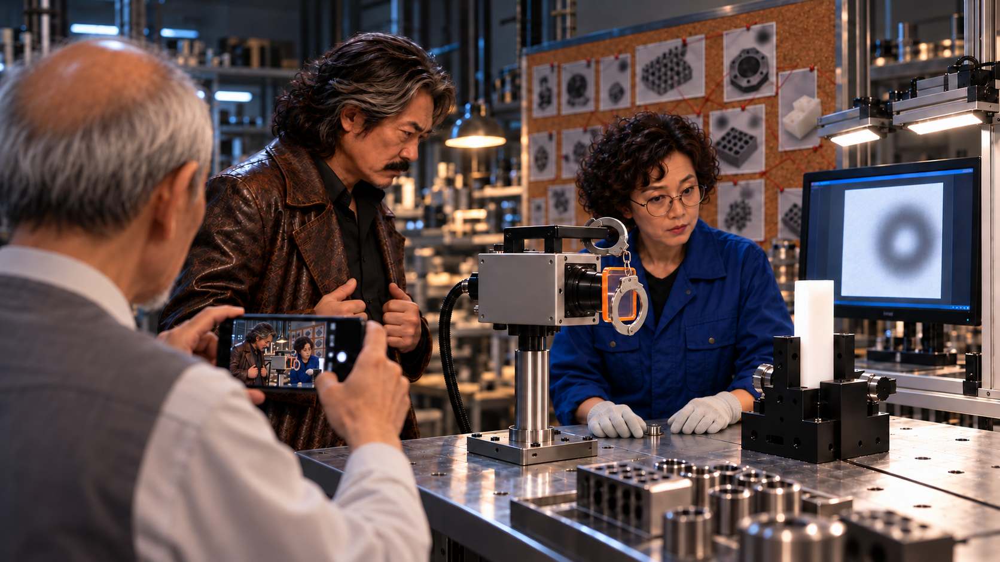

**첫 상태:** TE 휴대전화가 가슴 높이에서 올라가기 직전. DE는 아직 뿌듯한 자세, IN 손은 실물 고리를 가리키기 직전.

**후속 동작:** TE가 들어 한 번 촬영한다. DE는 늦게 전화 쪽으로 얼굴을 돌린다. IN이 고리를 확인해 준다.

**후편집 자막:** 새로운 사례 확보.

### C02_K08 · 27–31초

**첫 상태:** IN이 새 사진을 중앙에서 10cm 떨어진 곳에 들고 있다. 아직 벽에 붙이지 않았고 중앙은 비어 있다.

**후속 동작:** IN이 직접 사진을 붙인다. DE는 사진 속 자기 모습을 알아보고 눈이 멈춘다. 이 컷에서 말하거나 손을 뻗지 않는다.

**후편집 자막:** 무자막

### C02_K09 · 31–39초

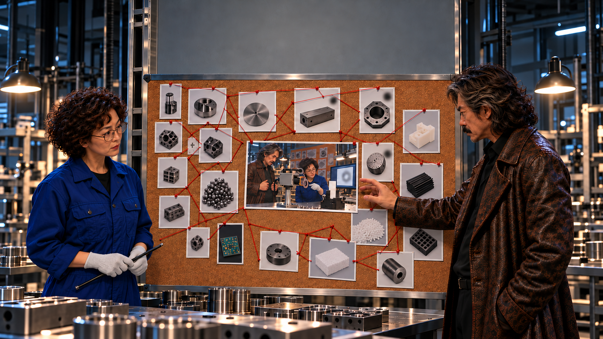

**첫 상태:** DE 손끝은 자기 사진 앞 10cm. IN의 포인터는 아직 허리 높이에 있고 중앙 사진은 붙어 있다.

**후속 동작:** IN의 포인터가 사진에 닿으면 DE가 떼려던 손가락을 펴 가장자리를 한 번 반듯하게 누른다. 그 손과 태연한 얼굴을 유지한다. 옷깃 정리·팔짱·추가 손짓은 넣지 않는다.

**후편집 자막:** 이 사례는 직접 설명하시죠. / Q-AI Fair
AI 실행의 과정까지, 함께 봐요.

## C03

**환경까지 가져왔습니다**

과정을 빠짐없이 보내 달랬더니 성공한 사무실이 통째로 온다. 끝인 줄 알자 실패했던 사무실도 온다.

### C03_K01 · 0–6초

**첫 상태:** 직원은 통화 중, 자료 위 손. 위 사무실은 안 보이고 정상 햇빛.

**후속 동작:** 요청 자막을 먼저 읽힘. 자료 위 컵 수면이 떨림→실제 공간을 지나는 그림자→위로 시선. 발화 불필요.

**후편집 자막:** 결과와 과정,
빠짐없이 보내주세요.

### C03_K02 · 6–10초

**첫 상태:** 청록 문틀 A가 공중에 고정, 케이블 팽팽. 직원·기사 옆 안전선 밖.

**후속 동작:** 모듈 조금 하강. 사람 위 이동 없음.

**후편집 자막:** 잘됐던 작업 환경까지 도착.

### C03_K03 · 10–13.5초

**첫 상태:** 직원이 회색 파일 옆에서 실행 전. 기사 양손 장갑, 종료 대기.

**후속 동작:** 큰 단순 도식 결과가 기준과 일치→R 끄덕임→기사의 장갑 벗은 끝 상태로 편집 가능. 정확한 장갑 탈착 전체를 필수 생성 요구로 삼지 않음.

**후편집 자막:** 이번 결과도 같네.

### C03_K04 · 13.5–20.5초

**첫 상태:** 설치 A왼쪽, 기사 벗은 장갑 소지. B아랫모서리 막 프레임 진입.

**후속 동작:** B 공개→기사가 장갑을 다시 준비하고 커프를 당겨 고정. 이미 확보한 실제 장갑 동작·상태 생략 허용, 전체 착용 재생성을 필수로 삼지 않음.

**후편집 자막:** 안 됐던 작업 환경도 도착.

### C03_K05 · 20.5–25초

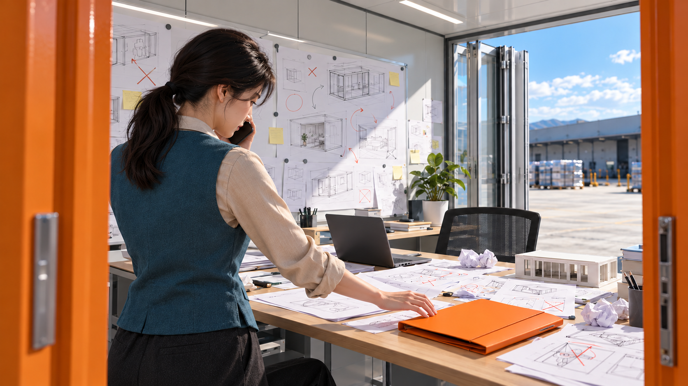

**첫 상태:** B 내부 이미 보임. R 왼손 평평한 검정 무선 스마트폰 귀에, 오른손 닫힌 주황 파일에 닿아 집기 직전. 꼬인 선·유선 수화기 없음.

**후속 동작:** R이 전화 상대 설명을 듣는 자세에서 주황 파일을 들어 기록을 살핀다. 보내는 동료 자막을 읽힌 뒤 기사 쪽으로 몸을 돌림. 질문·답변 립싱크 불필요.

**후편집 자막:** 보낸 동료: “안 됐던 과정도
빠짐없이 달라면서요.”

### C03_K06 · 25–30.75초

**첫 상태:** R은 이미 주황 파일을 손에 들고 일부 펼친 상태, 회색 파일은 테이블에 열려 있고 T가 운송장을 들고 있다. R에게 펜이 없다. 주황 표지 무늬는 내부 조건 기록의 증거가 아니다.

**후속 동작:** 주황 안쪽 기록을 회색 안쪽 기록과 비교. 일치 조건을 2초 유지한 뒤 운송장을 받지 않고 파일을 더 안는다. 펜·운송장 주고받기 없음.

**후편집 자막:** 안 된 과정에도
단서가 있네?

### C03_K07 · 30.75–36.75초

**첫 상태:** 처음부터 열린 마주 보는 패널. 직원은 표시된 회색·주황 파일 두 개를 이미 팔에 안고 통화 중. 기사는 벨트에 손 뻗기 전.

**후속 동작:** 직접 만나 확인하겠다는 자막에 기사가 두 방을 보며 벨트를 조인다. 직원은 두 파일을 한 팔에 유지하고 전화기를 든 손도 그대로 둔 채 몸을 출구로 돌린다. 이번에는 본인이 가겠다는 자막 뒤 기사의 손이 멈춘다.

**후편집 자막:** 해본 사람에게
물어봐야겠네요. / 이번엔 제가 가겠습니다.

### C03_K08 · 36.75–44.75초

**첫 상태:** 마주 보는 패널이 열린 두 방. 직원은 두 질문 기록을 안고 전경으로 나가려 함. 기사는 아직 서 있음. 하늘 무문자.

**후속 동작:** 직원이 작은 파일 두 개만 안고 퇴장한 뒤 기사가 기존 의자에 앉는다. 안전모는 머리에 유지하며 턱끈 조작은 요구하지 않는다. 제목 후편집.

**후편집 자막:** Q-AI Fair
AI 실행의 과정까지, 함께 봐요.

## C04

**목마는 식사 중입니다**

아무도 없는 선물이라던 트로이목마가 AI 문서 대조에서 식사 요청의 모순을 드러내고, 현장 확인 중 병사들의 밥그릇과 지휘관의 숟가락까지 쏟아진다.

### C04_K01 · 0–5초

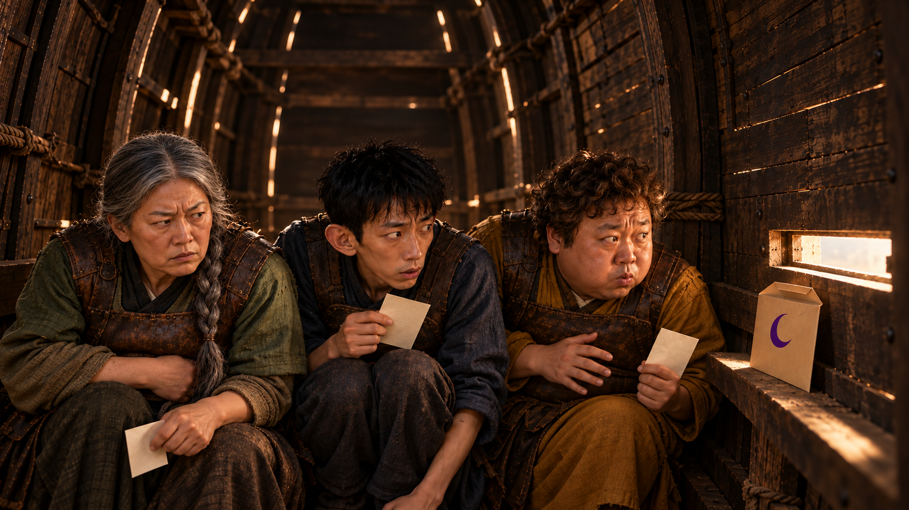

**첫 상태:** 병사 셋 긴장. 한 명의 빈손이 배 바로 위에서 누르기 직전. 다른 둘이 눈치를 볼 구도. 급식메모·초승달봉투는 무릎 높이. 그릇·숟가락 없음.

**후속 동작:** 한 병사가 배를 누르고 나머지 둘이 그를 쳐다본다. 꼬르륵 자막 뒤 급식 메모를 봉투에 넣음. 5초에서 복잡하면 마지막 메모 한 장 넣기만 보여 나머지는 이미 든 상태로 생략. 그릇·숟가락 비공개.

**후편집 자막:** 숨소리도 내지 마라. / 꼬르륵…

### C04_K02 · 5–8초

**첫 상태:** CM 손의 신고서·초승달 봉투가 RC 손 앞에 있다. 표지의 내부 탑승자 없음 문구를 후편집할 한 줄 영역. RC는 받기 전, 책상에는 다양한 다른 반입물 서류가 쌓여 있다.

**후속 동작:** CM이 봉투를 주고 RC가 원문을 책상에 두어 스캔 입력한다. 원본은 버리지 않는다.

**후편집 자막:** 신고: 내부 탑승자 없음

### C04_K03 · 8–11초

**첫 상태:** GU 손은 수레 손잡이, CM은 앞을 막기 직전. RC 태블릿은 아직 가슴 쪽을 향해 화면 내용 비공개.

**후속 동작:** CM이 수레 앞을 막고 근거를 요구하는 표정. RC가 태블릿을 돌린다. 한 줄 자막, 발화 없음.

**후편집 자막:** 아무도 없는데, 웬 배식?

### C04_K04 · 11–16초

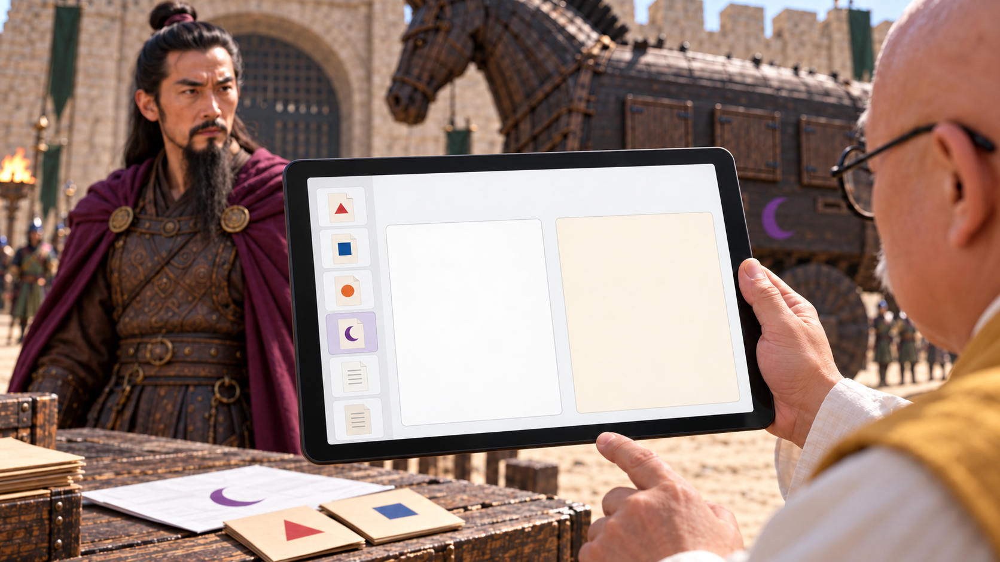

**첫 상태:** 태블릿 왼쪽 가장자리는 여러 반입물 목록, 가운데 큰 신고 원문 내부 탑승자 없음과 오른쪽 첨부 요청 식사·물·수저가 이미 나란히 보인다. AI 문서 대조의 확인 후보일 뿐 판정은 없음. RC 손가락은 두 구절을 짚기 직전.

**후속 동작:** RC가 태블릿의 모순 후보 두 곳만 차례로 짚는다. 작은 머리말 AI 대조·확인 필요와 큰 대조 카드 탑승자 없음↔수저 요청을 동시에 유지. CM이 목마 쪽을 곁눈질한다. 발화 없음.

**후편집 자막:** 탑승자 없음
↔ 수저 요청

### C04_K05 · 16–19초

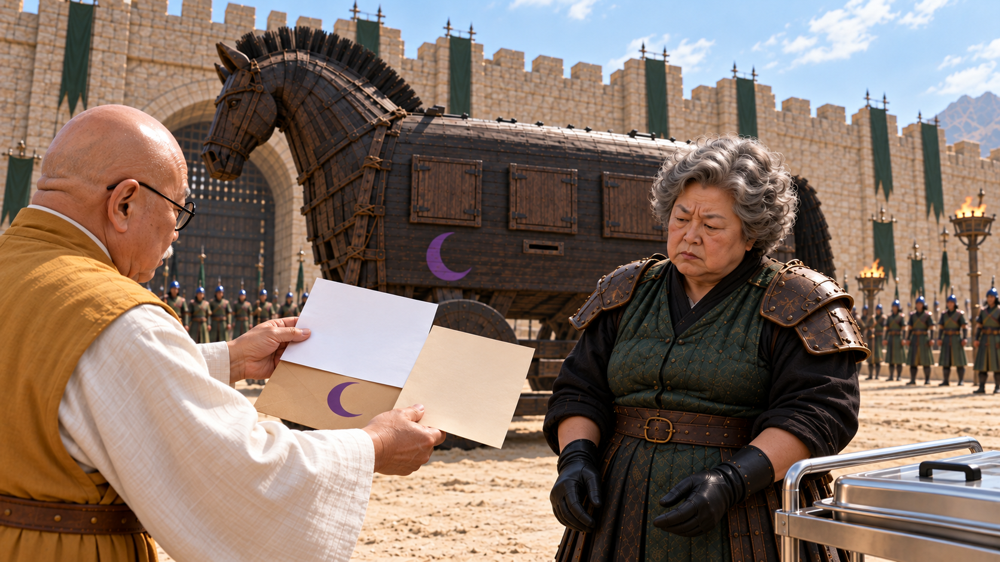

**첫 상태:** 실제 신고서와 급식 메모는 RC 손에 이미 펼쳐져 있다. 봉투·목마 초승달이 함께 보이고 GU는 원문을 보고 있다. GU가 원문 내용과 실물 표식을 확인하기 직전.

**후속 동작:** 이미 펼친 원문 두 장 유지. GU가 원문과 초승달을 확인한 뒤 수레를 봄. 다시 펼치거나 말하지 않음.

**후편집 자막:** 이 말, 수저를 씁니까?

### C04_K06 · 19–22초

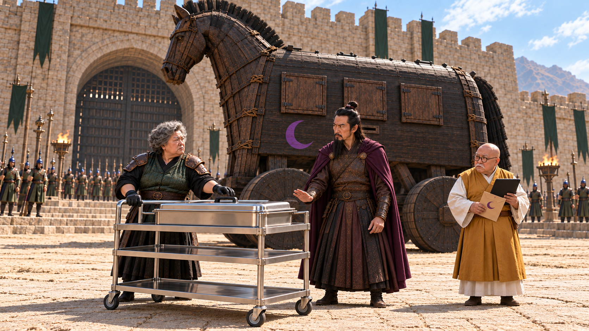

**첫 상태:** 수레 뚜껑은 닫혀 있고 GU 손은 손잡이 앞. CM의 막는 손은 아직 허리 높이.

**후속 동작:** CM이 손바닥으로 막으며 고개를 젓는다. 부인 자막을 읽힌 뒤 GU가 뚜껑 손잡이를 잡음. 패널은 닫힘.

**후편집 자막:** 안에는 아무도 없습니다.

### C04_K07 · 22–25초

**첫 상태:** GU가 닫힌 뚜껑 손잡이를 잡고 아직 열기 전. CM은 목마 쪽을 보며 음식에 반응하기 전.

**후속 동작:** GU가 뚜껑을 열어 김이 난다. CM 코가 미세하게 움직이고 목마 안의 숨소리가 겹친다.

**후편집 자막:** 무자막

### C04_K08 · 25–29초

**첫 상태:** 세 패널은 완전히 닫혀 있고 손·그릇·숟가락은 아직 안에 있다. 열린 수레에서만 김이 난다.

**후속 동작:** 정확히 창3개가 열리고 병사3명 각각 두 팔로 그릇1개·숟가락1개를 내민다. 총6팔·3그릇·3숟가락. 추가 사람/손 없음. CM은 부인하던 손을 못 내린다. 첫 그릇이 창 경계 밖으로 나오는 때가 음악 중단점이다.

**후편집 자막:** 무자막

### C04_K09 · 29–37초

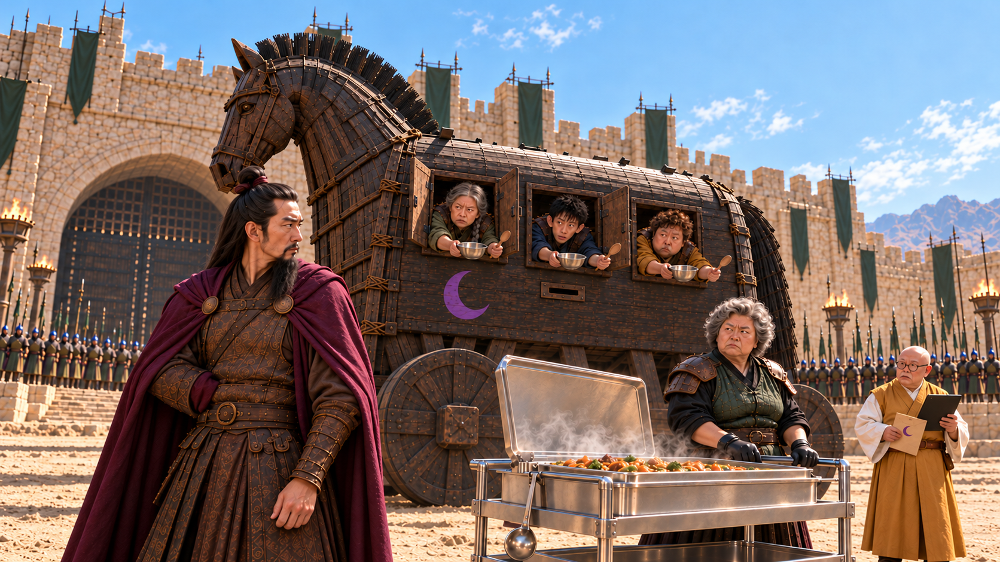

**첫 상태:** V7 S09_v2의 CM 전경·세 배식창·수레·인물 배치 유지. 병사 그릇3개는 이미 창밖. CM의 손은 망토 안에 있어 자기 숟가락은 아직 보이지 않는다. CM 시선은 GU를 향하고 턱은 정면의 권위 있는 자세이며 아직 더 들기 전. GU 국자는 수레 옆에 내려져 있다.

**후속 동작:** CM이 자기 숟가락을 망토에서 꺼내 턱을 듦. 공개 뒤 지휘관부터 자막. GU는 국자를 드는 시작만. 뒤 4.8초 행사명·시작 문구, 인물 무언.

**후편집 자막:** 지휘관부터. / Q-AI Fair
AI 실행 사례, 지금 시작합니다.

## C05

**괴수는 퇴근할 수 없다**

출입구를 독점하려 기둥을 뽑은 괴수가 새 기둥이 되고, 구조용인 줄 알았던 사다리에서는 행사 청취용 이어폰이 올라온다.

### C05_K01 · 0–4초

**첫 상태:** 괴수 입이 포효 직전 벌어져 있고 두 팔은 몸 옆. 앞왼쪽 기둥은 온전하며 포치 지붕은 수평.

**후속 동작:** 괴수가 포효 자세로 과시. 접수 선언 자막 뒤 실내 쪽으로 눈을 돌리고 기둥으로 손을 뻗음. 실내 소리를 들어야 동기가 이해되는 연출 제거.

**후편집 자막:** 이 입구는 내가 접수한다.

### C05_K02A · 4–11초

**첫 상태:** 기둥 온전·괴수 직립·손 접촉 직전.

**후속 동작:** 기둥을 빼 왼쪽 바닥에 놓고 손을 놓는다. 끝까지 직립, 지붕 수평, 두 손 자유.

**후편집 자막:** 무자막

### C05_K02B · 4–11초

**첫 상태:** 기둥 왼쪽 바닥·괴수 직립·양손 자유·목과 무릎 접기 전·지붕 수평.

**후속 동작:** 출입구를 자기 몸으로 막으려고 목·무릎을 접어 빈자리로 들어가 양팔을 벌린다. 다음 컷에서 양팔이 지붕 지지가 된다.

**후편집 자막:** 무자막

### C05_K03 · 11–15초

**첫 상태:** 괴수는 무릎을 굽히고 긴 목을 S자로 접은 채 두 팔을 승리 자세로 든다. 지붕이 막 기울기 시작했고 양손은 아직 닿지 않았다. 귀는 약 4.2m 높이.

**후속 동작:** 지붕이 더 기울기 시작하자 괴수가 양손으로 앞 가장자리를 받쳐 멈춘다. 머리·몸에 충돌하지 않는다.

**후편집 자막:** 무자막

### C05_K04 · 15–20초

**첫 상태:** FM이 접힌 받침대를 굴려 멈추기 직전. 괴수는 무릎과 긴 목을 S자로 접은 같은 크기로 지붕을 받치며 왼쪽 길을 본다. 정수리 4.5m·귀 4.2m 기준.

**후속 동작:** FM이 잭을 끝까지 올려 짧음을 확인하고 놓지 말라는 두 손을 듦. 그 뒤 부탁 자막. 괴수는 나갈 길을 흘겨보지만 지지 유지.

**후편집 자막:** 조금만 더 잡아주세요.

### C05_K05 · 20–26초

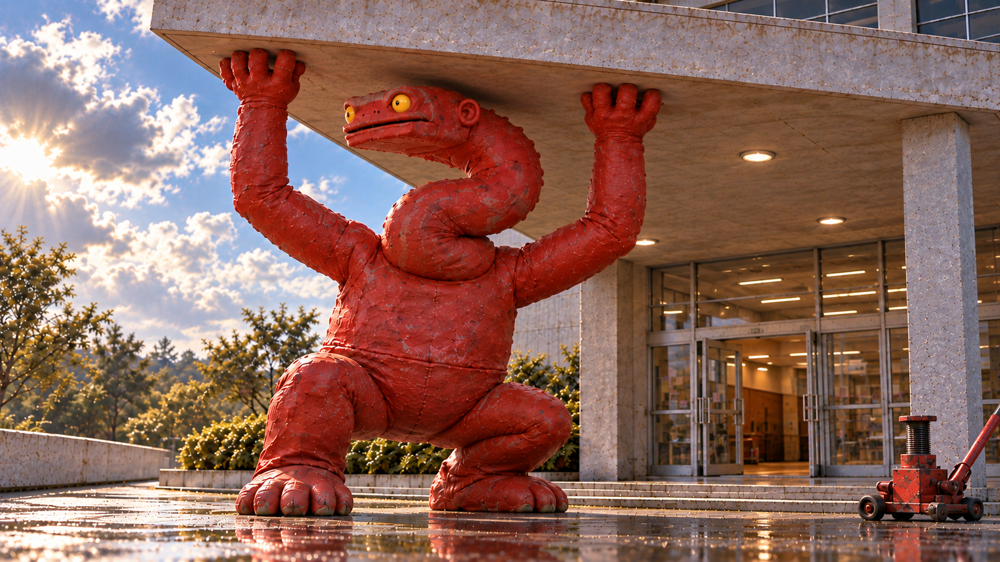

**첫 상태:** 괴수는 무릎·긴 목을 S자로 접은 같은 지지 자세. 양손이 지붕을 받치고 귀는 약 4.2m. 눈만 열린 문으로 돌아가 귀를 기울이기 직전.

**후속 동작:** 앞 3.6초 양손 지지 유지하며 발표 예고 자막. 뒤 2.4초 눈만 문 쪽으로 이동하고 눈꺼풀이 조금 열림→고개를 기울이다 지붕이 조금 움직여 즉시 복귀. 개과천선이 아니라 기다리던 중 생긴 호기심. 필수 안내 음성 없음.

**후편집 자막:** 잠시 후, AI 실행 사례 공개

### C05_K06 · 26–30초

**첫 상태:** 실제 PNG의 사다리는 이미 긴 길이로 펴져 있다. TE가 하부를 이동·고정하기 직전이며 새로 늘리거나 조립하지 않는다. 이어컵은 이 구도에서 보이지 않는다.

**후속 동작:** 이미 펴진 사다리의 하부를 TE가 바깥 지면에서 밀어 위치를 맞추고 지지대·바퀴 브레이크를 고정한다. 귀 높이는 그대로, 사다리 연장·조립 없음. 괴수는 목을 펴지 않고 눈만 따라간다.

**후편집 자막:** 무자막

### C05_K07 · 30–35초

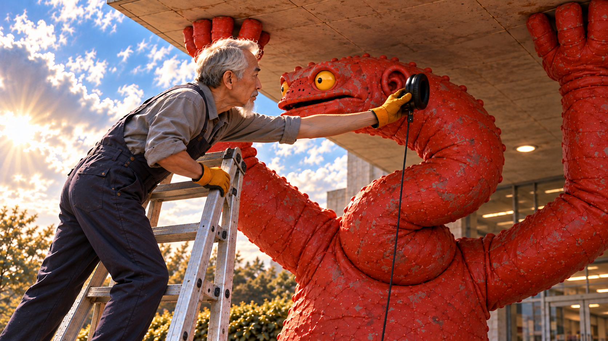

**첫 상태:** 주둥이 왼쪽·보이는 귀는 머리 오른쪽으로 와이드와 같은 축. TE가 검정 이어컵을 그 귀 바로 옆에 띄워 든 미장착 상태. 양손 지붕 지지 유지.

**후속 동작:** TE가 같은 먼쪽 귀에 이어컵·뒤끈을 건다. 실체를 먼저 보여준 뒤 아래 FM의 들리세요? 자막. 괴수 한 번 깜빡임. 발화 없음.

**후편집 자막:** 들리세요?

### C05_K08 · 35–43초

**첫 상태:** 괴수의 S자 목·굽힌 무릎·두 손 지지는 그대로. 이어컵은 연결 완료, 눈은 아래 FM을 향해 잘 들린다는 답을 보내려는 표정. 오른손 손목은 아직 펴져 있고 손가락도 지붕을 잡고 있다.

**후속 동작:** 35–38초 오른손 엄지 답신 시도→지붕 흔들림→다시 잡기→작은 끄덕임. 38–42.8초 손 고정 상태에 행사명·시작 문구. 필수 안내 음성 없음.

**후편집 자막:** Q-AI Fair
AI 실행 사례, 지금 시작합니다.

## C06

**퇴근 좀 해주세요**

사람을 쫓아내려던 유령이 업무 보조로 쓰이다 AI 활용 사례를 배워 직원의 남은 일을 끝내게 했더니, 다른 유령들의 상담 창구가 된다.

### C06_K01 · 0–5초

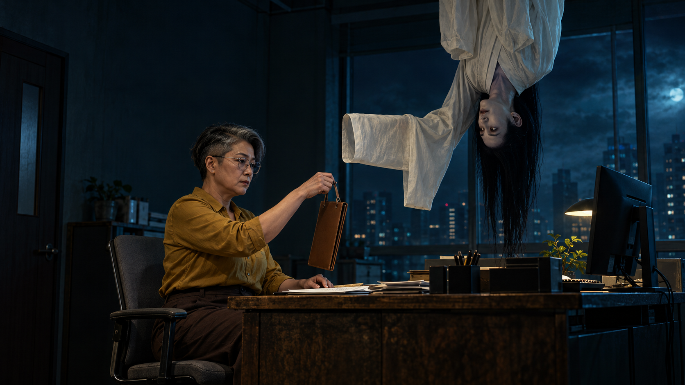

**첫 상태:** 책상 위쪽에서 GH가 정상 목을 유지한 거꾸로 공중 자세로 내려오기 직전. 얼굴은 머리카락 사이로 보인다. 한쪽 소매로 덮인 팔뚝을 수평으로 뻗고 손목을 조금 들어 불길하게 WO 쪽으로 내민다. WO는 닫힌 서류철의 고리 손잡이를 들고 있으며 아직 팔에 걸지 않았다.

**후속 동작:** GH가 천천히 얼굴을 가까이 내밀자 WO가 수평으로 내민 소매 덮인 팔뚝에 서류철의 고리 손잡이를 건다. GH의 눈만 매달린 서류철을 향한다.

**후편집 자막:** 이제 좀 나가라.

### C06_K02 · 5–10초

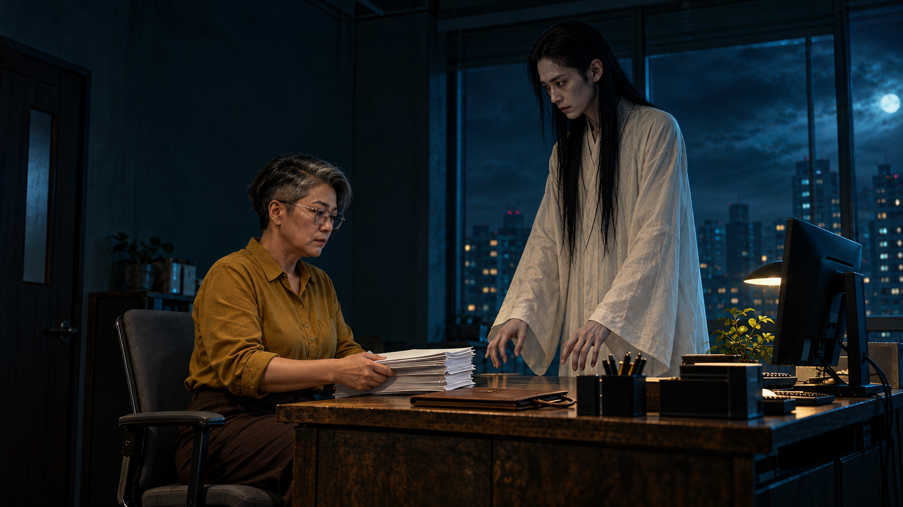

**첫 상태:** GH가 이제 정상 방향으로 책상 반대쪽에 서서 두 손을 책상 가장자리에 대기 직전. WO 앞에는 끝이 조금 어긋난 두꺼운 종이 묶음이 놓여 있다.

**후속 동작:** GH가 책상을 한 번 짧게 흔든다. WO는 종이 묶음 끝을 책상에 대어 반듯하게 맞춘 뒤, 고개만 작게 끄덕인다. GH가 흔들던 손을 멈춘다.

**후편집 자막:** 고마워요.

### C06_K03 · 10–14초

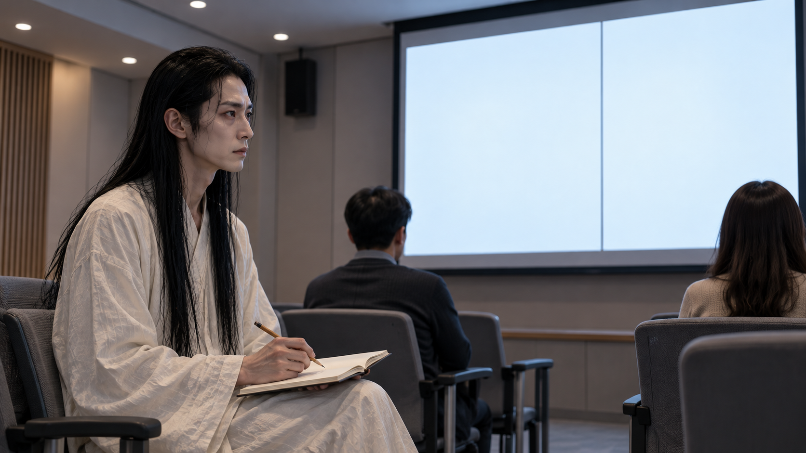

**첫 상태:** 밝은 소규모 발표 공간. GH가 앞줄 끝 의자에 똑바로 앉아 열린 무지 수첩 위로 연필을 들고 있다. 오른쪽의 큰 깨끗한 화면은 후편집용 두 단 빈 패널. 화면과 GH 얼굴이 함께 보인다. 다른 참석자는 멀리 보이는 뒷모습 두 명만.

**후속 동작:** GH가 화면과 수첩을 번갈아 보고 한 줄을 적는다. 발표 화면에는 후편집으로 기록 분류→원문 대조의 두 단계가 차례로 강조된다.

**후편집 자막:** Q-AI Fair
AI로 기록을 정리한 과정

### C06_K04 · 14–19초

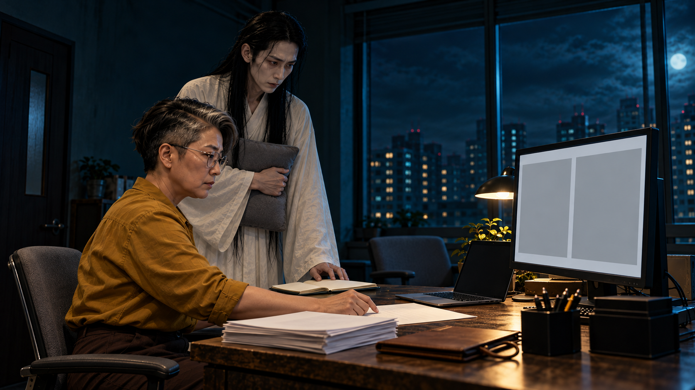

**첫 상태:** 원래 밤 사무실. GH가 K03의 수첩을 책상에 펼쳐 놓고, 다른 팔에는 휴식 의자의 회색 쿠션을 미리 안고 있다. WO는 모니터의 빈 분류 패널 옆에 원본 종이를 펴고 손끝으로 한 항목을 짚기 직전이다.

**후속 동작:** WO가 AI 분류 제안의 한 항목과 원본의 같은 표시를 대조한다. GH는 끝난 줄 알고 쿠션을 베개처럼 얼굴 옆에 대며 눕기 준비를 하다, WO가 확인할 두 번째 표시로 손을 옮기자 바로 멈춘다. 마지막 확인 표시는 WO가 직접 한다. 한 묶음 외 다른 업무는 저절로 처리되지 않는다.

**후편집 자막:** 이 한 건만 확인하면 끝.

### C06_K05 · 19–23초

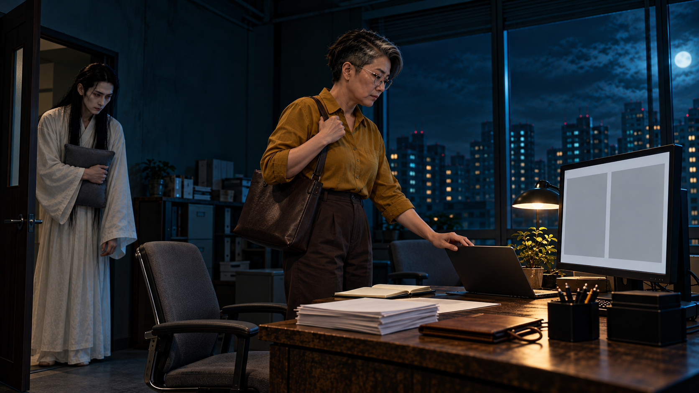

**첫 상태:** 원문 대조를 마친 WO가 닫기 직전인 노트북 위에 손을 올리고 있다. 책상에는 확인한 서류가 남아 있고 가방은 이미 어깨에 걸었다. GH는 출입문 옆을 비켜 선다.

**후속 동작:** WO가 노트북을 닫고 왼쪽 문 밖으로 걸어 나간다. GH는 문이 닫히는 것을 끝까지 지켜본다.

**후편집 자막:** 오늘 남은 일, 끝.

### C06_K06 · 23–27초

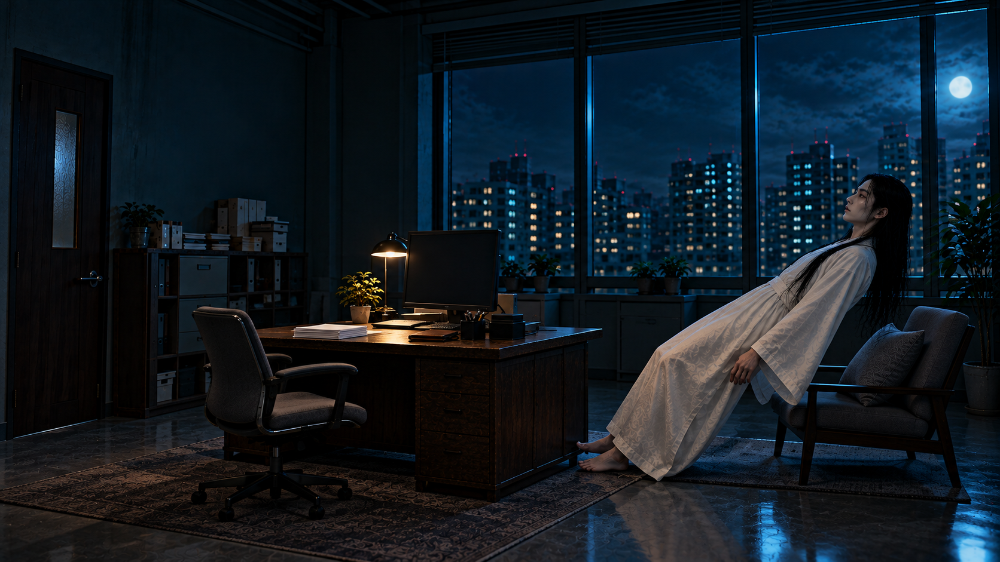

**첫 상태:** 사람이 떠난 사무실. GH가 책상 옆 낮은 휴식 의자 위로 천천히 몸을 눕히려는 반쯤 기대 선 자세다. 작은 회색 쿠션은 이미 의자에 놓였다. 문은 닫힘.

**후속 동작:** GH가 의자 바로 위에 몸을 길게 띄우며 눈을 감는다. 긴 수의는 정상 중력처럼 아래로 드리워지고 문 쪽 소리에 반응해야 할 필요는 없다.

**후편집 자막:** 드디어, 내 시간.

### C06_K07 · 27–32초

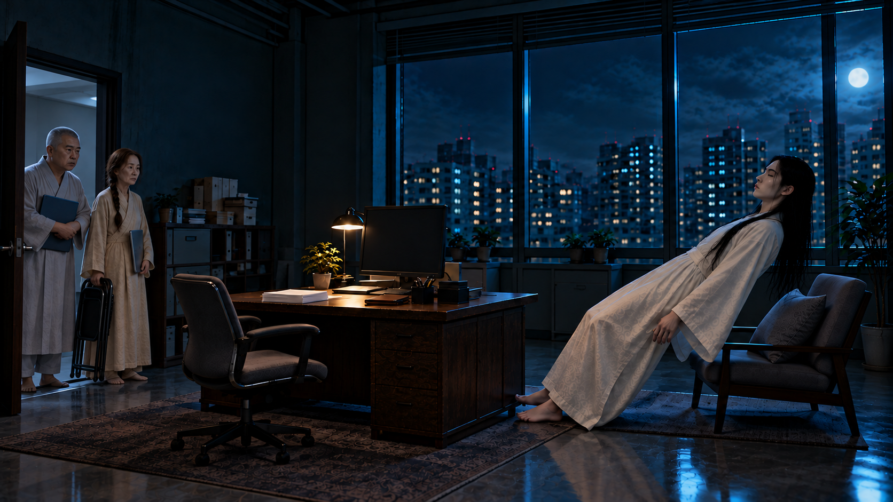

**첫 상태:** 왼쪽 문이 조금 열려 G2와 G3가 문턱 밖에 서 있다. G2는 닫힌 남색 노트북, G3는 회색 노트북과 접힌 의자를 들었다. GH는 오른쪽에서 반쯤 누운 자세로 눈을 뜨기 직전.

**후속 동작:** G2와 G3가 문 안으로 한 걸음 들어와 닫힌 노트북을 조심스럽게 내민다. GH는 몸을 일으키려다 멈추고 두 노트북을 번갈아 본다.

**후편집 자막:** 방금 나간 사람,
어떻게 내보냈어요?

### C06_K08 · 32–36초

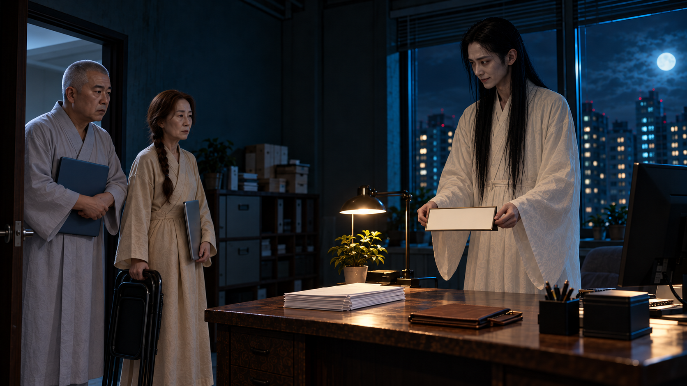

**첫 상태:** GH가 책상 뒤에 서서 작은 무지 탁상 팻말을 손에 들고 있다. G2는 노트북을 안고, G3는 접힌 의자를 든 채 책상 앞에 기다린다.

**후속 동작:** GH가 팻말을 두 방문자 쪽으로 반듯하게 세우고 두 손을 모은다. 팻말에는 후편집으로 질문을 행사로 돌리는 문구를 넣는다. G3는 의자를 아직 펴지 않는다.

**후편집 자막:** 질문은 Q-AI Fair에서.

### C06_K09 · 36–44초

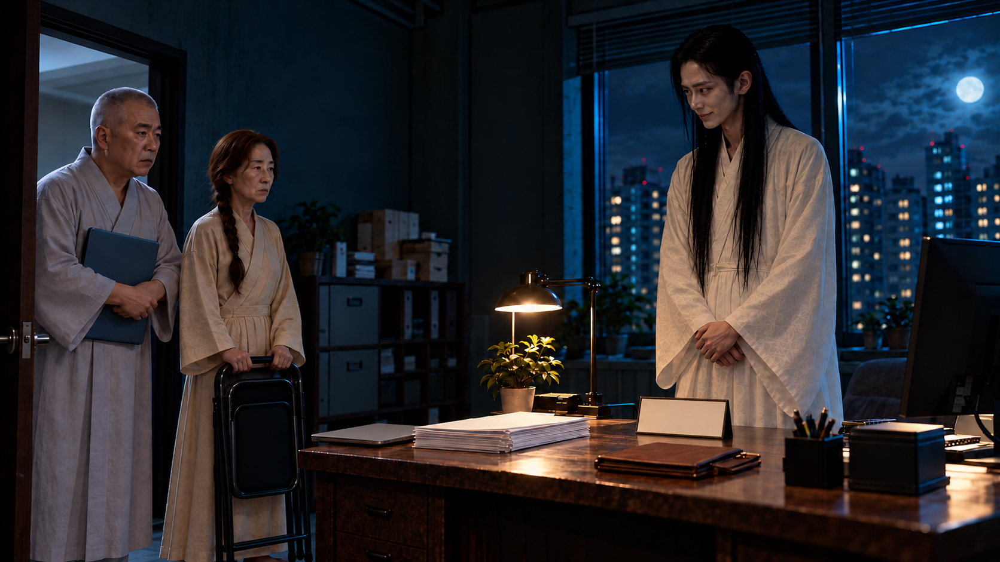

**첫 상태:** 팻말이 책상에 서 있다. G3의 닫힌 회색 노트북은 책상 왼쪽에 내려놓았다. G3가 접힌 의자의 양쪽을 잡고 펴기 직전이고 G2는 옆에서 남색 노트북을 안고 차례를 기다린다. GH는 정중한 미소를 유지하려 한다.

**후속 동작:** G3가 의자를 펴고 조용히 앉는다. GH의 미소가 굳는다. 마지막에는 G2가 여전히 서서 기다리는 상태를 유지하고 행사명·연결 문구를 후편집한다.

**후편집 자막:** Q-AI Fair
직접 해본 방법을 함께 봐요.

## C07

**결투 시간을 뺏긴 여자**

상대를 독점하려 줄을 던진 총잡이가 질문자들까지 자기 앞으로 데려오고, 결국 맨 앞에서 필기하면서도 결투의 폼을 버리지 못한다.

### C07_K01 · 0–5초

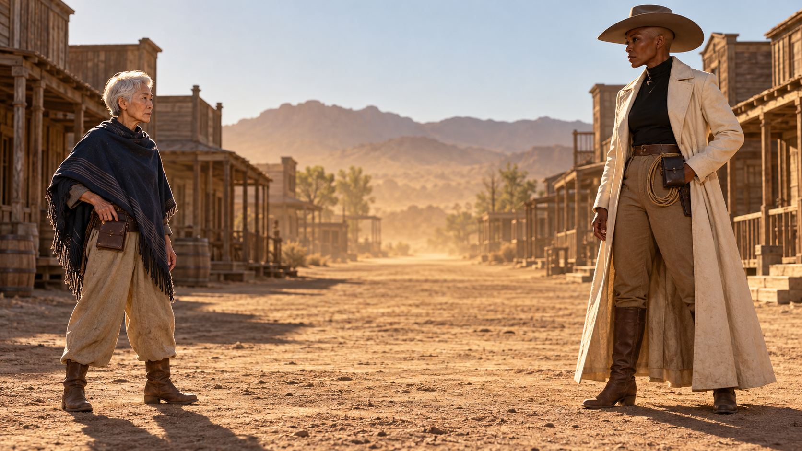

**첫 상태:** CW가 화면 오른쪽에서 긴 코트 자락을 뒤로 열고 대치. 왼쪽 EX는 닫힌 작은 가죽 수첩이 걸린 허리 파우치에 손을 대기 직전. 둘 사이 먼지 낀 빈 길.

**후속 동작:** EX가 허리에서 가죽 수첩을 꺼내 펼친다. CW의 손은 허리 옆에서 그대로 멈추고 눈만 수첩으로 내려간다.

**후편집 자막:** 오늘은 둘이 끝내자.

### C07_K02 · 5–10초

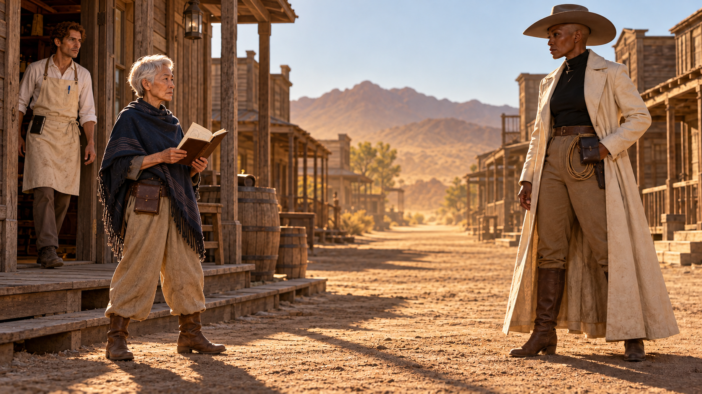

**첫 상태:** EX가 펼친 수첩을 가슴 높이에 들고 있다. Q1이 왼쪽 가게 문에서 한 발을 내딛기 직전. CW는 오른쪽에서 EX를 바라본다.

**후속 동작:** Q1이 둘 사이에 들어와 EX의 수첩을 가리킨다. CW가 EX 얼굴을 보려고 몸을 옆으로 반 걸음 옮긴다.

**후편집 자막:** AI로 직접 해봤다면서요?

### C07_K03 · 10–14초

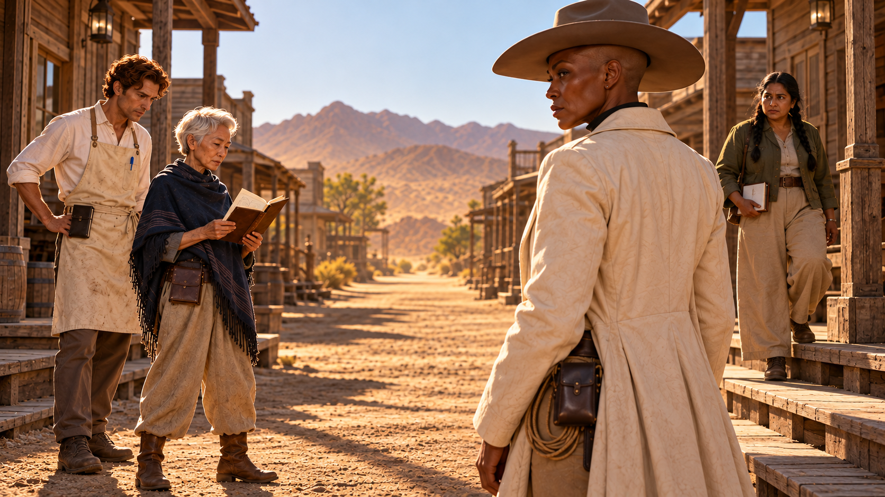

**첫 상태:** CW가 옆으로 이동해 EX를 겨우 다시 보고 있다. Q2가 반대쪽 보도에서 작은 흰 수첩을 들고 길로 발을 내딛기 직전. EX와 Q1은 열린 가죽 수첩을 보고 있다.

**후속 동작:** Q2가 CW의 새 시야를 가로질러 EX 앞으로 다가가 기록 한 곳을 가리킨다. CW가 다시 옆으로 몸을 기울이지만 세 사람이 겹쳐 보인다.

**후편집 자막:** 어디를 고쳤어요?

### C07_K04 · 14–17초

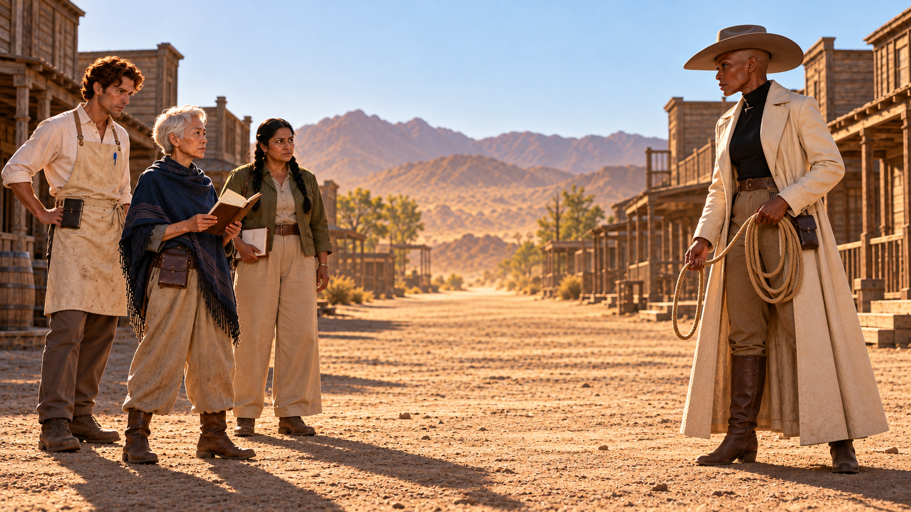

**첫 상태:** CW가 오른손에 느슨한 줄 고리를 어깨보다 낮게 들고, 왼손으로 나머지 줄을 잡는다. 왼쪽 EX는 수첩을 두 손으로 받친 채 고개만 CW 쪽으로 돌린다. 두 사람 사이 바닥은 비어 있다.

**후속 동작:** CW가 줄 고리를 EX 발 앞 빈 바닥에 던진다. 빈 오른손으로 EX 한 사람만 가리킨 뒤 자기 앞 빈자리를 짚는다. EX가 고개를 한 번 끄덕인다. 줄은 누구의 몸에도 걸리지 않는다. 준비 대기 없이 동작을 연결한다.

**후편집 자막:** 당신만 이쪽으로.

### C07_K05 · 17–20초

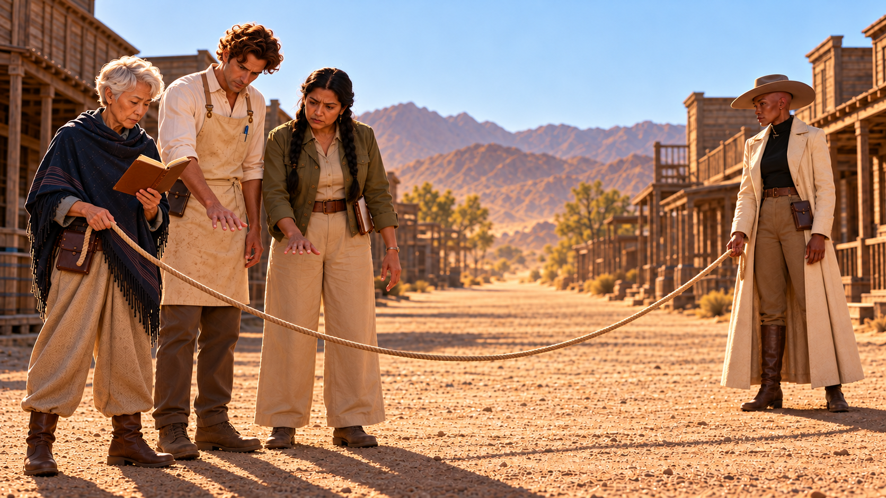

**첫 상태:** EX가 바닥에서 집은 줄 끝을 한 손으로 느슨하게 잡고, 다른 손으로 열린 수첩을 Q1에게 보여준다. Q1/Q2는 줄 뒤쪽으로 각각 손을 내밀기 직전. CW는 멀리서 줄 반대 끝을 잡고 있다.

**후속 동작:** EX가 한 손에 든 열린 수첩을 CW 쪽으로 돌린다. Q1은 보던 페이지를 놓치지 않으려고 몸을 따라 돌리며 바로 앞 느슨한 줄을 가볍게 잡는다. Q2도 시선을 수첩에 둔 채 다른 구간을 잡는다. EX는 페이지를 넘기거나 추가 손으로 가리키지 않는다.

**후편집 자막:** 잠깐, 그다음은요?

### C07_K06 · 20–24초

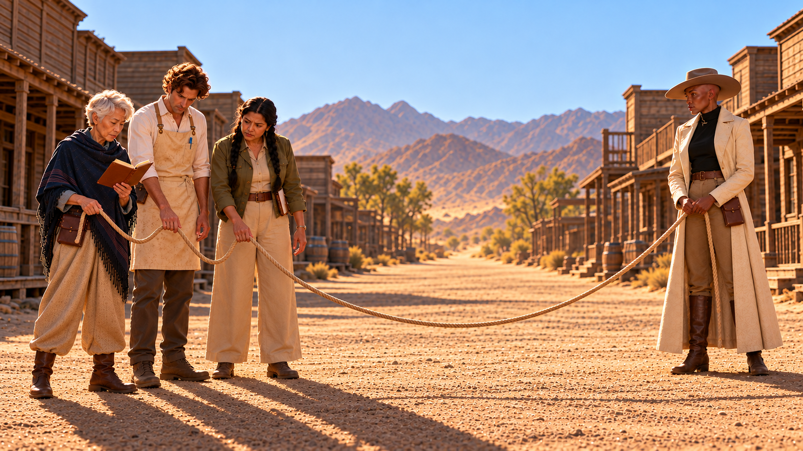

**첫 상태:** 오른쪽 CW가 줄 끝을 두 손으로 잡아 자기 쪽으로 안내하듯 당기기 직전. 왼쪽 세 사람은 수첩을 둘러보고 자기 발로 걷기 직전. 줄은 가볍게 늘어져 있다.

**후속 동작:** CW가 줄을 자기 쪽으로 안내한다. EX가 먼저 자기 발로 걷고 Q1·Q2가 수첩을 보려고 함께 걷는다. CW는 세 사람이 함께 오는 것을 보고 한 걸음 물러나며 느슨한 줄을 거둔다. 도착한 질문자 둘이 다시 시야를 가린다. CW가 틈으로 고개를 내밀다 멈추는 마지막 0.6초를 남긴다. 긴 이동의 중간 대기는 편집에서 덜어낸다.

**후편집 자막:** 무자막

### C07_K07 · 24–28초

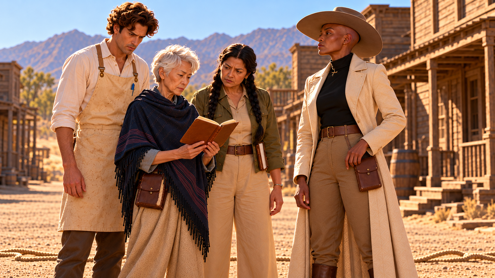

**첫 상태:** CW가 자기 허리 파우치에서 작은 검정 수첩을 꺼내기 직전. EX가 앞에서 펼친 가죽 수첩을 보여주고 Q1/Q2는 양옆에서 기다린다. 줄은 바닥.

**후속 동작:** CW가 작은 수첩과 노란 연필을 꺼내 가장 앞에서 적을 준비를 한다. 고개를 숙이지 않고 결투 때처럼 턱을 높인 채 EX에게 한 줄을 요청한다.

**후편집 자막:** 그 부분부터 다시.

### C07_K08 · 28–33초

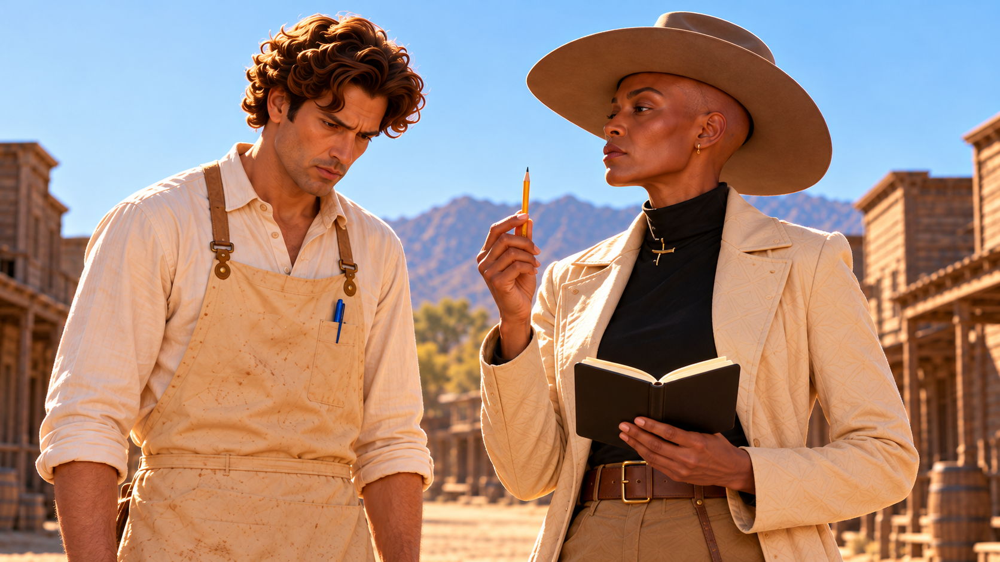

**첫 상태:** CW가 왼손에 열린 검정 수첩을 들고 오른손 엄지와 검지 사이에 짧은 노란 연필을 세워 돌리기 직전. Q1의 파란 볼펜은 아직 앞치마 주머니에 있다.

**후속 동작:** CW가 연필을 한 번 멋있게 돌리려다 화면 옆으로 놓친다. 빈손을 보는 0.5초 뒤 Q1이 평범한 파란 볼펜을 내민다. CW는 모자를 고치거나 웃지 않는다.

**후편집 자막:** 무자막

### C07_K09 · 33–39초

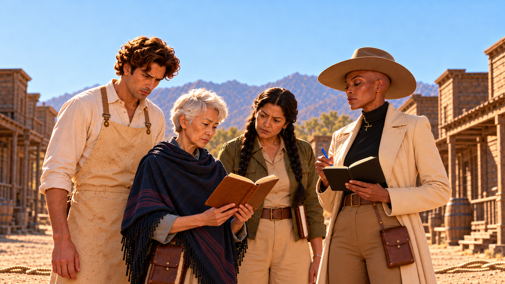

**첫 상태:** CW가 빌린 파란 볼펜을 손에 쥐고 검정 수첩 첫 줄 위에 대기 직전. EX가 가죽 수첩을 그쪽으로 기울이고, Q1/Q2도 함께 들여다본다.

**후속 동작:** CW가 턱은 높인 채 볼펜으로 한 줄을 적는다. EX는 다음 항목을 가리키고 둘은 조용히 고개를 맞댄다. 마지막에는 네 사람의 작은 학습 원을 유지한다.

**후편집 자막:** Q-AI Fair
직접 해본 이야기를 함께 봐요.

## C08

**이 오페라는 끝났습니다**

커튼콜을 독점하려던 오페라 주역이 무대 뒤를 가리켰다가 과정이 주인공이 되고, 재등장용 망토까지 과정 화면의 차광막으로 쓰인다.

### C08_K01 · 0–4초

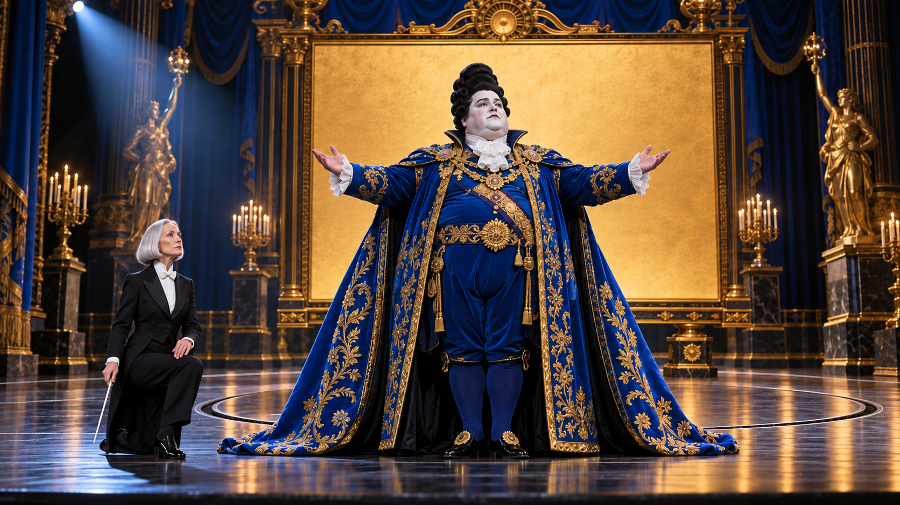

**첫 상태:** 금빛 결과판 앞에 OP가 양팔을 크게 벌린 채 인사하기 직전. CO는 앞무대 왼쪽에서 지휘봉을 내리고 한쪽 무릎을 낮추려 한다. 망토 겉감이 넓게 보이고 뒤 작업 공간은 전혀 보이지 않는다.

**후속 동작:** OP가 과장된 큰 인사를 한 번 한다. CO도 진지하게 몸을 낮춘다. OP가 천천히 일어나 피날레가 끝났다는 얼굴을 만든다.

**후편집 자막:** AI 적용 결과

### C08_K02 · 4–9초

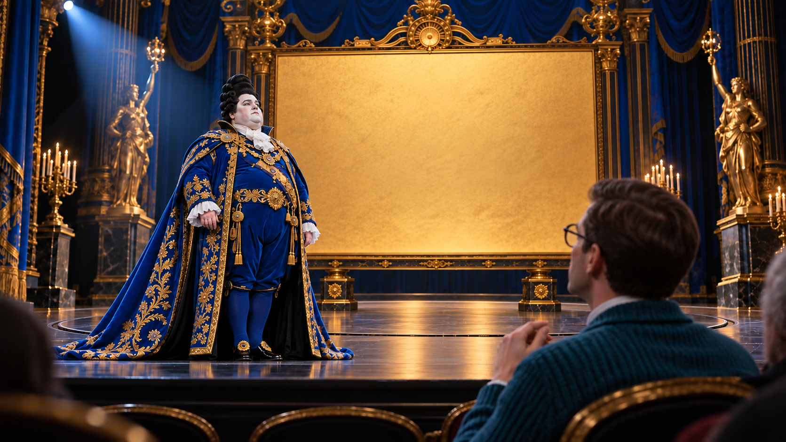

**첫 상태:** AU가 객석 앞줄에서 한 손을 가슴 높이로 들기 직전. 화면 후경 왼쪽 OP가 퇴장 방향으로 발을 돌린 상태지만 아직 떠나지 않았다.

**후속 동작:** AU가 손을 들고 OP를 본다. OP는 발을 멈추고 자신 있게 엄지로 막 뒤를 가리킨다. 입을 움직여 설명하지 않는다.

**후편집 자막:** 그런데,
어떻게 하셨어요?

### C08_K03 · 9–13초

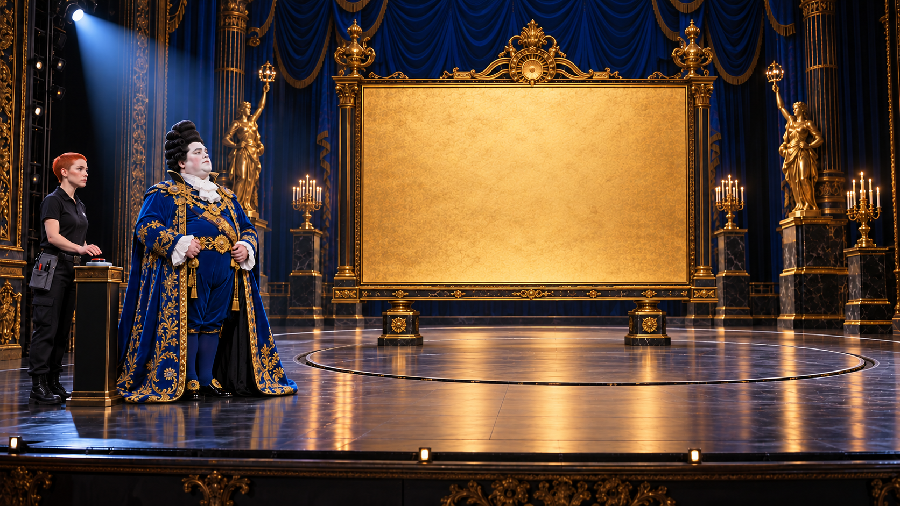

**첫 상태:** ST가 고정 앞무대 왼쪽 조작 버튼 위에 손을 대기 직전. 중앙 회전 세트는 여전히 금빛 앞면. OP는 왼쪽 고정 앞무대에서 망토를 모아 들고 있다.

**후속 동작:** ST가 버튼을 누르자 회전 세트가 약45도 돌아가기 시작한다. 객석의 시선이 세트로 빠지는 순간 OP가 고정 앞무대에서 한 걸음 옮겨 자기 정면을 다시 내밀지만, 시선은 돌아가는 세트를 따라간다. 뒤 책상 일부만 나타나고 전체는 다음 컷에 공개한다.

**후편집 자막:** 무자막

### C08_K04 · 13–18초

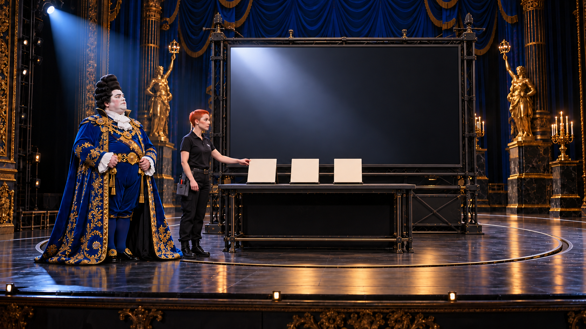

**첫 상태:** 회전이 완료되어 뒷면 작업 책상과 큰 작업 화면이 객석을 향한다. ST는 세 개의 무지 작업 카드 앞에 손을 들기 직전. OP는 화면 왼쪽 옆으로 돌아와 있고, 고정 왼쪽 조명의 반사가 화면 한쪽을 밝게 가린다.

**후속 동작:** ST가 첫 시도·수정 표시·적용본의 세 카드를 차례로 짚는다. 동일한 세 단계 도해가 작업 화면에 이미 있지만 좌상 조명의 반사가 가운데 수정 흔적 일부를 가린다. ST가 읽기 불편한 곳으로 시선을 한 번 옮긴다. CO와 AU의 시선은 OP에서 작업 화면으로 이동한다.

**후편집 자막:** 입력 → 확인·수정 → 적용

### C08_K05 · 18–23초

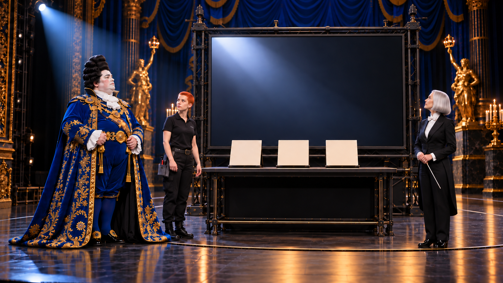

**첫 상태:** OP가 작업 화면 왼쪽 옆에서 망토 양끝을 손에 모아 쥔 상태. ST는 반사 때문에 화면을 보다가 OP 쪽으로 고개만 돌린다. CO는 작업 화면에 집중한다.

**후속 동작:** OP가 아무도 자기를 보지 않는 것을 눈으로 확인하고 한 걸음 앞으로 나서 망토를 거대한 부채처럼 펼친다. 검정 안감이 드러나고 ST가 그 넓은 어두운 면을 발견한다. 망토는 관객의 화면 시야를 막지 않는다. 이 컷에는 반사가 아직 남아 있다.

**후편집 자막:** 아직 제 장면입니다.

### C08_K06 · 23–29초

**첫 상태:** OP가 양팔을 벌려 망토를 크게 펼친 상태. ST의 손은 관객 쪽 자유 망토 끝에 닿기 직전. 왼쪽 위 빛이 아직 작업 화면에 반사되고 있다.

**후속 동작:** ST가 자유 망토 끝을 조명 쪽으로 들어 올리고 OP도 따라 팔을 높인다. 검정 안감이 고정 좌상 조명과 작업 화면 사이 빛길에 들어선다. 후편집에서 천 뒤로 향하는 광선과 같은 도해 위 반사를 동시에 줄인다. 도해를 새로 켜거나 바꾸지 않는다. 화면이 선명해진 상태를 마지막1초 유지하며 관객의 화면 시야는 가리지 않는다.

**후편집 자막:** 무자막

### C08_K07 · 29–33초

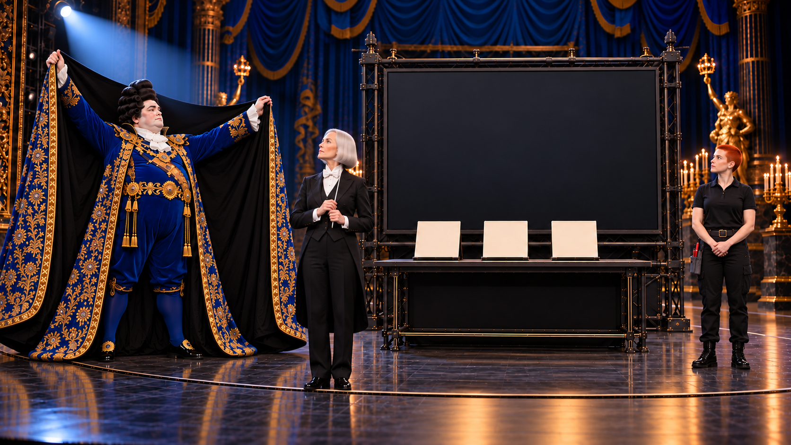

**첫 상태:** CO가 망토를 들고 있는 OP와 작업 화면 사이 앞무대에 서 있다. 지휘봉은 가슴 높이에서 멈춰 있고 아직 어느 쪽도 가리키지 않는다. ST는 작업 화면 옆에 준비.

**후속 동작:** CO가 작업 화면을 지휘봉으로 정중하게 가리킨다. OP가 그 끝을 따라 보다가 이미 높아진 팔을 조금 더 벌려 망토를 팽팽하게만 한다. 차광된 빛과 같은 도해를 유지하며 두 번째 차광 효과를 만들지 않는다.

**후편집 자막:** 이제, 과정을 보겠습니다.

### C08_K08 · 33–41초

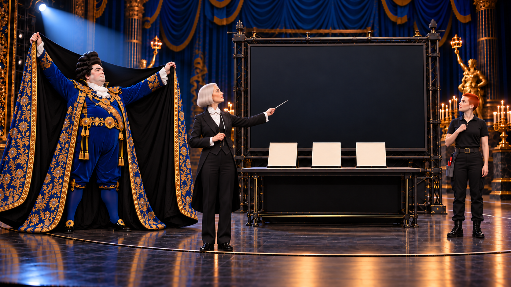

**첫 상태:** OP가 망토를 차광막으로 유지하며 턱을 높이고 있다. ST는 화면 옆에서 한 손을 가슴 가까이 두고 아직 엄지 표시를 하지 않았다. CO의 지휘봉은 작업 화면을 가리킨다.

**후속 동작:** ST가 OP에게 짧게 엄지를 보여 준다. OP는 관객의 환호를 받은 것처럼 턱을 더 높여 위엄 있게 받아들인다. 작업 화면과 망토 위치는 끝까지 유지한다.

**후편집 자막:** Q-AI Fair
결과 뒤의 이야기, 지금 시작합니다.

## C09

**지구인은 질문이 많다**

결과만 건네려던 사절이 과정을 가리려고 손바닥을 펼칠수록 보조팔이 기록을 더 내밀고, 끝내 투구까지 서류꽂이로 쓰인다.

### C09_K01 · 0–4초

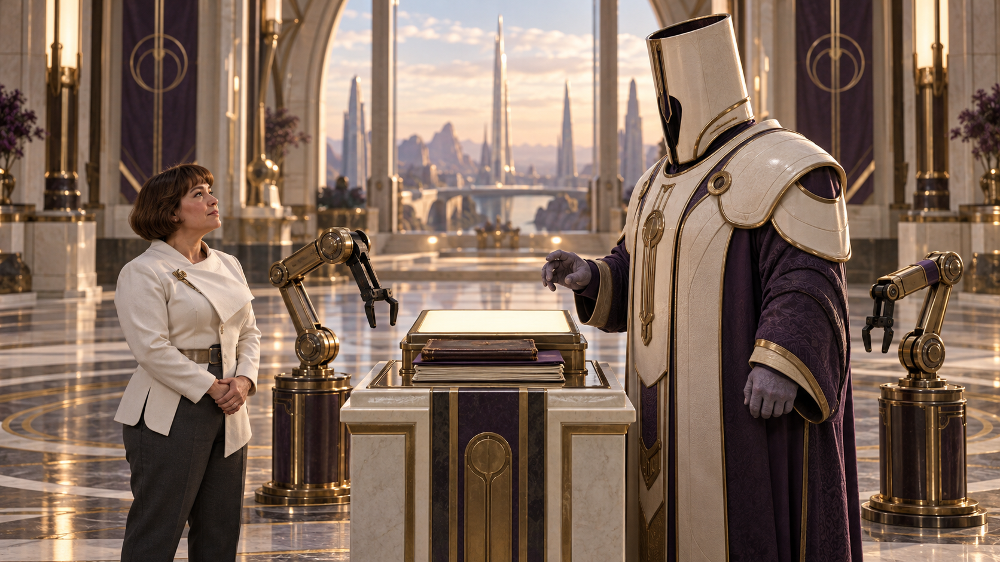

**첫 상태:** AL이 큰 투구를 쓴 채 오른쪽 높은 의전 자리에서 빈 오른손을 펴기 직전. 뒤 열린 받침대 맨 위에는 빛나는 무지 결과판, 아래에는 낡은 수첩과 폴더 가장자리가 보인다. AR_L은 결과판 바로 옆에서 대기, AR_R은 접힘. HU는 왼쪽 아래에 선다.

**후속 동작:** AL이 빈 손바닥을 보인다. AR_L이 받침대 맨 위 결과판을 집어 AL의 손 앞에 정중하게 내민다. AL이 받아 자신의 앞에 세운다. 다른 팔은 움직이지 않는다. HU의 시선은 하사되는 결과판을 지나 받침대의 낡은 기록으로 향한다. 열린 손을 먼저0.4초 보여준 뒤 팔이 출발한다.

**후편집 자막:** AI 적용 결과

### C09_K02 · 4–8초

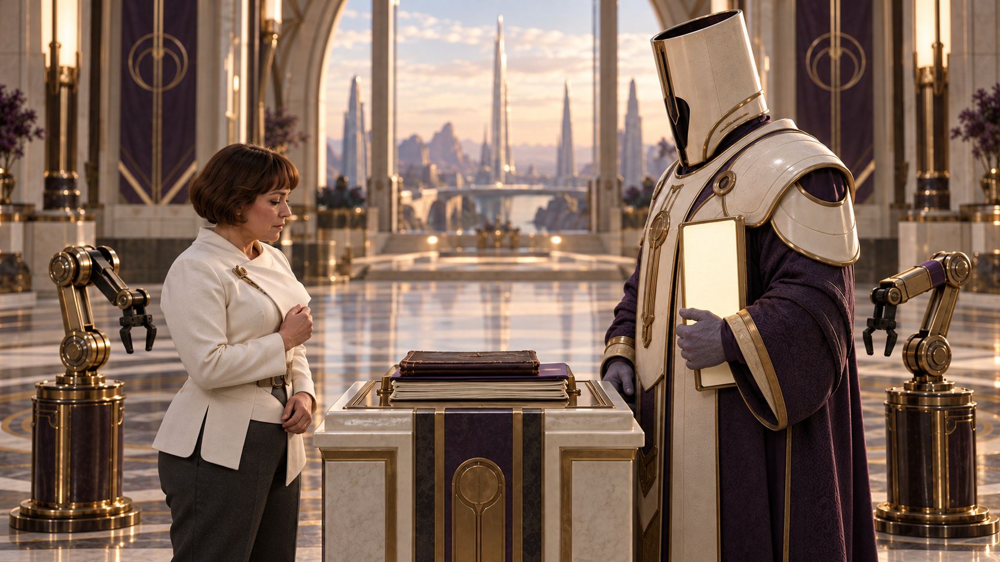

**첫 상태:** AL이 결과판을 왼손으로 HU 쪽에 내밀기 직전. HU는 결과판 아래로 보이는 낡은 수첩을 보고 있으며 오른손은 가슴 가까이 모아져 있다. 두 보조팔은 접혀 있다.

**후속 동작:** AL이 결과판을 하사하듯 앞으로 내민다. HU는 받는 대신 낡은 수첩을 가리키고 같은 빈 손바닥을 조심스럽게 편다.

**후편집 자막:** 어떤 순서로
해봤나요?

### C09_K03 · 8–13초

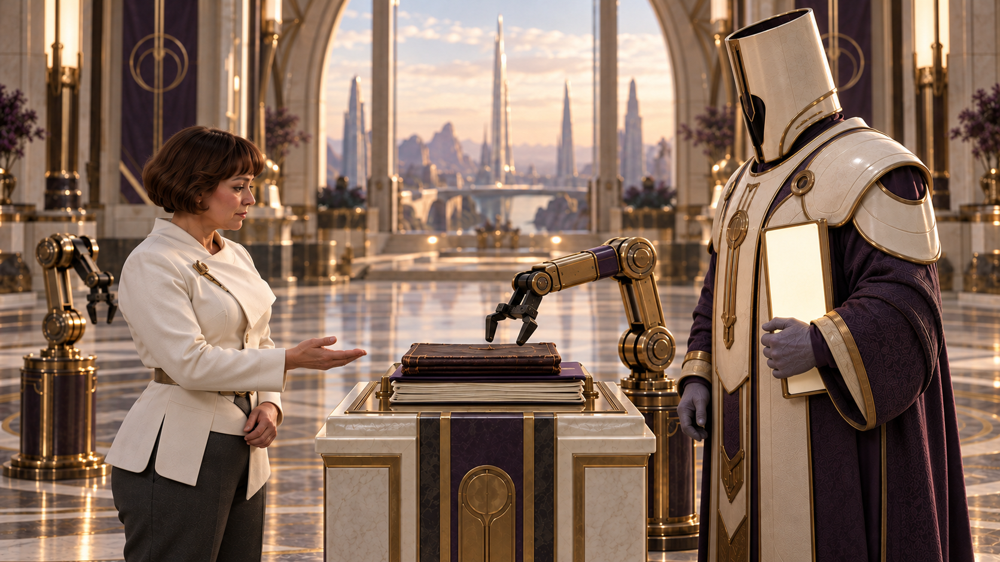

**첫 상태:** HU가 빈 오른손을 편 상태. AR_R 집게는 받침대 맨 위 낡은 수첩을 집기 직전. AL은 결과판을 들고 굳어 있다. L은 접힘.

**후속 동작:** AR_R이 낡은 수첩 하나를 집어 HU의 손 앞에 내민다. HU가 수첩을 받으면 R이 놓고 물러난다. AL은 결과판을 조금 높이 들며 수첩 쪽 시선을 가린다.

**후편집 자막:** 무자막

### C09_K04 · 13–17초

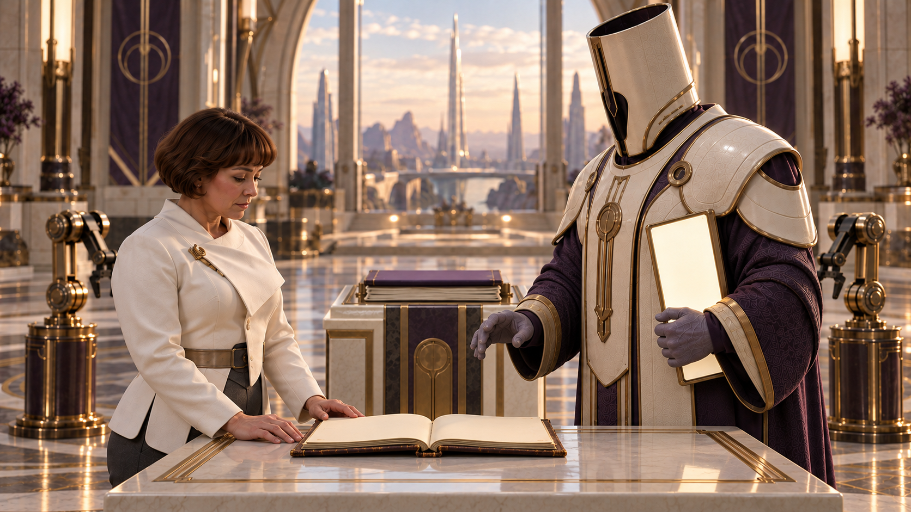

**첫 상태:** HU가 받은 수첩을 책상 위에 펼쳤다. AL은 왼손에 결과판을 들고 오른손을 아직 모은 채 수첩 앞을 가리려 한다. 팔들은 접혀 있다.

**후속 동작:** AL이 기록 앞을 가리려고 빈 오른손바닥을 활짝 편다. HU가 손 옆으로 고개를 조금 기울여 기록을 계속 본다. 마지막 약0.4초에 손바닥을 유지하고 서비스 표시등만 후편집으로 켠다. 두 보조팔은 이 컷 끝까지 접힌 채 정지한다. 팔의 출발은 다음 K05에서 한 번만 보여준다.

**후편집 자막:** 결과만 보셔도
됩니다.

### C09_K05 · 17–22초

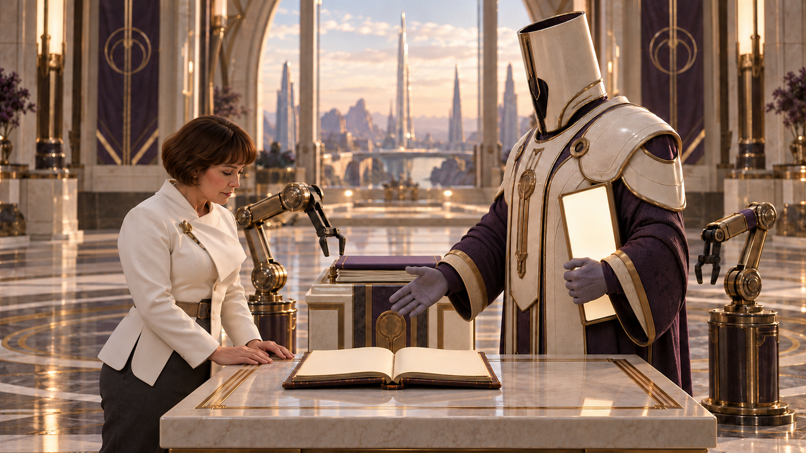

**첫 상태:** AL의 오른손이 기록 앞에서 활짝 펴져 있다. AR_L 집게는 받침대의 수정 폴더 앞에 멈춰 있고 AR_R은 접힘. HU는 손 옆으로 수첩을 보고 있다.

**후속 동작:** 앞 컷의 손바닥 호출을 이어 AR_L이 시작 즉시 한 번 출발해 실제 수정 폴더를 집고 AL의 펼친 손 앞에 정중하게 내민다. AL은 가리는 손을 유지하려다 폴더를 받을 수밖에 없고 결과판과 기록을 양손에 나눠 든다. AR_R은 접힌 채 정지. 다시 손을 펴거나 두 번째 출발·대기를 반복하지 않는다.

**후편집 자막:** 무자막

### C09_K06 · 22–26초

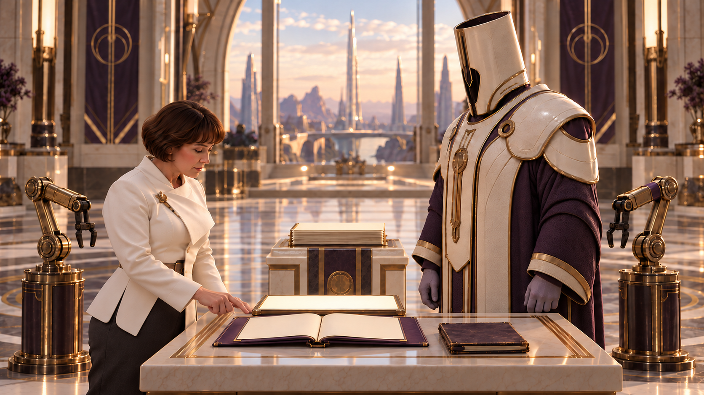

**첫 상태:** 결과판과 수정 폴더가 낮은 책상에 놓였다. HU가 수정 폴더 첫 페이지를 펼친 채 손끝을 대기 직전. AL은 거대한 투구를 쓴 채 책상을 내려다보려 하지만 곧게 서 있다.

**후속 동작:** HU가 수정 흔적 한 곳을 가리킨다. AL이 거대 투구째 몸을 조금 앞으로 기울여 보려다 불편해 멈춘다. 두 손을 투구 양옆으로 가져갈 준비를 한다.

**후편집 자막:** 수정한 쪽도
궁금한데요.

### C09_K07 · 26–31초

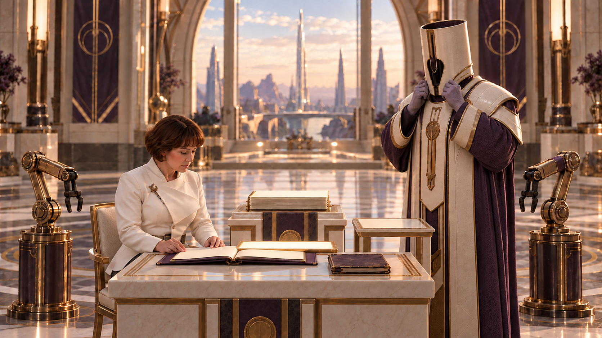

**첫 상태:** AL이 원통 투구 양옆을 두 손으로 잡고 아직 머리에 쓴 상태. 작은 옆 탁자는 비어 있다. HU는 낮은 책상 옆 의자에 앉아 기록을 보며 기다린다. 두 보조팔은 접힘.

**후속 동작:** AL이 원통 투구를 똑바로 위로 들어 실제 보라 얼굴을 드러내고, 열린 상단이 위를 향하도록 옆 탁자에 세운다. 자료 전달이나 팔 작동은 없다.

**후편집 자막:** 무자막

### C09_K08 · 31–36초

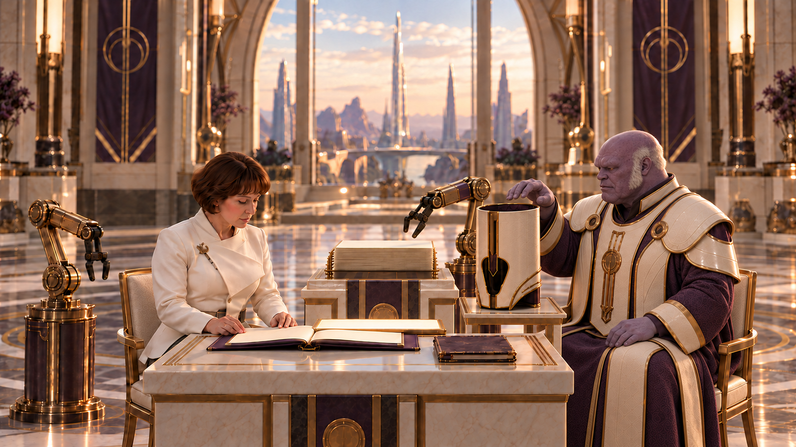

**첫 상태:** 투구를 벗은 AL이 HU와 비슷한 눈높이의 의자에 앉아 있고, 보라색 넓고 납작한 얼굴과 짧은 흰 구레나룻이 처음 선명히 보인다. 투구는 옆 탁자에 빈 원통으로 서 있다. AL이 다시 쓰려 원통 위로 빈 손을 펼치기 직전이며, AR_R은 받침대에 남은 얇은 자료 묶음 앞에서 대기.

**후속 동작:** AL이 투구를 잡으려 원통 위 서비스 범위에 빈 손을 펼친다. 약0.4초 뒤 AR_R 하나가 남은 얇은 자료 묶음을 집어 그 손 앞으로 내민다. AL이 손을 빼면 R은 바로 아래 열린 원통 안에 자료를 세우고 물러난다. AL이 멈춘 손 그대로 천천히 팔을 본다. L과 추가 자료는 움직이지 않는다.

**후편집 자막:** 무자막

### C09_K09 · 36–44초

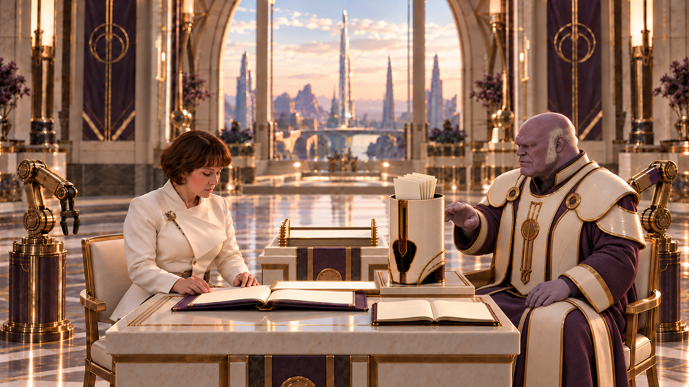

**첫 상태:** 자료가 꽂힌 투구가 두 사람 사이 탁자 위에 서 있다. AL의 손은 원통 옆에 닿기 직전, HU는 기록을 내려다보고 있다. 두 팔은 접힘.

**후속 동작:** 36–37초 AL이 자료가 든 투구를 HU 쪽으로 조금 밀고 턱을 든다. 37–39초 HU가 원통 속 낱장 한 장을 뽑아 펼친다. 39–44초 AL은 새로 가리키는 동작 없이 같은 낱장을 함께 바라본다. 책상 위 기존 수첩·수정 폴더는 그대로 남는다.

**후편집 자막:** Q-AI Fair
결과 뒤의 이야기도 함께 봐요.

## C10

**개막을 허가하지 않는 기계**

개막 리본을 자를 때마다 복구 시연 장치가 다시 잇고 가위마저 테이프에 붙자, 사회자는 길어진 리본을 줄넘기로 바꿔 첫 발표자를 입장시킨다.

### C10_K01 · 0–3초

**첫 상태:** MC가 양쪽 기둥 사이 빨간 천 리본에 금가위를 벌려 대기 직전. DV는 뒤 오른쪽 장치 옆에서 시연 화면을 본다. 크게 노출된 빨간 보충 롤은 아직 돌지 않음. 리본은 온전.

**후속 동작:** MC가 금가위로 리본을 한 번 자르고 두 팔을 의전 자세로 벌린다. 잘린 두 끝이 아래로 처진다. DV는 화면에 나타난 끊김 후보를 본다.

**후편집 자막:** 무자막

### C10_K02 · 3–8초

**첫 상태:** 잘린 리본 두 끝이 처져 있다. 접합 헤드는 두 끝 사이로 이동하기 직전이고 큰 빨간 롤에서 공급 띠가 헤드까지 이어져 있다. MC는 팔을 벌린 개막 미소, 금가위는 트레이.

**후속 동작:** 3–4.5초: 보이는 롤의 접합 띠로 잘린 리본을 다시 잇는다. 4.5초: MC가 벌린 팔과 미소를 유지한 채 눈만 접합부로 내린다. 4.7초 뒤 짧은 시연 자막. 복구 동작을 먼저 보여준다.

**후편집 자막:** 끊김 감지 →
자동 복구

### C10_K03 · 8–12초

**첫 상태:** 리본의 작은 접합 패치가 보인다. MC가 큰 정원 가위를 두 손으로 벌려 패치에 대기 직전이며 금가위는 아래 트레이에 남아 있다. DV는 장치 화면의 고정 시연 설정을 보고 있다.

**후속 동작:** MC가 벌린 큰 정원 가위를 패치 쪽으로 짧게 오른쪽으로 옮긴 뒤 같은 리본을 한 번 넓게 자른다. 리본 두 끝이 더 멀리 벌어지고 MC는 가위를 닫아 트레이 쪽으로 내린다. 장치가 움직이는 과정은 다음 컷에 둔다.

**후편집 자막:** 더 큰 가위면
됩니다.

### C10_K04 · 12–18초

**첫 상태:** 두 번째로 잘린 리본 끝이 더 멀리 처져 있다. 닫힌 금가위와 정원 가위가 얕은 트레이에 나란히 놓였다. 접합 헤드는 새 공급을 시작하기 직전이며 롤의 남은 빨간 띠가 충분히 보인다.

**후속 동작:** 장치가 같은 롤에서 긴 접합 띠를 공급해 두 끝을 잇는다. 공급이 필요 이상으로 계속되어 주 리본이 큰 U자로 바닥까지 늘어진다. MC는 바닥으로 내려가는 리본을 보면서도 의전 미소를 유지한다. 자투리 절단·낙하·가위 접착 과정을 이 숏에 모두 만들지 않는다.

**후편집 자막:** 무자막

### C10_K05 · 18–22초

**첫 상태:** 긴 주 리본이 바닥에 늘어지고, 별도로 잘려 떨어진 짧은 빨간 접착 자투리가 트레이 위 두 가위의 닫힌 날을 함께 붙였다. 주 리본과 트레이 사이에 연결 띠는 없다. DV의 손가락은 정지 버튼 직전, MC는 가위 손잡이를 보고 있다.

**후속 동작:** DV가 정지 버튼을 눌러 롤과 장치를 완전히 멈춘다. MC가 한 손잡이를 조금 들자 붙어 있는 다른 가위도 함께 들린다. MC는 더 쓰지 않고 그대로 내려놓고 바닥의 긴 리본으로 시선을 옮긴다. 함께 들리는 한 번의 움직임만 보이며 추가 분리 시도는 없다.

**후편집 자막:** 복구 시연,
여기까지.

### C10_K06 · 22–26초

**첫 상태:** 장치는 뒤 오른쪽에 멈춰 있다. 양쪽 의전 기둥의 집게가 실제로 열려 있고, MC는 기둥과 공급 롤에서 완전히 분리된 부드러운 리본 두 끝을 손에 들었다. DV가 한 끝을 받으려 빈손을 내민다. 별개 접착 자투리로 붙은 가위 두 개는 뒤 트레이에 남고, 주 리본과 연결되지 않는다.

**후속 동작:** MC가 DV에게 리본 한 끝을 정중히 건네고 반대 끝은 자신이 잡는다. 둘이 입구 좌우로 한 걸음 벌려 서며 MC가 의전처럼 팔을 가볍게 푼다. 리본 가운데는 바닥에 느슨하게 놓인다.

**후편집 자막:** 개막은
해야죠.

### C10_K07 · 26–32초

**첫 상태:** MC 왼쪽과 DV 오른쪽이 자유 리본 한 끝씩 잡고 첫 큰 회전을 시작하기 직전. 리본 뒤 후경 입구 쪽에는 P1이 회색 실행 기록 폴더를 가슴에 안고 발을 나란히 모은 채 기다린다. 리본 가운데는 아직 바닥.

**후속 동작:** 둘이 리본을 한 번 큰 원호로 돌려 박자를 보인다. P1이 그 박자에 두 번 움찔하지만 뛰지 못한다. MC는 미소를 유지하고 다시 낮은 출발 위치로 리본을 돌린다.

**후편집 자막:** 무자막

### C10_K08 · 32–38초

**첫 상태:** P1이 폴더를 두 팔로 안고 무릎을 살짝 굽혔다. 리본은 발 앞 낮은 위치에서 다음 회전을 시작하기 직전. MC와 DV의 손은 양옆에 있고 중앙 위 공간은 비어 있다.

**후속 동작:** P1이 낮게 지나가는 리본을 한 번 과장되게 높이 뛰어넘어 카메라 쪽 전경 발표 위치로 착지한다. MC와 DV는 리본 속도를 줄여 멈추고, P1은 폴더를 떨어뜨리지 않는다. 공중 정지나 두 번째 점프는 없다.

**후편집 자막:** 무자막

### C10_K09 · 38–46초

**첫 상태:** P1이 이미 리본 앞 카메라 쪽 전경 발표 위치에 착지해 회색 폴더를 펼치기 직전. MC와 DV는 리본을 느슨하게 잡고 정지해 있다. 뒤쪽 입구에는 P2가 서류철을 옆구리에 끼고 발을 모은 상태로 처음 등장.

**후속 동작:** P1이 아무 일도 없었던 듯 기록 폴더를 펼친다. 뒤에서 P2가 진지하게 무릎을 한 번 굽혀 준비 운동한다. MC는 그쪽을 향해 의전 미소를 유지한다. 다음 점프는 하지 않는다.

**후편집 자막:** Q-AI Fair
직접 해본 이야기, 시작합니다.
