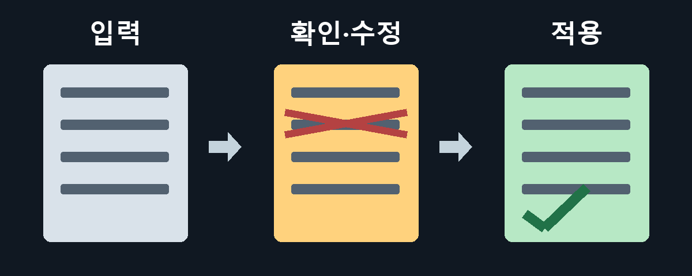
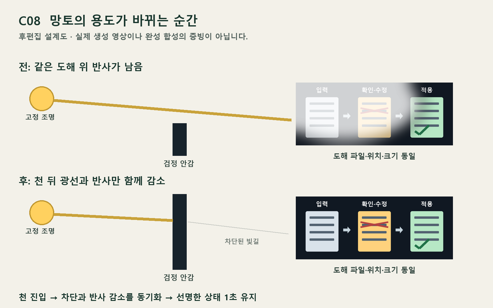

# V11 · 제작 전 확정 메모

이번 검토는 10안의 이야기·88개 시작 상태·자막·동작·편집 명세를 대상으로 했다. 새 Flow 요청과 크레딧 사용은 없다. 과거 V10, C01 완성 영상과 C03 원본·편집본은 보존한다. 실제 관객 반응, 연속 동작과 완성 영상의 현장 가독성을 검증한 것은 아니다.

## 제작 기준 한 곳

- 최신 내용은 이 폴더의 `storyboards.json`, 선택 PNG는 `scene_manifest.json`이다. 자막 시간·위치는 `shots[].caption_cues`가 기준이며 `text_assets[].cues`는 같은 내용으로 동기화한 사본이다.
- 루트 01–10번 문서는 이 데이터에서 만들어진 검수 화면이다. 과거 생성 때 실제 사용한 이미지 프롬프트는 이력으로 보존한다. 그 프롬프트의 옛 제목 여백을 최신 자막 배치로 해석하지 않는다.
- Flow에는 깨끗한 동작 영상만 요청한다. 지정 시작 이미지와 현재 `flow_prompts/`를 사용하고, 자막·행사명·정확한 문서·UI·대사·내레이션·립싱크는 생성하지 않는다.
- 현재 계획은 단위당8초 소스를 필요한 길이로 트림하는 방식이다. Flow의 현재 지원 길이·모델·요금은 이번에 확인하지 않았으며 실제 요청 직전에 확인한다.
- C05 K02A는3초, K02B는4초로 하나의7초 편집 구간을 나눠 사용한다. TSV의 `editorial_used_seconds`를 따른다. C09 K09는8초이며9초로 늘이거나 정지화면으로 메우지 않는다.
- 영상이 만들어지면 실제 움직임에 맞춰 자막 진입·퇴장과 가림을 재검수한다. 새 정보는 결정적 몸개그와 동시에 시작하지 않는다. 마지막 행사명은 각 안 약4.8초 이상 확보한다.

## 이야기별 중요한 것

| 안 | 반드시 화면으로 남길 원인과 결과 | 제작·후편집 기준 |
|---|---|---|
| C01 | 멋진 자세의 원본은 넘어지기 직전 → 코치는 착지까지 비법으로 만듦 | K04 실제 채택 동작의 시작 자세를 사진·모니터와 맞춘다. 모니터 안과 원본 낙하가 다른 자세면 합성을 고친다. 몸개그 이후 권위를 유지하는 표정을 확보. |
| C02 | 같은 위치의 흔적 → 창을 닦고 확인 → 수갑이 새 가림 | K02 반출 차단은 지나치게 엄숙하게. 모니터3장 비교, 닦기 전후, K07 실제 촬영 순간을 폰·인화사진에 일치시킨다. AI 후보와 사람의 확인을 구분한다. |
| C03 | 작업실까지 배송 → 실패 환경도 배송 → 본인이 찾아감 | 기존 원본 재사용 우선. 잘된/시행착오 기록에 같은 입력과 다른 수정 순서를 후합성. 장갑 전체 탈착을 다시 필수 생성하지 않는다. |
| C04 | 탑승자 없음과 수저 요청의 모순 → 세 창문 → 지휘관 숟가락 | 정확한 원문/태블릿은 후합성. K08은3창·3병사·6팔·3그릇·3숟가락, 공개 전에 식기 노출 금지. K09 숟가락 공개 뒤 자막. |
| C05 | 입구 점령 → 본인이 지붕 지지대 → 엄지도 못 듦 | K02A 채택 끝 상태를 K02B에 우선 연결. 크기/S목/무릎/양손 지지를 유지. 사다리 설치·등반은 컷 사이 시간 생략. 헤드셋은 보이는 소품이며 음성을 들어야 이해하는 정보가 없다. |
| C06 | 겁주기가 업무 보조 → 배워서 퇴근시킴 → 다른 유령 상담 | 업무 한 묶음에 적용한 뒤 사람이 확인한다. 접이식 의자가 펴지고 앉는 행동이 보인 뒤 하단 제목판. 유령의 안도와 굳는 미소를 남긴다. |
| C07 | 당신만 초대 → 수첩을 따라 모두 동행 → 본인도 수강 | K04/05/06은3/3/4초, 총39초. K04 자막은 CW이며 줄 낙하지점을 비운 중앙 하늘에 배치. K05 질문은 Q1이며 하단 유지. 줄은 항상 느슨하고 몸에 걸리지 않는다. 긴 이동 대기부터 덜고 마지막 재차 가림0.6초를 보존. |
| C08 | 관심 잃은 주역 → 망토로 주목받으려 함 → 차광 보조가 됨 | 아래 차광 명세 필수. K05 아무도 안 보는 것을 확인한 뒤 펼친다. 상단 제목을 쓰지 않고 마지막은 현행 하단 박스. |
| C09 | 손바닥 호출 규칙 → 가리려는 손도 호출 → 투구가 자료함 | 지정 호출에서만 손바닥→약0.4초→한 팔 작동. K04는 끝0.4초 손바닥·표시등만, 두 팔 정지. 이어 K05 첫머리 L이 즉시 한 번 출발하며 다시 호출하지 않는다. K09 앞3초 투구밀기/낱장꺼내기 뒤39–43.8초 제목, 총44초. 두 팔 동시 작동/새 자료 순간 출현 금지. |
| C10 | 절단→복구→긴 리본→가위 포기→줄넘기 개막 | K04는 복구·늘어짐만. 짧은 자투리 접착은 K05 초기상태로 생략. 정지 뒤 한 손잡이에 두 가위가 따라오는 반응1회 유지, 추가 분리 시도 없음. 긴 리본과 가위 연결 금지. |

## C08 차광 명세

`post_assets/C08_process.svg`가 K04~K08에 사용하는 동일 도해다. PNG도 제공한다. 허구의 입력→확인·수정→적용 흐름이며 실제 성과 숫자나 제품 기능의 증명으로 쓰지 않는다.

K04·K05부터 도해는 같은 위치에 이미 있다. 반사가 가운데 수정 흔적 일부를 가린다. K06에서 ST가 천 끝을 올리고 OP가 따라 팔을 높여 검정 안감이 고정 조명과 화면 사이로 들어간다. 천 뒤에서 화면으로 이어지는 빛과 화면 반사를 같은 순간에 줄이고, 같은 도해의 선명한 상태를 최소1초 보여준다. 광원과 천 위쪽의 일부 빛은 남아도 되며, 전체 배경·인물까지 어둡게 만들지 않는다. K07~K08에도 차단 상태를 유지한다.

위 도해는 후편집 계획이다. 실제 망토 움직임·합성 영상의 성공 증빙은 아니다. K06에서 올리기 시작한 실제 동작과 K07의 높은 망토 실제 영상을 연결하는 대안은 가능하지만, 조명·천·화면 관계가 전혀 성립하지 않는 원본에 반사만 임의로 지워 통과시키지 않는다. 화면 켜짐·다른 도해 등장·전체 암전으로 대체하지 않는다.

## 선택 후 먼저 확인할 동작

선택 작품의 어려운 핵심 컷부터1회 확인하고 나머지 촬영을 이어간다. 이 표는 생성 성공 약속이나 현재 크레딧 견적이 아니다.

| 안 | 우선 확인 | 실패했을 때 보존할 선택지 |
|---|---|---|
| C01 | K04 의자 이동·낮은 착지 | 실제 착지가 읽히는 구간을 먼저 고르고 사진/모니터를 맞춤. 정지 이미지로 낙하 대체 금지. |
| C02 | K05 수갑 부착·K06 가림 | 비교 화면은 후합성. 손·고리 연속성이 좋은 구간을 연결. |
| C03 | 기존 원본의 새 자막 전달력 | 추가 생성보다 확보한 원본과 두 기록 그래픽 우선. |
| C04 | K08 세 창문 공개 | 동시성보다 인원·팔·식기 수와 첫 공개 순서를 우선. |
| C05 | K02B 몸 접기·K03 지붕 받치기 | 앞 컷 실제 끝 프레임 연결. 몸 크기·손 지지가 바뀌면 해당 구간 보완. |
| C06 | K01 서류 걸기·K09 의자 앉기 | 마지막 휴식 실패가 읽히는 실제 반응을 확보. |
| C07 | K06 자발적 이동·재차 시야 가림 | 이동 대기를 덜고 마지막 접근을 사용. 강제 견인으로 바꾸지 않음. |
| C08 | K06 천 올리기와 빛길 | 위 매치컷 대안. 차광 인과 미성립이면 보류. |
| C09 | K08 낱장 묶음이 투구에 들어감 | 한 팔·같은 종이·같은 원통이 확인되는 구간만 사용. |
| C10 | K08 한 번의 점프와 착지 | 손·리본·폴더 연속성이 성립해야 채택. K05 가위 보조 개그가 실패해도 K04까지 좋은 영상을 함께 폐기하지 않음. |

영상 검수는 무음1회, 자막을 읽으며1회, BGM·효과음 포함1회로 구분한다. 실제 상영 화면에서 문자 크기와 읽는 시간을 확인한다. 행사 날짜·장소·참석 방법·성과 수치·혜택은 근거가 확인되기 전 넣지 않는다. 구체적인 출품 대회 심사규정은 제공받지 않았으므로 규정 적합성 심사로 보고하지 않는다.
