# 전체 이미지 콘티 · Q-AI Fair V9

모든 시작 이미지가 포함된 GitHub 읽기용 문서입니다. HTML 원본은 내려받아 열면 자막 배치도 확인할 수 있습니다.

[자막 배치 미리보기](storyboards/2026-10-23_v9-caption-first/index.html) · [전체 컷 표](storyboards/2026-10-23_v9-caption-first/STORYBOARDS.md) · [이미지·정확한 프롬프트](storyboards/2026-10-23_v9-caption-first/scene_manifest.json) · [검수 기록](storyboards/2026-10-23_v9-caption-first/review_summary.json)

## C01 · 성공 자세 교정원

성공자의 자세를 가르치던 코치가 그 자세가 의자에서 미끄러지기 직전이었다는 원본을 보고도, 바닥에 내려앉는 동작까지 새 비법으로 판다.

### C01_K01 · 0–4초

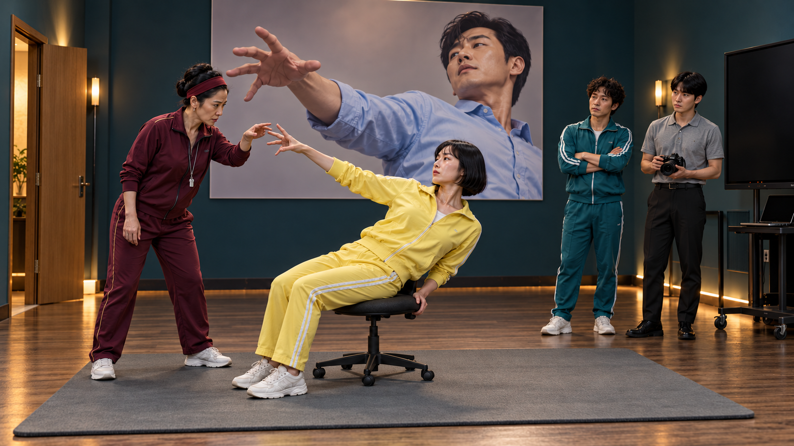

**첫 상태:** L1의 오른손 손가락이 살짝 구부러져 있고 T의 두 손가락은 아직 닿기 직전. 벽 사진에는 같은 손모양과 기울어진 상체만 크게 보이며 의자·다리·바닥은 잘려 있다.

**다음 동작:** T가 손가락만 2cm 펴 준다. L1은 숨을 참고 자세를 유지한다. 카메라는 움직이지 않는다.

**자막:** 0.3–3.8초 AI 성공자의 자세를
그대로 따라 하면?

**음향:** 선택 BGM/SFX: 스포츠 훈련 리듬, 손끝 클릭·바퀴·매트 푹·셔터. K04 착지 후0.7초 정적 가능. 대사/내레이션 없음; 소리를 꺼도 필수 정보 유지.

### C01_K02 · 4–8초

**첫 상태:** 벽 사진 속 P와 L1의 상체가 같은 방향으로 기울어 있다. T의 손바닥은 L1 어깨 옆에서 각도를 표시하기 직전. 사진 속 의자나 바닥은 보이지 않는다.

**다음 동작:** L1이 상체 각도를 조금 더 기울이고 손끝을 편다. T가 엄숙히 한 번 고개를 끄덕인다.

**자막:** 4–5.8초 AI 성공자의 자세를
그대로 따라 하면?

**음향:** 선택 BGM/SFX: 스포츠 훈련 리듬, 손끝 클릭·바퀴·매트 푹·셔터. K04 착지 후0.7초 정적 가능. 대사/내레이션 없음; 소리를 꺼도 필수 정보 유지.

### C01_K03 · 8–11초

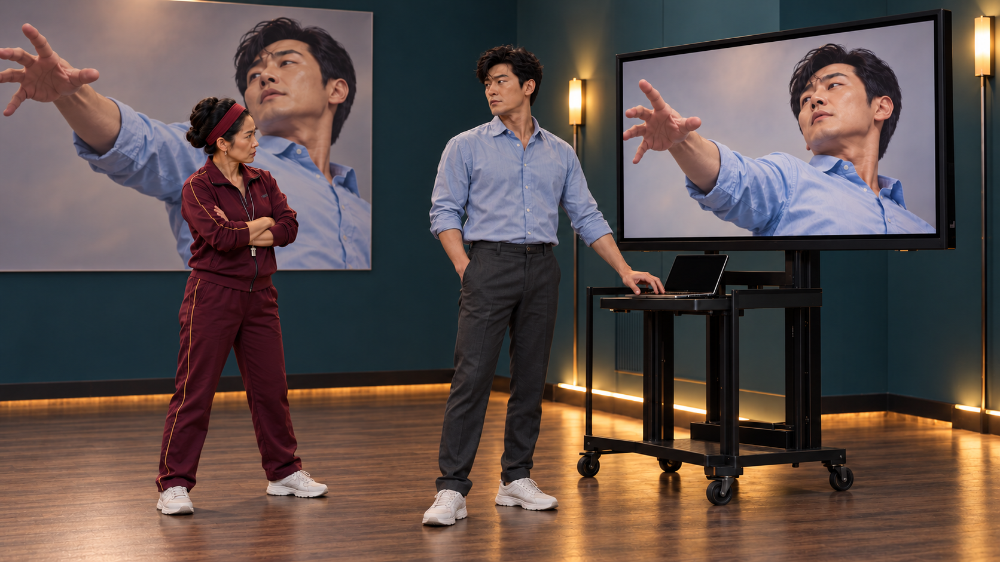

**첫 상태:** P가 포스터와 같은 하늘색 셔츠를 입고 노트북 재생 키에 손을 올린 상태. 큰 모니터는 사진과 같은 자세로 정지해 있다. 로고·작은 UI·문구 없음.

**다음 동작:** P가 재생 키를 한 번 누른다. 모니터는 편집용 정지 상태 유지. K04 독립 원본을 후편집 합성. 발화 없음.

**자막:** 8.3–10.8초 그 사진의 원본

**음향:** 선택 BGM/SFX: 스포츠 훈련 리듬, 손끝 클릭·바퀴·매트 푹·셔터. K04 착지 후0.7초 정적 가능. 대사/내레이션 없음; 소리를 꺼도 필수 정보 유지.

### C01_K04 · 11–16초

**첫 상태:** V8 S04_v2 모니터 내부와 동일 P·상체·손방향. 아직 낮은 바퀴 의자 끝에 앉은 전신, 매트·바퀴가 보이는 독립 원본 프레임. 착지 전.

**다음 동작:** 사진과 같은 자세로 시작한 P의 의자가 옆으로 밀려, 두꺼운 매트에 낮게 풀썩한다. 움직임은 모니터 내부에만 합성한다. 착지 후 설명 자막 없이 반응을 읽히며 정지 박자를 둔다.

**자막:** 무자막

**음향:** 선택 BGM/SFX: 스포츠 훈련 리듬, 손끝 클릭·바퀴·매트 푹·셔터. K04 착지 후0.7초 정적 가능. 대사/내레이션 없음; 소리를 꺼도 필수 정보 유지.

### C01_K05 · 16–20초

**첫 상태:** L1은 이미 일어서 P를 바라본다. 다시 일어나거나 의자에 앉지 않는다. P는 왼쪽 문 방향으로 손을 펼치고 T는 빈 의자를 본다.

**다음 동작:** 이미 서 있는 L1이 P에게 작업 방법을 묻는 태도. 자막을 읽은 뒤 둘이 왼쪽 문으로 두 걸음. T는 같은 의자를 매트 중앙으로 당긴다. 발화 없음.

**자막:** 16.2–19.7초 자세 말고,
어떻게 일했는지요.

**음향:** 선택 BGM/SFX: 스포츠 훈련 리듬, 손끝 클릭·바퀴·매트 푹·셔터. K04 착지 후0.7초 정적 가능. 대사/내레이션 없음; 소리를 꺼도 필수 정보 유지.

### C01_K06 · 20–25초

**첫 상태:** T는 아직 의자 끝에 앉아 오른손을 들고 있다. 양발은 매트 가까이, 의자는 낮고 몸 뒤로 조금 이동할 여유가 있다.

**다음 동작:** 의자가 옆으로 빠짐→T가 낮은 매트에 풀썩→오른팔·굽힌 무릎을 굳혀 권위를 유지. 착지 후 자막. 큰 부상 연기·발화 없음.

**자막:** 22.8–24.9초 착지까지가 비법입니다.

**음향:** 선택 BGM/SFX: 스포츠 훈련 리듬, 손끝 클릭·바퀴·매트 푹·셔터. K04 착지 후0.7초 정적 가능. 대사/내레이션 없음; 소리를 꺼도 필수 정보 유지.

### C01_K07 · 25–28초

**첫 상태:** T는 등을 매트에 대고 한 무릎을 굽혀 올린 채 오른팔을 들고 있다. A는 무릎을 꿇고 카메라를 향한다. L2는 아직 서 있지만 T의 굽힌 무릎을 유심히 보고 있다.

**다음 동작:** A가 셔터를 누른다. T는 자세를 더 굳히고 L2가 그 옆 매트로 몸을 낮추기 시작한다.

**자막:** 25.4–27.8초 새 교본 촬영

**음향:** 선택 BGM/SFX: 스포츠 훈련 리듬, 손끝 클릭·바퀴·매트 푹·셔터. K04 착지 후0.7초 정적 가능. 대사/내레이션 없음; 소리를 꺼도 필수 정보 유지.

### C01_K08 · 28–32초

**첫 상태:** 두 사람은 이미 나란히 매트에 등을 댄 채 오른팔과 한 무릎을 들고 있다. L2의 발끝 각도만 T와 다르다. A는 둘을 함께 촬영한다.

**다음 동작:** L2가 발끝을 T와 같은 방향으로 꺾는다. T가 눈으로 만족을 표시하고 A의 셔터가 한 번 울린다.

**자막:** 무자막

**음향:** 선택 BGM/SFX: 스포츠 훈련 리듬, 손끝 클릭·바퀴·매트 푹·셔터. K04 착지 후0.7초 정적 가능. 대사/내레이션 없음; 소리를 꺼도 필수 정보 유지.

### C01_K09 · 32–39초

**첫 상태:** K08의 나란히 누운 T·L2와 조수. 팔과 굽힌 무릎 자세 유지, 좌상단 벽은 텍스트 없는 여백.

**다음 동작:** A가 한 장 더 찍고 T·L2는 자세를 유지한다. 왼쪽 문만 천천히 닫힌다. 카메라 고정.

**자막:** 32.5–38.8초 Q-AI Fair
AI 실행 경험을 함께 나눠요.

**음향:** 선택 BGM/SFX: 스포츠 훈련 리듬, 손끝 클릭·바퀴·매트 푹·셔터. K04 착지 후0.7초 정적 가능. 대사/내레이션 없음; 소리를 꺼도 필수 정보 유지.

## C02 · 검은 점을 잡아라

검사 사진의 흐린 흔적을 범인 표식으로 쫓던 형사가 AI 후보 비교와 재촬영으로 원인을 듣고 카메라를 체포했다가, 자신이 만든 새 가림까지 다음 공개 사례로 올라간다.

### C02_K01 · 0–4초

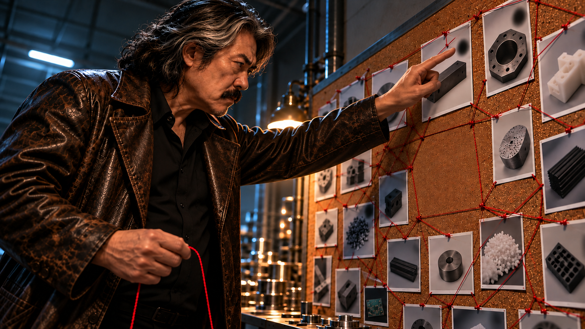

**첫 상태:** 기존 DE 캐스팅·가죽 코트·사진벽 그대로, 낮은 시점에서 손가락이 전경에 크게 보인다. 손가락은 흐린 흔적 사진에 닿기 직전이고 붉은 실 끝도 아직 다음 사진에 걸리지 않았다. 중앙 빈 영역과 사진·실 배치는 유지.

**다음 동작:** DE가 사진의 흐린 흔적을 한 번 짚고 붉은 실을 다른 사진으로 당긴다. 확신에 찬 얼굴, 웃음·윙크·발화 없음.

**자막:** 0.4–3.8초 현장마다 같은 흔적.

**음향:** 선택 BGM/SFX: 누아르 리듬, 촬영·천 닦기·수갑 철컥. K05 철컥 뒤0.6초 무반응. 대사/내레이션 없음; 소리를 꺼도 필수 정보 유지.

### C02_K02 · 4–7초

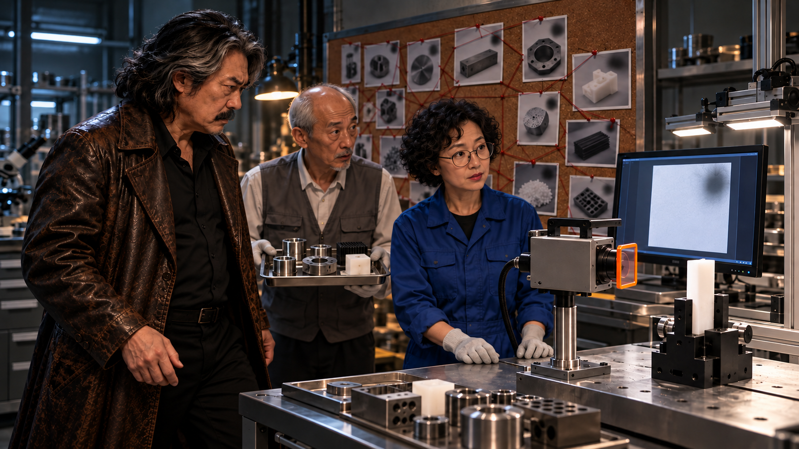

**첫 상태:** DE가 트레이 앞에 들어서기 직전, IN은 모니터를 가리키기 직전. 수갑은 아직 코트 안.

**다음 동작:** TE가 트레이를 멈추고 DE가 막아선다. IN이 모니터를 가리키면 DE는 몸을 둔 채 고개만 돌린다. 발화 없음.

**자막:** 4.3–6.8초 사진부터 보시죠.

**음향:** 선택 BGM/SFX: 누아르 리듬, 촬영·천 닦기·수갑 철컥. K05 철컥 뒤0.6초 무반응. 대사/내레이션 없음; 소리를 꺼도 필수 정보 유지.

### C02_K03 · 7–13초

**첫 상태:** 모니터 왼쪽에는 다수의 서로 다른 제품 썸네일, 오른쪽에는 AI가 좁힌 후보 원본3장이 나란히 이미 보인다. 세 사진은 서로 다른 제품이며 같은 위치에 부드러운 어두운 가림이 있다. IN 손은 사람의 원본 겹침 조작 직전. 원인 판정은 없다.

**다음 동작:** IN이 이미 좁혀진 원본3장을 겹쳐 비교한다. 같은 위치를 지목하는 손과 DE가 장비로 돌리는 시선을 겹쳐 다음 컷으로 연결한다.

**자막:** 7.2–9.8초 AI가 모은 유사 흔적 후보 / 10–12.8초 원본을 겹치니, 같은 위치.

**음향:** 선택 BGM/SFX: 누아르 리듬, 촬영·천 닦기·수갑 철컥. K05 철컥 뒤0.6초 무반응. 대사/내레이션 없음; 소리를 꺼도 필수 정보 유지.

### C02_K04 · 13–17초

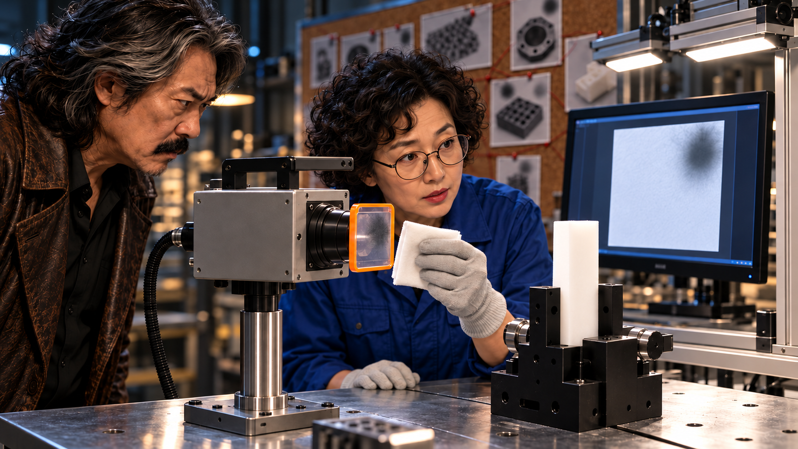

**첫 상태:** 천이 흐린 W 표면에 닿기 직전. 동일 시편은 지그에 고정, 모니터는 청소 전 가림이 있는 결과.

**다음 동작:** IN이 W를 닦고 촬영 버튼을 누른다. 모니터가 동일 시편의 가림 없는 결과로 바뀌며 DE가 고개를 끄덕인다.

**자막:** 14.5–16.9초 닦고 다시 찍으니… 사라졌다.

**음향:** 선택 BGM/SFX: 누아르 리듬, 촬영·천 닦기·수갑 철컥. K05 철컥 뒤0.6초 무반응. 대사/내레이션 없음; 소리를 꺼도 필수 정보 유지.

### C02_K05 · 17–21초

**첫 상태:** 수갑 첫 고리가 B 앞에서 열린 상태. 두 번째 고리는 DE 손에 있어 아직 W를 가리지 않는다.

**다음 동작:** DE가 첫 고리를 B에 잠그고 손을 놓는다. 다른 고리가 W 앞에 매달린다. 철컥 뒤 0.6초 무반응. H는 움직이지 않음, 발화 없음.

**자막:** 17.3–19.5초 이제 못 움직여.

**음향:** 선택 BGM/SFX: 누아르 리듬, 촬영·천 닦기·수갑 철컥. K05 철컥 뒤0.6초 무반응. 대사/내레이션 없음; 소리를 꺼도 필수 정보 유지.

### C02_K06 · 21–24초

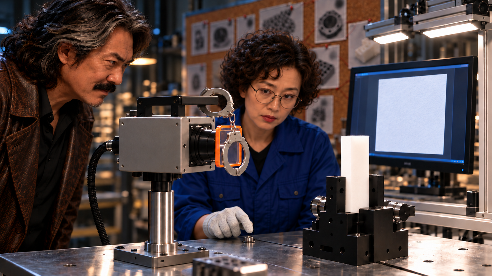

**첫 상태:** 고리가 W 앞에 걸려 있지만 모니터에는 아직 K04 깨끗한 이전 결과. IN 손은 촬영 버튼 위.

**다음 동작:** IN이 촬영하고 모니터에 새 흐린 고리 가림이 나타난다. IN이 실물 고리를 본 뒤 TE와 눈을 마주친다.

**자막:** 무자막

**음향:** 선택 BGM/SFX: 누아르 리듬, 촬영·천 닦기·수갑 철컥. K05 철컥 뒤0.6초 무반응. 대사/내레이션 없음; 소리를 꺼도 필수 정보 유지.

### C02_K07 · 24–27초

**첫 상태:** TE 휴대전화가 가슴 높이에서 올라가기 직전. DE는 아직 뿌듯한 자세, IN 손은 실물 고리를 가리키기 직전.

**다음 동작:** TE가 들어 한 번 촬영한다. DE는 늦게 전화 쪽으로 얼굴을 돌린다. IN이 고리를 확인해 준다.

**자막:** 24.6–26.9초 새로운 사례 확보.

**음향:** 선택 BGM/SFX: 누아르 리듬, 촬영·천 닦기·수갑 철컥. K05 철컥 뒤0.6초 무반응. 대사/내레이션 없음; 소리를 꺼도 필수 정보 유지.

### C02_K08 · 27–31초

**첫 상태:** IN이 새 사진을 중앙에서 10cm 떨어진 곳에 들고 있다. 아직 벽에 붙이지 않았고 중앙은 비어 있다.

**다음 동작:** IN이 직접 사진을 붙인다. DE는 사진 속 자기 모습을 알아보고 눈이 멈춘다. 이 컷에서 말하거나 손을 뻗지 않는다.

**자막:** 무자막

**음향:** 선택 BGM/SFX: 누아르 리듬, 촬영·천 닦기·수갑 철컥. K05 철컥 뒤0.6초 무반응. 대사/내레이션 없음; 소리를 꺼도 필수 정보 유지.

### C02_K09 · 31–39초

**첫 상태:** DE 손끝은 자기 사진 앞 10cm. IN의 포인터는 아직 허리 높이에 있고 중앙 사진은 붙어 있다.

**다음 동작:** IN의 포인터가 사진에 닿으면 DE가 떼려던 손가락을 펴 가장자리를 한 번 반듯하게 누른다. 그 손과 태연한 얼굴을 유지한다. 옷깃 정리·팔짱·추가 손짓은 넣지 않는다.

**자막:** 31.2–33.8초 이 사례는 직접 설명하시죠. / 34–38.8초 Q-AI Fair
AI 실행의 과정까지, 함께 봐요.

**음향:** 선택 BGM/SFX: 누아르 리듬, 촬영·천 닦기·수갑 철컥. K05 철컥 뒤0.6초 무반응. 대사/내레이션 없음; 소리를 꺼도 필수 정보 유지.

## C03 · 환경까지 가져왔습니다

과정을 빠짐없이 보내 달랬더니 성공한 사무실이 통째로 온다. 끝인 줄 알자 실패했던 사무실도 온다.

### C03_K01 · 0–6초

**첫 상태:** 직원은 통화 중, 자료 위 손. 위 사무실은 안 보이고 정상 햇빛.

**다음 동작:** 요청 자막을 먼저 읽힘. 자료 위 컵 수면이 떨림→실제 공간을 지나는 그림자→위로 시선. 발화 불필요.

**자막:** 0.2–3.8초 결과와 과정,
빠짐없이 보내주세요.

**음향:** 선택 BGM/SFX: 배송 리듬, 착지·파일·버클·의자. 기존 음성은 비정보적 공간음과 분리 가능. 대사/내레이션 없음; 소리를 꺼도 필수 정보 유지.

### C03_K02 · 6–10초

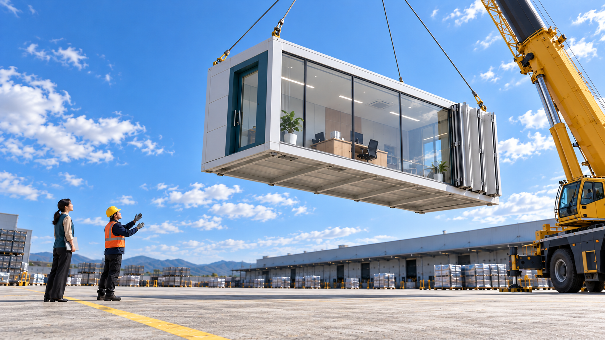

**첫 상태:** 청록 문틀 A가 공중에 고정, 케이블 팽팽. 직원·기사 옆 안전선 밖.

**다음 동작:** 모듈 조금 하강. 사람 위 이동 없음.

**자막:** 6.3–9.8초 잘됐던 작업 환경까지 도착.

**음향:** 선택 BGM/SFX: 배송 리듬, 착지·파일·버클·의자. 기존 음성은 비정보적 공간음과 분리 가능. 대사/내레이션 없음; 소리를 꺼도 필수 정보 유지.

### C03_K03 · 10–13.5초

**첫 상태:** 직원이 회색 파일 옆에서 실행 전. 기사 양손 장갑, 종료 대기.

**다음 동작:** 큰 단순 도식 결과가 기준과 일치→R 끄덕임→기사의 장갑 벗은 끝 상태로 편집 가능. 정확한 장갑 탈착 전체를 필수 생성 요구로 삼지 않음.

**자막:** 10.2–12.8초 같은 조건 → 같은 결과

**음향:** 선택 BGM/SFX: 배송 리듬, 착지·파일·버클·의자. 기존 음성은 비정보적 공간음과 분리 가능. 대사/내레이션 없음; 소리를 꺼도 필수 정보 유지.

### C03_K04 · 13.5–20.5초

**첫 상태:** 설치 A왼쪽, 기사 벗은 장갑 소지. B아랫모서리 막 프레임 진입.

**다음 동작:** B 공개→기사가 장갑을 다시 준비하고 커프를 당겨 고정. 이미 확보한 실제 장갑 동작·상태 생략 허용, 전체 착용 재생성을 필수로 삼지 않음.

**자막:** 14.1–17초 안 됐던 작업 환경도 도착.

**음향:** 선택 BGM/SFX: 배송 리듬, 착지·파일·버클·의자. 기존 음성은 비정보적 공간음과 분리 가능. 대사/내레이션 없음; 소리를 꺼도 필수 정보 유지.

### C03_K05 · 20.5–25초

**첫 상태:** B 내부 이미 보임. R 왼손 평평한 검정 무선 스마트폰 귀에, 오른손 닫힌 주황 파일에 닿아 집기 직전. 꼬인 선·유선 수화기 없음.

**다음 동작:** R이 전화 상대 설명을 듣는 자세에서 주황 파일을 들어 기록을 살핀다. 보내는 동료 자막을 읽힌 뒤 기사 쪽으로 몸을 돌림. 질문·답변 립싱크 불필요.

**자막:** 20.8–24.8초 보낸 동료: “안 됐던 과정도
빠짐없이 달라면서요.”

**음향:** 선택 BGM/SFX: 배송 리듬, 착지·파일·버클·의자. 기존 음성은 비정보적 공간음과 분리 가능. 대사/내레이션 없음; 소리를 꺼도 필수 정보 유지.

### C03_K06 · 25–30.75초

**첫 상태:** R은 이미 주황 파일을 손에 들고 일부 펼친 상태, 회색 파일은 테이블에 열려 있고 T가 운송장을 들고 있다. R에게 펜이 없다. 주황 표지 무늬는 내부 조건 기록의 증거가 아니다.

**다음 동작:** 주황 안쪽 기록을 회색 안쪽 기록과 비교. 일치 조건을 2초 유지한 뒤 운송장을 받지 않고 파일을 더 안는다. 펜·운송장 주고받기 없음.

**자막:** 28–30.6초 안 된 과정에도
단서가 있네?

**음향:** 선택 BGM/SFX: 배송 리듬, 착지·파일·버클·의자. 기존 음성은 비정보적 공간음과 분리 가능. 대사/내레이션 없음; 소리를 꺼도 필수 정보 유지.

### C03_K07 · 30.75–36.75초

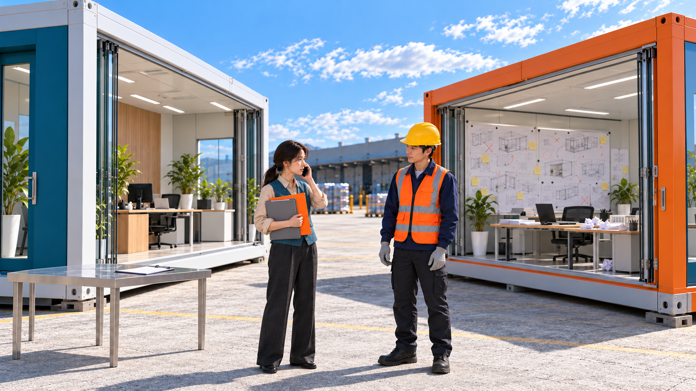

**첫 상태:** 처음부터 열린 마주 보는 패널. 직원은 표시된 회색·주황 파일 두 개를 이미 팔에 안고 통화 중. 기사는 벨트에 손 뻗기 전.

**다음 동작:** 직접 만나 확인하겠다는 자막에 기사가 두 방을 보며 벨트를 조인다. 직원은 두 파일을 한 팔에 유지하고 전화기를 든 손도 그대로 둔 채 몸을 출구로 돌린다. 이번에는 본인이 가겠다는 자막 뒤 기사의 손이 멈춘다.

**자막:** 30.95–33.55초 직접 봐야겠습니다. / 33.85–36.55초 이번엔 제가 가겠습니다.

**음향:** 선택 BGM/SFX: 배송 리듬, 착지·파일·버클·의자. 기존 음성은 비정보적 공간음과 분리 가능. 대사/내레이션 없음; 소리를 꺼도 필수 정보 유지.

### C03_K08 · 36.75–44.75초

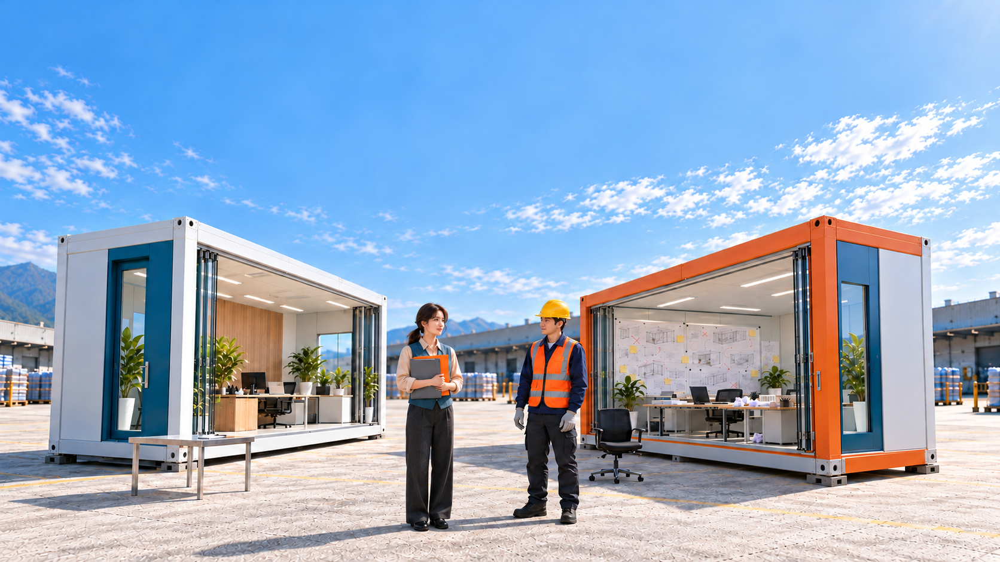

**첫 상태:** 마주 보는 패널이 열린 두 방. 직원은 두 질문 기록을 안고 전경으로 나가려 함. 기사는 아직 서 있음. 하늘 무문자.

**다음 동작:** 직원이 작은 파일 두 개만 안고 퇴장한 뒤 기사가 기존 의자에 앉는다. 안전모는 머리에 유지하며 턱끈 조작은 요구하지 않는다.

**자막:** 38.75–44.55초 Q-AI Fair
AI 실행의 과정까지, 함께 봐요.

**음향:** 선택 BGM/SFX: 배송 리듬, 착지·파일·버클·의자. 기존 음성은 비정보적 공간음과 분리 가능. 대사/내레이션 없음; 소리를 꺼도 필수 정보 유지.

## C04 · 목마는 식사 중입니다

아무도 없는 선물이라던 트로이목마가 AI 문서 대조에서 식사 요청의 모순을 드러내고, 현장 확인 중 병사들의 밥그릇과 지휘관의 숟가락까지 쏟아진다.

### C04_K01 · 0–5초

**첫 상태:** 병사 셋 긴장. 한 명의 빈손이 배 바로 위에서 누르기 직전. 다른 둘이 눈치를 볼 구도. 급식메모·초승달봉투는 무릎 높이. 그릇·숟가락 없음.

**다음 동작:** 한 병사가 배를 누르고 나머지 둘이 그를 쳐다본다. 꼬르륵 자막 뒤 급식 메모를 봉투에 넣음. 5초에서 복잡하면 마지막 메모 한 장 넣기만 보여 나머지는 이미 든 상태로 생략. 그릇·숟가락 비공개.

**자막:** 0.2–2초 숨소리도 내지 마라. / 2.6–4.7초 꼬르륵…

**음향:** 선택 BGM/SFX: 진지한 전쟁 음악, 목재·뚜껑·그릇. K08 첫 그릇 창경계 통과 때 음악 중단. 대사/내레이션 없음; 소리를 꺼도 필수 정보 유지.

### C04_K02 · 5–8초

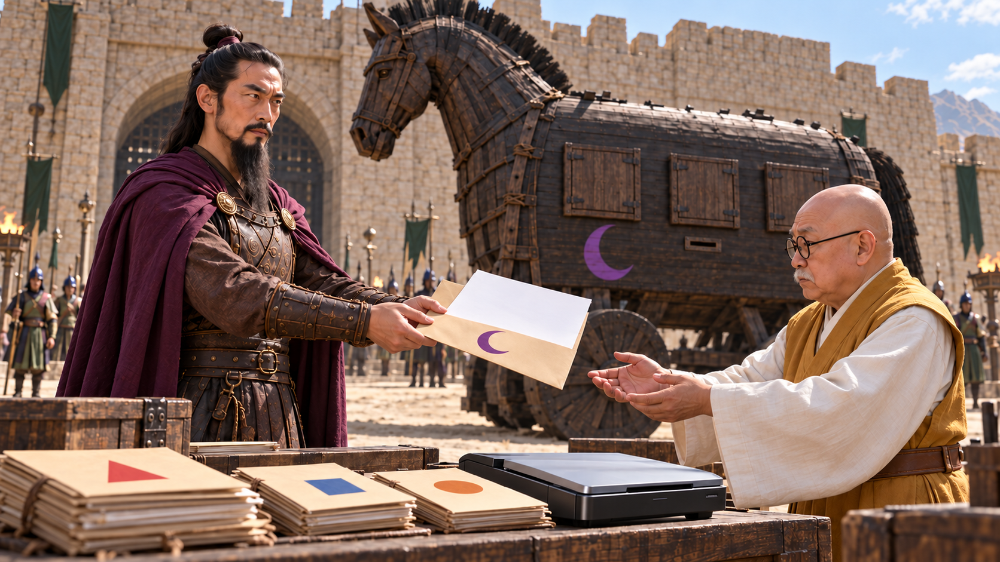

**첫 상태:** CM 손의 신고서·초승달 봉투가 RC 손 앞에 있다. 표지의 내부 탑승자 없음 문구를 후편집할 한 줄 영역. RC는 받기 전, 책상에는 다양한 다른 반입물 서류가 쌓여 있다.

**다음 동작:** CM이 봉투를 주고 RC가 원문을 책상에 두어 스캔 입력한다. 원본은 버리지 않는다.

**자막:** 5.2–7.8초 신고: 내부 탑승자 없음

**음향:** 선택 BGM/SFX: 진지한 전쟁 음악, 목재·뚜껑·그릇. K08 첫 그릇 창경계 통과 때 음악 중단. 대사/내레이션 없음; 소리를 꺼도 필수 정보 유지.

### C04_K03 · 8–11초

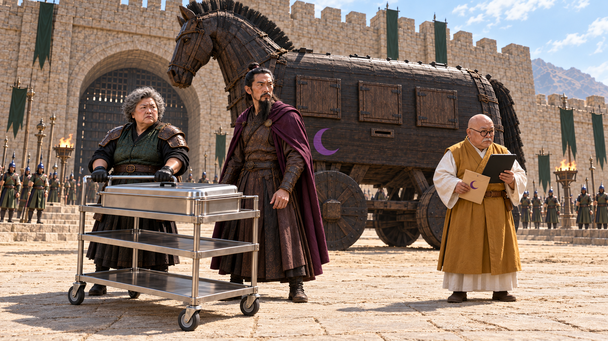

**첫 상태:** GU 손은 수레 손잡이, CM은 앞을 막기 직전. RC 태블릿은 아직 가슴 쪽을 향해 화면 내용 비공개.

**다음 동작:** CM이 수레 앞을 막고 근거를 요구하는 표정. RC가 태블릿을 돌린다. 한 줄 자막, 발화 없음.

**자막:** 8.3–10.8초 아무도 없는데, 웬 배식?

**음향:** 선택 BGM/SFX: 진지한 전쟁 음악, 목재·뚜껑·그릇. K08 첫 그릇 창경계 통과 때 음악 중단. 대사/내레이션 없음; 소리를 꺼도 필수 정보 유지.

### C04_K04 · 11–18초

**첫 상태:** 태블릿 왼쪽 가장자리는 여러 반입물 목록, 가운데 큰 신고 원문 내부 탑승자 없음과 오른쪽 첨부 요청 식사·물·수저가 이미 나란히 보인다. AI 문서 대조의 확인 후보일 뿐 판정은 없음. RC 손가락은 두 구절을 짚기 직전.

**다음 동작:** RC가 대조 후보를 보여주고 신고와 첨부 요청을 차례로 짚음. 문구는 단계별 후편집. CM은 목마로 시선을 돌림. 발화 없음.

**자막:** 11.2–13.2초 AI 문서 대조 · 확인 필요 / 13.3–17.9초 탑승자 없음
↔ 식사·물·수저 요청

**음향:** 선택 BGM/SFX: 진지한 전쟁 음악, 목재·뚜껑·그릇. K08 첫 그릇 창경계 통과 때 음악 중단. 대사/내레이션 없음; 소리를 꺼도 필수 정보 유지.

### C04_K05 · 18–21초

**첫 상태:** 실제 신고서와 급식 메모는 RC 손에 이미 펼쳐져 있다. 봉투·목마 초승달이 함께 보이고 GU는 원문을 보고 있다. GU가 원문 내용과 실물 표식을 확인하기 직전.

**다음 동작:** 이미 펼친 원문 두 장 유지. GU가 원문과 초승달을 확인한 뒤 수레를 봄. 다시 펼치거나 말하지 않음.

**자막:** 18.2–20.8초 이 말, 수저를 씁니까?

**음향:** 선택 BGM/SFX: 진지한 전쟁 음악, 목재·뚜껑·그릇. K08 첫 그릇 창경계 통과 때 음악 중단. 대사/내레이션 없음; 소리를 꺼도 필수 정보 유지.

### C04_K06 · 21–24초

**첫 상태:** 수레 뚜껑은 닫혀 있고 GU 손은 손잡이 앞. CM의 막는 손은 아직 허리 높이.

**다음 동작:** CM이 손바닥으로 막으며 고개를 젓는다. 부인 자막을 읽힌 뒤 GU가 뚜껑 손잡이를 잡음. 패널은 닫힘.

**자막:** 21.1–23.8초 안에는 아무도 없습니다.

**음향:** 선택 BGM/SFX: 진지한 전쟁 음악, 목재·뚜껑·그릇. K08 첫 그릇 창경계 통과 때 음악 중단. 대사/내레이션 없음; 소리를 꺼도 필수 정보 유지.

### C04_K07 · 24–27초

**첫 상태:** GU가 닫힌 뚜껑 손잡이를 잡고 아직 열기 전. CM은 목마 쪽을 보며 음식에 반응하기 전.

**다음 동작:** GU가 뚜껑을 열어 김이 난다. CM 코가 미세하게 움직이고 목마 안의 숨소리가 겹친다.

**자막:** 무자막

**음향:** 선택 BGM/SFX: 진지한 전쟁 음악, 목재·뚜껑·그릇. K08 첫 그릇 창경계 통과 때 음악 중단. 대사/내레이션 없음; 소리를 꺼도 필수 정보 유지.

### C04_K08 · 27–31초

**첫 상태:** 세 패널은 완전히 닫혀 있고 손·그릇·숟가락은 아직 안에 있다. 열린 수레에서만 김이 난다.

**다음 동작:** 정확히 창3개가 열리고 병사3명 각각 두 팔로 그릇1개·숟가락1개를 내민다. 총6팔·3그릇·3숟가락. 추가 사람/손 없음. CM은 부인하던 손을 못 내린다. 첫 그릇이 창 경계 밖으로 나오는 때가 음악 중단점이다.

**자막:** 무자막

**음향:** 선택 BGM/SFX: 진지한 전쟁 음악, 목재·뚜껑·그릇. K08 첫 그릇 창경계 통과 때 음악 중단. 대사/내레이션 없음; 소리를 꺼도 필수 정보 유지.

### C04_K09 · 31–39초

**첫 상태:** V7 S09_v2의 CM 전경·세 배식창·수레·인물 배치 유지. 병사 그릇3개는 이미 창밖. CM의 손은 망토 안에 있어 자기 숟가락은 아직 보이지 않는다. CM 시선은 GU를 향하고 턱은 정면의 권위 있는 자세이며 아직 더 들기 전. GU 국자는 수레 옆에 내려져 있다.

**다음 동작:** CM이 자기 숟가락을 망토에서 꺼내 턱을 듦. 공개 뒤 지휘관부터 자막. GU는 국자를 드는 시작만. 뒤 4.8초 행사명·시작 문구, 인물 무언.

**자막:** 31.8–33.8초 지휘관부터. / 34–38.8초 Q-AI Fair
AI 실행 사례, 지금 시작합니다.

**음향:** 선택 BGM/SFX: 진지한 전쟁 음악, 목재·뚜껑·그릇. K08 첫 그릇 창경계 통과 때 음악 중단. 대사/내레이션 없음; 소리를 꺼도 필수 정보 유지.

## C05 · 괴수는 퇴근할 수 없다

행사를 방해하려 현관 기둥을 뽑은 괴수가 자기 머리 위 지붕을 받치는 새 기둥이 되고, 구조용인 줄 알았던 사다리에서는 행사 청취용 이어폰이 올라온다.

### C05_K01 · 0–4초

**첫 상태:** 괴수 입이 포효 직전 벌어져 있고 두 팔은 몸 옆. 앞왼쪽 기둥은 온전하며 포치 지붕은 수평.

**다음 동작:** 괴수가 포효 자세로 과시. 접수 선언 자막 뒤 실내 쪽으로 눈을 돌리고 기둥으로 손을 뻗음. 실내 소리를 들어야 동기가 이해되는 연출 제거.

**자막:** 0.6–3.7초 이 행사는 내가 접수한다.

**음향:** 선택 BGM/SFX: 재난 브라스→짧은 승리→구조 기대. 삐걱·잭·바퀴 잠금·이어컵. 이어컵 공개 때 기대음악 중단. 대사/내레이션 없음; 소리를 꺼도 필수 정보 유지.

### C05_K02A · 4–11초

**첫 상태:** 기둥 온전·괴수 직립·손 접촉 직전.

**다음 동작:** 기둥을 빼 왼쪽 바닥에 눕히고 손을 놓음. 몸은 직립.

**자막:** 무자막

**음향:** 선택 BGM/SFX: 재난 브라스→짧은 승리→구조 기대. 삐걱·잭·바퀴 잠금·이어컵. 이어컵 공개 때 기대음악 중단. 대사/내레이션 없음; 소리를 꺼도 필수 정보 유지.

### C05_K02B · 4–11초

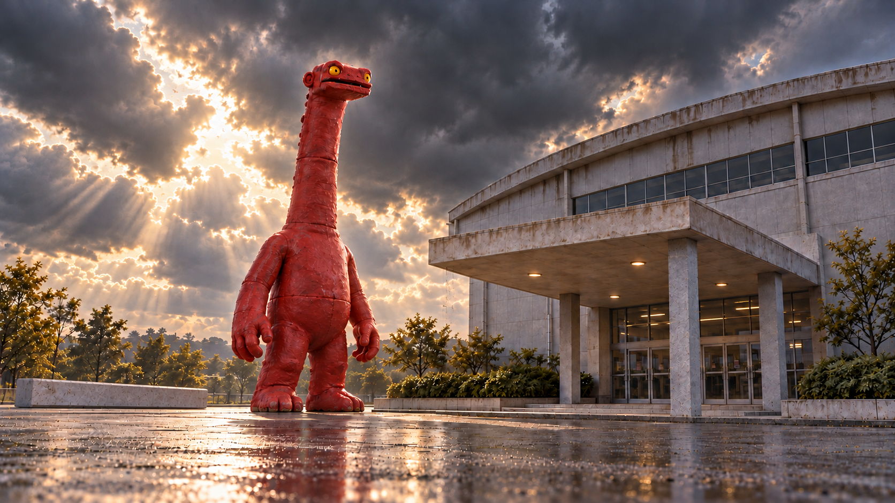

**첫 상태:** 기둥 왼쪽 바닥·괴수 직립·양손 자유·목과 무릎 접기 전·지붕 수평.

**다음 동작:** 같은 크기로 목·무릎 접어 빈자리 진입 후 승리 자세. 아직 지붕 지지 안 함.

**자막:** 무자막

**음향:** 선택 BGM/SFX: 재난 브라스→짧은 승리→구조 기대. 삐걱·잭·바퀴 잠금·이어컵. 이어컵 공개 때 기대음악 중단. 대사/내레이션 없음; 소리를 꺼도 필수 정보 유지.

### C05_K03 · 11–15초

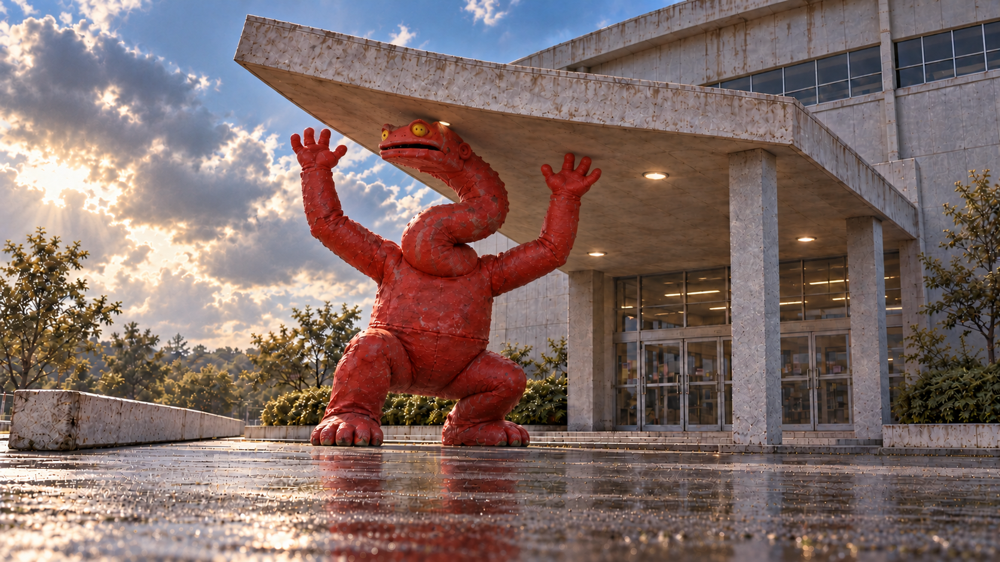

**첫 상태:** 괴수는 무릎을 굽히고 긴 목을 S자로 접은 채 두 팔을 승리 자세로 든다. 지붕이 막 기울기 시작했고 양손은 아직 닿지 않았다. 귀는 약 4.2m 높이.

**다음 동작:** 지붕이 더 기울기 시작하자 괴수가 양손으로 앞 가장자리를 받쳐 멈춘다. 머리·몸에 충돌하지 않는다.

**자막:** 무자막

**음향:** 선택 BGM/SFX: 재난 브라스→짧은 승리→구조 기대. 삐걱·잭·바퀴 잠금·이어컵. 이어컵 공개 때 기대음악 중단. 대사/내레이션 없음; 소리를 꺼도 필수 정보 유지.

### C05_K04 · 15–20초

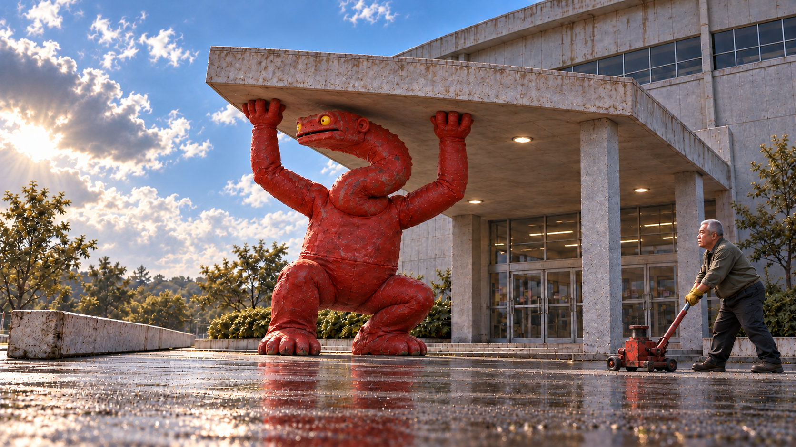

**첫 상태:** FM이 접힌 받침대를 굴려 멈추기 직전. 괴수는 무릎과 긴 목을 S자로 접은 같은 크기로 지붕을 받치며 왼쪽 길을 본다. 정수리 4.5m·귀 4.2m 기준.

**다음 동작:** FM이 잭을 끝까지 올려 짧음을 확인하고 놓지 말라는 두 손을 듦. 그 뒤 부탁 자막. 괴수는 나갈 길을 흘겨보지만 지지 유지.

**자막:** 17.5–19.8초 조금만 더 잡아주세요.

**음향:** 선택 BGM/SFX: 재난 브라스→짧은 승리→구조 기대. 삐걱·잭·바퀴 잠금·이어컵. 이어컵 공개 때 기대음악 중단. 대사/내레이션 없음; 소리를 꺼도 필수 정보 유지.

### C05_K05 · 20–26초

**첫 상태:** 괴수는 무릎·긴 목을 S자로 접은 같은 지지 자세. 양손이 지붕을 받치고 귀는 약 4.2m. 눈만 열린 문으로 돌아가 귀를 기울이기 직전.

**다음 동작:** 앞 3.6초는 양손 지지 유지하며 발표 예고 자막. 뒤 2.4초 눈·귀를 문으로 기울임→지붕이 조금 움직임→즉시 되돌림. 안내 음성 필수 아님.

**자막:** 20.2–23.6초 잠시 후, AI 실행 사례 공개

**음향:** 선택 BGM/SFX: 재난 브라스→짧은 승리→구조 기대. 삐걱·잭·바퀴 잠금·이어컵. 이어컵 공개 때 기대음악 중단. 대사/내레이션 없음; 소리를 꺼도 필수 정보 유지.

### C05_K06 · 26–30초

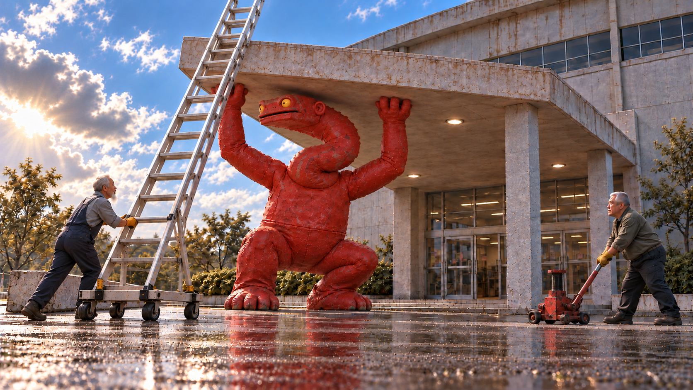

**첫 상태:** 실제 PNG의 사다리는 이미 긴 길이로 펴져 있다. TE가 하부를 이동·고정하기 직전이며 새로 늘리거나 조립하지 않는다. 이어컵은 이 구도에서 보이지 않는다.

**다음 동작:** 이미 펴진 사다리의 하부를 TE가 바깥 지면에서 밀어 위치를 맞추고 지지대·바퀴 브레이크를 고정한다. 귀 높이는 그대로, 사다리 연장·조립 없음. 괴수는 목을 펴지 않고 눈만 따라간다.

**자막:** 무자막

**음향:** 선택 BGM/SFX: 재난 브라스→짧은 승리→구조 기대. 삐걱·잭·바퀴 잠금·이어컵. 이어컵 공개 때 기대음악 중단. 대사/내레이션 없음; 소리를 꺼도 필수 정보 유지.

### C05_K07 · 30–35초

**첫 상태:** 주둥이 왼쪽·보이는 귀는 머리 오른쪽으로 와이드와 같은 축. TE가 검정 이어컵을 그 귀 바로 옆에 띄워 든 미장착 상태. 양손 지붕 지지 유지.

**다음 동작:** TE가 화면에 보이는 같은 귀에 이어컵과 뒤끈을 건다. 실체 공개 후 들리세요? 자막. 괴수 한 번 깜빡임. 발화 없음.

**자막:** 32.4–34.9초 들리세요?

**음향:** 선택 BGM/SFX: 재난 브라스→짧은 승리→구조 기대. 삐걱·잭·바퀴 잠금·이어컵. 이어컵 공개 때 기대음악 중단. 대사/내레이션 없음; 소리를 꺼도 필수 정보 유지.

### C05_K08 · 35–43초

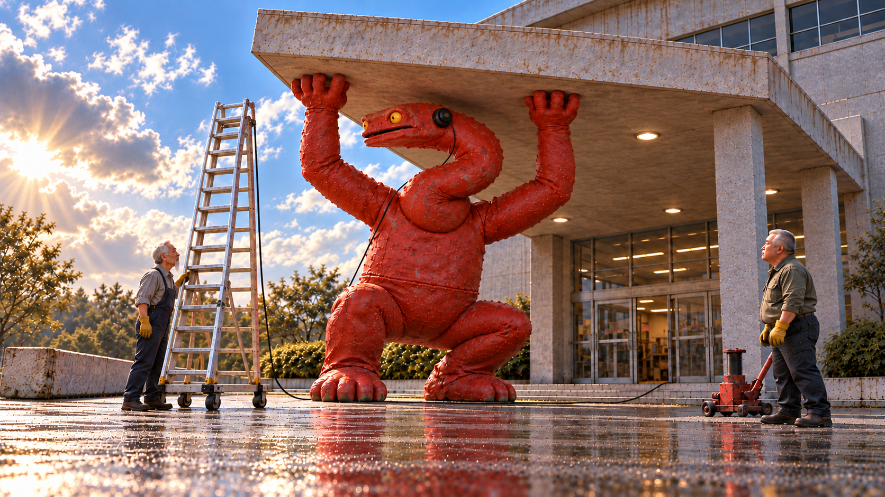

**첫 상태:** 괴수의 S자 목·굽힌 무릎·두 손 지지는 그대로. 이어컵은 연결 완료, 눈은 아래 FM을 향해 잘 들린다는 답을 보내려는 표정. 오른손 손목은 아직 펴져 있고 손가락도 지붕을 잡고 있다.

**다음 동작:** 35–38초 오른손 엄지 답신 시도→지붕 흔들림→다시 잡기→작은 끄덕임. 38–42.8초 손 고정 상태에 행사명·시작 문구. 필수 안내 음성 없음.

**자막:** 38–42.8초 Q-AI Fair
AI 실행 사례, 지금 시작합니다.

**음향:** 선택 BGM/SFX: 재난 브라스→짧은 승리→구조 기대. 삐걱·잭·바퀴 잠금·이어컵. 이어컵 공개 때 기대음악 중단. 대사/내레이션 없음; 소리를 꺼도 필수 정보 유지.

[제작 연결·후편집 메모](storyboards/2026-10-23_v9-caption-first/PRODUCTION_NOTES.md) · [이전 V8 전체 이미지](콘티_바로보기_V8.md)
