# 전체 이미지 콘티 · V8

**1·3·5번은 그대로 유지하고, 2·4번의 대사와 연출을 다듬었습니다.**
새 5안의 첫 프레임 43장과 각 컷의 대사·다음 행동입니다. 이번 수정은 콘티 단계이며, 이전에 완성한 1번 영상은 별도로 보존했습니다.

[1번](#c01) · [2번](#c02) · [3번](#c03) · [4번](#c04) · [5번](#c05)

[HTML 원본과 이미지 폴더](storyboards/2026-10-19_tone-polish-v8/) · [전체 컷 표](storyboards/2026-10-19_tone-polish-v8/STORYBOARDS.md) · [검토 기록](storyboards/2026-10-19_tone-polish-v8/review_summary.json)

2번: 진지한 체포극과, 자기 사진을 떼려다가 반듯하게 펴 주는 체면 유지.
4번: 숨소리까지 금지한 잠입 작전과, 들킨 뒤에도 “지휘관부터.”라고 명령하는 태도.

## C01

**1번 · 성공 자세 교정원 · 34초**

성공자의 자세를 가르치던 코치가 그 자세가 의자에서 미끄러지기 직전이었다는 원본을 보고도, 바닥에 내려앉는 동작까지 새 비법으로 판다.

### C01 K01 · 0–3초

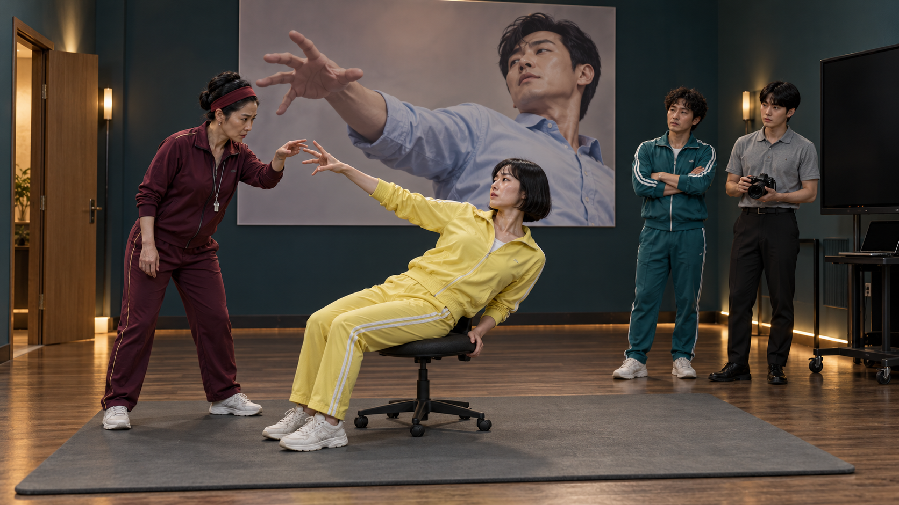

**대사:** T: “손끝이 중요해요.”

**다음 행동:** T가 손가락만 2cm 펴 준다. L1은 숨을 참고 자세를 유지한다. 카메라는 움직이지 않는다.

**소리·호흡:** 절제된 스포츠 광고 드럼과 규칙적인 메트로놈. 손끝을 고칠 때 작은 클릭.

### C01 K02 · 3–6초

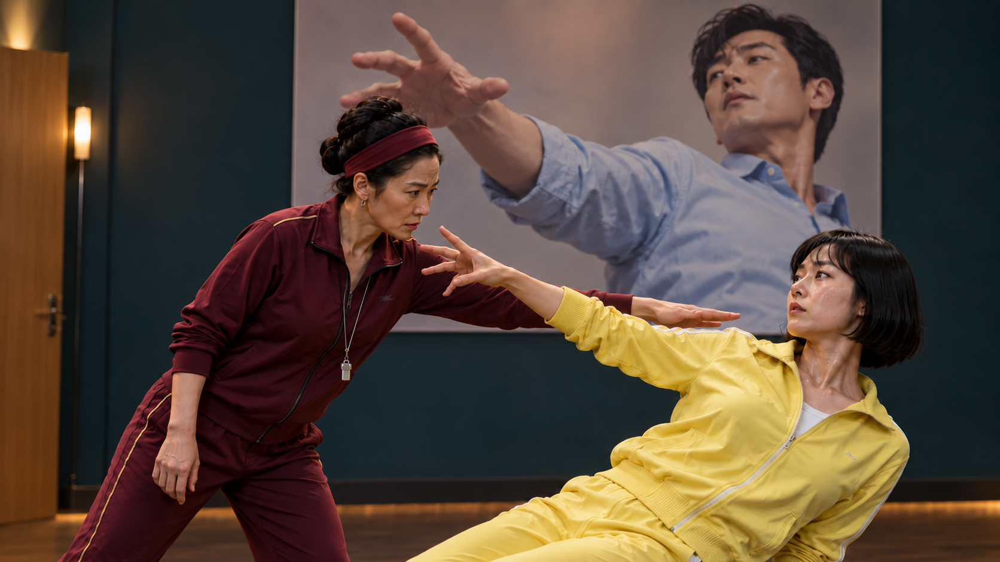

**대사:** T: “AI 잘 쓴 사람의 각도.”

**다음 행동:** L1이 상체 각도를 조금 더 기울이고 손끝을 편다. T가 엄숙히 한 번 고개를 끄덕인다.

**소리·호흡:** 메트로놈 두 번, 낮은 드럼 유지. 과장된 운동 호흡 1회.

### C01 K03 · 6–9초

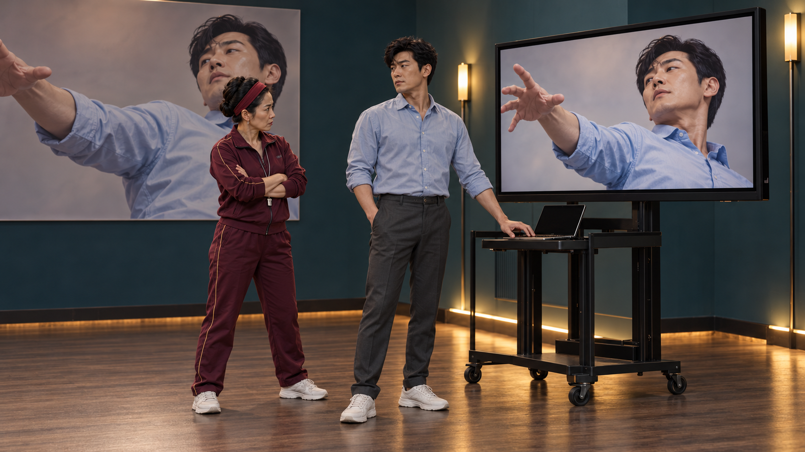

**대사:** P: “전체 영상이 있어요.”

**다음 행동:** P가 재생 키를 누른다. 모니터가 크롭 없는 원본으로 넘어가려는 순간 K04로 컷한다.

**소리·호흡:** 스포츠 음악 볼륨을 낮춘다. 재생 키 소리와 원본 공간의 의자 바퀴 소리.

### C01 K04 · 9–14초

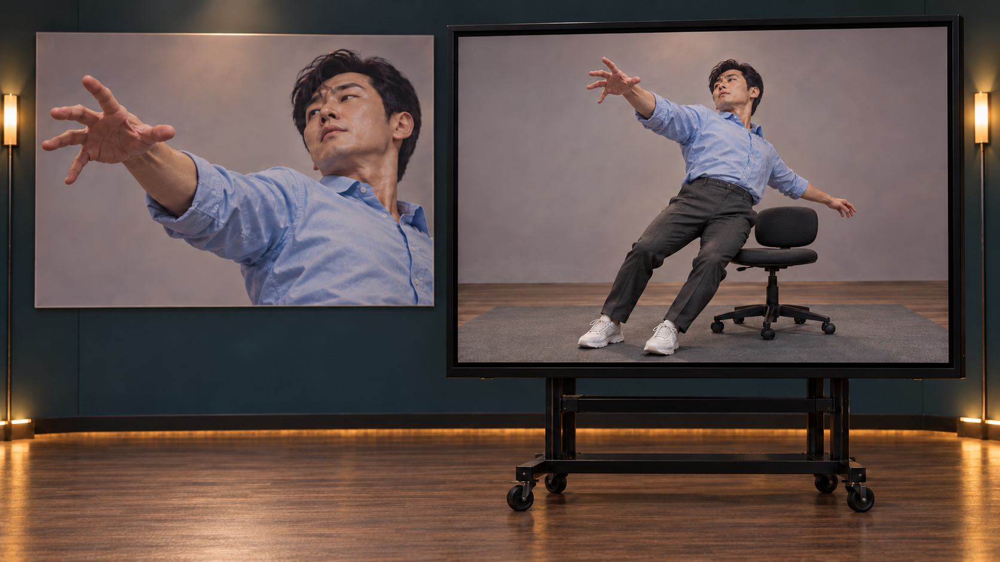

**대사:** 현장 P, 화면 밖: “의자가 밀린 거예요.”

**다음 행동:** 고정된 큰 모니터 안에서 의자가 옆으로 밀려 빠지고 P가 매트에 낮게 풀썩한다. 오른손이 균형을 잡다 내려간다. 포스터는 움직이지 않아 원인과 크롭의 차이가 보인다.

**소리·호흡:** 바퀴 구름과 낮은 푹 소리. 음악을 끊고 0.7초 동안 공간음만 남긴 뒤 P의 말.

### C01 K05 · 14–18초

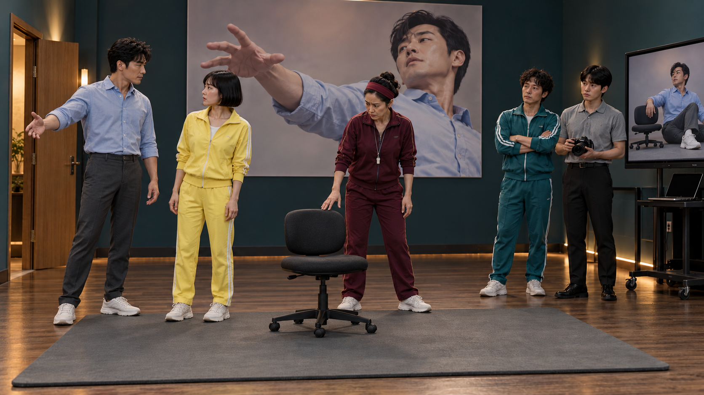

**대사:** L1: “그럼, 일은 어떻게 하셨어요?”

**다음 행동:** P와 L1이 왼쪽 문 쪽으로 두 걸음 이동한다. T는 의자를 자기 앞 매트 중앙으로 20cm 당긴다.

**소리·호흡:** 운동 드럼 대신 짧은 발소리. 문 여는 소리. T가 의자를 잡을 때 스포츠 음악의 비장한 저음 재개.

### C01 K06 · 18–22초

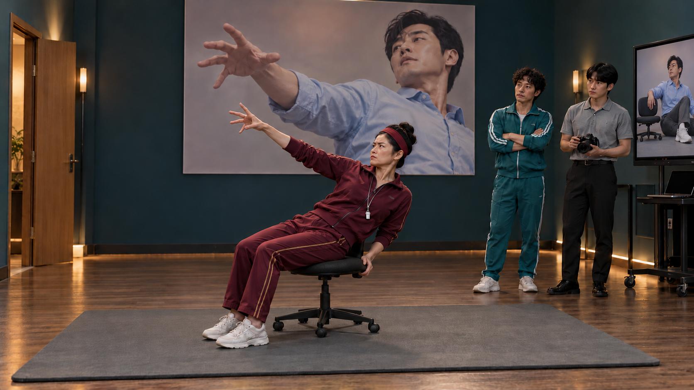

**대사:** T: “착지까지가 비법입니다.”

**다음 행동:** 의자가 옆으로 밀리자 T의 몸이 매트에 낮게 풀썩 뒤집힌다. 곧바로 오른팔과 굽힌 무릎을 굳혀 의도한 자세인 척한다. 충격 자체보다 멈춰서 권위를 지키는 표정에 집중한다.

**소리·호흡:** 비장한 드럼 한 번 뒤 바퀴 소리, 낮은 푹. 0.5초 음악만 멈추고 호흡·공간음 유지.

### C01 K07 · 22–25초

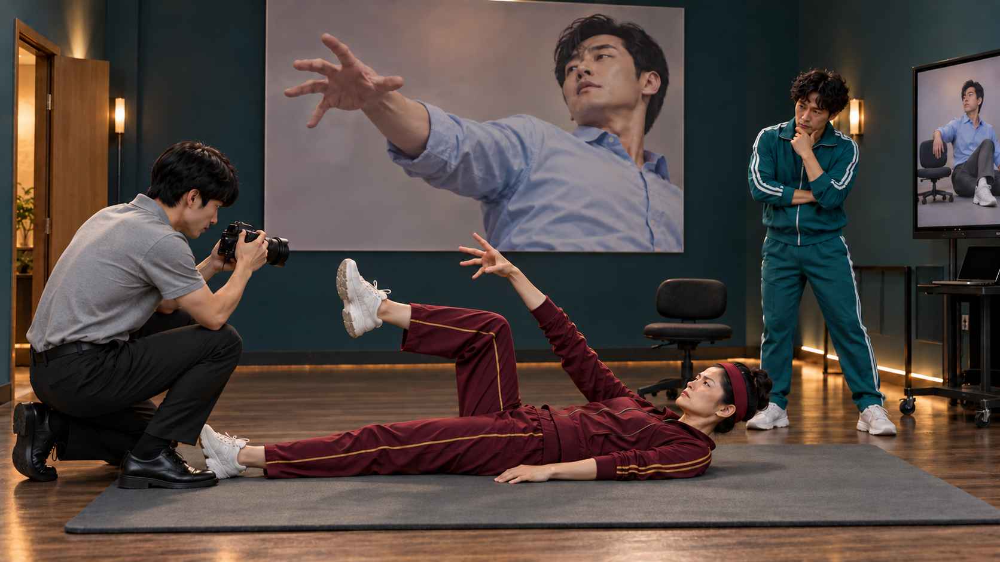

**대사:** A: “새 교본, 찍겠습니다.”

**다음 행동:** A가 셔터를 누른다. T는 자세를 더 굳히고 L2가 그 옆 매트로 몸을 낮추기 시작한다.

**소리·호흡:** 셔터 세 번. 반 박자 과하게 장엄한 금관 음색은 기획만 지정.

### C01 K08 · 25–28초

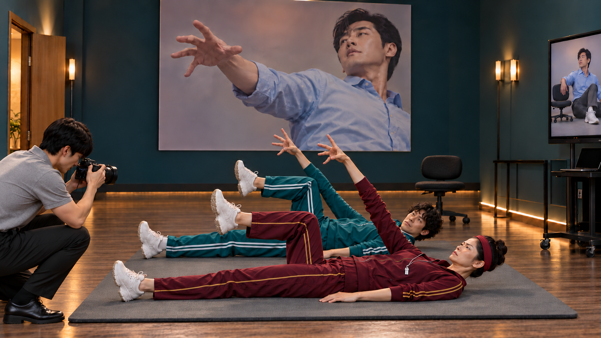

**대사:** 없음

**다음 행동:** L2가 발끝을 T와 같은 방향으로 꺾는다. T가 눈으로 만족을 표시하고 A의 셔터가 한 번 울린다.

**소리·호흡:** 셔터 한 번 뒤 체육관 공간음 1초. 메트로놈이 다시 똑같이 시작.

### C01 K09 · 28–34초

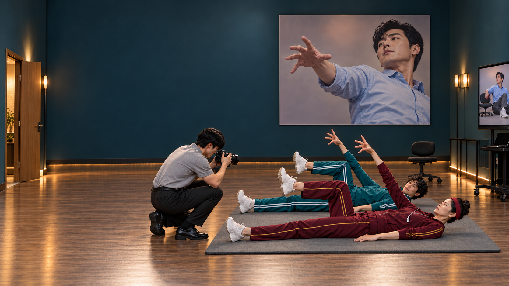

**대사:** 없음

**다음 행동:** A가 한 장 더 찍고 T·L2는 자세를 유지한다. 왼쪽 문만 천천히 닫힌다. 카메라 고정.

**소리·호흡:** 메트로놈·셔터 한 번. 끝 0.5초는 공간음만 남겨 다음 콘텐츠로 연결.

## C02

**2번 · 검은 점을 잡아라 · 35초**

검사 사진의 흐린 흔적을 범인 표식으로 쫓던 형사가 AI 후보 비교와 재촬영으로 원인을 듣고 카메라를 체포했다가, 자신이 만든 새 가림까지 다음 공개 사례로 올라간다.

### C02 K01 · 0–4초

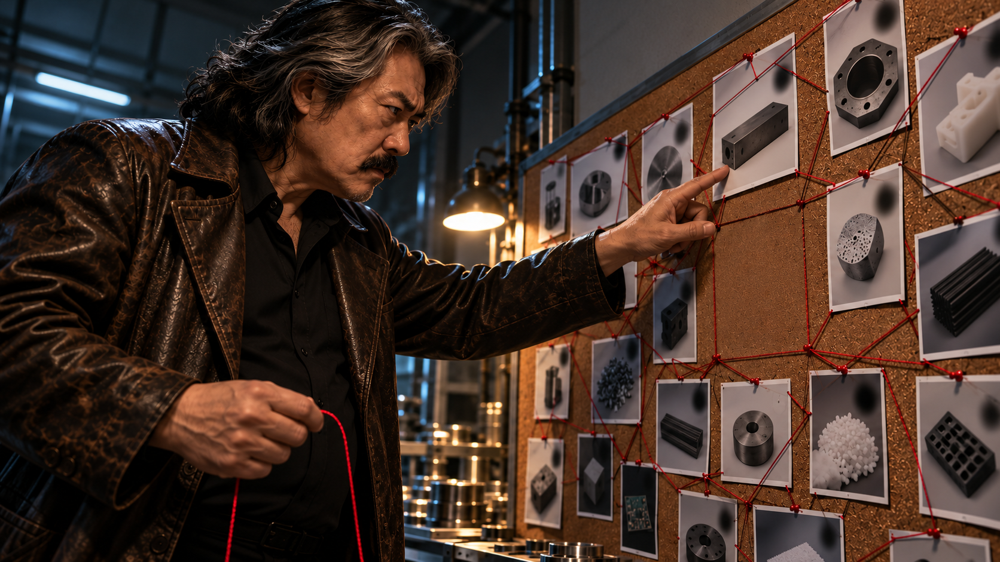

**대사:** DE: “현장마다… 네가 있었어.”

**다음 행동:** DE가 손끝을 해당 사진 우상단의 흐린 흔적으로 옮겨 한 번 짚고 낮게 말하며 붉은 실을 다른 사진으로 당긴다. 얼굴은 진짜 범인을 쫓는 확신을 유지하고 미리 웃거나 관객에게 윙크하지 않는다.

**소리·호흡:** 낮은 범죄 스릴러 베이스를 진지하게 유지. 첫 구절 뒤 약0.4초 호흡, 전체 대사 약2.8초. 붉은 실 당기는 소리. 개그를 예고하는 효과음 없음.

### C02 K02 · 4–7초

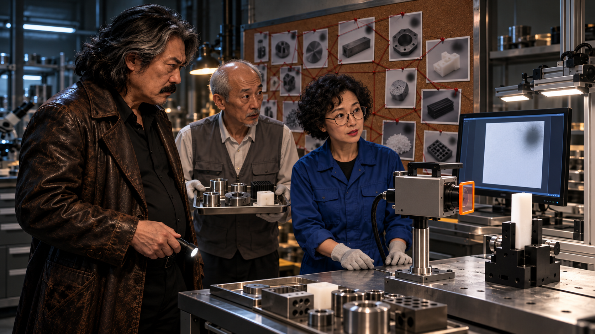

**대사:** IN: “사진부터 보시죠.”

**다음 행동:** TE가 트레이를 멈추고 DE가 막아선다. IN이 모니터를 가리켜 말하면 DE는 몸으로 길을 막는 자세를 유지한 채 고개만 돌린다.

**소리·호흡:** 추격 박자만 빠지고 낮은 스릴러 베이스는 유지한다. 트레이가 멈추는 금속 소리. K05의 수갑 클릭 뒤 음악 중단과 강도를 구별한다.

### C02 K03 · 7–12초

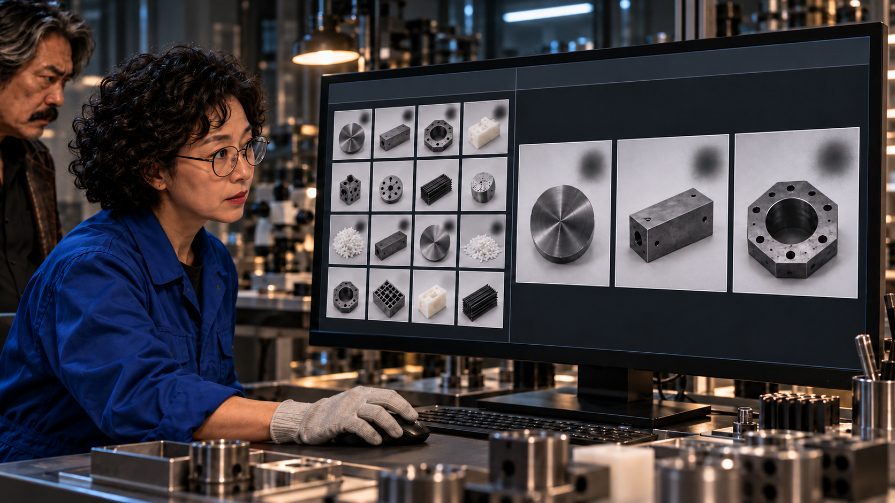

**대사:** IN: “AI가 묶은 후보를 겹쳐 봤어요.”

**다음 행동:** IN이 이미 좁혀진 원본3장을 겹쳐 비교한다. 같은 위치를 지목하는 손과 DE가 장비로 돌리는 시선을 겹쳐 다음 컷으로 연결한다.

**소리·호흡:** 후보3장은 첫 프레임에 읽힌다. 약2초 겹침, 약2초 비교와 대사, 마지막1초 장비로 시선 이동. 대사는 자연스럽게 약3초. 과장된 분석 완료 효과음 없음.

### C02 K04 · 12–16초

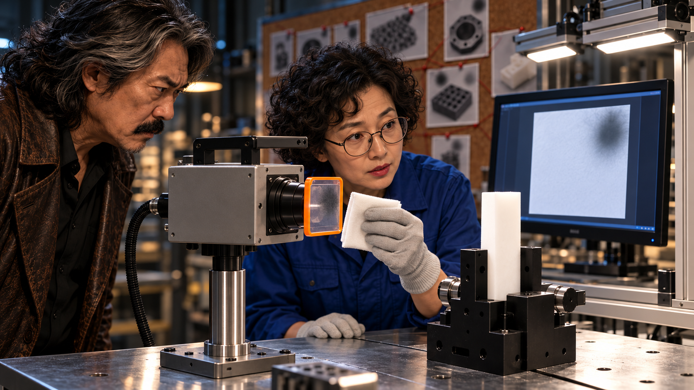

**대사:** IN: “같은 조건으로 다시.”

**다음 행동:** IN이 W를 닦고 촬영 버튼을 누른다. 모니터가 동일 시편의 가림 없는 결과로 바뀌며 DE가 고개를 끄덕인다.

**소리·호흡:** 청소 전 결과와 천이 닿기 직전 상태는 첫 프레임에 함께 보임. 1.5초 닦기, 촬영 버튼 한 번, 약1초 청소 후 결과 확인. 대사 약1.5초. 같은 시편·조건을 유지.

### C02 K05 · 16–20초

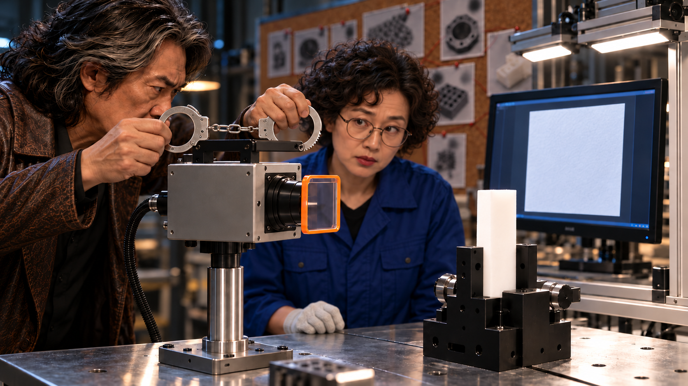

**대사:** DE: “이제 못 움직여.”

**다음 행동:** DE가 대사와 함께 첫 고리를 B에 잠그고 손을 놓는다. 나머지 고리가 W 앞에 매달린다. 철컥 뒤 0.6초 배우는 표정이나 손으로 반응하지 않으며 H는 전혀 이동하지 않는다.

**소리·호흡:** 대사 약1.6초 뒤 수갑 철컥. 철컥 직후 0.6초만 음악을 끊고 방의 공간음·금속 잔향은 남긴다. 그 0.6초에 배우 반응이나 코믹 효과음을 넣지 않는다. 이후 컷 연결의 낮은 음악만 복귀.

### C02 K06 · 20–23초

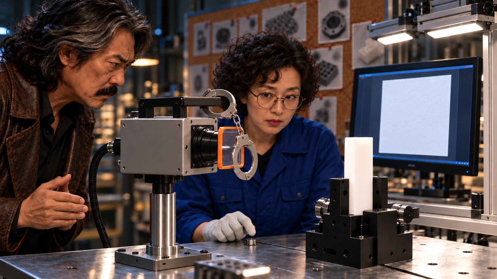

**대사:** 없음

**다음 행동:** IN이 촬영하고 모니터에 새 흐린 고리 가림이 나타난다. IN이 실물 고리를 본 뒤 TE와 눈을 마주친다.

**소리·호흡:** 촬영 버튼, DE의 손 터는 소리. 모니터 결과 뒤 0.7초 공간음만.

### C02 K07 · 23–26초

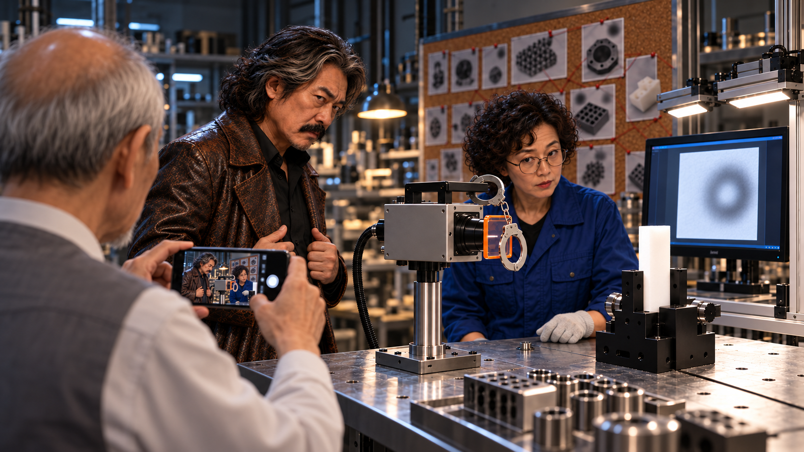

**대사:** 없음

**다음 행동:** TE가 들어 한 번 촬영한다. DE는 늦게 전화 쪽으로 얼굴을 돌린다. IN이 고리를 확인해 준다.

**소리·호흡:** 전화 셔터 한 번. DE가 카메라를 보고 뒤늦게 굳는 작은 숨.

### C02 K08 · 26–29초

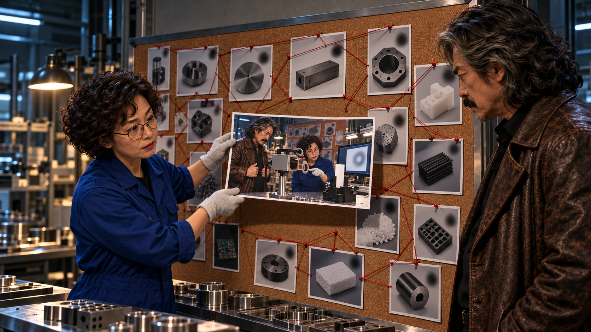

**대사:** 없음

**다음 행동:** IN이 직접 사진을 붙인다. DE는 사진 속 자기 모습을 알아보고 눈이 멈춘다. 이 컷에서 말하거나 손을 뻗지 않는다.

**소리·호흡:** 종이·압정 소리와 낮은 수사 음악. 설명 대사 없이 사진 붙이는 동작과 DE가 알아보는 짧은 호흡만 남긴다.

### C02 K09 · 29–35초

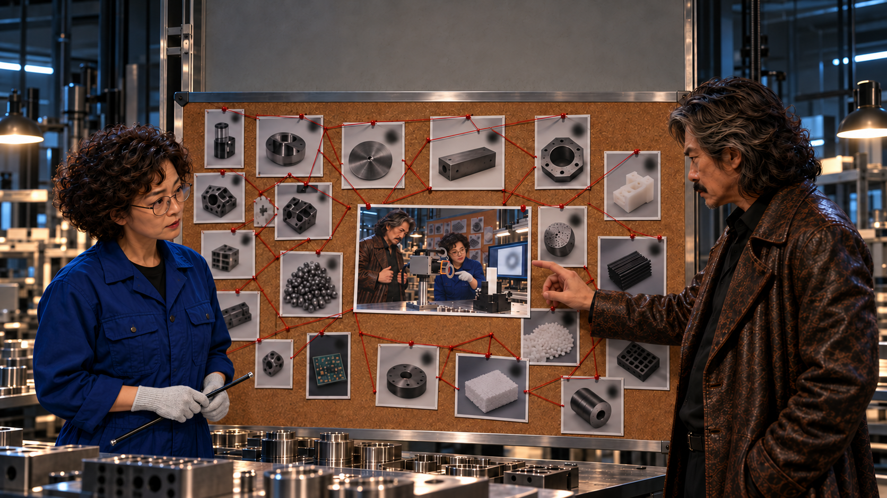

**대사:** IN: “이 사례는 직접 설명하시죠.”

**다음 행동:** IN의 포인터가 사진에 닿으면 DE가 떼려던 손가락을 펴 가장자리를 한 번 반듯하게 누른다. 그 손과 태연한 얼굴을 유지한다. 옷깃 정리·팔짱·추가 손짓은 넣지 않는다.

**소리·호흡:** 컷 시작 약0.2초 뒤 IN의 말 약3초. 포인터 닿는 소리와 사진 가장자리를 펴는 작은 종이 마찰. 손을 펴는 동작 뒤 추가 옷 마찰·팔짱 효과음 없음. 행사명은29–35초 전체6초.

## C03

**3번 · 환경까지 가져왔습니다 · 42초**

과정을 빠짐없이 보내 달랬더니 성공한 사무실이 통째로 온다. 끝인 줄 알자 실패했던 사무실도 온다.

### C03 K01 · 0–4초

**대사:** R: “결과 말고, 어떻게 했는지도요.”

**다음 행동:** 그림자 이동→위로 시선.

**소리·호흡:** 바람·통화음, 마지막 1초 크레인 엔진.

### C03 K02 · 4–9초

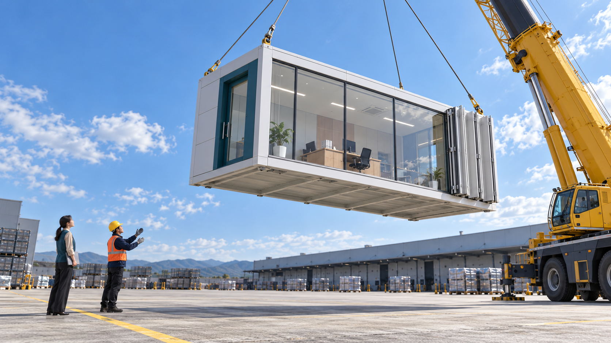

**대사:** T: “작업 환경, 도착했습니다.”

**다음 행동:** 모듈 조금 하강. 사람 위 이동 없음.

**소리·호흡:** 금관 한 번, 무전·유압·엔진.

### C03 K03 · 9–13초

**대사:** R: “같이 나오네요.”

**다음 행동:** 결과→끄덕임→기사 장갑 한 짝 벗음.

**소리·호흡:** 확인음·장갑 소리, 해결 화음.

### C03 K04 · 13–18초

**대사:** T: “아직 하나 더요.”

**다음 행동:** B공개→기사 장갑 재착용.

**소리·호흡:** 후진 경고음, 첫 팡파르 시작하다 두 음에 끊음.

### C03 K05 · 18–25초

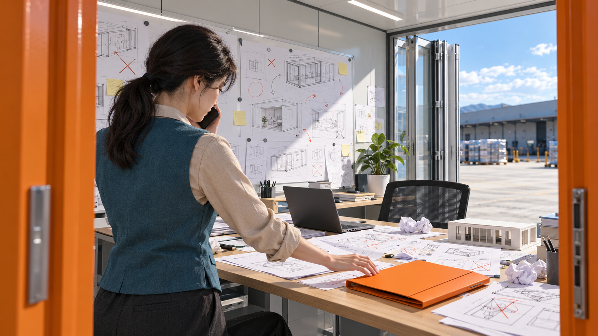

**대사:** R: “이건 왜 보냈어요?” S(전화): “안 됐던 것도 빠짐없이 달라면서요.”

**다음 행동:** 파일 들어 질문→답 듣고 기사로 회전.

**소리·호흡:** 전화 음색·종이. 대사 5초·반응 1초.

### C03 K06 · 25–30초

**대사:** R: “반품… 잠깐.”

**다음 행동:** 직원이 주황 파일을 돌려 안쪽 조건 기록을 열어 봄→테이블의 회색 기록과 같은 표시 발견→반품 서명 보류→회색 파일도 함께 듦. 첫 프레임의 주황 패턴은 표지이며 내부 기록은 아직 보이지 않는다. 대응 도식은 후편집 대상이다.

**소리·호흡:** 펜 딸깍, 0.4초 정적, 종이.

### C03 K07 · 30–37초

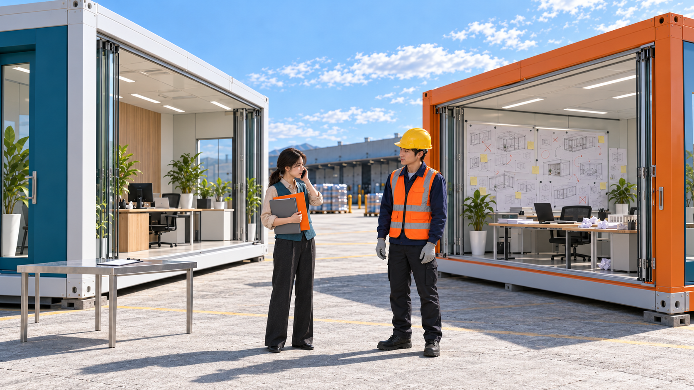

**대사:** R: “이건 직접 들어야겠네요.” (기사에게) “제가 갈게요.”

**다음 행동:** 직원 청강 결정→기사가 재운송 준비→작은 파일 들어 “제가 갈게요”→기사 손 멈춤. 패널 개방·파일 수거 동작 없음.

**소리·호흡:** 패널 레일·버클. 기사 안도 숨 0.8초.

### C03 K08 · 37–42초

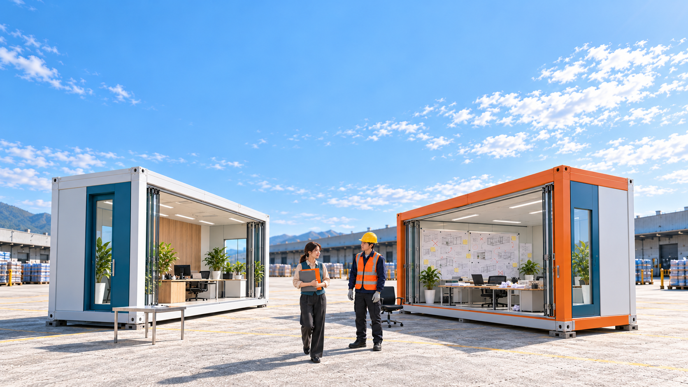

**대사:** 없음.

**다음 행동:** 직원 퇴장→기사 끈 풀고 착석. 제목 후편집.

**소리·호흡:** 발소리·의자 삐걱, 가벼운 끝 화음.

## C04

**4번 · 목마는 식사 중입니다 · 34초**

아무도 없는 선물이라던 트로이목마가 AI 문서 대조에서 식사 요청의 모순을 드러내고, 현장 확인 중 병사들의 밥그릇과 지휘관의 숟가락까지 쏟아진다.

### C04 K01 · 0–4초

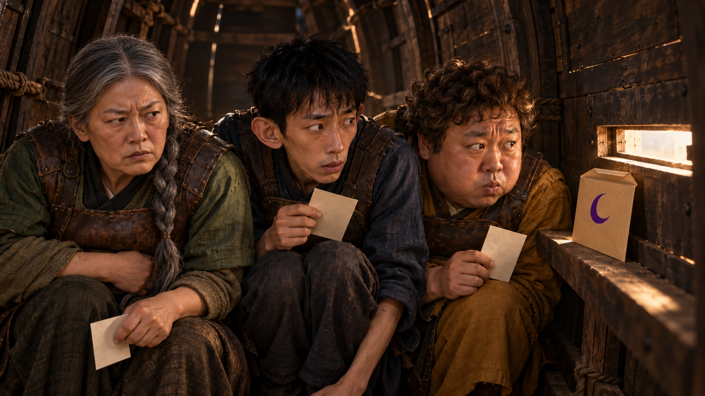

**대사:** CM, 바깥 목소리: “숨소리도 내지 마라.”

**다음 행동:** 병사들이 원래처럼 각 메모를 봉투에 끼운다. 바깥 명령 끝 직후 꼬르륵이 나도 손을 얽거나 빼앗지 않고 마지막 손이 봉투를 전달 틈 밖으로 민다.

**소리·호흡:** 낮고 진지한 전쟁 북. 명령 약1.8초가 끝나자마자 꼬르륵 한 번을 분명하게 들려준다. 메모 넣는 종이 소리는 낮게. 코믹 음악·추가 반응 대사 없음.

### C04 K02 · 4–7초

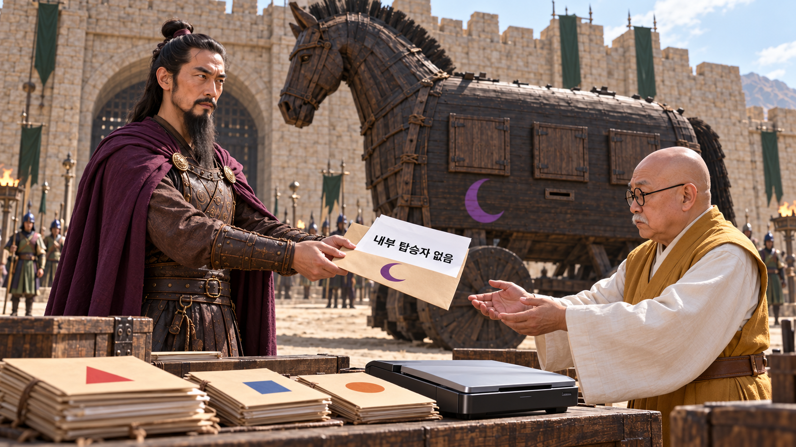

**대사:** 없음

**다음 행동:** CM이 봉투를 주고 RC가 원문을 책상에 두어 스캔 입력한다. 원본은 버리지 않는다.

**소리·호흡:** 봉투 내려놓는 소리, 현대 스캐너의 짧은 작동음.

### C04 K03 · 7–11초

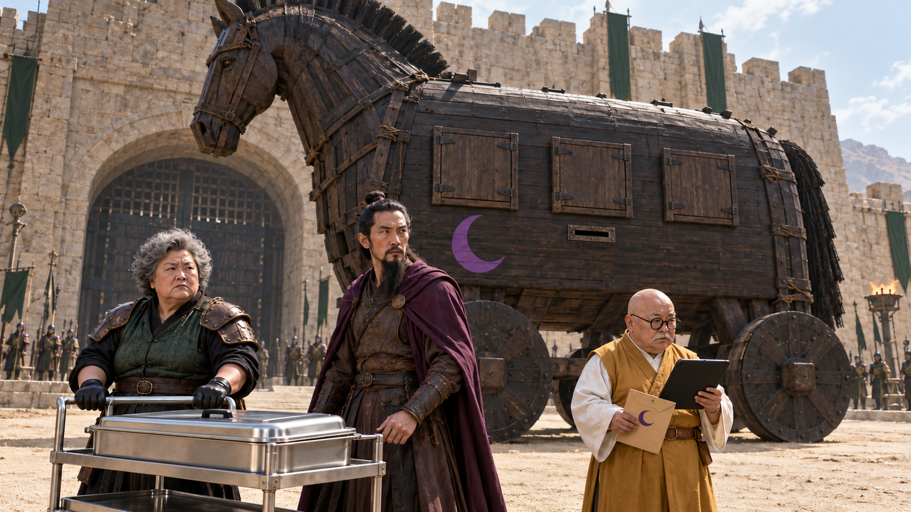

**대사:** GU: “확인 좀 하겠습니다.” / CM: “무슨 근거로?”

**다음 행동:** CM이 막으며 묻고 RC가 태블릿을 CM·GU 쪽으로 돌린다.

**소리·호흡:** 수레 바퀴 멈추는 소리, 짧은 긴장 현악. 대사 약3.5초.

### C04 K04 · 11–16초

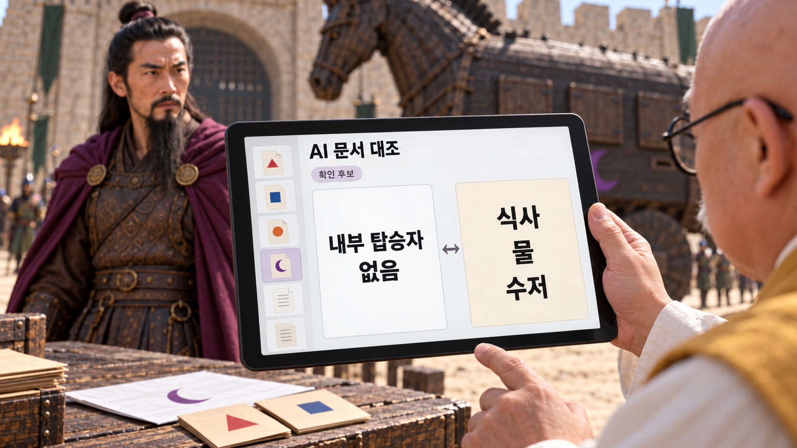

**대사:** RC: “AI로 대조했습니다. 이 말, 수저를 씁니까?”

**다음 행동:** RC가 신고 구절을 짚어 첫 문장을 말하고 급식 요청의 수저를 짚으며 질문한다. CM은 설명을 듣고 목마로 눈을 돌린다. 다음 K05에서 같은 원문을 사람이 확인한다.

**소리·호흡:** 첫 문장 약2.2초, 약0.2초 짧은 간격 뒤 질문 약2.2초. 이미 보이는 두 원문 영역을 지목하며 마지막 수저 지목과 CM의 목마 시선을 겹친다. 분석 완료 효과음이나 웃음 효과음 없음.

### C04 K05 · 16–18초

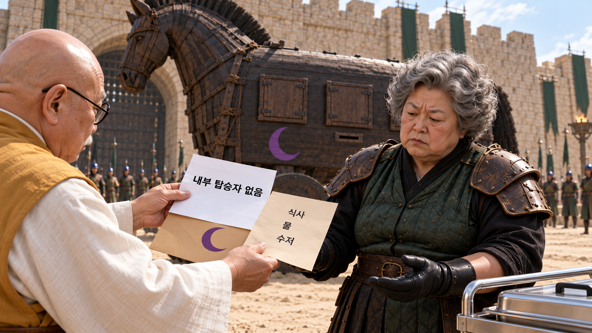

**대사:** RC: “원문도 같습니다.”

**다음 행동:** RC가 펼쳐 든 두 원문 내용이 맞음을 말로 확인한다. GU가 실물 표식과 수레로 시선을 옮긴다. 새로 펼치는 동작을 추가하지 않는다.

**소리·호흡:** 종이를 잡은 손의 작은 마찰음. 짧은 말 약1초와 표식·수레 시선이 겹침.

### C04 K06 · 18–21초

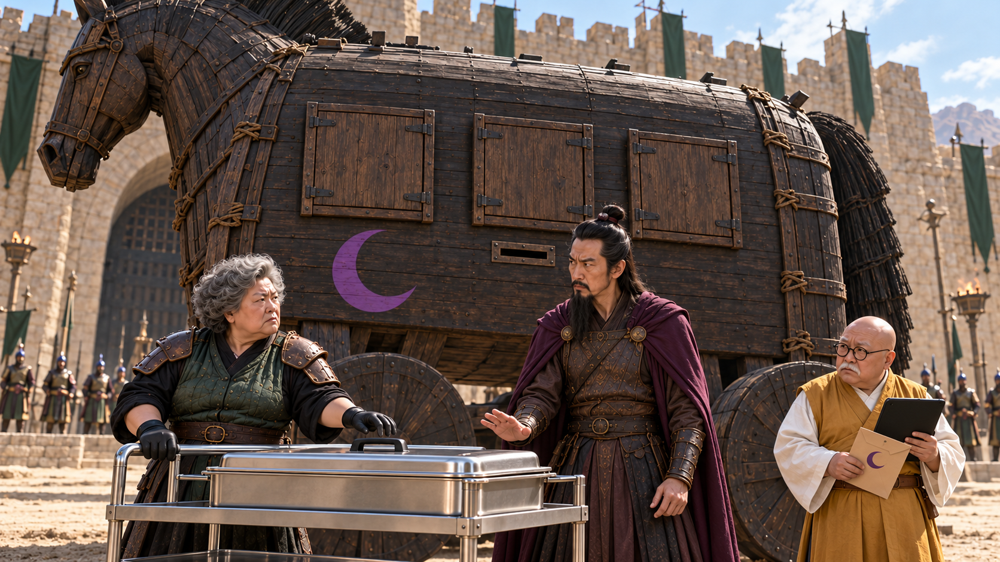

**대사:** CM: “안에는 아무도 없습니다.”

**다음 행동:** CM이 손바닥으로 막으며 부인한다. GU가 뚜껑 손잡이를 잡는다.

**소리·호흡:** 부인 약2초 뒤 목마 속 꼬르륵을 짧은 헛기침으로 덮음. GU의 확인 선언 반복 없음.

### C04 K07 · 21–24초

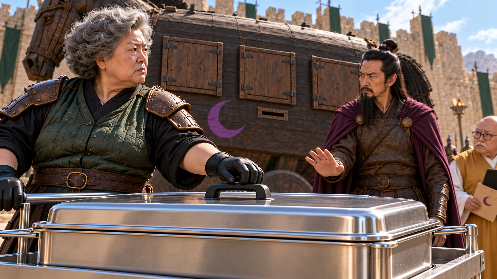

**대사:** 없음

**다음 행동:** GU가 뚜껑을 열어 김이 난다. CM 코가 미세하게 움직이고 목마 안의 숨소리가 겹친다.

**소리·호흡:** 뚜껑 금속음·김 소리·목마 안 동시 들숨 위로 진지한 전쟁 음악이 계속 긴장 상승한다. 음식이 보이거나 냄새를 맡는 순간에 음악을 먼저 끊거나 익살스러운 선율로 바꾸지 않는다.

### C04 K08 · 24–28초

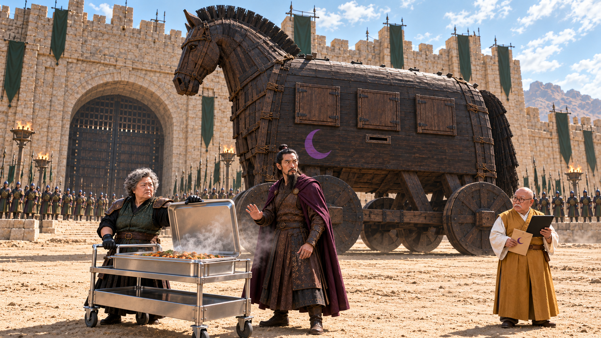

**대사:** 없음

**다음 행동:** 패널3개가 열리고 각 병사가 한 그릇·한 숟가락을 동시에 내민다. CM은 부인하던 손을 내리지 못한다.

**소리·호흡:** 진지한 전쟁 음악은 패널이 열리기 시작할 때까지 이어진다. 첫 그릇이 창 경계 밖으로 나오는 바로 그 순간 음악만 끊는다. 나무 패널 소리·그릇 딸그랑·짧고 당당한 배식 종 한 번은 남기며 코믹 음악을 새로 깔지 않는다.

### C04 K09 · 28–34초

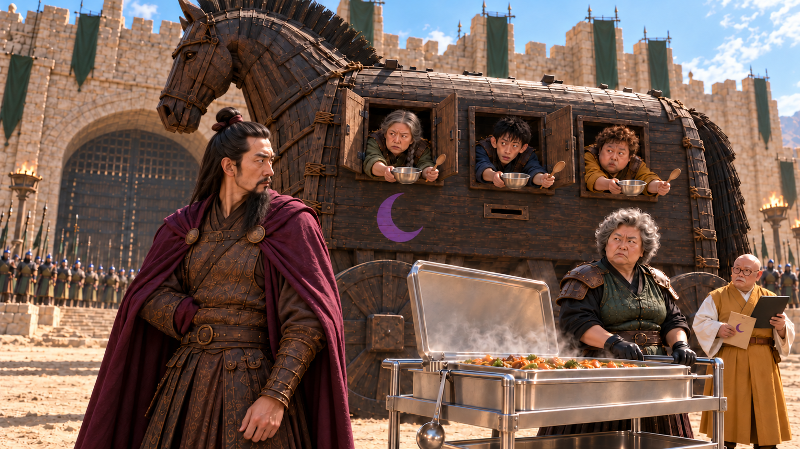

**대사:** CM: “지휘관부터.” / 내레이션: “첫 사례를 시작합니다.”

**다음 행동:** CM은 주위를 살피지 않고 GU를 보며 자기 숟가락을 꺼낸다. 턱을 조금 들고 “지휘관부터.”라고 말한다. GU는 대꾸 없이 국자를 드는 시작까지만, RC는 원문과 현장 기록을 유지한다. 약2.3초부터 내레이션을 얹는다.

**소리·호흡:** 컷 시작0~1.7초: 망토에서 숟가락을 꺼내며 CM의 “지휘관부터.” 약1.2초. 1.7~2.3초 턱·시선 유지, GU의 답은 없음. 2.3~5.3초(전체30.3~33.3초): 첫 사례 시작 안내 약3초. 끝0.7초는 그릇·공간음. 제목은28–34초 전체6초, 두 발화는 겹치지 않는다.

## C05

**5번 · 괴수는 퇴근할 수 없다 · 38초**

행사를 방해하려 현관 기둥을 뽑은 괴수가 자기 머리 위 지붕을 받치는 새 기둥이 되고, 구조용인 줄 알았던 사다리에서는 행사 청취용 이어폰이 올라온다.

### C05 K01 · 0–4초

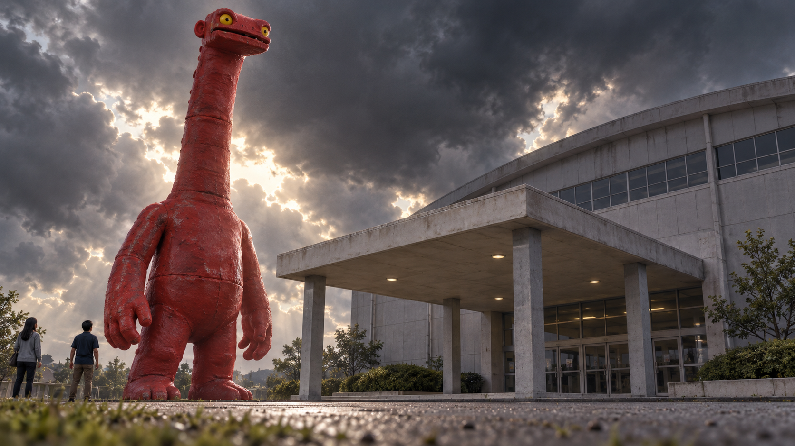

**대사:** 없음

**다음 행동:** 괴수가 포효한 뒤 실내 쪽으로 눈을 돌리고 앞왼쪽 기둥에 손을 뻗기 시작한다.

**소리·호흡:** 낮은 재난 영화 브라스와 괴수 포효. 그 뒤 실내 마이크 확인 소리와 의자 움직임이 작게 들린다.

### C05 K02 · 4–8초

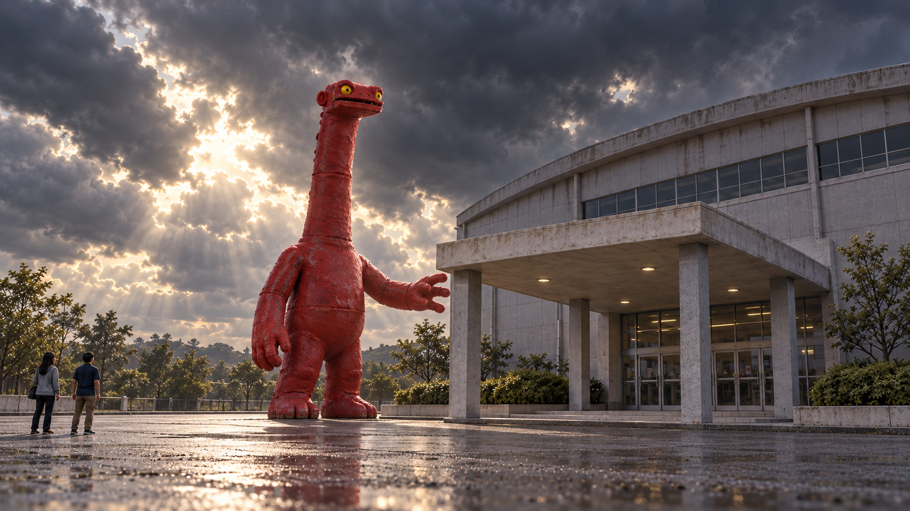

**대사:** 없음

**다음 행동:** 기둥을 빼 왼쪽에 눕힌다. 바로 무릎을 굽히고 긴 목을 큰 S자로 접어 포치 밑으로 들어가 양팔을 승리 자세로 든다. 동작 사이 몸 크기는 고정.

**소리·호흡:** 모형 기둥 빠지는 둔탁한 퍽, 짧은 승리 음악. 사람의 부상 소리 없음.

### C05 K03 · 8–12초

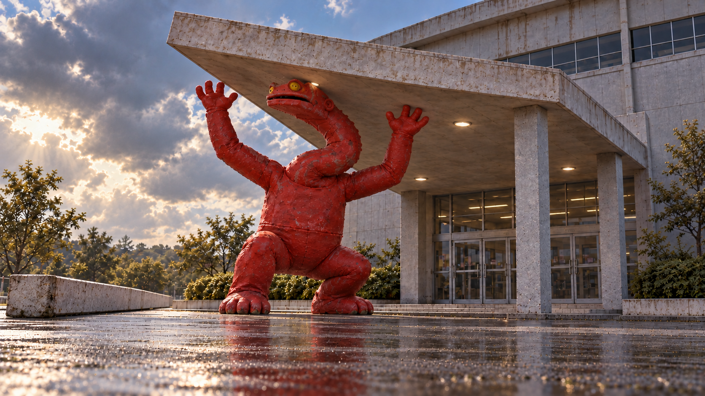

**대사:** 없음

**다음 행동:** 지붕이 더 기울기 시작하자 괴수가 양손으로 앞 가장자리를 받쳐 멈춘다. 머리·몸에 충돌하지 않는다.

**소리·호흡:** 승리 음악이 지붕 삐걱임에 끊김. 두 손이 닿는 둥 소리와 짧은 헛숨. 이후 낮의 공간음.

### C05 K04 · 12–17초

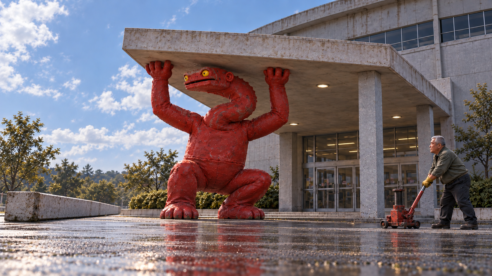

**대사:** FM: “조금만 더요.”

**다음 행동:** FM이 잭을 끝까지 올렸다가 부족한 높이를 확인하고 급히 두 손을 든다. 괴수는 떠날 길을 흘겨보다 양손 지지를 유지한다. 긴 목의 접힘과 귀 높이는 그대로.

**소리·호흡:** 잭 손잡이 돌리는 소리, 길이가 끝나는 딸깍. 반장의 부탁은 기능적으로 급하고 비웃음 없음.

### C05 K05 · 17–22초

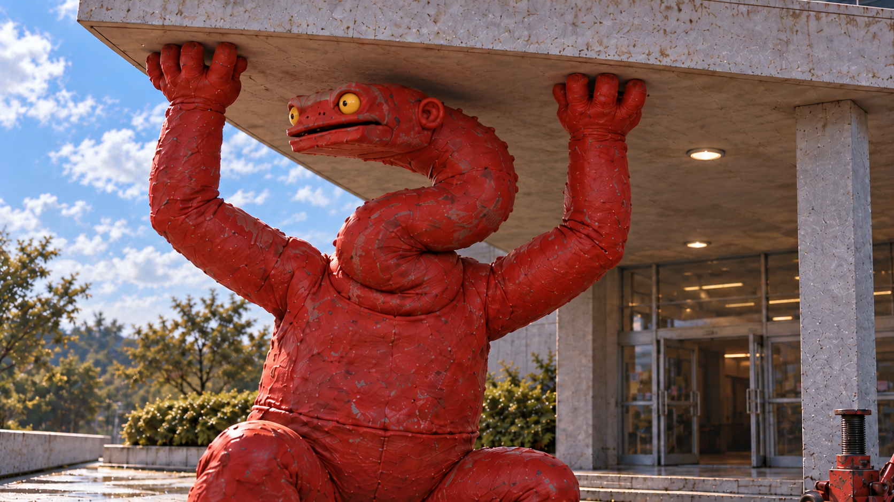

**대사:** 실내 안내: “잠시 후, AI 실행 사례 발표를 시작합니다.”

**다음 행동:** 괴수가 귀를 문 쪽으로 기울인다. 지붕이 작은 범위로 따라 움직이자 바로 자세를 되돌린다.

**소리·호흡:** 안내는 실내 스피커처럼 약간 멀게 4~4.5초. 뒤에 작은 지붕 삐걱임. 괴수 발화 없음.

### C05 K06 · 22–27초

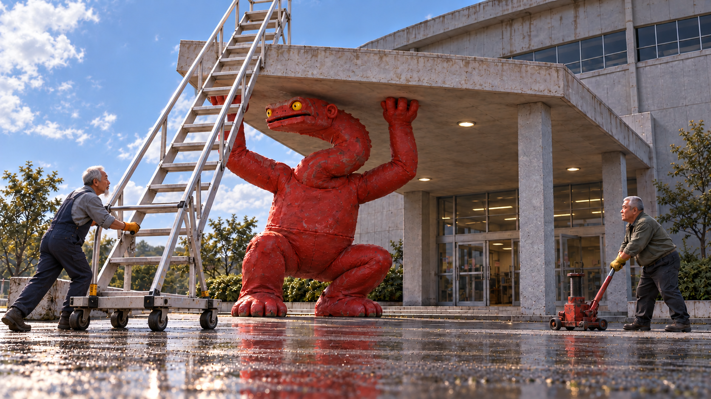

**대사:** 없음

**다음 행동:** TE가 바깥 지지대를 고정하고 사다리 끝을 이미 고정된 4.2m 귀 높이에 맞춘다. 괴수는 목을 펴지 않고 눈만 위로 따라간다.

**소리·호흡:** 사다리 바퀴 소리, 금속 연장 잠금 철컥. 음악이 짧게 해결의 기대를 만든다.

### C05 K07 · 27–32초

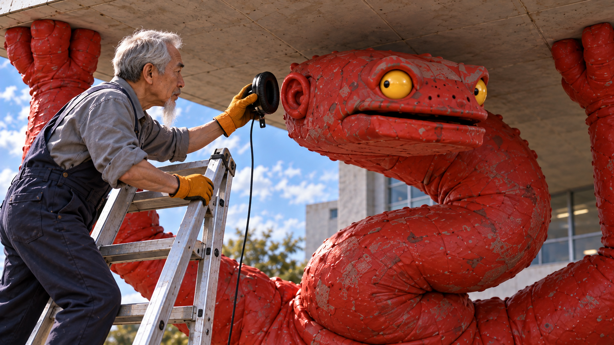

**대사:** FM, 아래 화면 밖: “밖에서도 들리시죠?”

**다음 행동:** TE가 이어컵을 귀에 걸고 짧은 뒤 고정끈을 건다. 괴수는 눈을 한번 깜빡이고 오른쪽 실내를 본다.

**소리·호흡:** 이어컵이 귀에 닿는 툭 소리, 실내 마이크의 가벼운 준비음. 해결 음악은 짧게 멎고 질문 2초.

### C05 K08 · 32–38초

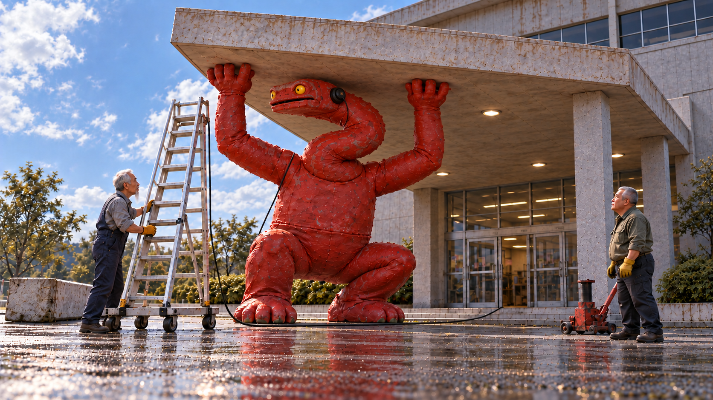

**대사:** 실내 안내, 34–38초: “AI 실행 사례 발표를 시작합니다.”

**다음 행동:** 첫 2초: 괴수가 답하려 오른손 손목을 눈에 띄게 굽히고 손가락을 펼쳐 엄지 손짓으로 바꾸려 한다. 지붕이 흔들리자 곧바로 다시 잡고 고개를 끄덕인다. 34초 안내 시작 뒤에는 두 손을 고정하고 작은 고갯짓으로 듣는다.

**소리·호흡:** 32–34초 손짓 답을 시도할 때 삐걱, 다시 잡는 둥. 34–38초 시작 안내를 자연스럽게 4초로 말한다. 끝에서 실제 진행으로 연결.

---

새로 보완한 이미지는 C02 K01·C04 K09 두 장입니다. 다른 41장은 V7 원본을 재사용했습니다.
행사명은 2026년 품질팀 AI 실행 결과 발표 대회입니다. 미확정 일시·장소·신청 방법·실적·상금은 넣지 않았습니다.
인물과 사건은 허구이며 실제 동작·음성·립싱크·관객 반응을 검증한 결과는 아닙니다.
